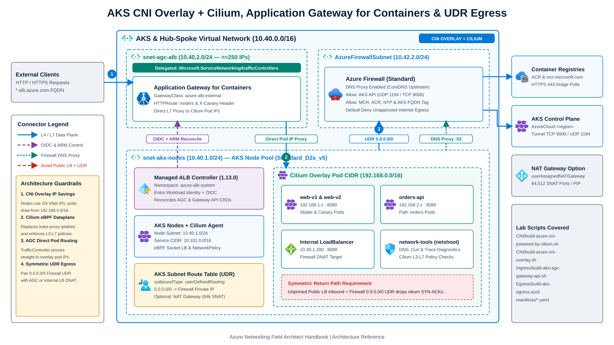

# AKS and container networking labs

Azure CLI runbooks and Kubernetes manifests for building, inspecting, and validating **Azure Kubernetes Service (AKS)** network architectures. The labs cover CNI dataplanes, **Application Gateway for Containers** (Kubernetes Gateway API), outbound egress control, and Linux container networking fundamentals.

> **Field Architect Handbook:** Pair these labs with **[AKS Networking (`aks-networking.md`)](../../src/content/docs/05-workload-networking/aks-networking.md)** ([live handbook page](https://jonathan-vella.github.io/azure-networking/05-workload-networking/aks-networking/)) for IP sizing formulas, CNI trade-off matrices, Cilium eBPF architecture, and ingress/egress design patterns.



---

## Lab directory structure

| Path | Focus area | Key technologies and SKUs |
| --- | --- | --- |
| [`CNI/build-azure-cni-powered-by-cilium.sh`](CNI/build-azure-cni-powered-by-cilium.sh) | Recommended AKS CNI and eBPF dataplane | Azure CNI Overlay (`192.168.0.0/16`), `--network-dataplane cilium`, `Standard_D2s_v5` |
| [`CNI/build-azure-cni-overlay.sh`](CNI/build-azure-cni-overlay.sh) | Brownfield BYO-VNet CNI Overlay | `--network-plugin-mode overlay`, User-Assigned Managed Identity, VNet RBAC |
| [`CNI/build-azure-cni.sh`](CNI/build-azure-cni.sh) | Traditional flat VNet Azure CNI | Direct VNet subnet pod IPs (`--network-plugin azure`), `Standard_D2s_v5` |
| [`Ingress/build-aks-agc-gateway-api.sh`](Ingress/build-aks-agc-gateway-api.sh) | Modern L7 ingress (Gateway API) | **Application Gateway for Containers**, Managed ALB Controller (Helm `1.13.0`), OIDC + Workload Identity, `Microsoft.ServiceNetworking/trafficControllers` subnet delegation |
| [`Egress/build-aks-egress.azcli`](Egress/build-aks-egress.azcli) | Outbound egress and symmetric routing | `--outbound-type userDefinedRouting` (Azure Firewall + DNS Proxy + DNAT) vs. `userAssignedNATGateway` |
| [`docker-networking/`](docker-networking/) | Linux container networking fundamentals | Two `Standard_B2ls_v2` Ubuntu 24.04 LTS (`Canonical:ubuntu-24_04-lts:server:latest`) hosts demonstrating `bridge`, port publishing, dual-homed containers, and `ipvlan` L3 mode |
| [`manifests/`](manifests/) | Shared Kubernetes YAML manifests | [`network-tools-pod.yaml`](manifests/network-tools-pod.yaml) (`nicolaka/netshoot:v0.16`), [`demo-workload.yaml`](manifests/demo-workload.yaml) (`nginxdemos/nginx-hello:plain-text` + HTTP echo probes), [`gateway-api-routes.yaml`](manifests/gateway-api-routes.yaml) |

---

## Lab walkthroughs

### 1. CNI and eBPF dataplane (`CNI/`)

- **Azure CNI Powered by Cilium (`build-azure-cni-powered-by-cilium.sh`):** Deploys an AKS cluster combining Overlay pod IP allocation (`192.168.0.0/16`) with Cilium's eBPF dataplane for kube-proxy replacement and L3-L7 network policy enforcement.
- **Azure CNI Overlay (`build-azure-cni-overlay.sh`):** Attaches an AKS cluster to an existing brownfield VNet subnet (or creates a default VNet when none exists) using a User-Assigned Managed Identity pre-granted `Network Contributor` so internal Load Balancers reconcile without RBAC propagation delays.
- **Traditional Azure CNI (`build-azure-cni.sh`):** Demonstrates flat VNet pod IP allocation when pods must be directly routable by VNet peers without NAT or overlay encapsulation.

All scripts accept `PREFIX`, `LOCATION`, and `RG` overrides:

```bash
PREFIX=aks-cilium LOCATION=eastus2 ./CNI/build-azure-cni-powered-by-cilium.sh
```

### 2. Application Gateway for Containers and Gateway API (`Ingress/`)

[`Ingress/build-aks-agc-gateway-api.sh`](Ingress/build-aks-agc-gateway-api.sh) provisions an end-to-end L7 Gateway API topology:

1. Creates a VNet with a `/24` AKS node subnet (`snet-aks-nodes`) and a `/24` subnet (`snet-agc-alb`) delegated to `Microsoft.ServiceNetworking/trafficControllers`.
2. Deploys an AKS cluster with **Azure CNI Overlay + Cilium**, `--enable-oidc-issuer`, and `--enable-workload-identity`.
3. Configures a federated User-Assigned Managed Identity (`azure-alb-identity`) with least-privilege roles (`AppGw for Containers Configuration Manager` and `Reader` on the `MC_*` node resource group, plus `Network Contributor` on the delegated AGC subnet).
4. Installs the **ALB Controller** (`1.13.0`) from `oci://mcr.microsoft.com/application-lb/charts/alb-controller` and creates an `ApplicationLoadBalancer` custom resource.
5. Applies [`manifests/gateway-api-routes.yaml`](manifests/gateway-api-routes.yaml) (`GatewayClass: azure-alb-external`, `Gateway`, and `HTTPRoute`) for path-based (`/orders`) and header-based canary (`X-Canary: true`) routing directly to pod overlay IPs.

### 3. Outbound egress control (`Egress/`)

[`Egress/build-aks-egress.azcli`](Egress/build-aks-egress.azcli) supports `OUTBOUND_MODE=udr` (default) or `OUTBOUND_MODE=natgw`:

- **`udr` (`userDefinedRouting`):** Routes `0.0.0.0/0` from the AKS node subnet to **Azure Firewall** with DNS Proxy enabled, configures required AKS control-plane and registry rules scoped to the AKS subnet CIDR, and demonstrates why inbound traffic must enter through Firewall DNAT (targeting an internal LoadBalancer) or Application Gateway for Containers rather than an unpinned public LoadBalancer to avoid asymmetric return routing.
- **`natgw` (`userAssignedNATGateway`):** Associates an Azure NAT Gateway for up to 64,512 SNAT ports per public IP without centralized firewall inspection.

### 4. Linux and container networking fundamentals (`docker-networking/`)

- [`docker-networking/build-docker-hosts.sh`](docker-networking/build-docker-hosts.sh) deploys two `Standard_B2ls_v2` Ubuntu 24.04 LTS VMs locked down to your client IP via NSGs.
- [`docker-networking/docker-networking-basics.sh`](docker-networking/docker-networking-basics.sh) runs stage-by-stage experiments (`basics`, `bridge-host1`, `bridge-host2`, `dual-homed`, `ipvlan-same-subnet`, `ipvlan-routed`, `cleanup`) covering Linux `veth` pairs, custom `bridge` networks, dual-homed containers, and `ipvlan` (`ipvlan_mode=l3`) routing inside an Azure VNet.

---

## Retired legacy labs and architectural rationale

Three legacy lab tracks were retired to `.archive/` to align with upstream Kubernetes and Azure platform lifecycles:

1. **Kubenet (`build-kubenet.sh`, `build-kubenet-dual-stack.sh`):** Azure retires Kubenet on AKS in March 2028. Kubenet relied on Azure Route Tables (UDRs) per node, capping cluster scale against the 400-route table limit and complicating hub-firewall UDR attachment. **Azure CNI Overlay** replaces Kubenet without consuming VNet pod IPs or UDR slots.
2. **Community Ingress-NGINX and AGIC (`build-azure-cni-overlay-with-nginx.sh`, `build-azure-cni-with-app-gw.sh`):** Kubernetes SIG-Network retired `ingress-nginx` in favor of the **Gateway API**, and **Application Gateway for Containers (AGC)** replaces Application Gateway Ingress Controller (AGIC) with faster control-plane updates, native Gateway API support (`azure-alb-external`), and higher connection scale.
3. **Docker Swarm and unverified `calicoctl` binary (`build-docker-swarm-cluster.sh`, `calicoctl`):** Docker Swarm cluster scripts and checked-in third-party binaries were removed in favor of managed AKS clusters running **Azure CNI Powered by Cilium** for eBPF service load balancing and network policy enforcement.
