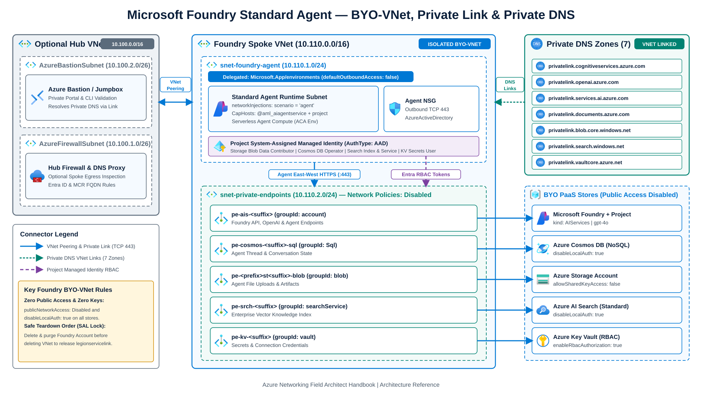

# Microsoft Foundry and private AI networking labs

Deployable Bicep and Azure CLI labs for isolating **Microsoft Foundry (AI Services and Projects) Standard Agents** with Bring-Your-Own Virtual Network (BYO-VNet) subnet injection, Private Link, and Private DNS, alongside private **Azure Machine Learning** managed-network workspace patterns.

> **Field Architect Handbook:** See **[Microsoft Foundry and Fabric Networking (`foundry-and-fabric-networking.md`)](../../src/content/docs/05-workload-networking/foundry-and-fabric-networking.md)** ([live handbook page](https://jonathan-vella.github.io/azure-networking/05-workload-networking/foundry-and-fabric-networking/)) for subnet sizing rules, Service Association Link lifecycles, DNS forwarding, and Azure Firewall allow-lists.



---

## Lab contents

| Path | Description |
| --- | --- |
| [`build-foundry-standard-agent-vnet.bicep`](build-foundry-standard-agent-vnet.bicep) | End-to-end Bicep template for **Microsoft Foundry Standard Agent BYO-VNet** (isolated Spoke VNet or peered Hub-and-Spoke), Private Endpoints, 7 Private DNS Zones, BYO Storage / Key Vault / Cosmos DB / AI Search (`publicNetworkAccess: 'Disabled'`), Project connections, RBAC, and Capability Hosts. |
| [`deploy-foundry-standard-agent.sh`](deploy-foundry-standard-agent.sh) | Azure CLI runner that registers resource providers, lints and compiles the Bicep template, runs ARM preflight validation, deploys the stack, and prints verification and safe teardown commands. |
| [`ml-private-workspace/build-cust-vnet.sh`](ml-private-workspace/build-cust-vnet.sh) | Builds a customer VNet (`vm-subnet` + `private-endpoint-subnet` with `--private-endpoint-network-policies Disabled`) and an NSG-locked `Standard_B2ls_v2` Ubuntu 24.04 LTS jumpbox (`Canonical:ubuntu-24_04-lts:server:latest`, plus optional `Standard_D2s_v5` Windows jumpbox) using [`ml-private-workspace/cloud-init.txt`](ml-private-workspace/cloud-init.txt). |
| [`ml-private-workspace/build-workspace.sh`](ml-private-workspace/build-workspace.sh) | Provisions a private Azure Machine Learning workspace (`managed_approved`, `managed_internet`, or `byo_vnet`) with an `amlworkspace` Private Endpoint and `privatelink.api.azureml.ms` / `privatelink.notebooks.azure.net` Private DNS zones. |

---

## 1. Microsoft Foundry Standard Agent BYO-VNet lab

### Architecture highlights

1. **Dedicated agent subnet (`snet-foundry-agent`, `/24`):** Delegated exclusively to `Microsoft.App/environments` (`defaultOutboundAccess: false`) and injected into the Foundry account (`kind: 'AIServices'`, `allowProjectManagement: true`) via `networkInjections` (`scenario: 'agent'`, `useMicrosoftManagedNetwork: false`).
2. **Private Endpoint subnet (`snet-private-endpoints`, `/24`):** Configured with `privateEndpointNetworkPolicies: 'Disabled'` to host Private Endpoints for:
   - **Microsoft Foundry Account** (`groupId: account`)
   - **Azure Storage Account** (`groupId: blob`) for agent file uploads
   - **Azure Cosmos DB for NoSQL** (`groupId: Sql`) for agent conversation threads and definitions
   - **Azure AI Search** (`groupId: searchService`) for agent vector stores
   - **Azure Key Vault** (`groupId: vault`) for enterprise secrets
3. **Complete Private DNS topology:** Provisions and links all seven required Private DNS zones to the Spoke VNet (and optional Hub VNet when `deployHubVnet=true`):
   - `privatelink.cognitiveservices.azure.com`
   - `privatelink.openai.azure.com`
   - `privatelink.services.ai.azure.com`
   - `privatelink.blob.core.windows.net`
   - `privatelink.documents.azure.com`
   - `privatelink.search.windows.net`
   - `privatelink.vaultcore.azure.net`
4. **Zero local keys (`disableLocalAuth: true`):** Enforces Microsoft Entra ID authentication across Foundry, Cosmos DB, Storage, Key Vault, and AI Search, wiring Project Managed Identity RBAC and Capability Hosts (platform-provisioned `<account>@aml_aiagentservice` via `networkInjections` plus `caphost-project`).

### Quickstart

```bash
# Deploy isolated Spoke VNet topology in eastus2
LOCATION=eastus2 NAME_PREFIX=foundrylab ./deploy-foundry-standard-agent.sh

# Deploy with a peered Hub VNet (AzureFirewallSubnet + AzureBastionSubnet)
DEPLOY_HUB_VNET=true LOCATION=swedencentral NAME_PREFIX=foundryhub ./deploy-foundry-standard-agent.sh
```

> **Prerequisite for Capability Hosts:** When `deployCapabilityHosts=true` (default), ensure the deploying principal holds **Storage Blob Data Contributor** and **Cosmos DB Operator** at the subscription or resource-group scope, or run a two-stage deploy with `DEPLOY_CAPABILITY_HOSTS=false` first.

### Safe teardown order (Service Association Link)

`Microsoft.App/environments` injects a `legionservicelink` Service Association Link into `snet-foundry-agent`. Delete and purge the Foundry account before deleting the VNet or resource group:

```bash
az cognitiveservices account delete -g "$RESOURCE_GROUP" -n "$FOUNDRY_NAME"
az cognitiveservices account purge  -g "$RESOURCE_GROUP" -n "$FOUNDRY_NAME" -l "$LOCATION"
az group delete -n "$RESOURCE_GROUP" --yes --no-wait
```

---

## 2. Azure Machine Learning private workspace lab (`ml-private-workspace/`)

When running Azure Machine Learning registries, compute clusters, or managed online endpoints alongside Foundry:

```bash
cd ml-private-workspace
./build-cust-vnet.sh
NETWORK_MODE=managed_approved ./build-workspace.sh
```
