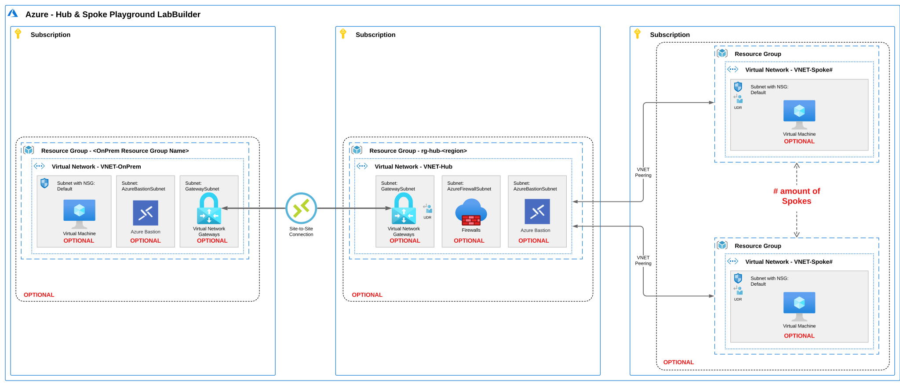
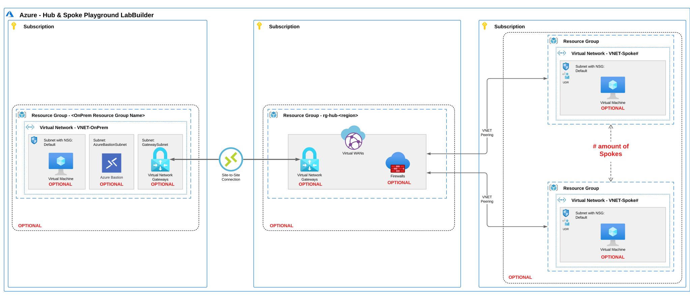

# Azure Hub-and-Spoke and Virtual WAN playground

Repeatable single-region and two-region Bicep lab builder for Hub-and-Spoke virtual networks, Azure Virtual WAN (vWAN), Azure Firewall with Routing Intent, Azure Virtual Network Manager (AVNM), and simulated on-premises Site-to-Site (S2S) VPN topologies.

> **Field Architect Handbook:** Pair deployments from this lab with the live handbook chapters and repository sources:
> - [Hub-and-Spoke vs. Virtual WAN](https://jonathan-vella.github.io/azure-networking/02-core-topologies/hub-spoke-vs-vwan/) ([source](../../src/content/docs/02-core-topologies/hub-spoke-vs-vwan.md))
> - [Virtual WAN and Routing Intent](https://jonathan-vella.github.io/azure-networking/02-core-topologies/virtual-wan-and-routing-intent/) ([source](../../src/content/docs/02-core-topologies/virtual-wan-and-routing-intent.md))
> - [Hands-On Labs and Operational Tools Guide](https://jonathan-vella.github.io/azure-networking/06-operations-reviews/labs-and-tools-guide/) ([source](../../src/content/docs/06-operations-reviews/labs-and-tools-guide.md))
>
> **Provenance and attribution:** Originally authored by Pieterbas Nagengast in [`PieterbasNagengast/Azure-HubSpoke-LabBuilder`](https://github.com/PieterbasNagengast/Azure-HubSpoke-LabBuilder) under the MIT License, and maintained in this repository as an integrated lab module. See [`THIRD_PARTY_NOTICES.md`](../../THIRD_PARTY_NOTICES.md) for full copyright and license details.

## Table of contents

- [Deploy to Azure](#deploy-to-azure)
- [Architecture overview](#architecture-overview)
- [Scenarios and parameter files](#scenarios-and-parameter-files)
  - [Topology diagrams](#topology-diagrams)
  - [Pre-built Bicep parameter sets](#pre-built-bicep-parameter-sets)
- [Deploying with Azure CLI](#deploying-with-azure-cli)
- [Address space and resource naming](#address-space-and-resource-naming)
  - [Subnet IP address allocation](#subnet-ip-address-allocation)
  - [Resource groups and resource names](#resource-groups-and-resource-names)
- [Optional platform capabilities](#optional-platform-capabilities)
  - [Azure Virtual Network Manager and RBAC prerequisites](#azure-virtual-network-manager-and-rbac-prerequisites)
  - [Private subnets (disable default outbound access)](#private-subnets-disable-default-outbound-access)
  - [Azure Monitor Agent, VM Insights, and Dependency Agent](#azure-monitor-agent-vm-insights-and-dependency-agent)
- [Multi-region deployments](#multi-region-deployments)
- [Cost management and teardown](#cost-management-and-teardown)
- [Parameters reference](#parameters-reference)
- [Changelog](#changelog)

## Deploy to Azure

| Deployment option | Portal template |
| --- | --- |
| Subscription-scoped Azure Portal wizard (`ARM/main.json` + `uiDefinition.json`) | [](https://portal.azure.com/#blade/Microsoft_Azure_CreateUIDef/CustomDeploymentBlade/uri/https%3A%2F%2Fraw.githubusercontent.com%2Fjonathan-vella%2Fazure-networking%2Fmain%2Flabs%2Fvirtual-wan-playground%2FARM%2Fmain.json/uiFormDefinitionUri/https%3A%2F%2Fraw.githubusercontent.com%2Fjonathan-vella%2Fazure-networking%2Fmain%2Flabs%2Fvirtual-wan-playground%2FuiDefinition.json) |

> **Warning:** Use this lab only for validation, training, testing, and issue reproduction in non-production subscriptions. Do not deploy these templates into production environments.

## Architecture overview

`main.bicep` deploys modular Azure network topologies at subscription scope from a single parameter contract. Every major component can be toggled independently:

- **Hub network (`hubType = 'VNET'` or `'VWAN'`)**: Deploy either a customer-managed Hub VNet or an Azure Virtual WAN with regional Virtual Hubs.
- **Spoke VNets (`amountOfSpokes`)**: Deploy 1 or more spoke VNets connected via standard VNet peerings, AVNM connectivity configurations, or Virtual WAN hub VNet connections.
- **Centralized inspection (`deployFirewallInHub`)**: Deploy Azure Firewall (`Standard` or `Premium`) with optional DNS Proxy, an optional allow-list rule collection group for spoke-to-spoke and HTTP/HTTPS egress traffic, spoke UDRs (`0.0.0.0/0` next hop to Azure Firewall), or Virtual WAN Routing Intent (`internetTrafficRoutingPolicy`, `privateTrafficRoutingPolicy`).
- **Azure Virtual Network Manager (`deployVnetPeeringAVNM`)**: Manage Hub-and-Spoke peerings (with an optional Directly Connected spoke group) and optional spoke UDRs (`deployAvnmUDRs`) for `VNET` hub topologies.
- **Simulated on-premises environment (`deployOnPrem`)**: Provision a separate VNet with an optional VM, Azure Bastion host, zone-redundant `VpnGw1AZ` VPN Gateway, and eBGP/static S2S IPsec connection to the Hub or vWAN VPN Gateway.
- **Workload VMs (`deployVMsInSpokes`, `deployVMinOnPrem`)**: Deploy Windows Server 2022 Datacenter Gen2 (with inbound ICMPv4 echo enabled via Run Command) or Ubuntu Server 22.04 LTS Gen2 (`Standard_B2ls_v2` by default).
- **Bastion access (`deployBastionInHub`, `deployBastionInOnPrem`)**: Deploy Azure Bastion (`Standard` by default; `Basic`, `Standard`, or `Premium` supported) with a dedicated NSG on `AzureBastionSubnet`. `Standard` and `Premium` SKUs enable IP-based connection and native client tunneling so a single Bastion host can reach spoke VMs across peered or VPN-connected networks.

## Scenarios and parameter files

You can combine parameters to deploy five core topology patterns:

| Topology pattern | Deployed resources |
| --- | --- |
| **1. Spokes only** | Regional spoke resource groups (`rg-spoke#-<CODE>`), spoke VNets (`VNET-Spoke#-<CODE>`), `default` subnet with NSG, and optional spoke VMs. |
| **2. Hub or vWAN Hub only** | Hub resource group (`rg-hub-<CODE>` for `VNET` or `rg-hub` for `VWAN`), Hub VNet or vWAN + Virtual Hub, and optional Azure Bastion (`VNET` only), Azure Firewall + Firewall Policy, and VPN Gateway. |
| **3. Hub + Spokes** | Combines patterns 1 and 2 with VNet peerings (`VNET`), AVNM hub-and-spoke connectivity (`AVNM`), or vWAN hub VNet connections (`VWAN`), plus spoke route tables when Azure Firewall is deployed. |
| **4. Hub + Spokes + On-Premises** | Adds `rg-onprem-<CODE>`, `VNET-OnPrem-<CODE>`, `NSG-OnPrem-<CODE>`, and optional on-premises VM, Azure Bastion, VPN Gateway, and S2S IPsec VPN connection (`VpnConnections.bicep` or `vWanVpnConnections.bicep`). |
| **5. Multi-region Hub, Spokes, and On-Premises** | Deploys patterns 1 through 4 across two Azure regions with automatic Global VNet Peering (`VNET`) or inter-hub vWAN transit (`VWAN`), cross-region firewall routes (`RT-Hub-FW-<CODE>`), and cross-region S2S VPN connections (`VpnCrossRegionConnections.bicep`). |

### Topology diagrams

#### Customer-managed Hub-and-Spoke (`hubType = 'VNET'`)



#### Azure Virtual WAN (`hubType = 'VWAN'`)



### Pre-built Bicep parameter sets

The [`bicepparams/`](bicepparams/) directory contains 17 validated parameter files (`scenario0` through `scenario5`) that layer components incrementally. Start with the lowest scenario that covers your test case to minimize deployment time and hourly gateway cost:

| Scenario | Parameter files | Active components | Typical use case |
| --- | --- | --- | --- |
| **Scenario 0** | `scenario0.vnet.bicepparam`<br>`scenario0.vwan.bicepparam`<br>`scenario0.avnm.bicepparam` | Hub + 2 Spokes + On-Premises VNet + peerings/connections (no VMs, Bastion, Firewall, or Gateways) | Fast (~5 min) validation of CIDR allocation, VNet peerings, vWAN hub connections, and AVNM network groups |
| **Scenario 1** | `scenario1.vnet.bicepparam`<br>`scenario1.vwan.bicepparam`<br>`scenario1.avnm.bicepparam` | Scenario 0 + Spoke and On-Premises VMs | Baseline east-west VM connectivity and DNS resolution checks |
| **Scenario 2** | `scenario2.vnet.bicepparam`<br>`scenario2.vwan.bicepparam`<br>`scenario2.avnm.bicepparam` | Scenario 1 + Azure Bastion (`Standard` SKU; Hub + On-Premises for `VNET`/`AVNM`, On-Premises for `VWAN`) | Private RDP/SSH and IP-connect session testing without public VM IPs |
| **Scenario 3** | `scenario3.vnet.bicepparam`<br>`scenario3.vwan.bicepparam`<br>`scenario3.avnm.bicepparam` | Scenario 2 + Azure Firewall (`Standard`) + rule collection group + spoke UDRs / vWAN hub routes | Testing spoke-to-spoke inspection, Routing Intent, DNS Proxy, and private subnets |
| **Scenario 4** | `scenario4.vnet.bicepparam`<br>`scenario4.vwan.bicepparam`<br>`scenario4.avnm.bicepparam` | Scenario 3 + Hub and On-Premises VPN Gateways (`VpnGw1AZ` / vWAN VPN Gateway) with BGP enabled (`65010`/`65515` and `65020`), without S2S tunnel | Pre-staging gateways (~30 min) and inspecting gateway BGP settings before tunnel bring-up |
| **Scenario 5** | `scenario5.vnet.bicepparam`<br>`scenario5.vwan.bicepparam` | Scenario 4 + active S2S IPsec VPN connection with eBGP between On-Premises and Hub | End-to-end hybrid branch-to-spoke transit through Azure Firewall and BGP route propagation |

## Deploying with Azure CLI

Deploy `main.bicep` at subscription scope. Pass credentials and shared keys at runtime rather than storing secrets in `.bicepparam` files:

```bash
# Scenario 0: Fast topology-only validation (no VM credentials required)
az deployment sub create \
  --name vwan-lab-scen0 \
  --location swedencentral \
  --template-file labs/virtual-wan-playground/main.bicep \
  --parameters labs/virtual-wan-playground/bicepparams/scenario0.vwan.bicepparam

# Scenario 3: Secured Virtual WAN Hub with Routing Intent and private spoke subnets
read -rsp "Enter VM admin password: " VM_ADMIN_PASSWORD && echo
az deployment sub create \
  --name vwan-lab-scen3 \
  --location swedencentral \
  --template-file labs/virtual-wan-playground/main.bicep \
  --parameters labs/virtual-wan-playground/bicepparams/scenario3.vwan.bicepparam \
  --parameters \
    adminUsername=azureadmin \
    adminPassword="$VM_ADMIN_PASSWORD" \
    internetTrafficRoutingPolicy=true \
    privateTrafficRoutingPolicy=true \
    defaultOutboundAccess=false

# Scenario 5: Full Hub-and-Spoke + S2S VPN + eBGP + Azure Firewall
read -rsp "Enter IPsec shared key: " VPN_SHARED_KEY && echo
az deployment sub create \
  --name vnet-lab-scen5 \
  --location swedencentral \
  --template-file labs/virtual-wan-playground/main.bicep \
  --parameters labs/virtual-wan-playground/bicepparams/scenario5.vnet.bicepparam \
  --parameters \
    adminUsername=azureadmin \
    adminPassword="$VM_ADMIN_PASSWORD" \
    sharedKey="$VPN_SHARED_KEY"
```

If you modify any `.bicep` file, rebuild the compiled ARM template used by the Portal Deploy-to-Azure button and verify all parameter files:

```bash
cd labs/virtual-wan-playground
az bicep build --file main.bicep --outfile ARM/main.json
```

## Address space and resource naming

Each entry in `locations` requires a `/16` IPv4 CIDR block (for example, `172.16.0.0/16`). `mainRegion.bicep` slices that `/16` into `/24` virtual networks using `cidrSubnet()`:

- **Hub VNet or vWAN Virtual Hub**: First `/24` (`x.x.0.0/24`).
- **Spoke VNets (`1..amountOfSpokes`)**: Subsequent `/24` ranges (`x.x.1.0/24`, `x.x.2.0/24`, and so on).
- **Simulated On-Premises VNet**: Final `/24` in the `/16` block (`x.x.255.0/24`).

### Subnet IP address allocation

**Spoke VNet (`x.x.Y.0/24`):**

| Subnet name | Address prefix | Notes |
| --- | --- | --- |
| `default` | `x.x.Y.0/26` | Linked to `NSG-Spoke#-<CODE>`, and to `RT-Spoke#-<CODE>` when Hub VNet Firewall + UDRs are enabled. |

**Hub VNet (`x.x.0.0/24`, when `hubType = 'VNET'`):**

| Subnet name | Address prefix | Notes |
| --- | --- | --- |
| `AzureFirewallSubnet` | `x.x.0.0/26` | Created when `deployFirewallInHub = true` (Azure Firewall private IP is `x.x.0.4`). |
| `AzureBastionSubnet` | `x.x.0.64/26` | Created when `deployBastionInHub = true`; linked to `NSG-Bastion-Hub-<CODE>`. |
| `GatewaySubnet` | `x.x.0.128/26` | Created when `deployGatewayInHub = true`; linked to `RT-Hub-GatewaySubnet-<CODE>` when Firewall + UDRs are active. |

**Azure Virtual WAN Hub (when `hubType = 'VWAN'`):**

| Resource | Address prefix | Notes |
| --- | --- | --- |
| `HUB-<CODE>` | `x.x.0.0/24` | Managed Virtual Hub address space (`minCapacity: 2` routing infrastructure units, ASN `65515`). |

**Simulated On-Premises VNet (`x.x.255.0/24`):**

| Subnet name | Address prefix | Notes |
| --- | --- | --- |
| `default` | `x.x.255.0/26` | Linked to `NSG-OnPrem-<CODE>`. |
| `AzureBastionSubnet` | `x.x.255.64/26` | Created when `deployBastionInOnPrem = true`; linked to `NSG-Bastion-OnPrem-<CODE>`. |
| `GatewaySubnet` | `x.x.255.128/26` | Created when `deployGatewayinOnPrem = true`. |

### Resource groups and resource names

Regional resources append a unique uppercase short code (`<CODE>`) from `regionShortCodes` in `main.bicep` (61 mapped Azure Public Cloud regions without collisions, such as `swedencentral` -> `SCE`, `spaincentral` -> `SPC`, `germanywestcentral` -> `GWC`, `eastus` -> `EUS`, `eastus2` -> `EUS2`, `indiasouthcentral` -> `INS`, with an automatic uppercase prefix fallback for newly added regions):

| Component | Name pattern |
| --- | --- |
| Hub resource group (`VNET`) | `<hubRgName>-<CODE>` in each region's `hubSubscriptionID` (default `rg-hub-SCE`) |
| Hub resource group (`VWAN`) | `<hubRgName>` in the root deployment subscription (default `rg-hub`, shared across regions) |
| Spoke resource groups | `<spokeRgNamePrefix><#>-<CODE>` in each region's `spokeSubscriptionID` (default `rg-spoke1-SCE`, `rg-spoke2-SCE`) |
| On-Premises resource group | `<onpremRgName>-<CODE>` in each region's `onPremSubscriptionID` (default `rg-onprem-SCE`) |
| AVNM resource group | `<avnmRgName>` in the root deployment subscription (default `rg-avnm`, created when `deployVnetPeeringAVNM = true`) |
| DCR resource group | `<dcrRgName>` in the root deployment subscription (default `rg-dcr`, created when `diagnosticWorkspaceId` is non-empty) |
| Hub VNet / vWAN / Virtual Hub | `VNET-Hub-<CODE>` / `vWAN` / `HUB-<CODE>` |
| Spoke VNets and VMs | `VNET-Spoke#-<CODE>`, `VM-Spoke#-<CODE>`, `NSG-Spoke#-<CODE>`, `RT-Spoke#-<CODE>` |
| Hub security and gateway resources | `Firewall-Hub-<CODE>`, `Gateway-Hub-<CODE>`, `Bastion-Hub-<CODE>`, `NSG-Bastion-Hub-<CODE>` |
| Hub route tables (`VNET`) | `RT-Hub-GatewaySubnet-<CODE>`, `RT-Hub-FW-<CODE>` (multi-region firewall transit) |
| On-Premises resources | `VNET-OnPrem-<CODE>`, `VM-OnPrem-<CODE>`, `Bastion-OnPrem-<CODE>`, `NSG-OnPrem-<CODE>`, `NSG-Bastion-OnPrem-<CODE>`, `Gateway-OnPrem-<CODE>` |
| Azure Virtual Network Manager | `AVNM`, `AVNM-<location>` (managed identity), `AVNM-NetworkGroup-<CODE>` |
| VM Insights Data Collection Rule | `MSVMI-LabBuilder` |

## Optional platform capabilities

### Azure Virtual Network Manager and RBAC prerequisites

Setting `deployVnetPeeringAVNM = true` (supported when `hubType = 'VNET'`, `deployHUB = true`, and `deploySpokes = true`) creates an Azure Virtual Network Manager instance (`AVNM` in `rg-avnm`) that manages spoke static network groups, Hub-and-Spoke connectivity configurations (with optional `DirectlyConnected` spoke mesh via `deployVnetPeeringMesh = true`), and optional spoke default routes to Azure Firewall (`deployAvnmUDRs = true`).

Because ARM creates AVNM configurations declaratively but requires an explicit commit operation to push them to target regions, `modules/avnmdeployment.bicep` runs an Azure PowerShell `Microsoft.Resources/deploymentScripts` job (`Deploy-AzNetworkManagerCommit`) using a User-Assigned Managed Identity.

> **RBAC prerequisites for AVNM deployments:**
> - **Role assignment write access (`Owner` or `User Access Administrator` + `Contributor`)** on the deployment subscription so `modules/avnmroleassignment.bicep` can grant `Network Contributor` (`4d97b98b-1d4f-4787-a291-c67834d212e7`) to the User-Assigned Managed Identity on the `AVNM` resource.
> - **`Network Contributor` (or `Owner`)** across every Hub and Spoke subscription listed in `locations` so AVNM can register those subscriptions in `networkManagerScopes` and commit peering/UDR configurations.

### Private subnets (disable default outbound access)

`defaultOutboundAccess` defaults to `true` on spoke `default` subnets. Set `defaultOutboundAccess = false` (or select **Enable Private Subnet: yes** in the Portal UI) to disable implicit outbound SNAT on spoke subnets. Enable this setting together with `deployFirewallInHub = true` and `deployUDRs = true` (or `deployAvnmUDRs = true` in AVNM mode, or `internetTrafficRoutingPolicy = true` in vWAN mode) so spoke VMs have an explicit outbound path through Azure Firewall.

### Azure Monitor Agent, VM Insights, and Dependency Agent

Supplying an existing Log Analytics Workspace resource ID in `diagnosticWorkspaceId` creates resource group `rg-dcr` with Data Collection Rule `MSVMI-LabBuilder`, associates the DCR with every deployed VM, installs the Azure Monitor Agent (`AzureMonitorWindowsAgent` or `AzureMonitorLinuxAgent`), and installs `DependencyAgentWindows` (Service Map) on Windows VMs.

## Multi-region deployments

`locations` accepts 1 or 2 regional objects (`_Locations` in `types.bicep`). Each entry defines its own Azure region, `/16` CIDR block, and subscription IDs for Hub, Spoke, and On-Premises resources:

```bicep
param locations = [
  {
    region: 'swedencentral'
    addressSpace: '172.16.0.0/16'
    hubSubscriptionID: '<hub-sub-guid>'
    spokeSubscriptionID: '<spoke-sub-guid>'
    onPremSubscriptionID: '<onprem-sub-guid>'
  }
  {
    region: 'germanywestcentral'
    addressSpace: '172.31.0.0/16'
    hubSubscriptionID: '<hub-sub-guid>'
    spokeSubscriptionID: '<spoke-sub-guid>'
    onPremSubscriptionID: '<onprem-sub-guid>'
  }
]
```

When `locations` contains two regions (`isMultiRegion = true`):

- **Independent regional stamps**: Each region receives its own Hub (or Virtual Hub inside the shared `vWAN`), spokes, and optional simulated on-premises VNet with non-overlapping `/16` address spaces.
- **Cross-region hub transit**: For `hubType = 'VNET'`, `main.bicep` creates Global VNet Peering between the two Hub VNets and, when Azure Firewall and UDRs are active, attaches `RT-Hub-FW-<CODE>` to `AzureFirewallSubnet` with a cross-region route (`toRegion<CODE>`) pointing to the remote hub firewall's private IP. For `hubType = 'VWAN'`, Standard Virtual WAN provides inter-hub transit across both `HUB-<CODE>` hubs.
- **Cross-region hybrid S2S VPN**: When `deploySiteToSite = true` alongside Hub and On-Premises gateways, `VpnCrossRegionConnections.bicep` builds redundant cross-region IPsec tunnels from each region's On-Premises gateway to the opposite region's Hub or vWAN gateway. On-Premises BGP ASNs increment per region (`onpremBgpAsn + i`, e.g., `65020` and `65021`) to prevent ASN collisions.

## Cost management and teardown

VPN Gateways (`VpnGw1AZ` and vWAN VPN Gateways), Secured Virtual Hubs, Azure Firewall, and Azure Bastion incur continuous hourly charges even with zero traffic. Delete lab resource groups immediately after completing validation:

```bash
# Delete regional and shared lab resource groups asynchronously (example for SCE)
for rg in rg-spoke1-SCE rg-spoke2-SCE rg-onprem-SCE rg-hub-SCE rg-hub rg-avnm rg-dcr; do
  if az group exists --name "$rg" | grep -q true; then
    az group delete --name "$rg" --yes --no-wait
  fi
done
```

**Dependency cleanup notes:**
- **AVNM deployments (`rg-avnm`)**: Active AVNM connectivity or routing commits place management locks on member VNets. If spoke VNet deletion reports an AVNM association lock, deploy an empty AVNM commit to the target region (or remove static members and re-commit in Network Manager) before deleting `rg-avnm` and the member spoke resource groups.
- **Virtual WAN Routing Intent (`rg-hub`)**: Deleting the entire `rg-hub` resource group removes the Virtual WAN, Hubs, Firewalls, and Routing Intent policies together. If you delete individual resources inside `rg-hub` manually, remove the Virtual Hub's `routingIntent` resource before deleting the secured hub's Azure Firewall.

## Parameters reference

All 44 top-level parameters in [`main.bicep`](main.bicep):

| Parameter | Type | Default | Allowed values | Description |
| --- | --- | --- | --- | --- |
| `locations` | `_Locations` (array, len 1..2) | Single entry (`swedencentral`, `172.16.0.0/16`, current subscription) | Regions in `regionShortCodes`; `/16` CIDR per region | Regional deployment targets (`region`, `addressSpace`, `hubSubscriptionID`, `spokeSubscriptionID`, `onPremSubscriptionID`). |
| `adminUsername` | `string` | `''` | | Local administrator username for spoke and on-premises VMs (required when deploying VMs). |
| `adminPassword` | `securestring` | `''` | | Local administrator password for spoke and on-premises VMs (required when deploying VMs). |
| `vmSizeSpoke` | `string` | `'Standard_B2ls_v2'` | | VM SKU for spoke virtual machines. |
| `vmSizeOnPrem` | `string` | `'Standard_B2ls_v2'` | | VM SKU for the simulated on-premises virtual machine. |
| `osTypeSpoke` | `string` | `'Windows'` | `'Linux'`, `'Windows'` | Operating system for spoke VMs (`Windows` = Server 2022 Gen2; `Linux` = Ubuntu 22.04 LTS Gen2). |
| `osTypeOnPrem` | `string` | `'Windows'` | `'Linux'`, `'Windows'` | Operating system for the on-premises VM. |
| `tagsByResource` | `object` | `{}` | | Optional tag map keyed by ARM resource type (e.g., `'Microsoft.Network/virtualNetworks'`). |
| `diagnosticWorkspaceId` | `string` | `''` | | Existing Log Analytics Workspace resource ID for VM Insights DCR and AMA/Dependency Agent onboarding. |
| `dcrRgName` | `string` | `'rg-dcr'` | | Resource group name for the VM Insights Data Collection Rule (`MSVMI-LabBuilder`). |
| `deploySpokes` | `bool` | `false` | | Deploy spoke VNets (`rg-spoke#-<CODE>`). |
| `spokeRgNamePrefix` | `string` | `'rg-spoke'` | | Resource group name prefix for spoke VNets. |
| `amountOfSpokes` | `int` | `2` | | Number of spoke VNets to deploy per region. |
| `deployVMsInSpokes` | `bool` | `false` | | Deploy one VM in each spoke VNet `default` subnet. |
| `deployVnetPeeringMesh` | `bool` | `false` | | Enable `DirectlyConnected` spoke-to-spoke mesh inside the AVNM connectivity group (requires `deployVnetPeeringAVNM = true`). |
| `deployAvnmUDRs` | `bool` | `false` | | Let AVNM Routing Configuration manage spoke `0.0.0.0/0` UDRs to Azure Firewall instead of standalone spoke route tables. |
| `defaultOutboundAccess` | `bool` | `true` | | Enable (`true`) or disable (`false`, private subnet) implicit default outbound internet access on spoke `default` subnets. |
| `deployHUB` | `bool` | `true` | | Deploy Hub VNet or Azure Virtual WAN Hub. |
| `hubType` | `string` | `'VNET'` | `'VNET'`, `'VWAN'` | Hub architecture: customer-managed Hub VNet (`'VNET'`) or Azure Virtual WAN (`'VWAN'`). |
| `hubRgName` | `string` | `'rg-hub'` | | Hub resource group name (`VWAN`) or regional prefix `<hubRgName>-<CODE>` (`VNET`). |
| `deployBastionInHub` | `bool` | `false` | | Deploy Azure Bastion in the Hub VNet (`hubType = 'VNET'` only). |
| `bastionInHubSKU` | `string` | `'Standard'` | `'Basic'`, `'Standard'`, `'Premium'` | SKU for the Hub Azure Bastion host. |
| `deployGatewayInHub` | `bool` | `false` | | Deploy a VPN Gateway in the Hub VNet (`VpnGw1AZ`) or Virtual WAN Hub. |
| `deployFirewallInHub` | `bool` | `false` | | Deploy Azure Firewall in the Hub VNet or Secured Virtual Hub. |
| `AzureFirewallTier` | `string` | `'Standard'` | `'Standard'`, `'Premium'` | SKU tier for Azure Firewall and Firewall Policy. |
| `deployFirewallrules` | `bool` | `false` | | Deploy `HubSpokeLabBuilderCollectionGroup` allowing RFC1918/regional east-west traffic and outbound HTTP/HTTPS (`80`/`443`). |
| `firewallDNSproxy` | `bool` | `false` | | Enable DNS Proxy on Azure Firewall Policy and point VNet custom DNS servers to the firewall private IP. |
| `deployUDRs` | `bool` | `true` | | Attach route tables (`0.0.0.0/0` and spoke return routes via Azure Firewall) in `VNET` Hub and Spoke subnets. |
| `hubBgp` | `bool` | `true` | | Enable BGP on the Hub VPN Gateway. |
| `hubBgpAsn` | `int` | `65515` | | BGP ASN for the Hub VPN Gateway (`65515` required for `VWAN`; use a distinct ASN such as `65010` for `VNET` S2S BGP). |
| `avnmRgName` | `string` | `'rg-avnm'` | | Resource group name for Azure Virtual Network Manager. |
| `deployVnetPeeringAVNM` | `bool` | `false` | | Deploy AVNM to manage Hub-and-Spoke peerings (`hubType = 'VNET'` only). |
| `internetTrafficRoutingPolicy` | `bool` | `false` | | Configure vWAN Routing Intent policy for Internet (`0.0.0.0/0`) traffic via Azure Firewall. |
| `privateTrafficRoutingPolicy` | `bool` | `false` | | Configure vWAN Routing Intent policy for Private (RFC1918) traffic via Azure Firewall. |
| `deployOnPrem` | `bool` | `false` | | Deploy simulated on-premises VNet (`rg-onprem-<CODE>`). |
| `onpremRgName` | `string` | `'rg-onprem'` | | Resource group name prefix for simulated on-premises resources. |
| `deployBastionInOnPrem` | `bool` | `false` | | Deploy Azure Bastion in the simulated on-premises VNet. |
| `bastionInOnPremSKU` | `string` | `'Standard'` | `'Basic'`, `'Standard'`, `'Premium'` | SKU for the on-premises Azure Bastion host. |
| `deployVMinOnPrem` | `bool` | `false` | | Deploy a VM in the simulated on-premises VNet. |
| `deployGatewayinOnPrem` | `bool` | `false` | | Deploy a `VpnGw1AZ` VPN Gateway in the simulated on-premises VNet. |
| `deploySiteToSite` | `bool` | `false` | | Create S2S IPsec VPN connections (intra-region and, in multi-region mode, cross-region) between On-Premises and Hub gateways. |
| `sharedKey` | `securestring` | `''` | | IPsec pre-shared key for S2S VPN connections (required when `deploySiteToSite = true`). |
| `onpremBgp` | `bool` | `true` | | Enable BGP on the simulated on-premises VPN Gateway. |
| `onpremBgpAsn` | `int` | `65020` | | Base BGP ASN for On-Premises VPN Gateways (`65020` in region 0, `65021` in region 1). |

## Changelog

### November 2026
- Resolved multi-region `regionShortCodes` collision (`spaincentral` -> `SPC`, preserving `swedencentral` -> `SCE`), expanded regional mappings to 61 Azure Public Cloud regions including `eastus2` (`EUS2`), `indiasouthcentral` (`INS`), `westus` (`WUS`), `belgiumcentral` (`BEC`), and `malaysiawest` (`MYW`), and added a safe fallback for unmapped regions.
- Aligned Hub and On-Premises Azure Bastion SKUs to support `Basic`, `Standard`, and `Premium` (defaulting to `Standard` with IP-connect and native tunneling enabled) and added all 8 required `AzureBastionSubnet` NSG rules.
- Fixed malformed `json()` route table expressions in `modules/vnet.bicep`, single-region array bounds evaluation in multi-region deployment names, `HubResourceGroup.bicep` gateway route table condition when `deployUDRs = false`, spoke `firewallDNSproxy` guard when `deployHUB = false`, cross-subscription `vWAN`/`AVNM` resource group scoping in `mainRegion.bicep`, cross-region BGP enablement checks in `VpnCrossRegionConnections.bicep`, multi-region vWAN VPN site deployment naming in `vWanVpnConnections.bicep`, and AVNM role-assignment dependency ordering in `modules/avnmmanager.bicep`.
- Standardized internal Bicep parameter spelling (`vpnGwEnableBgp`, `vnetAddressSpace`, `avnmConnectivityConfigName`) and rebuilt `ARM/main.json`.
- Hardened `uiDefinition.json` (hidden subscription/control `coalesce` defaults, `SizeSelector` subscription/location scopes, multi-region BGP ASN validation) and updated `README.md` parameter tables, RBAC prerequisites, CLI examples, and Field Architect Handbook cross-links.

### April 2026
- Updated Bicep resource API versions.
- Fixed Azure Firewall Policy rule collection group CIDR handling for multi-region deployments.
- Upgraded VNet VPN Gateway SKU to zone-redundant `VpnGw1AZ` Generation 2 with zone-redundant Standard Public IPs.

### 2022 to 2025 (upstream history)
- **2025**: Added two-region deployments with Global VNet Peering and cross-region S2S VPN connections, private spoke subnet support (`defaultOutboundAccess`), Bastion subnet NSGs, AVNM-managed spoke UDRs, and `Standard_B2ls_v2` default VM SKUs.
- **2024**: Added Virtual WAN Routing Intent policies, Azure Bastion `Premium` SKU option in Hub, `/26` subnet standardization, `cidrSubnet()`/`cidrHost()` addressing, and Bicep safe-dereference operators.
- **2022 to 2023**: Added AVNM hub-and-spoke peering orchestration, Azure Monitor Agent / VM Insights DCR onboarding, Azure Firewall DNS Proxy, multi-subscription parameters, Virtual WAN support, BGP S2S VPN, and Linux/Windows VM selection.

