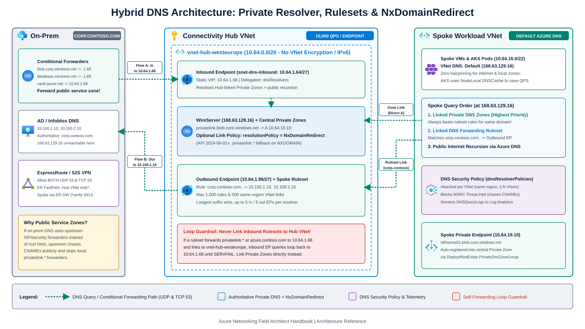
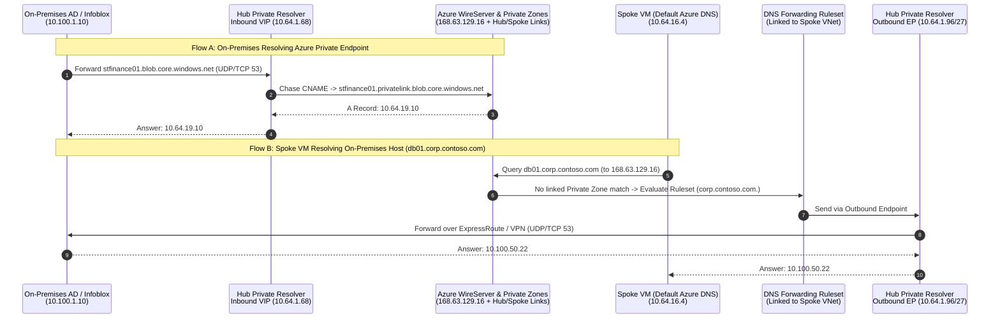

Many "network outage" escalations in hybrid Azure environments trace back to DNS resolution failures. Once you restrict PaaS resources behind Private Endpoints and connect datacenters over ExpressRoute or VPN, name resolution depends on VNet links, CNAME recursion behavior, and regional forwarding boundaries.

This chapter covers how Azure's **`168.63.129.16`** WireServer endpoint evaluates queries, how to deploy **[Azure DNS Private Resolver](https://learn.microsoft.com/en-us/azure/dns/dns-private-resolver-overview)** without forwarding loops or QPS bottlenecks, and when to enable **`NxDomainRedirect`** and **DNS security policies**. For multi-subscription `privatelink.*` zone topologies, Bicep Deployment Stacks, and `DeployIfNotExists` Azure Policy governance, see [Private Link & Enterprise DNS at Scale](/azure-networking/04-network-security/private-link-and-dns-at-scale/).

---

## `168.63.129.16` and split-brain Private Link resolution

Every Azure virtual network defaults to Azure-provided DNS through the virtual IP **[`168.63.129.16`](https://learn.microsoft.com/en-us/azure/virtual-network/what-is-ip-address-168-63-129-16)**. This address is not a routable server on your VNet. Every Azure compute host intercepts `168.63.129.16` locally on the Hyper-V WireServer backplane (handling DHCP, guest agent heartbeats on TCP 80/32526, load balancer probes, and DNS on UDP/TCP 53). Traffic to `168.63.129.16` ignores UDRs, and DNS traffic to `168.63.129.16` bypasses NSGs unless an outbound NSG rule explicitly targets the `AzurePlatformDNS` service tag.

When a VM in a VNet configured with **Default (Azure-provided) DNS** queries `168.63.129.16`, Azure evaluates sources in this exact order:
1. **Linked Azure Private DNS Zones**: Consults all Private DNS Zones linked directly to that VNet. If a linked zone matches the namespace, it wins authoritatively (and overrides any DNS forwarding ruleset rule for the same namespace).
2. **Linked DNS Forwarding Rulesets**: Evaluates enabled forwarding rules attached to the VNet via Azure DNS Private Resolver, choosing the longest domain suffix match.
3. **Public DNS recursion**: Resolves unmatched names against public internet DNS roots (or internal VNet-scoped `*.internal.cloudapp.net` hostnames and PTR records).

### Why on-premises DNS cannot query `168.63.129.16` directly

Because `168.63.129.16` exists only on the Azure host fabric, packets addressed to `168.63.129.16` across ExpressRoute, S2S VPN, or P2S VPN drop in transit. On-premises Active Directory DNS servers or Infoblox grids must forward Azure queries to a **routable private IP inside an Azure VNet**, specifically an Azure DNS Private Resolver Inbound Endpoint (`10.64.1.68`), which then queries `168.63.129.16` inside that VNet.

### Conditional forwarder zone rule: public service zone vs. `privatelink.*`

When a PaaS resource enables a Private Endpoint, Microsoft's public authoritative DNS inserts a `privatelink` CNAME alias (`stfinance01.blob.core.windows.net` -> `CNAME stfinance01.privatelink.blob.core.windows.net`) so TLS certificates remain valid against the original hostname.

Per [Microsoft's Private Endpoint DNS integration guidance](https://learn.microsoft.com/en-us/azure/private-link/private-endpoint-dns-integration), configure on-premises conditional forwarders for the **recommended public service DNS zone** (such as `blob.core.windows.net`, `database.windows.net`, or `vault.azure.net`) pointing to your Azure DNS Private Resolver Inbound Endpoint IP, rather than forwarding only `privatelink.*`. Here is why:
- Most enterprise on-premises DNS servers disable root hints and forward unresolved queries to upstream perimeter or security resolvers (ISP, Cisco Umbrella, Zscaler, Cloudflare). If you only add a conditional forwarder for `privatelink.blob.core.windows.net`, your on-premises DNS server sends the initial query for `stfinance01.blob.core.windows.net` upstream. That upstream public resolver chases the entire CNAME chain on the internet itself and returns the **public IP**, completely bypassing your local `privatelink.*` forwarder.
- Forwarding `blob.core.windows.net` sends the initial query straight to the Inbound Endpoint (`10.64.1.68`), where `168.63.129.16` returns the private IP (`10.64.19.10`) for Private Endpoints and resolves un-privatized public storage accounts via Azure's recursive fleet. Forwarding `privatelink.*` alone works only when on-premises DNS performs iterative root-hint recursion directly without upstream recursive forwarders.

---

## Azure DNS Private Resolver architecture

**Azure DNS Private Resolver** replaces IaaS BIND, Unbound, and Windows DNS forwarder VMs with a zone-redundant PaaS service. Deployed in a regional hub VNet (or a dedicated DNS spoke VNet in Virtual WAN), it uses three [endpoints and ruleset components](https://learn.microsoft.com/en-us/azure/dns/private-resolver-endpoints-rulesets):



1. **Inbound endpoint**: Occupies its own dedicated `/28` to `/24` subnet (`snet-dns-inbound`, `/27` recommended) delegated exclusively to `Microsoft.Network/dnsResolvers`. Exposes a static or dynamic private VIP (dynamic defaults to the fifth subnet IP, such as `.4` or `.68`) that answers queries from on-premises or other VNets against Private DNS Zones linked to the resolver's VNet plus public recursion.
2. **Outbound endpoint**: Occupies a separate dedicated `/28` to `/24` subnet (`snet-dns-outbound`, `/27` recommended) delegated to `Microsoft.Network/dnsResolvers`. Has no single VIP; it egresses conditional forwarding queries toward on-premises or external DNS servers.
3. **DNS forwarding ruleset**: Groups up to **1,000 dot-terminated forwarding rules** (for example, `corp.contoso.com.` -> `10.100.1.10:53, 10.100.2.10:53`), associates with up to 2 outbound endpoints on the same resolver, and links to up to **500 VNets in the same Azure region** (even across subscriptions, and without requiring VNet peering for name resolution).



### Provisioning and inspecting with the `az dns-resolver` CLI

Azure CLI manages Private Resolver resources through the [`az dns-resolver`](https://learn.microsoft.com/en-us/cli/azure/dns-resolver) extension group (note the command group is `az dns-resolver`, not `az network dns-resolver`):

```bash
# Inspect resolver endpoints, forwarding rulesets, and rules
az dns-resolver show \
  --resource-group rg-platform-dns \
  --name dnspr-hub-westeurope

az dns-resolver forwarding-rule create \
  --resource-group rg-platform-dns \
  --ruleset-name ruleset-spoke-hybrid \
  --name rule-corp-contoso \
  --domain-name "corp.contoso.com." \
  --forwarding-rule-state Enabled \
  --target-dns-servers '[{"ipAddress":"10.100.1.10","port":53},{"ipAddress":"10.100.2.10","port":53}]'
```

### Distributed ruleset links and the hub self-forwarding loop

Keep spoke VNet DNS settings on **Default (Azure-provided `168.63.129.16`)**, link central `privatelink.*` zones via Azure Policy, and link your **DNS forwarding ruleset** to each spoke VNet for on-premises corporate namespaces. Unlike overriding spoke VNet custom DNS to `10.64.1.68`, this distributed design resolves internet and spoke-linked Private DNS queries directly on each Hyper-V host without crossing VNet peering or burning your Inbound Endpoint's QPS quota.

:::danger[Never link an inbound-forwarding ruleset back to the hub VNet]
If a forwarding ruleset contains a rule pointing `azure.contoso.com.` or `privatelink.*` to your Hub Inbound Endpoint (`10.64.1.68`), **do not link that ruleset to the Hub VNet (`vnet-hub-westeurope`)**. When `10.64.1.68` attempts to resolve the query inside the Hub VNet, the Hub's own ruleset link intercepts the lookup and forwards it right back to `10.64.1.68` until `SERVFAIL`. Also avoid wildcard catch-all rules (`.`) on a Hub VNet hosting an ExpressRoute Gateway if the target DNS server cannot resolve public Azure management FQDNs; note that Azure ignores wildcard rules for reserved two-label domains (`windows.net`, `azure.com`, `azure.net`), and rejects `168.63.129.16` as a forwarding rule destination.
:::

### Documented limits, QPS scaling, and feature incompatibilities

| Limit or constraint | Platform ceiling / behavior | Operational impact |
| --- | --- | --- |
| **Resolvers & endpoints** | 15 resolvers/subscription; 1 resolver/VNet; up to **5 inbound** and **5 outbound** endpoints per resolver | Each endpoint requires a dedicated `/28` to `/24` subnet; delete rulesets and VNet links before deleting an outbound endpoint. |
| **Throughput ceiling** | **10,000 QPS per endpoint** (up to 6 target DNS IPs per rule) | Multiple target IPs in one rule run in **failover order with exponential backoff**, not 50/50 load balancing. Partition high-QPS spokes across separate rulesets/outbound endpoints and enable **NodeLocal DNSCache** in [AKS](/azure-networking/05-workload-networking/aks-networking/). |
| **Ruleset scale & region** | **1,000 rules** and **500 VNet links** per ruleset; **2 rulesets** per outbound endpoint | VNet links must be in the **same Azure region** as the resolver (cross-subscription in-region works; cross-tenant does not). Deploy one resolver per active region. |
| **Transport protocol** | UDP 53 and TCP 53 | Responses above 512/1232 bytes (DNSSEC, large recordsets) retry on **TCP 53**. Open both UDP 53 and TCP 53 across NSGs and firewalls. |
| **ExpressRoute FastPath** | Hub VNet only per [FastPath docs](https://learn.microsoft.com/en-us/azure/expressroute/about-fastpath) *(listed as unsupported on older [Resolver overview](https://learn.microsoft.com/en-us/azure/dns/dns-private-resolver-overview))* | FastPath never bypasses the gateway for a resolver in a **Spoke VNet** (queries transit the ExpressRoute Gateway). Validate hub-resolver FastPath behavior in your target region and circuit SKU before cutover. |
| **Unsupported features** | **No IPv6** subnets, **no VNet Encryption**, **no Azure Lighthouse** | Do not enable VNet Encryption on the VNet hosting Private Resolver, and keep resolver subnets IPv4-only. |

---

## Cross-tenant Private Link fallback with `NxDomainRedirect`

When your VNet links `privatelink.blob.core.windows.net` for internal storage accounts and an application also connects to an external partner's or SaaS vendor's storage account (`vendorfeed.blob.core.windows.net`) that uses a Private Endpoint in the vendor's tenant, split-brain DNS blocks access by default:

1. Public DNS aliases `vendorfeed.blob.core.windows.net` -> `vendorfeed.privatelink.blob.core.windows.net`.
2. Because your VNet has `privatelink.blob.core.windows.net` linked authoritatively, `168.63.129.16` checks your private zone, finds no `vendorfeed` record, and returns authoritative **`NXDOMAIN`**.

Available since Private DNS API `2024-06-01`, **[`resolutionPolicy: "NxDomainRedirect"`](https://learn.microsoft.com/en-us/azure/dns/private-dns-fallback)** ("Enable fallback to internet") on the Private DNS Zone's Virtual Network Link solves this natively without forwarder hacks:

```bash
az network private-dns link vnet update \
  --resource-group rg-platform-dns \
  --zone-name privatelink.blob.core.windows.net \
  --name link-hub-westeurope \
  --resolution-policy NxDomainRedirect
```

When `NxDomainRedirect` is set on a VNet link (applicable **exclusively to `privatelink.*` zones** for `A`, `AAAA`, and `CNAME` queries; rejected with `BadRequest` on custom or non-`privatelink` zones), Azure's recursive resolver automatically retries public recursion using the original public QNAME whenever the local private zone returns `NXDOMAIN`.

:::caution[Guardrails before enabling `NxDomainRedirect`]
Enable `NxDomainRedirect` only on `privatelink.*` zones where workloads legitimately call external partner or SaaS PaaS endpoints, and pair it with outbound Azure Firewall FQDN rules and `publicNetworkAccess: Disabled` on all internal PaaS resources. If an internal Private Endpoint record is deleted while `publicNetworkAccess` was left `Enabled`, `NxDomainRedirect` resolves the public IP instead of failing closed.
:::

---

## VNet DNS logging and threat blocking (DNS security policy)

Historically, keeping spoke VNets on `168.63.129.16` gave security teams zero visibility into per-VM DNS queries unless they forced all UDP/TCP 53 traffic through Azure Firewall DNS Proxy or custom forwarders. **[Azure DNS resolver policy (DNS security policy)](https://learn.microsoft.com/en-us/azure/dns/dns-security-policy)** (`Microsoft.Network/dnsResolverPolicies`) closes that gap directly on the VNet fabric:

- **VNet-level filtering and CNAME chasing**: Links 1:N to same-region VNets (1 policy per VNet, up to 100 rules at priorities `100` to `65000` with `Allow`, `Block`, or `Alert` actions). Rules inspect full CNAME chains, blocking domains even when hidden behind an alias.
- **Managed MSRC Threat Intelligence**: Blocks known malicious and command-and-control domains sourced continuously from the Microsoft Security Response Center before any TCP/UDP payload connection starts.
- **Native query logs**: Diagnostic settings on `Microsoft.Network/dnsResolverPolicies` export the `DnsResponse` category into the `DNSQueryLogs` table in Log Analytics (with Basic Logs and ingestion-time transformation support), Storage, or Event Hubs.

---

## Hybrid DNS option comparison

| Criterion | Azure DNS Private Resolver (+ DNS Security Policy) | Custom IaaS Forwarders (BIND / Unbound / CoreDNS) | Active Directory Domain Controllers in Azure | Enterprise DDI Appliances (Infoblox / BlueCat NVAs) |
| --- | --- | --- | --- | --- |
| **Patching & HA clustering** | **Zero** (zone-redundant PaaS SLA) | High (VMSS, ILB probes, OS patching, config sync) | High (AD replication, patching, DC lifecycle) | High (appliance upgrades, grid licensing, HA pairs) |
| **Throughput ceiling** | `10,000` QPS/endpoint (up to `50,000` QPS across 5 endpoints) | Scales with VM SKU + Standard ILB | Moderate (DNS shares CPU/memory with AD DS LSASS) | High (appliance SKU dependent) |
| **Query logging & blocklists** | `DNSQueryLogs` + MSRC Threat Intel & custom domain lists | Full `dnstap` / packet capture + custom RPZ | Windows DNS analytical logs + Defender for DNS | Integrated IPAM, DNSSEC signing, custom RPZ feeds |
| **Virtual WAN integration** | Deploy in a dedicated DNS Spoke VNet connected to vHub | Deploy in DNS Spoke VNet | Deploy in Identity Spoke VNet | Deploy in Shared Services Spoke VNet |

---

:::tip[What I recommend]
1. **Deploy one Azure DNS Private Resolver per active region.** Allocate dedicated `/27` inbound and `/27` outbound subnets in your regional hub VNet (or dedicated DNS spoke VNet in Virtual WAN), and retire custom Linux/Windows DNS proxy VMs unless you require `dnstap` packet captures or DDI grid replication.
2. **Keep spoke VNets on Default Azure DNS (`168.63.129.16`).** Attach **DNS forwarding ruleset VNet links** to spokes for corporate domains (`corp.contoso.com.`) and link central `privatelink.*` zones via Azure Policy ([Private Link & Enterprise DNS at Scale](/azure-networking/04-network-security/private-link-and-dns-at-scale/)) so spoke lookups never hairpin through a single Inbound VIP.
3. **Forward the public PaaS service zone from on-premises DNS.** Point on-premises conditional forwarders for `blob.core.windows.net`, `database.windows.net`, and `vault.azure.net` to your regional Inbound Endpoint IPs (Region A primary, Region B secondary) so upstream corporate forwarders cannot bypass Private Link CNAMEs.
4. **Use `NxDomainRedirect` selectively on `privatelink.*` VNet links.** Enable `resolutionPolicy: NxDomainRedirect` where workloads access external partner PaaS endpoints, backed by `publicNetworkAccess: Disabled` on every internal PaaS resource.
5. **Attach a regional DNS security policy (`dnsResolverPolicies`) to every VNet.** Enable the MSRC Threat Intelligence domain list in `Block` mode and stream `DNSQueryLogs` to Log Analytics without routing DNS packets through a firewall proxy.
:::

---

## References

- [What is Azure DNS Private Resolver? (architecture, quotas, and VNet/subnet restrictions)](https://learn.microsoft.com/en-us/azure/dns/dns-private-resolver-overview)
- [Azure DNS Private Resolver endpoints and rulesets](https://learn.microsoft.com/en-us/azure/dns/private-resolver-endpoints-rulesets)
- [Azure CLI reference: `az dns-resolver`](https://learn.microsoft.com/en-us/cli/azure/dns-resolver)
- [Azure Private Endpoint DNS integration scenarios (public service zone conditional forwarding)](https://learn.microsoft.com/en-us/azure/private-link/private-endpoint-dns-integration)
- [Fallback to internet for Azure Private DNS zones (`NxDomainRedirect`)](https://learn.microsoft.com/en-us/azure/dns/private-dns-fallback)
- [Azure DNS resolver policy (DNS security policy and MSRC Threat Intelligence)](https://learn.microsoft.com/en-us/azure/dns/dns-security-policy)
- [Azure IP address `168.63.129.16` overview (`AzurePlatformDNS`)](https://learn.microsoft.com/en-us/azure/virtual-network/what-is-ip-address-168-63-129-16)
- [Azure ExpressRoute FastPath limitations with DNS Private Resolver](https://learn.microsoft.com/en-us/azure/expressroute/about-fastpath)

