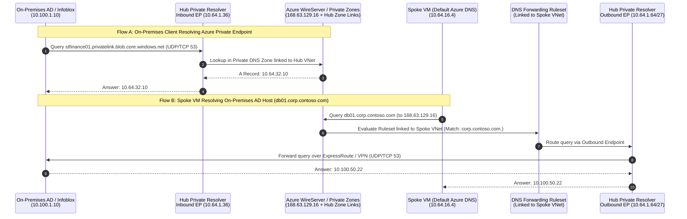

In enterprise Azure networks, "the network is down" is a DNS failure more than half the time. Once you lock down PaaS services behind Azure Private Endpoints and connect on-premises datacenters over ExpressRoute or VPN, name resolution becomes tightly coupled to VNet topology, CNAME chain recursion, and regional forwarding boundaries.

Getting hybrid DNS right requires understanding what Azure's platform IP **`168.63.129.16`** can and cannot do, deploying **Azure DNS Private Resolver** without forwarding loops or QPS bottlenecks, and aligning centralized Private DNS Zone governance across landing zones.

---

## `168.63.129.16` and Split-Brain Private Link Resolution

Every Azure virtual network defaults to **Azure-provided DNS**, backed by the magic virtual IP **`168.63.129.16`**. This address is **not a routable server on your VNet**—it is an anycast-like link-local endpoint intercepted directly by the Hyper-V host WireServer on every Azure compute node.

When a VM inside VNet A queries `168.63.129.16`:
1. Azure checks all **Azure Private DNS Zones** linked via Virtual Network Links to VNet A. If an authoritative match exists, it returns the private `A` record immediately.
2. If no linked Private DNS Zone matches, `168.63.129.16` performs public internet DNS recursion on the VM's behalf.

### Why On-Premises Servers Cannot Query `168.63.129.16`

Because `168.63.129.16` exists only on the Azure physical host backplane, **packets sent to `168.63.129.16` across ExpressRoute, S2S VPN, or P2S VPN are blackholed**. An on-premises Active Directory DNS server or Infoblox grid cannot set `168.63.129.16` as a conditional forwarder target. It must forward queries to a **routable private IP inside a hub VNet**—which then proxies the lookup to `168.63.129.16`.

### How Split-Brain CNAME Resolution Works for Private Link

Microsoft PaaS services avoid breaking certificate validation by keeping the public FQDN (`stfinance01.blob.core.windows.net`) intact and inserting a `privatelink` CNAME alias in Microsoft's public authoritative DNS whenever a Private Endpoint exists:

1. Client queries `stfinance01.blob.core.windows.net`.
2. Public DNS (or corporate DNS recursing to public roots) returns: `CNAME stfinance01.privatelink.blob.core.windows.net`.
3. **Inside a linked Azure VNet**: `168.63.129.16` intercepts `privatelink.blob.core.windows.net` against the linked Private DNS Zone and returns `10.64.32.10`.
4. **From On-Premises**: Your on-premises DNS server has a **conditional forwarder** for `blob.core.windows.net` (or `privatelink.blob.core.windows.net`—forwarding the `privatelink.*` zone is cleaner because un-privatized public blobs continue resolving publicly without hairpinning through Azure!) pointing to your **Azure DNS Private Resolver Inbound Endpoint IP** (`10.64.1.36`).

---

## Azure DNS Private Resolver Architecture

**Azure DNS Private Resolver** eliminates the legacy tax of patching, clustering, load-balancing, and monitoring IaaS BIND/Unbound or Windows DNS forwarder VMs in every hub VNet. Deployed inside a regional hub VNet (including the hub VNet of a customer-managed topology, or a dedicated DNS/shared-services VNet attached to an Azure Virtual WAN hub), it separates ingress and egress resolution into three managed constructs:

1. **Inbound Endpoint**: Assigned a static or dynamic private IP from a dedicated `/28`–`/27` subnet (`snet-dns-inbound` delegated to `Microsoft.Network/dnsResolvers`). Answers queries arriving from on-premises DNS servers (or other VNets) using every Private DNS Zone linked to the **resolver's own hub VNet**, plus public recursion.
2. **Outbound Endpoint**: Provisioned in a second dedicated `/28`–`/27` subnet (`snet-dns-outbound`). Holds no customer-facing single VIP; instead, it sources outbound UDP/TCP 53 queries from its subnet toward on-premises DNS servers or external resolvers.
3. **DNS Forwarding Ruleset**: Contains up to **1,000 domain forwarding rules** (for example, `corp.contoso.com. -> 10.100.1.10, 10.100.2.10`) associated with an Outbound Endpoint, and linked via **Virtual Network Links** to up to **500 spoke VNets in the same region**.



### Distributed Ruleset Links vs. Custom VNet DNS Settings

With DNS Private Resolver, **keep spoke VNet DNS server settings at "Default (Azure-provided)"** and link your **DNS Forwarding Ruleset** to each spoke VNet instead of overriding spoke VNet DNS IPs to `10.64.1.36`!

Why this distributed pattern is superior:
- **Zero Hairpinning for Local Zones & Internet**: Queries from spoke VMs for public FQDNs or spoke-linked Private DNS Zones resolve locally on the Hyper-V host at `168.63.129.16` in sub-millisecond time without consuming your Inbound Endpoint's **10,000 QPS quota** or traversing VNet peering.
- **Centralized Hub Private Zone Resolution**: You do *not* even have to link all 80+ `privatelink.*` Private DNS Zones to every spoke VNet! Link all `privatelink.*` Private DNS Zones **once to the Hub VNet**, and add forwarding rules in your spoke-linked Ruleset (or forward specific corporate private domains) to the Hub Inbound Endpoint `10.64.1.36`—*or* link the centralized Private DNS Zones directly via Azure Policy (preferred for highest QPS scale and lowest latency; see [Private Link & DNS at Scale](/azure-networking/04-network-security/private-link-and-dns-at-scale/)).

:::danger[Never Create a Self-Forwarding Hub Loop]
If you put a rule in a DNS Forwarding Ruleset that forwards `azure.contoso.com` or `privatelink.*` to your Hub Inbound Endpoint (`10.64.1.36`), **never link that same Ruleset to the Hub VNet containing `10.64.1.36`**! When the Inbound Endpoint tries to resolve the query, the Hub VNet's own ruleset intercepts it and forwards it right back to `10.64.1.36` in an infinite loop until SERVFAIL. If the Hub VNet needs to resolve on-premises `corp.contoso.com`, create a **separate hub-only ruleset** containing *only* on-premises domain rules.
:::

### Hard Platform Limits & High-QPS Scaling

Before deploying a single Private Resolver for hundreds of chatty microservice or AKS spokes, design around its documented limits:

- **10,000 QPS per endpoint**: Each Inbound or Outbound Endpoint caps at 10,000 queries per second (up to 5 inbound and 5 outbound endpoints per resolver; 1 resolver per VNet). Note that listing two target IPs inside a single forwarding rule provides **failover retry, not 50/50 load balancing**—the first target takes 100% of queries until unresponsive. To scale past 10,000 QPS, partition spoke VNets into Spoke Group A (linked to Ruleset A -> Outbound Endpoint A) and Spoke Group B (linked to Ruleset B -> Outbound Endpoint B), and enable **NodeLocal DNSCache** inside [AKS clusters](/azure-networking/05-workload-networking/aks-networking/).
- **Strict Regional Scope**: A DNS Forwarding Ruleset can **only be linked to VNets in the exact same Azure region** as the Private Resolver. Multi-region deployments require a Private Resolver pair per region (with on-premises conditional forwarders listing Region 1 Inbound IP primary and Region 2 Inbound IP secondary for cross-region DR).
- **Feature Incompatibilities**: Subnets delegated to `Microsoft.Network/dnsResolvers` **do not support IPv6**, **do not support VNet Encryption**, and **do not support ExpressRoute FastPath** (inbound DNS queries from on-premises must traverse the ExpressRoute Gateway, not bypass it via FastPath).
- **UDP Fragmentation Over Hybrid Links**: Large DNSSEC or multi-record responses exceeding 512/1232 bytes fall back from UDP 53 to **TCP 53**. Always permit **both UDP 53 and TCP 53** across hub firewalls, NSGs, and on-premises firewalls between DNS servers and both Inbound/Outbound resolver subnets.

---

## Native Cross-Tenant & Unlinked Private Link Fallback (`NxDomainRedirect`)

A classic enterprise pain point occurs when your VNet links `privatelink.blob.core.windows.net` for internal storage accounts, and an application simultaneously tries to reach a partner's or SaaS vendor's Azure Storage account (`vendorfeed.blob.core.windows.net`) that *also* has a Private Endpoint in the vendor's own tenant:

1. Public DNS aliases `vendorfeed.blob.core.windows.net` -> `vendorfeed.privatelink.blob.core.windows.net`.
2. Because *your* VNet has `privatelink.blob.core.windows.net` linked authoritatively, `168.63.129.16` checks your private zone, finds no `vendorfeed` record, and returns **authoritative `NXDOMAIN`**—breaking public access to the vendor's storage account!

Previously, architects built brittle custom forwarder loops to work around this. Since Private DNS API `2024-06-01`, Azure provides a native, zero-infrastructure fix: set **`resolutionPolicy: "NxDomainRedirect"`** ("Enable fallback to internet") on the Private DNS Zone's **Virtual Network Link**:

```bash
az network private-dns link vnet update \
  --resource-group rg-platform-dns \
  --zone-name privatelink.blob.core.windows.net \
  --name link-hub-westeurope \
  --resolution-policy NxDomainRedirect
```

When `NxDomainRedirect` is enabled on the VNet link (including the Hub VNet link backing your DNS Private Resolver Inbound Endpoint), whenever `privatelink.blob.core.windows.net` returns `NXDOMAIN` locally, Azure's recursive fleet automatically re-queries the public endpoint chain and returns the external public IP—preserving private resolution for your own endpoints while unblocking legitimate external SaaS/partner PaaS endpoints.

:::caution[Security Review Before Enabling `NxDomainRedirect`]
Only enable `NxDomainRedirect` where workloads legitimately connect to external public PaaS instances of that resource type—and enforce outbound data-exfiltration controls via Azure Firewall FQDN rules or Private Link network isolation. If a typo or deleted internal Private Endpoint falls back to a public IP on a PaaS resource where `publicNetworkAccess` was accidentally left `Enabled`, traffic will attempt the public path instead of failing closed.
:::

---

## Hybrid DNS Architecture Trade-Off Matrix

| Evaluation Criteria | Azure DNS Private Resolver | Custom IaaS Forwarders (BIND / Unbound / CoreDNS VMs) | Active Directory Domain Controllers in Azure | Enterprise DDI Appliances (Infoblox / BlueCat NVAs) |
| --- | --- | --- | --- | --- |
| **OS Patching & HA Clustering** | **Zero** (Zone-redundant PaaS SLA) | High (VMSS/ILB health probes, OS patching, config sync) | High (AD replication, patching, DC promo lifecycle) | High (Appliance upgrades, Grid licensing, HA pairs) |
| **Throughput Ceiling** | 10,000 QPS per endpoint (up to 50k QPS partitioned per resolver) | Scales with VM SKU + ILB | Moderate (DNS tied to AD DS LSASS memory/CPU) | High (appliance SKU dependent) |
| **Granular Query Logging & RPZ** | Metrics + DNS Security Policy (VNet DNS traffic logs / domain blocklists) | Full query-level `dnstap` / syslog + custom RPZ | Windows DNS Analytical/Debug logs + Defender for DNS | Rich IPAM integration, DNSSEC signing, RPZ threat feeds |
| **Monthly Baseline Cost** | Moderate fixed hourly fee per Inbound + Outbound endpoint + ruleset | Low compute cost for 2 small Linux VMs, high ops labor | Sunk cost *if* IaaS DCs already exist in-region | High software licensing + larger VM SKUs |
| **Virtual WAN Compatibility** | Deploy in a dedicated DNS Spoke VNet peered/connected to vWAN hub | Deploy in DNS Spoke VNet | Deploy in Identity Spoke VNet | Deploy in Shared Services Spoke VNet |

For enterprise governance of the 80+ `privatelink.*` zones using Azure Policy `DeployIfNotExists` and `PrivateDnsZoneGroup`, continue to [Private Link & DNS at Scale](/azure-networking/04-network-security/private-link-and-dns-at-scale/).

---

:::tip[What I Recommend]
1. **Default to Azure DNS Private Resolver in Every Active Region**: Deploy one Private Resolver per regional hub (or dedicated DNS VNet in Virtual WAN) with `/27` inbound and `/27` outbound subnets. Eliminate custom Linux/Windows DNS proxy VMs unless regulatory mandates require packet-level `dnstap` or Infoblox Grid synchronization.
2. **Keep Spoke VNets on Default Azure DNS (`168.63.129.16`)**: Use **DNS Forwarding Ruleset VNet Links** on spokes for on-premises corporate domains (`corp.contoso.com`), and link centralized `privatelink.*` Private DNS Zones directly to hubs/spokes via Azure Policy so spoke queries never bottleneck a single Inbound Endpoint IP.
3. **Forward Only `privatelink.*` Subzones From On-Premises**: Configure on-premises conditional forwarders for the specific `privatelink.<service>` zones (such as `privatelink.blob.core.windows.net`, `privatelink.database.windows.net`) pointing to your regional Inbound Endpoint IPs (Region A primary, Region B secondary), rather than forwarding all of `windows.net` across ExpressRoute.
4. **Use `NxDomainRedirect` Deliberately Instead of Hairpin Forwarders**: Enable `resolutionPolicy: NxDomainRedirect` on VNet links for shared PaaS zones (`blob`, `vaultcore`, `cognitiveservices`) where external partner access is required, backed by `publicNetworkAccess: Disabled` on all internal PaaS resources.
5. **Enable Azure DNS Security Policy for VNet Query Visibility**: Attach DNS Security Policies at the VNet level to stream DNS query logs to Log Analytics and block known malicious domains at the platform layer before packets ever leave the subnet.
:::
