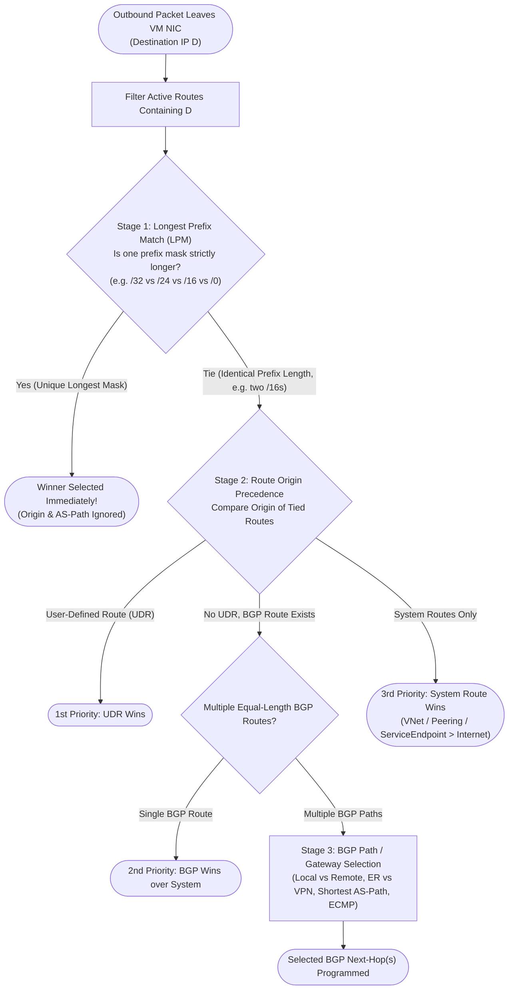
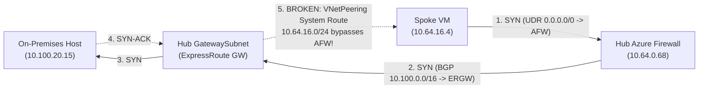

Azure software-defined networking (SDN) does not forward packets hop-by-hop using traditional Ethernet ARP broadcasts or router-interface ACLs. Every virtual machine network interface (NIC) has an **effective route table** programmed by the Azure host fabric before the first packet leaves the guest OS. Almost every "intermittent firewall drop," "broken ExpressRoute return path," or "Private Endpoint bypassing inspection" incident in production traces back to misunderstanding the exact mathematical order in which Azure evaluates that table.

---

## The Deterministic NIC Route Selection Algorithm

When a NIC transmits an IPv4 or IPv6 packet, the Azure host evaluates all **Active** routes in the subnet's effective route table using a strict three-stage pipeline. There are no exceptions to stage order.



### Stage 1: Longest Prefix Match (LPM) Always Wins First

Before Azure looks at whether a route came from your manual Route Table (UDR), ExpressRoute BGP, or an internal System route, **the longest subnet mask wins unconditionally**:

- A `/32` System route created by a **Private Endpoint** (`InterfaceEndpoint`) beats a `/24` UDR and beats a `0.0.0.0/0` firewall UDR.
- A `/24` on-premises prefix learned via **ExpressRoute BGP** beats a `10.0.0.0/8` summary UDR pointing to Azure Firewall.
- A `/16` System route from **VNet Peering** beats a `0.0.0.0/0` default route advertised by Azure Route Server or configured via UDR.

:::danger[The #1 Misconception in Azure Networking]
Creating a `0.0.0.0/0 -> Azure Firewall` UDR on a spoke subnet **does not** send spoke-to-hub, spoke-to-peered-spoke, or spoke-to-on-premises traffic through the firewall if more-specific System (`/16`) or BGP (`/24`) routes remain active on that NIC! `0.0.0.0/0` is the shortest possible mask (`/0`); every other active route in the table beats it on LPM.
:::

### Stage 2: Route Origin Tie-Breaker (`UDR > BGP > System`)

Only when two or more active routes match the destination with the **exact same prefix length** (for example, two routes for `10.50.0.0/16`, or two routes for `0.0.0.0/0`) does Azure invoke origin precedence:

1. **User-Defined Route (UDR)** — highest precedence.
2. **BGP Route** (ExpressRoute Gateway, VPN Gateway, Azure Route Server, or Virtual WAN hub propagation) — second precedence.
3. **System Default Route** (`VnetLocal`, `VNetPeering`, `GlobalVNetPeering`, `ConnectedGroup`, `VirtualNetworkServiceEndpoint`, `InterfaceEndpoint`, `Internet`) — lowest precedence.

*Subtle System-vs-BGP protection rule*: Within a VNet's own address space and direct VNet peerings, Azure protects local fabric reachability—an NVA peered with [Azure Route Server](/azure-networking/02-core-topologies/hub-spoke-and-route-server/) cannot hijack intra-VNet or direct VNet-peering prefixes simply by advertising a more-specific BGP route; steering traffic away from `VnetLocal` or `VNetPeering` requires an explicit UDR.

### Stage 3: Why BGP AS-Path Prepending Cannot Beat UDRs or LPM

Network engineers coming from MPLS/Cisco WAN backgrounds routinely attempt to steer traffic away from a failover path by prepending `AS_PATH` four times (`65001 65001 65001 65001`). In Azure, **AS-path length is evaluated only inside the BGP gateway/router control plane among equal-prefix BGP candidates**:

- If Path A advertises `10.20.1.0/24` with AS-path `65001 65001 65001` over S2S VPN, and Path B advertises `10.20.0.0/16` with AS-path `65001` over ExpressRoute, **VPN wins** because `/24` beats `/16` at Stage 1 (LPM) before AS-path is ever inspected.
- Even for identical `/16` prefixes in a Virtual WAN hub or Route Server VNet, default **Hub Routing Preference (`ExpressRoute`)** prefers local ExpressRoute over local S2S VPN *before* comparing AS-path length—unless you explicitly switch routing preference to `ASPath` (see [Virtual WAN & Routing Intent](/azure-networking/02-core-topologies/virtual-wan-and-routing-intent/) and [ExpressRoute Resiliency](/azure-networking/03-hybrid-connectivity/expressroute-resiliency/)).

### Concrete Route Evaluation Scenarios

Assume a spoke VM (`10.64.16.4`) sends a packet to `10.100.20.15`. Below is how different effective route combinations resolve:

| Candidate Routes Present on Spoke NIC | Winning Route | Why It Won |
| --- | --- | --- |
| 1) System `0.0.0.0/0 -> Internet`<br/>2) UDR `0.0.0.0/0 -> 10.64.0.68 (Firewall)`<br/>3) BGP `10.100.0.0/16 -> 10.64.0.4 (ER GW)` | **BGP `10.100.0.0/16 -> ER GW`** | `/16` beats `/0` on **LPM (Stage 1)**. Traffic bypasses the firewall completely! |
| 1) UDR `10.100.0.0/16 -> 10.64.0.68 (Firewall)`<br/>2) BGP `10.100.0.0/16 -> 10.64.0.4 (ER GW)` | **UDR `10.100.0.0/16 -> Firewall`** | Tied at `/16`; **UDR beats BGP (Stage 2)**. |
| 1) UDR `10.100.0.0/16 -> 10.64.0.68 (Firewall)`<br/>2) BGP `10.100.20.0/24 -> 10.64.0.4 (ER GW)` | **BGP `10.100.20.0/24 -> ER GW`** | On-prem advertised a de-aggregated `/24`, beating the `/16` UDR on **LPM (Stage 1)** and silently bypassing inspection again. |
| 1) UDR `0.0.0.0/0 -> 10.64.0.68 (Firewall)` (with **Propagate gateway routes = Disabled**)<br/>2) *(BGP routes suppressed)* | **UDR `0.0.0.0/0 -> Firewall`** | Suppressing BGP propagation removes all `/16` and `/24` gateway routes from the spoke NIC, leaving `0.0.0.0/0` as the sole match. |
| 1) UDR `10.64.32.0/24 -> 10.64.0.68 (Firewall)`<br/>2) System `10.64.32.10/32 -> InterfaceEndpoint` | **System `/32 -> InterfaceEndpoint`** | Private Endpoint `/32` beats `/24` UDR on **LPM (Stage 1)** unless PE Network Policies (`RouteTableEnabled`) and a `/32` UDR are applied. |

---

## `DisableBgpRoutePropagation`: Precision Tool with Blast Radius

Every Azure Route Table exposes a boolean property: **`disableBgpRoutePropagation`** (labeled **"Propagate gateway routes: Yes / No"** in the Azure Portal). Setting `disableBgpRoutePropagation: true` stops Azure from injecting *any* BGP-learned prefixes (from ExpressRoute Gateways, VPN Gateways, Azure Route Server, or Virtual WAN hubs) into subnets associated with that route table.

### Where Engineers Use It Correctly

1. **Customer-Managed Hub-and-Spoke Spoke Subnets**: When all spoke-to-on-premises and spoke-to-internet traffic must pass through a hub firewall (`10.64.0.68`), disabling gateway route propagation on spoke route tables prevents hundreds of specific `/24` on-premises BGP prefixes from entering the spoke NICs and out-matching `0.0.0.0/0 -> Firewall` via LPM.
2. **NVA Untrusted / Transit Interfaces**: In multi-NIC third-party NVA or [AVS transit](/azure-networking/05-workload-networking/avs-networking/) designs, disabling BGP propagation on the internet-facing or cross-hub NIC prevents Azure Route Server from programming a routing loop back into the appliance that originated the route.

### Three Destructive Misconfigurations

1. **Setting `disableBgpRoutePropagation: true` on `GatewaySubnet`**: Never disable BGP propagation on `GatewaySubnet`! ExpressRoute and VPN gateways require BGP route exchange to function; Azure Portal blocks this today, and forcing it via legacy templates breaks hybrid routing completely.
2. **Setting `disableBgpRoutePropagation: true` on `AzureFirewallSubnet`**: Your hub firewall *needs* the specific on-premises `/24` and `/16` BGP routes from `GatewaySubnet` so it knows how to forward inspected packets down the ExpressRoute or VPN tunnel! Keep propagation **Enabled** on `AzureFirewallSubnet`, and attach a route table containing **only `0.0.0.0/0 -> Internet`** (plus explicit spoke prefixes if multi-hub) so the firewall never loops default-route traffic back to an ARS-peered NVA.
3. **Setting `disableBgpRoutePropagation: true` in Virtual WAN Spokes**: In a [Virtual WAN Secured Hub with Routing Intent](/azure-networking/02-core-topologies/virtual-wan-and-routing-intent/), the hub dynamically pushes `0.0.0.0/0` and RFC 1918 next-hops via BGP propagation. Disabling gateway route propagation on a vWAN spoke subnet blackholes all hub-learned routes!

---

## Asymmetric Routing Pitfalls with Stateful Firewalls

Stateful firewalls (Azure Firewall, Palo Alto VM-Series, Fortinet FortiGate, Check Point CloudGuard) track TCP 3-way handshakes (`SYN -> SYN-ACK -> ACK`) in a session table. If the forward `SYN` traverses the firewall, **the return `SYN-ACK` must traverse the exact same firewall cluster**. If the return packet takes a direct path around the firewall, either the return packet lacks a session or subsequent `ACK`/data packets hit the firewall without a completed handshake and are dropped (`TCP Out-of-State` / `Invalid SYN-ACK`).

### Failure Case 1: Missing `GatewaySubnet` UDR on Return from On-Premises



- **Why it breaks**: Spoke subnet has `disableBgpRoutePropagation: true` and `0.0.0.0/0 -> AFW`. Outbound `SYN` hits AFW, then ERGW, then On-Prem. When `SYN-ACK` returns to `GatewaySubnet`, ERGW sees the VNet Peering system route `10.64.16.0/24 -> VNetPeering` and delivers `SYN-ACK` straight to the Spoke VM—bypassing AFW! Seconds later, AFW drops the spoke's `ACK` because AFW never saw `SYN-ACK`.
- **The Surgical Fix**: Attach a dedicated Route Table (`rt-hub-gateway`) to `GatewaySubnet` (with **Propagate gateway routes = Enabled**!) containing exact spoke summary or VNet UDRs (`10.64.16.0/24 -> 10.64.0.68`). By Stage 2 (`UDR > System`), `GatewaySubnet` now forwards inbound traffic for `10.64.16.0/24` to Azure Firewall, restoring full symmetry.

### Failure Case 2: Private Endpoint `/32` Bypass

By default (`privateEndpointNetworkPolicies: Disabled`), deploying a Private Endpoint in Spoke B (`10.64.32.10`) injects a `/32` `InterfaceEndpoint` system route into Spoke B, the Hub, and `GatewaySubnet`.
- When On-Premises connects to `10.64.32.10`, `GatewaySubnet`'s `/32` `InterfaceEndpoint` route beats your `10.64.32.0/24 -> AFW` UDR via LPM and jumps straight to the Private Endpoint.
- Worse, in Virtual WAN with Private Routing Intent or multi-spoke inspection, forward traffic may traverse the firewall while return traffic takes a direct path—or vice versa.
- **The Surgical Fix**: Set **`privateEndpointNetworkPolicies: RouteTableEnabled`** (or `Enabled` if NSGs are also required) on the subnet hosting the Private Endpoints. This suppresses wide `/32` route injection or lets broader subnet UDRs govern routing cleanly across `GatewaySubnet` and peerings. See [Private Link & DNS at Scale](/azure-networking/04-network-security/private-link-and-dns-at-scale/).

### SNAT vs. Symmetric UDR Placement

When engineers cannot immediately fix a missing return UDR during an incident, they often enable **Private Range SNAT** on Azure Firewall or the NVA (`SNAT: Always` instead of `Never` for RFC 1918). SNAT rewrites the client's source IP to the firewall's internal IP, forcing the destination to reply back to the firewall.

**Treat Private SNAT as an emergency band-aid, never a target architecture**:
- Downstream servers, NSG flow logs, SQL audit trails, and Active Directory event logs see **every connection in the company originating from the firewall's four subnet IPs**, destroying forensic attribution and zero-trust identity/IP policies.
- High east-west throughput exhausts ephemeral SNAT ports between internal tiers.
- Fix the routing symmetry with deterministic UDRs (or Virtual WAN Routing Intent) and set Azure Firewall Private SNAT (`snat.privateRanges`) so RFC 1918 + `100.64.0.0/10` are **never SNATed** internally.

---

## Validating Effective Routes in Production

Never guess what Azure programmed by reading static Route Table resources in the portal—a disconnected peering, stopped NVA, or forgotten `disableBgpRoutePropagation` toggle changes the live NIC state. Always inspect the **NIC effective route table** and **Network Watcher Next Hop**:

```bash
# 1. Inspect the exact active/invalid routes programmed on a VM NIC
az network nic show-effective-route-table \
  --resource-group rg-prod-spoke-app \
  --name nic-vm-app-01 \
  --output table

# 2. Deterministically test Azure's LPM + Tie-breaker winner for a specific flow
az network watcher show-next-hop \
  --resource-group rg-prod-spoke-app \
  --vm vm-app-01 \
  --source-ip 10.64.16.4 \
  --dest-ip 10.100.20.15 \
  --output json
```

Look closely at the **`State`** column in `show-effective-route-table`:
- **`Active`**: Eligible for Stage 1–3 selection.
- **`Invalid`**: Suppressed—either shadowed by an exact-prefix higher-precedence route (`UDR` shadowing `BGP` or `System`) or invalidated because a peered VNet / virtual network gateway went down.

---

:::tip[What I Recommend]
1. **Summarize Spoke Address Spaces Per Region**: If all regional spokes live inside `10.64.16.0/20`–`10.65.240.0/20`, `GatewaySubnet` needs only a handful of summary UDRs pointing to Azure Firewall rather than hitting Azure's **400-UDR-per-route-table ceiling**.
2. **Never Disable BGP Propagation on `GatewaySubnet`, `AzureFirewallSubnet`, or Virtual WAN Spokes**: Reserve `disableBgpRoutePropagation: true` strictly for customer-managed hub-and-spoke workload subnets (where `0.0.0.0/0 -> Firewall` must catch hybrid traffic) and NVA loop-prevention NICs.
3. **Enable `RouteTableEnabled` on Every Private Endpoint Subnet**: Eliminate `/32` LPM surprises across `GatewaySubnet` and hub firewalls from day one.
4. **Refuse Private-to-Private SNAT as a Permanent Design**: Preserve client source IPs end-to-end across RFC 1918 and `100.64.0.0/10`; fix asymmetric paths with symmetric UDRs or [Virtual WAN Routing Intent](/azure-networking/02-core-topologies/virtual-wan-and-routing-intent/). (Only exception: PaaS Private Endpoints accessed via certain Layer-7 proxies or specific [Azure Firewall DNAT patterns](/azure-networking/04-network-security/firewall-and-nva-patterns/) where return routing cannot hold a UDR.)
:::
