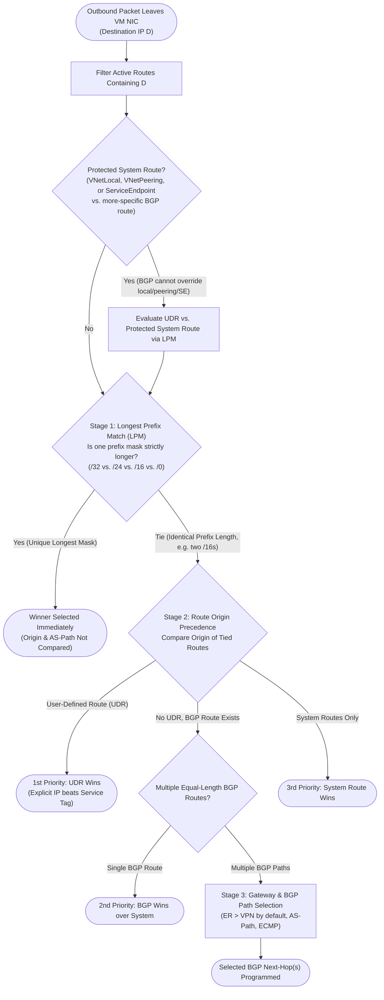
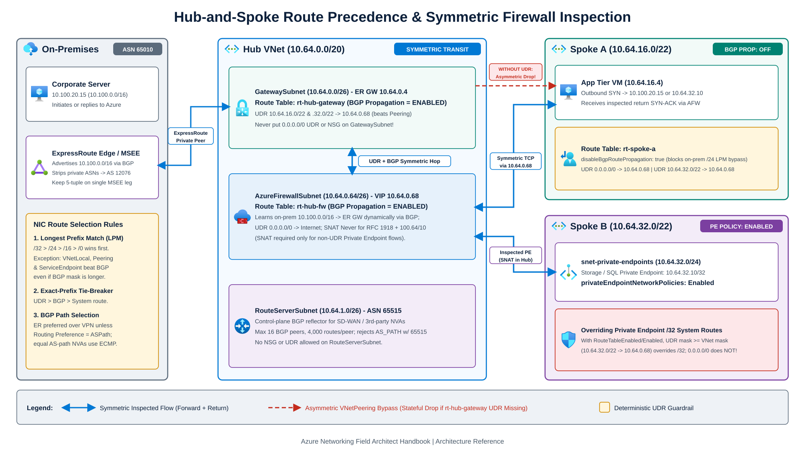
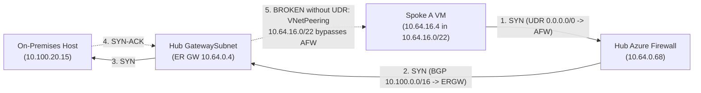

Azure software-defined networking (SDN) does not forward packets hop-by-hop using Ethernet ARP broadcasts or router-interface ACLs. Instead, the Azure host programs an **effective route table** onto every virtual machine network interface (NIC) before the first packet leaves the guest OS. Common production incidents such as intermittent stateful firewall drops, broken ExpressRoute return paths, and Private Endpoints bypassing inspection trace directly to the evaluation order of that table.

---

## Deterministic NIC route selection

When a NIC transmits an IPv4 or IPv6 packet, the Azure host filters all `Active` routes containing the destination IP and evaluates them in [three strict stages](https://learn.microsoft.com/en-us/azure/virtual-network/virtual-networks-udr-overview).



### Stage 1: Longest prefix match (LPM) and fabric-protected routes

Across candidate routes, **the longest subnet mask wins first**:

- A `/32` `InterfaceEndpoint` system route created by a Private Endpoint beats a `/24` UDR and beats a `0.0.0.0/0` firewall UDR (unless Private Endpoint network policies are enabled on the endpoint's subnet).
- A `/24` on-premises prefix learned over ExpressRoute BGP beats a `10.0.0.0/8` summary UDR pointing to Azure Firewall.
- A `/16` `VirtualNetworkPeering` system route beats a `0.0.0.0/0` default route advertised by Azure Route Server or configured in a UDR.

Azure enforces two fabric protections that qualify pure LPM:
1. **BGP cannot hijack intra-VNet, peering, or Service Endpoint space.** System routes for `VNetLocal`, `VirtualNetworkPeering`, and `VirtualNetworkServiceEndpoint` are preferred over BGP routes *even when an NVA or gateway advertises a longer, more-specific BGP prefix* via [Azure Route Server](/azure-networking/02-core-topologies/hub-spoke-and-route-server/) or VPN. Steering intra-VNet or peered VNet traffic through a firewall requires an explicit UDR.
2. **`VirtualNetworkServiceEndpoint` routes cannot be overridden by UDRs.** Enabling a Virtual Network Service Endpoint on a subnet injects high-priority Azure backbone routes for that service that even a UDR cannot redirect. Migrate from Service Endpoints to Private Endpoints when traffic must traverse a central firewall.

:::danger[The #1 routing misconception in Azure]
Attaching a `0.0.0.0/0 -> Azure Firewall` UDR to a spoke subnet **does not** send spoke-to-hub, spoke-to-peered-spoke, or spoke-to-on-premises traffic through the firewall while more-specific `/16` peering or `/24` BGP routes remain active on that NIC. Because `/0` is the shortest possible mask, every other active route beats it at Stage 1.
:::

### Stage 2: Route origin tie-breaker (`UDR > BGP > System`)

When two or more active routes match the destination with the **exact same prefix length** (such as two routes for `10.50.0.0/16` or two routes for `0.0.0.0/0`), Azure breaks the tie by route origin:

1. **User-Defined Route (UDR)** wins first. If an explicit IP prefix UDR ties with a [Service Tag UDR](https://learn.microsoft.com/en-us/azure/virtual-network/virtual-networks-udr-overview) (up to 25 Service Tag UDRs per route table), the explicit IP prefix wins. Among overlapping Service Tags, Azure evaluates regional service tags (`Storage.WestEurope`) before top-level service tags (`Storage`), then regional `AzureCloud.<region>`, and finally `AzureCloud`.
2. **BGP route** (learned from ExpressRoute Gateway, VPN Gateway, Azure Route Server, or Virtual WAN hub propagation) wins second. Note that adding a `0.0.0.0/0` UDR (or learning `0.0.0.0/0` with next hop `VirtualNetworkGateway`) also causes Azure to remove the default `None` discard system routes for `10.0.0.0/8`, `172.16.0.0/12`, `192.168.0.0/16`, and `100.64.0.0/10` on that subnet.
3. **System default route** (`VNetLocal`, `VirtualNetworkPeering`, `VirtualNetworkServiceEndpoint`, `InterfaceEndpoint`, `Internet`, `None`) ranks last.

### Stage 3: Why BGP AS-path prepending loses to LPM and hub preference

Engineers accustomed to MPLS WANs often prepend `AS_PATH` (`65001 65001 65001`) expecting Azure to avoid a backup path. Azure evaluates `AS_PATH` length only inside the BGP control plane among **equal-prefix BGP candidates**, and even then after gateway routing preference:

- If S2S VPN advertises `10.20.1.0/24` with a triple-prepended `AS_PATH` while ExpressRoute advertises `10.20.0.0/16` with a single ASN, **S2S VPN still wins** because `/24` beats `/16` at Stage 1 before BGP attributes are compared.
- For identical `/16` prefixes in a [Virtual WAN hub](/azure-networking/02-core-topologies/virtual-wan-and-routing-intent/) or [Azure Route Server](https://learn.microsoft.com/en-us/azure/route-server/route-server-faq) VNet, default **Hub Routing Preference (`ExpressRoute`)** selects ExpressRoute over S2S VPN or SD-WAN *before* comparing `AS_PATH` length unless you explicitly change routing preference to `ASPath` (see [ExpressRoute Resiliency](/azure-networking/03-hybrid-connectivity/expressroute-resiliency/)).
- When multiple NVAs advertise the identical prefix with equal `AS_PATH` length to Azure Route Server, Route Server programs all next hops onto VM NICs for **Equal-Cost Multi-Path (ECMP)** forwarding. Never include ASN `65515` in an NVA's `AS_PATH`: Route Server uses `65515` itself and drops the prefix under BGP loop prevention. Also note that ExpressRoute strips private BGP ASNs when advertising routes to on-premises, presenting them under Microsoft's `AS 12076`.

### Concrete route evaluation examples

Assume a spoke VM (`10.64.16.4`) sends a packet to `10.100.20.15` (or `10.64.32.10` in row 5):

| Active / candidate routes on spoke NIC | Winning route | Selection reason |
| --- | --- | --- |
| 1) System `0.0.0.0/0 -> Internet`<br/>2) UDR `0.0.0.0/0 -> 10.64.0.68 (Firewall)`<br/>3) BGP `10.100.0.0/16 -> 10.64.0.4 (ER GW)` | **BGP `10.100.0.0/16 -> ER GW`** | `/16` beats `/0` at **Stage 1 (LPM)**. Hybrid traffic bypasses the firewall. |
| 1) UDR `10.100.0.0/16 -> 10.64.0.68 (Firewall)`<br/>2) BGP `10.100.0.0/16 -> 10.64.0.4 (ER GW)` | **UDR `10.100.0.0/16 -> Firewall`** | Tied at `/16`; **UDR beats BGP at Stage 2** (BGP route becomes `Invalid`). |
| 1) UDR `10.100.0.0/16 -> 10.64.0.68 (Firewall)`<br/>2) BGP `10.100.20.0/24 -> 10.64.0.4 (ER GW)` | **BGP `10.100.20.0/24 -> ER GW`** | On-premises advertised a de-aggregated `/24`, beating the `/16` UDR at **Stage 1 (LPM)** and bypassing inspection. |
| 1) UDR `0.0.0.0/0 -> 10.64.0.68 (Firewall)` with `disableBgpRoutePropagation: true`<br/>2) *(BGP routes suppressed)* | **UDR `0.0.0.0/0 -> Firewall`** | Disabling gateway route propagation keeps all `/16` and `/24` BGP routes off the spoke NIC, so `0.0.0.0/0` wins. |
| 1) UDR `10.64.32.0/22 -> 10.64.0.68 (Firewall)`<br/>2) System `10.64.32.10/32 -> InterfaceEndpoint` (Spoke B VNet `10.64.32.0/22`) | **System `/32`** if policy `Disabled`;<br/>**UDR `/22 -> Firewall`** if `RouteTableEnabled` or `Enabled` | With [Private Endpoint network policies](https://learn.microsoft.com/en-us/azure/private-link/disable-private-endpoint-network-policy) enabled, any UDR prefix equal to or more specific than the target VNet's address space (`/22` or `/24` here, never `0.0.0.0/0`) overrides the `/32` route. |

---

## `disableBgpRoutePropagation`: precision tool with blast radius

Every Azure Route Table includes **`disableBgpRoutePropagation`** (shown as **"Propagate gateway routes: Yes / No"** in the Azure Portal). Setting `disableBgpRoutePropagation: true` blocks ExpressRoute Gateways, VPN Gateways, Azure Route Server, and Virtual WAN hubs from injecting gateway and BGP routes into associated subnets.



### Valid production uses

In customer-managed hub-and-spoke spoke subnets, setting `disableBgpRoutePropagation: true` alongside `0.0.0.0/0 -> 10.64.0.68` stops hundreds of specific on-premises `/24` BGP prefixes from landing on spoke NICs and out-matching the firewall default route.

In multi-NIC third-party NVA or [AVS transit](/azure-networking/05-workload-networking/avs-networking/) designs, disabling BGP propagation on untrusted or internet-facing appliance NICs prevents Azure Route Server from programming a routing loop back into the appliance that originated the prefix.

### Three destructive misconfigurations

1. **Disabling propagation on `GatewaySubnet`**: Never set `disableBgpRoutePropagation: true` (or attach a `0.0.0.0/0` UDR) on `GatewaySubnet`. ExpressRoute and VPN gateways stop functioning when BGP route propagation or management reachability is blocked.
2. **Disabling propagation on `AzureFirewallSubnet`**: The hub firewall *must* learn on-premises `/24` and `/16` BGP routes from `GatewaySubnet` so it knows how to forward inspected packets down the ExpressRoute circuit or VPN tunnel. Keep propagation **Enabled** on `AzureFirewallSubnet`, and attach a route table with `0.0.0.0/0 -> Internet` so an NVA advertising `0.0.0.0/0` to Route Server cannot loop firewall internet egress. Also note that `nextHopType: VirtualNetworkGateway` in a manual UDR works only when the VNet's gateway is a VPN Gateway, never an ExpressRoute Gateway or Route Server.
3. **Disabling propagation on Virtual WAN spoke subnets**: A [Virtual WAN Secured Hub with Routing Intent](/azure-networking/02-core-topologies/virtual-wan-and-routing-intent/) distributes `0.0.0.0/0` and private RFC 1918 firewall routes to spokes via BGP propagation. Setting `disableBgpRoutePropagation: true` on a Virtual WAN spoke blackholes hub-learned connectivity.

---

## Asymmetric routing pitfalls with stateful firewalls

Stateful firewalls (Azure Firewall, Palo Alto VM-Series, Fortinet FortiGate, Check Point CloudGuard) track TCP 3-way handshakes (`SYN -> SYN-ACK -> ACK`). When the forward `SYN` crosses a firewall cluster, the return `SYN-ACK` must cross that exact same firewall cluster. If the return leg takes a direct peering or `/32` shortcut, subsequent `ACK` and data packets hit the firewall without an established session and drop as out-of-state TCP.

### Missing `GatewaySubnet` return UDR from on-premises



When Spoke A (`10.64.16.0/22`) sets `disableBgpRoutePropagation: true` and `0.0.0.0/0 -> 10.64.0.68`, outbound `SYN` packets cross Azure Firewall and `GatewaySubnet` to reach on-premises. When `SYN-ACK` returns to `GatewaySubnet`, an unconfigured gateway subnet follows the `VirtualNetworkPeering` system route (`10.64.16.0/22`) straight to the spoke VM, bypassing Azure Firewall. Moments later, Azure Firewall drops the spoke's `ACK`.

Fix this symmetrically by associating a dedicated route table (`rt-hub-gateway`) with `GatewaySubnet`, keeping **Propagate gateway routes = Enabled**, and adding UDRs that match (or are more specific than) each peered spoke VNet's address space (for example, `10.64.16.0/22 -> 10.64.0.68` and `10.64.32.0/22 -> 10.64.0.68`). Do **not** rely on a broader `/20` summary UDR (`10.64.16.0/20`) on `GatewaySubnet`: because VNet peering injects each spoke's `/22` `VirtualNetworkPeering` route onto `GatewaySubnet`, `/22` beats `/20` at Stage 1 (LPM) and bypasses the firewall. Matching `/22` UDRs tie on prefix length and beat `VirtualNetworkPeering` at Stage 2 (`UDR > System`). Standard route tables hold up to **400 UDRs**, while **Azure Virtual Network Manager (AVNM) UDR configurations** raise that limit to **1,000 UDRs per route table** for large hub-and-spoke estates.

### Private Endpoint `/32` bypass and return-path SNAT

With default subnet settings (`privateEndpointNetworkPolicies: Disabled`), deploying a Private Endpoint in Spoke B (`10.64.32.10`) propagates a `/32` `InterfaceEndpoint` system route across Spoke B, the Hub VNet, and `GatewaySubnet`. That `/32` beats every `/24` or `/16` firewall UDR on LPM. Even worse, Private Endpoint NICs do not evaluate UDRs on their own subnet when emitting return packets, so return traffic always follows direct system routing toward the client's source IP.

Apply a two-part fix in customer-managed hub-and-spoke topologies (see [Private Link & Enterprise DNS at Scale](/azure-networking/04-network-security/private-link-and-dns-at-scale/)):
1. Set **`privateEndpointNetworkPolicies: Enabled`** (or `RouteTableEnabled`) on the subnet hosting Private Endpoints, and configure client/gateway UDRs with a prefix mask **equal to or more specific than the Private Endpoint VNet's address space** (`0.0.0.0/0` never overrides a Private Endpoint route).
2. Enable SNAT at the hub firewall *specifically* for inspected Private Endpoint flows (Azure Firewall Application Rules SNAT automatically; Network Rules or third-party NVAs require explicit SNAT unless deployed in a Virtual WAN Secured Hub with Private Routing Intent, which handles Private Endpoint symmetry natively).

### Why general Private-to-Private SNAT is an anti-pattern

During routing outages, teams sometimes set Azure Firewall Private SNAT to `Always` across all RFC 1918 traffic to mask asymmetric return paths. Refuse that shortcut for general VM-to-VM and hybrid traffic. Rewriting every internal connection to the firewall's subnet IPs destroys source-IP attribution in SQL audit trails, Active Directory security logs, and NSG flow logs, and risks internal SNAT port exhaustion. Fix the missing UDRs instead and keep `snat.privateRanges` (`IANAPrivateRanges`: `10.0.0.0/8`, `172.16.0.0/12`, `192.168.0.0/16`, `100.64.0.0/10`) un-SNATed for standard east-west and hybrid VM flows.

---

## Validating effective routes in production

Static Route Table blades in the portal do not show invalidated peerings, BGP withdrawals, or shadowed system routes. Always inspect the live NIC effective route table and [Network Watcher Next Hop](https://learn.microsoft.com/en-us/azure/network-watcher/next-hop-overview):

```bash
# 1. Inspect active and shadowed/invalid routes programmed on a running VM NIC
az network nic show-effective-route-table \
  --resource-group rg-prod-spoke-app \
  --name nic-vm-app-01 \
  --output table

# 2. Test Azure's exact LPM + origin winner for a source/destination pair
az network watcher show-next-hop \
  --resource-group rg-prod-spoke-app \
  --vm vm-app-01 \
  --source-ip 10.64.16.4 \
  --dest-ip 10.100.20.15 \
  --output json
```

Check two fields in `show-effective-route-table`:
- **`Active` state**: Eligible for Stage 1 to Stage 3 selection (watch for `nextHopType: None`, which drops packets intentionally when reserved ranges are unrouted or an NVA/gateway is unhealthy).
- **`Invalid` state**: Shadowed by an equal-prefix higher-precedence route (such as a `User` UDR overriding a `Default` or `VirtualNetworkGateway` route) or disabled by a down peering.

---

:::tip[What I recommend]
1. **Match `GatewaySubnet` UDR masks to exact spoke VNet prefixes.** Because `VirtualNetworkPeering` injects each spoke VNet's exact prefix onto `GatewaySubnet`, `rt-hub-gateway` needs matching (or longer) spoke UDRs pointing to Azure Firewall to win at Stage 2. Use **AVNM UDR routing configurations** when you need up to **1,000 UDRs per route table** beyond the standard 400-route limit.
2. **Keep BGP propagation enabled on `GatewaySubnet`, `AzureFirewallSubnet`, and Virtual WAN spokes.** Use `disableBgpRoutePropagation: true` only on customer-managed spoke subnets (paired with `0.0.0.0/0 -> Firewall`) and NVA loop-prevention interfaces.
3. **Set `privateEndpointNetworkPolicies: Enabled` on every Private Endpoint subnet.** Remember that `0.0.0.0/0` never overrides Private Endpoint `/32` routes; your UDR mask must be at least as specific as the VNet hosting the Private Endpoint.
4. **Keep general east-west and hybrid traffic free of Private SNAT.** Preserve true client IPs across `IANAPrivateRanges` (`10.0.0.0/8`, `172.16.0.0/12`, `192.168.0.0/16`, `100.64.0.0/10`) using symmetric UDRs or [Virtual WAN Routing Intent](/azure-networking/02-core-topologies/virtual-wan-and-routing-intent/), reserving internal SNAT strictly for non-UDR Private Endpoint or [DNAT hairpin flows](/azure-networking/04-network-security/firewall-and-nva-patterns/).
:::

---

## References

- [Azure virtual network traffic routing (system routes, UDRs, Service Tag precedence, and route selection)](https://learn.microsoft.com/en-us/azure/virtual-network/virtual-networks-udr-overview)
- [Manage network policies for Private Endpoints (`RouteTableEnabled` and UDR prefix rules)](https://learn.microsoft.com/en-us/azure/private-link/disable-private-endpoint-network-policy)
- [Azure Route Server FAQ (ASN `65515`, ECMP, AS-path behavior, and limits)](https://learn.microsoft.com/en-us/azure/route-server/route-server-faq)
- [Azure Network Watcher Next Hop overview](https://learn.microsoft.com/en-us/azure/network-watcher/next-hop-overview)
- [Diagnose a virtual machine network routing problem using the Azure CLI](https://learn.microsoft.com/en-us/azure/network-watcher/diagnose-vm-network-routing-problem-cli)
- [Azure Firewall SNAT private IP address ranges](https://learn.microsoft.com/en-us/azure/firewall/snat-private-range)

