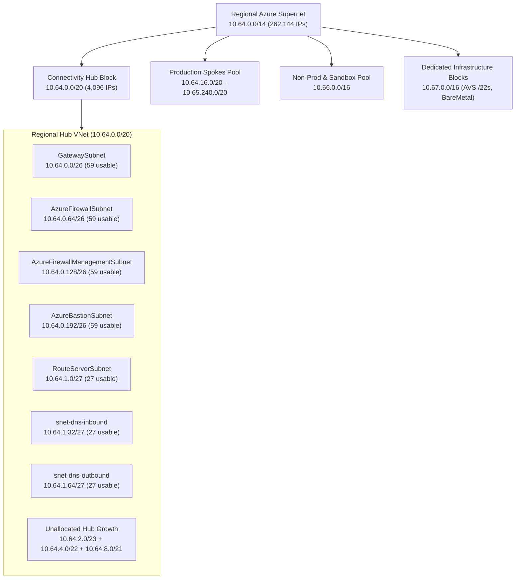

Address space mistakes are the most expensive defects in Azure networking. You can swap an Azure Firewall SKU, migrate from VPN to ExpressRoute, or replace custom DNS forwarders during a maintenance window, but fixing an undersized hub VNet or an overlapping `/16` across fifty production spokes requires IP renumbering, peering teardown, and multi-team outages.

Enterprise IP address management (IPAM) in Azure starts with two non-negotiable rules: **allocate regional, summarizable supernets** from your corporate IPAM before deploying a single VNet, and **size platform subnets for five-year gateway and scale-set growth**, never for day-one VM counts.

---

## Regional Supernet & Hub-Spoke CIDR Discipline

Treat every Azure region as a cleanly summarizable routing domain. When on-premises routers or [Virtual WAN Route Maps](/azure-networking/02-core-topologies/virtual-wan-and-routing-intent/) advertise Azure space back to corporate datacenters, a contiguous `/15` or `/16` per region collapses hundreds of spoke VNet prefixes into a single BGP summary route. Fragmented `/24` allocations scattered across non-contiguous RFC 1918 blocks quickly exhaust ExpressRoute and Azure Route Server prefix budgets.

### Avoiding the `/24` Hub Trap

The most common brownfield blocker is the `/24` connectivity hub. A `/24` provides only 256 raw IPv4 addresses—before Azure reserves **five IPs per subnet** (network address, default gateway `.1`, two Azure DNS mapping IPs `.2` and `.3`, and broadcast). Once you place `GatewaySubnet` (`/26`), `AzureFirewallSubnet` (`/26`), `AzureFirewallManagementSubnet` (`/26`), and `AzureBastionSubnet` (`/26`) into a `/24`, **100% of the VNet is consumed**. You have zero room left for `RouteServerSubnet` (`/27`), Azure DNS Private Resolver inbound/outbound subnets (two `/28`s), or NVA transit subnets.

:::caution[Address Space Expansion Caveats]
While Azure allows adding secondary CIDR blocks to an existing VNet—even while VNet peerings remain active (peering sync refreshes the remote route tables)—many organizations run out of contiguous IP space around their original `/24`, forcing fragmented non-summarizable prefixes onto every hub route table and firewall rule. Allocate at least a **`/20` (4,096 IPs) or `/19` (8,192 IPs)** for regional hub VNets, and at least a **`/23` or `/22`** for Virtual WAN hubs.
:::



---

## Mandatory Platform & Workload Subnet Sizing

Azure control-plane services enforce strict subnet names, minimum CIDR masks, and exclusive delegation rules. Under-sizing `GatewaySubnet` to `/28` or `/27` works for a lone VPN gateway today, then blocks coexisting ExpressRoute + S2S VPN gateways or zone-redundant `ErGwScale` upgrades tomorrow.

| Subnet / Workload Role | Exact Name / Delegation | Minimum Floor | Recommended Production Size | Architectural Rationale |
| --- | --- | --- | --- | --- |
| **VPN / ExpressRoute Gateways** | `GatewaySubnet` (exact) | `/27` (most SKUs) | **`/26`** | Required for coexisting ER + S2S VPN gateways and zone-redundant scale units (`ErGwScale`). Never attach an NSG to `GatewaySubnet`. |
| **Azure Firewall** | `AzureFirewallSubnet` (exact) | `/26` | **`/26`** | Mandatory `/26` accommodates underlying scale-out instances up to maximum throughput. |
| **Firewall Forced Tunnel Mgmt** | `AzureFirewallManagementSubnet` | `/26` | **`/26`** | Required for Azure Firewall Basic and any Standard/Premium firewall using forced tunneling (`0.0.0.0/0` to on-prem or upstream NVA). |
| **Azure Bastion** | `AzureBastionSubnet` (exact) | `/26` | **`/26`** | Mandatory `/26` from Standard SKU upward to support host scaling. |
| **Azure Route Server** | `RouteServerSubnet` (exact) | `/27` | **`/27`** | Mandatory `/27`; hosts redundant control-plane BGP endpoints. Zero data-plane traffic transits this subnet. |
| **DNS Private Resolver (In/Out)** | Delegated `Microsoft.Network/dnsResolvers` | `/28` per endpoint | **`/27` per endpoint** | Each inbound and outbound endpoint requires its own dedicated subnet (`/28` to `/24`). Up to 5 inbound and 5 outbound endpoints per resolver. |
| **Application Gateway v2** | Dedicated subnet (any name) | `/29` (small) | **`/24`** | Up to 125 autoscaling instances plus 5 Azure-reserved IPs and rolling platform update headroom. |
| **Private Endpoints (Spoke)** | Dedicated subnet (`RouteTableEnabled`) | `/28` | **`/24` to `/22`** | Every PaaS sub-resource (`blob`, `dfs`, `queue`, `sqlServer`) consumes a NIC IP; multi-region DR and AI/data estates consume hundreds of IPs rapidly. |
| **AKS Nodes (CNI Overlay)** | Node pool subnet | `/25` | **`/23` or `/22`** | Node IPs + max surge upgrade nodes (`maxSurge` buffer). Pod IPs come from a non-routed overlay CIDR. |
| **Azure VMware Solution (AVS)** | Separate `/22` block (not in VNet) | `/22` | **`/22` per cluster group** | Provisioned outside VNets; must be completely non-overlapping with Azure and on-premises space. See [AVS Networking](/azure-networking/05-workload-networking/avs-networking/). |

### AKS Address Preservation: Azure CNI Overlay vs. Flat Pod CIDRs

Historically, traditional Azure CNI assigned routable VNet subnet IPs to every Kubernetes pod—burning a `/19` (8,192 IPs) for a single mid-sized cluster and exhausting regional IPAM pools within months.

In modern landing zones, default to **Azure CNI Overlay powered by Cilium**. Only AKS worker nodes consume routable VNet IPs (for example, a `/23` subnet supporting ~500 nodes). Pods receive addresses from an isolated logical CIDR—commonly **`100.64.0.0/16` (RFC 6598 Carrier-Grade NAT space)**—which is NATed to the node's VNet IP when leaving the cluster and **reusable identically across every AKS cluster in your tenant**. Reserve flat VNet-routable pod subnets (Dynamic IP Allocation) strictly for rare workloads where external on-premises peers must initiate inbound connections directly to individual pod IPs without a Kubernetes `Service` load balancer. See [AKS Networking](/azure-networking/05-workload-networking/aks-networking/) for full data-plane guidance.

---

## IPv4 / IPv6 Dual-Stack Planning & Parity Gaps

Azure Virtual Networks support dual-stack IPv4/IPv6 addressing, allowing VMs and Standard Load Balancers to serve mobile, IoT, and public internet clients natively over IPv6 while maintaining IPv4 reachability to internal services. However, **Azure is not an IPv6-only cloud**, and dual-stack designs carry strict platform constraints that break hub-and-spoke assumptions if overlooked.

### Hard Dual-Stack Sizing & NIC Rules

1. **Every IPv6 subnet must be an exact `/64`**: Azure enforces `/64` per subnet for on-premises router compatibility. Request a `/48` or `/56` global unicast or ULA (`fd00::/8`) block per VNet so you can carve clean `/64` subnets aligned 1:1 with your IPv4 subnets (for example, `10.64.16.0/24` paired with `fd00:db8:64:10::/64`).
2. **No IPv6-only VMs or VMSS**: Every NIC attached to a dual-stack subnet must still hold a primary IPv4 configuration alongside its IPv6 configuration. IPv6-only compute does not save IPv4 VNet space on VMs.
3. **PaaS Coexistence Blockers**: Certain delegated PaaS services fail deployment if *any* IPv6 address space exists on the VNet—even if their specific delegated subnet is IPv4-only. Notably, **Azure Database for PostgreSQL Flexible Server** (VNet-injected mode) rejects VNets containing IPv6 prefixes; isolate such services in IPv4-only spoke VNets or connect via Private Link instead of VNet injection.

### Security & Routing Parity Hazards

Enabling IPv6 on a spoke VNet without auditing your security perimeter creates silent bypasses or broken connectivity:

- **Hub Inspection & Routing Services are IPv4-Only**: **Azure Firewall**, **Azure Virtual WAN**, **Azure Route Server**, **Azure NAT Gateway**, and **Azure DNS Private Resolver** do not process IPv6 data-plane traffic. `AzureFirewallSubnet` must remain IPv4-only even inside a dual-stack VNet. If you require centralized L7/IDS inspection of IPv6 traffic, you must deploy dual-stack third-party NVAs behind a dual-stack Standard Internal Load Balancer.
- **UDR Default Route Separation**: A User-Defined Route for `0.0.0.0/0` affects **IPv4 only**. It does not capture `::/0`. While Azure does not assign default outbound IPv6 internet access unless a VM has an instance-level IPv6 Public IP or sits behind an IPv6 Load Balancer, any dual-stack subnet with public IPv6 reachability needs an explicit `::/0` UDR pointing to a dual-stack NVA if inspection is mandated.
- **NSG Rule Separation & ICMPv6**: A single NSG supports both IPv4 and IPv6 rules, but you **cannot mix IPv4 and IPv6 prefixes inside the same security rule**. Furthermore, NSGs do not expose `ICMPv6` as a selectable protocol; blocking IPv6 `Any` without careful port scoping can disrupt Neighbor Discovery or Path MTU Discovery outside Azure's host fabric.

---

## Default Outbound Access Retirement & Explicit Egress

Historically, deploying a VM into an Azure subnet without a NAT Gateway, Load Balancer, or Public IP caused Azure to silently allocate an implicit, Microsoft-owned **default outbound access IP**. That implicit behavior violated Zero Trust principles, used ephemeral IPs that changed on VM stop/start, broke under SNAT port exhaustion, and failed to support ICMP or IP fragmentation.

**Starting with Azure Network API versions released after March 31, 2026 (and already default in the Azure Portal), newly created subnets set `defaultOutboundAccess: false` (Private Subnets) by default.** Existing VNets are not retroactively altered, and Virtual Machine Scale Sets in **Flexible orchestration mode** already enforce explicit outbound regardless of API version.

### The Service-Tag `Internet` UDR Trap in Private Subnets

A subtle outage hits platform teams migrating spoke subnets to `defaultOutboundAccess: false` while using centralized firewalls:

1. Your spoke subnet has `0.0.0.0/0 -> VirtualAppliance (Azure Firewall)` to inspect egress.
2. To save firewall data-processing costs or satisfy AKS/AVD/Backup control-plane requirements, an engineer adds a UDR for a Service Tag (for example, `AzureMonitor` or `Storage.WestEurope`) with **`nextHopType: Internet`**, expecting traffic to bypass the firewall.
3. **In a Private Subnet (`defaultOutboundAccess: false`), `nextHopType: Internet` fails with connection timeouts** unless the subnet also has an explicit public SNAT mechanism (such as an **Azure NAT Gateway**) attached! Without a NAT Gateway, the VM has no public source IP to egress directly to the Service Tag's public endpoints. (By contrast, **Virtual Network Service Endpoints** use `VirtualNetworkServiceEndpoint` and continue to work, though Private Endpoints remain preferred.)

:::caution[Clearing Legacy Default Outbound IPs Requires Deallocation]
Setting `--default-outbound false` on an existing subnet stops *new* VMs from receiving default outbound IPs, and attaching a NAT Gateway immediately shifts active egress to the NAT Gateway. However, existing running VMs retain `defaultOutboundConnectivityEnabled: true` on their NIC metadata—keeping Azure Advisor alerts active—until those VMs are **stopped and deallocated**.
:::

### Explicit Outbound Architecture Trade-Offs

| Outbound Method | SNAT Port Scalability | Static Customer-Owned IP | L7 FQDN Filtering / IDPS | Best Fit in Enterprise Landing Zones |
| --- | --- | --- | --- | --- |
| **Azure NAT Gateway** (Standard / Zone-Redundant) | **Up to 1,024,000 SNAT ports** (16 Public IPs × 64,512 ports dynamically shared, no pre-allocation waste) | Yes (Public IPs or `/28` Public IP Prefix) | No (L3/L4 egress SNAT only; pair with NSGs) | High-concurrency outbound API/webhook spokes, AKS clusters without forced tunneling, or attached **to `AzureFirewallSubnet`** to scale firewall SNAT beyond 2,496 ports/IP. |
| **Centralized Azure Firewall / NVA** (via `0.0.0.0/0` UDR) | 2,496 SNAT ports per firewall PIP (scales to **1,024,000 ports** when backed by NAT Gateway on `AzureFirewallSubnet`) | Yes | **Yes** (FQDN rules, TLS inspection, IDPS, Threat Intel) | Default enterprise landing zone pattern for regulated workloads requiring Zero Trust egress logging and L7 filtering. |
| **Standard Load Balancer Outbound Rules** | Manual static port pre-allocation per backend VM (prone to port exhaustion on scale-out) | Yes | No | Dual-stack **IPv6** outbound SNAT (where NAT Gateway is unavailable) or legacy symmetric ingress/egress frontends. |
| **Instance-Level Public IP on VM NIC** | 64,512 ports (single VM) | Yes | No | Perimeter edge appliances (DMZ NVAs, third-party SD-WAN/VPN concentrators). Never assign to application or database VMs. |

### Auditing Non-Private Subnets Across Subscriptions

Run this Azure Resource Graph query to identify spoke subnets across your estate that still permit implicit default outbound access (`defaultOutboundAccess` null or `true`):

```kusto
resources
| where type =~ 'microsoft.network/virtualnetworks'
| mv-expand subnet = properties.subnets
| extend subnetName = tostring(subnet.name),
         prefix = tostring(subnet.properties.addressPrefix),
         defaultOutbound = subnet.properties.defaultOutboundAccess,
         natGateway = tostring(subnet.properties.natGateway.id)
| where subnetName !in ('GatewaySubnet', 'AzureFirewallSubnet', 'AzureFirewallManagementSubnet', 'AzureBastionSubnet', 'RouteServerSubnet')
| where isnull(defaultOutbound) or tobool(defaultOutbound) == true
| project subscriptionId, resourceGroup, vnet = name, subnetName, prefix, defaultOutbound, hasNatGateway = isnotempty(natGateway)
```

---

:::tip[What I Recommend]
1. **Enforce Azure Virtual Network Manager (AVNM) IPAM Pools from Day One**: Assign non-overlapping `/15` or `/16` regional blocks into AVNM IPAM pools so spoke landing zone vending automatically claims clean `/24`–`/22` CIDRs without spreadsheet drift.
2. **Never Deploy a Hub Smaller Than `/20` (or `/23` for Virtual WAN)**: Carve `GatewaySubnet`, `AzureFirewallSubnet`, `AzureFirewallManagementSubnet`, and `AzureBastionSubnet` at `/26`, `RouteServerSubnet` at `/27`, and two `/27` subnets for [Azure DNS Private Resolver](/azure-networking/01-foundations/dns-and-private-resolver/) up front—even if some remain empty initially.
3. **Standardize on AKS CNI Overlay (`100.64.0.0/16`)**: Reclaim thousands of RFC 1918 addresses per region by decoupling pod CIDRs from VNet subnets.
4. **Set `defaultOutboundAccess: false` Everywhere via Azure Policy**: Pair private spoke subnets with `0.0.0.0/0` UDRs to your hub firewall, and attach an **Azure NAT Gateway** directly to `AzureFirewallSubnet` (or high-SNAT spokes) so you never suffer SNAT exhaustion or accidental implicit egress.
5. **Isolate Dual-Stack IPv6 to Edge/Ingress Spokes**: Until Azure Firewall, Virtual WAN, and Route Server support IPv6 natively, terminate public IPv6 at Azure Front Door, Application Gateway, or dedicated dual-stack edge spokes rather than enabling IPv6 indiscriminately across internal data-tier VNets.
:::
