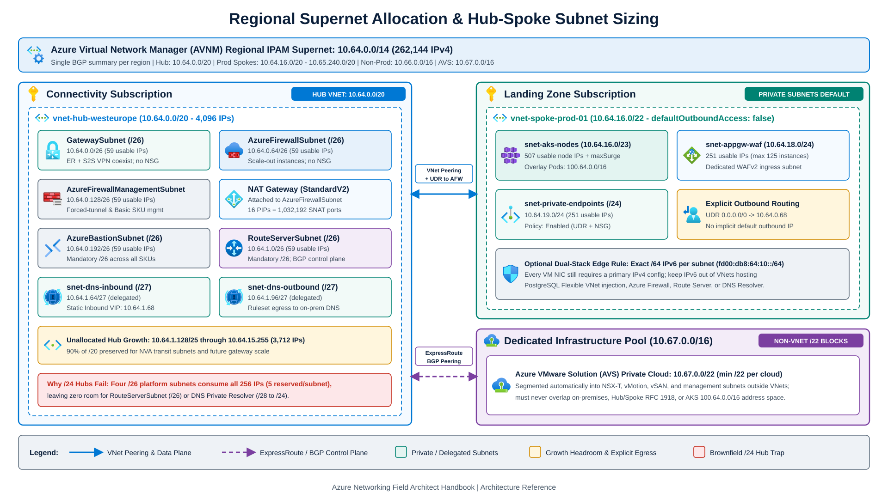
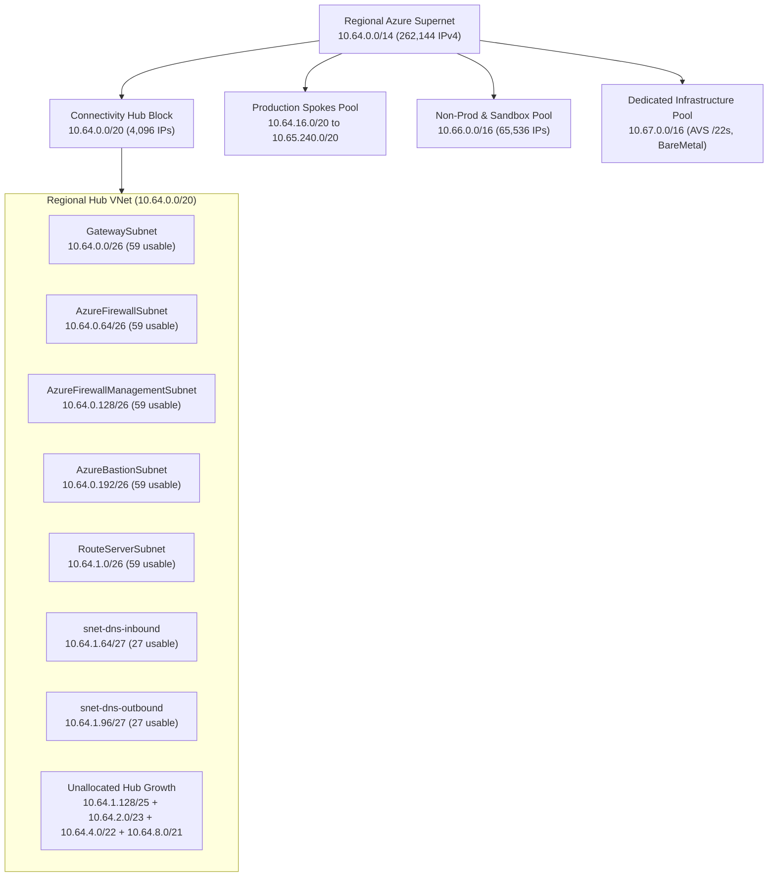

Address space mistakes are the hardest defects to fix in Azure networking. You can swap an Azure Firewall SKU, migrate from VPN to ExpressRoute, or replace custom DNS forwarders during a maintenance window, while fixing an undersized hub VNet or an overlapping `/16` across fifty production spokes forces IP renumbering, peering teardown, and coordinated application outages.

Enterprise IP address management (IPAM) in Azure rests on two rules. First, allocate regional, summarizable supernets from your corporate IPAM before deploying your first VNet. Second, size platform subnets for five-year gateway and scale-set growth rather than day-one VM counts.

---

## Regional supernet and hub-spoke CIDR discipline

Treat every Azure region as a summarizable routing domain. When on-premises routers, `summarizedGatewayPrefixes` on virtual network gateways, or [Virtual WAN Route Maps](/azure-networking/02-core-topologies/virtual-wan-and-routing-intent/) advertise Azure space back to corporate datacenters, a contiguous `/14`, `/15`, or `/16` per region collapses hundreds of spoke VNet prefixes into a single BGP summary route. Scattered `/24` allocations across non-contiguous RFC 1918 blocks quickly exhaust ExpressRoute's 1,000-prefix advertisement limit and Azure Route Server's prefix capacity.



### Avoiding the `/24` hub trap

The most common brownfield blocker is the `/24` connectivity hub. A `/24` contains 256 raw IPv4 addresses, and Azure reserves five IPs in every subnet (`.0` network address, `.1` default gateway, `.2` and `.3` Azure DNS mapping IPs, and `.255` broadcast). Once you place `GatewaySubnet` (`/26`), `AzureFirewallSubnet` (`/26`), `AzureFirewallManagementSubnet` (`/26`), and `AzureBastionSubnet` (`/26`) inside a `/24`, all 256 addresses are gone. Zero room remains for `RouteServerSubnet` (`/26`), [Azure DNS Private Resolver](/azure-networking/01-foundations/dns-and-private-resolver/) inbound and outbound subnets (`/28` to `/24` each), or NVA transit subnets.

:::caution[Address space expansion caveats]
Azure lets you append secondary CIDR blocks to an existing VNet while VNet peerings stay active, and peering sync refreshes the remote route tables. In practice, adjacent IP space around an original `/24` is usually already assigned elsewhere, which forces non-summarizable prefixes onto hub route tables and firewall rules. Allocate at least a **`/20` (4,096 IPs) or `/19` (8,192 IPs)** for customer-managed regional hub VNets. In Azure Virtual WAN, where the hub address space cannot be modified after creation and `/24` is the hard minimum, allocate at least a **`/23` or `/22`** per virtual hub.
:::



---

## Mandatory platform and workload subnet sizing

Azure platform services require exact case-sensitive subnet names, minimum CIDR masks, and exclusive delegations. Sizing `GatewaySubnet` at `/28` works only for a legacy Basic VPN gateway and blocks zone-redundant gateways, ExpressRoute + VPN coexistence, and 16-circuit `ErGw3Az` or `ErGwScale` deployments.

| Subnet or workload role | Exact name or delegation | Platform minimum | Recommended size | Architectural rationale |
| --- | --- | --- | --- | --- |
| **VPN and ExpressRoute gateways** | `GatewaySubnet` (exact) | `/27` (all non-Basic SKUs) | **`/26`** | Required for 16 ExpressRoute circuits (`ErGw3Az`, `ErGwScale` >= 10 scale units) and recommended for ER + S2S VPN coexistence. Never attach an NSG or `0.0.0.0/0` UDR. |
| **Azure Firewall** | `AzureFirewallSubnet` (exact) | `/26` | **`/26`** | Mandatory `/26` across all SKUs for backend scale-out instances (up to 30 Gbps Standard, 100 Gbps Premium). Subnet NSGs are unsupported. |
| **Firewall forced-tunnel management** | `AzureFirewallManagementSubnet` | `/26` | **`/26`** | Required for Azure Firewall Basic and any Standard or Premium firewall configured with forced tunneling (`0.0.0.0/0` to on-premises or an NVA). |
| **Azure Bastion** | `AzureBastionSubnet` (exact) | `/26` | **`/26`** | Mandatory `/26` for all dedicated Bastion deployments (Basic, Standard, and Premium) created on or after November 2, 2021. |
| **Azure Route Server** | `RouteServerSubnet` (exact) | `/26` | **`/26`** | Mandatory `/26` in current Portal, CLI, and PowerShell deployments. Hosts redundant BGP control-plane endpoints (`ASN 65515`); no NSG or UDR allowed. |
| **DNS Private Resolver (inbound / outbound)** | Delegated `Microsoft.Network/dnsResolvers` | `/28` per endpoint (`/24` max) | **`/27` per endpoint** | Each inbound and outbound endpoint requires its own dedicated subnet (`/28` to `/24`). Up to 5 inbound and 5 outbound endpoints per resolver. |
| **Application Gateway v2** | Dedicated subnet (any name) | Formula (`instances + 5 + 1 private IP`) | **`/24`** | Supports up to 125 autoscaling instances plus 5 Azure-reserved IPs, 1 private frontend IP, and rolling platform update headroom. |
| **Private Endpoints (spoke)** | Dedicated subnet (`privateEndpointNetworkPolicies: Enabled`) | `/28` | **`/24` to `/22`** | Every PaaS sub-resource (`blob`, `dfs`, `queue`, `sqlServer`) consumes one NIC IP. Multi-region DR and AI/data estates consume hundreds of IPs quickly. |
| **AKS nodes (Azure CNI Overlay)** | Node pool subnet (<= 63-char name) | Formula (`nodes + maxSurge + 5 reserved`) | **`/23` or `/22`** | Covers worker node IPs plus rolling upgrade `maxSurge` nodes and 5 Azure-reserved IPs. Each node receives a `/24` slice from the overlay pod CIDR (up to 250 pods/node). |
| **Azure VMware Solution (AVS)** | Separate `/22` block (outside VNet) | `/22` | **`/22` per private cloud** | Provisioned outside Azure VNets and carved into NSX-T, vMotion, and management segments. Must not overlap Azure or on-premises space. See [AVS Networking](/azure-networking/05-workload-networking/avs-networking/). |

### AKS address preservation with Azure CNI Overlay

Legacy flat Azure CNI assigned routable VNet subnet IPs to every Kubernetes pod, consuming a `/19` (8,192 IPs) for a single mid-sized cluster. Also note that AKS ends support for legacy `kubenet` on March 31, 2028.

Default new clusters to **[Azure CNI Overlay](https://learn.microsoft.com/en-us/azure/aks/concepts-network-azure-cni-overlay) with Azure CNI Powered by Cilium**. Only AKS worker nodes consume routable VNet subnet IPs (a `/23` subnet provides 507 usable IPs for nodes and upgrade surge). Pods draw from a logical overlay CIDR (default `10.244.0.0/16`, or **`100.64.0.0/16` from RFC 6598 shared space** when `10.x` is used on-premises). Azure CNI carves a fixed `/24` per node from that pod CIDR, routes pod-to-pod traffic without encapsulation overhead, and SNATs egress traffic to the node's primary VNet IP. You can reuse the exact same overlay pod CIDR across independent AKS clusters as long as it does not overlap with any VNet, peered network, or on-premises range. Keep flat VNet-routable pod subnets (`Azure CNI Pod Subnet`) only for workloads where external peers must initiate inbound connections directly to pod IPs without a Kubernetes `Service`. See [AKS Networking](/azure-networking/05-workload-networking/aks-networking/) for full cluster design.

---

## IPv4/IPv6 dual-stack planning and parity gaps

[IPv6 for Azure Virtual Network](https://learn.microsoft.com/en-us/azure/virtual-network/ipv6-overview) lets VMs, Virtual Machine Scale Sets, and Standard Load Balancers serve mobile, IoT, and public internet clients natively over IPv6 alongside internal IPv4 endpoints. Azure is not an IPv6-only cloud, however, and dual-stack networks carry strict sizing and service limits.

### Dual-stack sizing and NIC constraints

Every IPv6 subnet in Azure must be an **exact `/64`** so routes remain compatible with on-premises hardware routers if advertised over ExpressRoute Direct or VPN. Allocate a `/48` or `/56` global unicast or ULA (`fd00::/8`) block per dual-stack VNet so each `/64` maps cleanly to its IPv4 counterpart (for example, `10.64.16.0/24` paired with `fd00:db8:64:10::/64`).

IPv6-only VMs and Virtual Machine Scale Sets are not supported. Every NIC attached to a dual-stack subnet must retain at least one IPv4 IP configuration, so dual-stack mode does not reduce IPv4 consumption on compute nodes.

Check PaaS and container coexistence before adding an IPv6 prefix to an existing VNet. Azure Container Instances and Azure Container Apps do not support IPv6 container communication, and you cannot add an IPv6 range to a VNet that already contains resource navigation links. Most importantly, **Azure Database for PostgreSQL Flexible Server** (VNet-injected mode) blocks deployment into any VNet that defines an IPv6 address space, even when the delegated PostgreSQL subnet itself has only an IPv4 CIDR. Host VNet-injected PostgreSQL in an IPv4-only spoke or connect via Private Link instead.

### Security and routing parity hazards

Adding IPv6 to a spoke VNet without checking hub inspection and NSG behavior creates blind spots or outages:

#### Hub inspection and BGP services
**Azure Firewall**, **Azure Virtual WAN**, and **Azure DNS Private Resolver** process IPv4 traffic only (`AzureFirewallSubnet` and `Microsoft.Network/dnsResolvers` subnets must stay IPv4-only). **Azure Route Server** also supports IPv4 only, and deploying Route Server into a VNet that already has an IPv6 address space breaks IPv6 connectivity inside that VNet. Peering a dual-stack spoke to an IPv4 Route Server hub keeps IPv4 working while leaving IPv6 unsupported across the peering. For centralized L7/IDPS inspection of IPv6 traffic, deploy dual-stack third-party NVAs behind a dual-stack Standard Internal Load Balancer.

#### NAT Gateway SKU split for IPv6
Zonal **Standard** NAT Gateways support IPv4 only. Zone-redundant **[StandardV2 NAT Gateways](https://learn.microsoft.com/en-us/azure/virtual-network/nat-gateway/nat-gateway-resource)** support up to 16 IPv4 and 16 IPv6 StandardV2 public IPs (or prefixes), outbound ICMPv4/ICMPv6 ping, and NAT64 (`64:ff9b::/96` when paired with an external DNS64 server). StandardV2 NAT Gateways require StandardV2 public IPs and cannot upgrade in place from Standard SKU.

#### Separate default routes and NSG rules
A User-Defined Route for `0.0.0.0/0` matches IPv4 only and never captures `::/0`. Any dual-stack subnet with public IPv6 connectivity requires an explicit `::/0` UDR to a dual-stack NVA if outbound inspection is mandatory. Within NSGs, IPv4 and IPv6 prefixes cannot share the same security rule, `ICMPv6` is not an explicit selectable protocol, and IPv6 health probes on a dual-stack Load Balancer fail unless an active NSG is associated with the backend.

---

## Default outbound access retirement and explicit egress

Historically, deploying a VM into a subnet without a NAT Gateway, Load Balancer outbound rule, or instance-level Public IP caused Azure to assign an implicit, Microsoft-owned [default outbound access IP](https://learn.microsoft.com/en-us/azure/virtual-network/ip-services/default-outbound-access). Those ephemeral IPs changed without notice, lacked customer ownership, dropped ICMP pings and fragmented IP packets, and bypassed explicit Zero Trust egress design.

For Azure Network API versions released **after March 31, 2026** (and already by default in the Azure Portal), subnets in newly created VNets set **`defaultOutboundAccess: false`** (Private Subnets) by default. Existing VNets and deployments pinned to older ARM/Terraform API versions are not retroactively modified, while Virtual Machine Scale Sets in **Flexible orchestration mode** already omit default outbound IPs regardless of API version. Private subnet settings apply to VM and VMSS subnets; delegated and platform-managed PaaS subnets manage their own service-specific outbound paths.

```bash
# Explicitly harden an existing or new spoke subnet as a Private Subnet
az network vnet subnet update \
  --resource-group rg-prod-spoke-app \
  --vnet-name vnet-spoke-prod-01 \
  --name snet-app \
  --default-outbound false
```

### The Service Tag `Internet` UDR trap in Private Subnets

Teams migrating spoke subnets to `defaultOutboundAccess: false` behind a hub firewall regularly hit an unexpected connection failure when bypassing inspection with Service Tags:

1. The spoke subnet associates a route table with `0.0.0.0/0 -> VirtualAppliance (10.64.0.68)` for centralized firewall inspection.
2. An engineer adds a UDR for a Service Tag such as `AzureMonitor` or `AzureBackup` with **`nextHopType: Internet`** to bypass firewall processing fees.
3. In a Private Subnet (`defaultOutboundAccess: false`), **`nextHopType: Internet` fails** unless the subnet also has an explicit public SNAT method attached (such as an Azure NAT Gateway). Without default outbound access or a NAT Gateway, the VM has no public source IP to reach the Service Tag's public endpoints. By contrast, Service Endpoints use `nextHopType: VirtualNetworkServiceEndpoint` and continue to work, and same-region Azure Storage remains reachable on the Azure backbone unless restricted by NSG rules.

:::caution[Deallocation and NAT Gateway cutover caveats]
1. **Stop and deallocate existing VMs**: Setting `--default-outbound false` prevents new VMs from receiving default outbound IPs, while existing running VMs must be **stopped and deallocated** for the private-subnet change to take effect on their NICs (and to clear `defaultOutboundConnectivityEnabled` / Azure Advisor alerts). Also note a documented Load Balancer issue: IP-based backend pools still fall back to default outbound access unless a NAT Gateway is attached to the subnet.
2. **Plan a maintenance window when attaching `StandardV2` NAT Gateway**: Adding a [StandardV2 NAT Gateway](https://learn.microsoft.com/en-us/azure/nat-gateway/nat-sku) to a live subnet that already routes outbound via Azure Firewall, Load Balancer, or VM instance-level Public IPs can interrupt active connections while new connections cut over to the NAT Gateway. In dual-stack subnets, do not combine a `StandardV2` NAT Gateway with Load Balancer IPv6 outbound rules.
:::

### Explicit outbound architecture comparison

| Outbound method | SNAT port scalability | Customer-owned static IP | L7 FQDN filtering and IDPS | Best fit in enterprise landing zones |
| --- | --- | --- | --- | --- |
| **Azure NAT Gateway (`StandardV2` / `Standard`)** | **Up to 1,032,192 SNAT ports** per protocol (`16` PIPs x `64,512` ports dynamically pooled; up to 50k concurrent flows per PIP to the same destination and 2M total active connections) | Yes (StandardV2 or Standard PIPs / `/28` prefixes) | No (L3/L4 SNAT; pair with NSGs or hub firewall) | Default choice (`StandardV2` for multi-AZ + IPv4/IPv6 up to 100 Gbps) on high-concurrency spokes, or attached directly to **`AzureFirewallSubnet`** in hub-and-spoke VNets. |
| **Centralized Azure Firewall / NVA** (via `0.0.0.0/0` UDR) | `2,496` SNAT ports per firewall PIP *per backend VMSS instance* (minimum 2 instances = `4,992` ports/PIP, up to 250 PIPs; scales to **`1,032,192` ports** with NAT Gateway on `AzureFirewallSubnet`) | Yes | **Yes** (FQDN rules, TLS inspection, IDPS, Threat Intel) | Standard enterprise pattern for regulated workloads requiring egress audit logs and L7 filtering. Note: NAT Gateway cannot attach to a Virtual WAN secured hub; attach it to spoke subnets instead if needed. |
| **Standard Load Balancer outbound rules** | Manual static port pre-allocation per backend instance (risks exhaustion during scale-out) | Yes | No | Symmetric ingress/egress load-balanced pools where NAT Gateway is not deployed. |
| **Instance-level Public IP on VM NIC** | `64,512` ports (single VM only) | Yes | No | Perimeter DMZ appliances and third-party SD-WAN/VPN edge VMs. Never assign to application or database VMs. |

### Auditing non-private subnets with Azure Resource Graph

Run this query in Azure Resource Graph Explorer to list spoke subnets across your tenant where `defaultOutboundAccess` remains `null` or `true`:

```kusto
resources
| where type =~ 'microsoft.network/virtualnetworks'
| mv-expand subnet = properties.subnets
| extend subnetName = tostring(subnet.name),
         prefix = tostring(subnet.properties.addressPrefix),
         defaultOutbound = subnet.properties.defaultOutboundAccess,
         natGateway = tostring(subnet.properties.natGateway.id)
| where subnetName !in ('GatewaySubnet', 'AzureFirewallSubnet', 'AzureFirewallManagementSubnet', 'AzureBastionSubnet', 'RouteServerSubnet')
| where isnull(defaultOutbound) or tobool(defaultOutbound) == true
| project subscriptionId, resourceGroup, vnet = name, subnetName, prefix, defaultOutbound, hasNatGateway = isnotempty(natGateway)
```

---

:::tip[What I recommend]
1. **Assign regional supernets through Azure Virtual Network Manager (AVNM) IPAM pools.** Carve non-overlapping `/14`, `/15`, or `/16` regional blocks in AVNM so spoke vending claims clean `/24` to `/22` CIDRs automatically and hybrid gateways can advertise one summary route via `summarizedGatewayPrefixes` or Route Maps.
2. **Never deploy a regional hub VNet smaller than `/20` (or `/23` for a Virtual WAN hub).** Reserve `/26` each for `GatewaySubnet`, `AzureFirewallSubnet`, `AzureFirewallManagementSubnet`, `AzureBastionSubnet`, and `RouteServerSubnet`, plus two `/27` subnets for [Azure DNS Private Resolver](/azure-networking/01-foundations/dns-and-private-resolver/) before onboarding your first spoke.
3. **Standardize AKS on Azure CNI Overlay with Cilium (`100.64.0.0/16` or `10.244.0.0/16`).** Keep pod IPs out of routable RFC 1918 VNet space and migrate any remaining `kubenet` clusters well ahead of the March 31, 2028 retirement.
4. **Enforce `defaultOutboundAccess: false` on all non-delegated VM and VMSS workload subnets via Azure Policy.** Route spoke egress via `0.0.0.0/0` UDRs to your hub firewall, and attach a zone-redundant **StandardV2 NAT Gateway** to `AzureFirewallSubnet` during initial hub build (in customer-managed hubs) so outbound traffic scales to `1,032,192` SNAT ports without implicit Microsoft-owned IPs.
5. **Confine dual-stack IPv6 to internet-facing edge spokes.** Until Azure Firewall, Virtual WAN, Route Server, and DNS Private Resolver support IPv6 data paths, terminate external IPv6 at Azure Front Door, Application Gateway, or dedicated dual-stack ingress spokes rather than adding IPv6 prefixes to internal database or hub VNets.
:::

---

## References

- [Default outbound access in Azure and March 31, 2026 default change](https://learn.microsoft.com/en-us/azure/virtual-network/ip-services/default-outbound-access)
- [Azure NAT Gateway resource, SNAT ports, and NAT64](https://learn.microsoft.com/en-us/azure/nat-gateway/nat-gateway-resource)
- [Azure NAT Gateway SKUs (`Standard` vs. `StandardV2` limits and cutover notes)](https://learn.microsoft.com/en-us/azure/nat-gateway/nat-sku)
- [Integrate NAT Gateway with Azure Firewall in a hub-and-spoke network](https://learn.microsoft.com/en-us/azure/nat-gateway/tutorial-hub-spoke-nat-firewall)
- [Azure virtual networks and dedicated platform subnet sizing guide](https://learn.microsoft.com/en-us/azure/networking/design-guide/vnets-subnets)
- [Quickstart: Create an Azure Route Server (`RouteServerSubnet` `/26` requirement)](https://learn.microsoft.com/en-us/azure/route-server/quickstart-configure-route-server-cli)
- [About Azure Bastion configuration settings (`AzureBastionSubnet` `/26` requirement)](https://learn.microsoft.com/en-us/azure/bastion/configuration-settings)
- [About ExpressRoute virtual network gateways and `GatewaySubnet` sizing](https://learn.microsoft.com/en-us/azure/expressroute/expressroute-about-virtual-network-gateways)
- [What is IPv6 for Azure Virtual Network?](https://learn.microsoft.com/en-us/azure/virtual-network/ipv6-overview)
- [Overview of Azure CNI Overlay networking in AKS](https://learn.microsoft.com/en-us/azure/aks/concepts-network-azure-cni-overlay)

