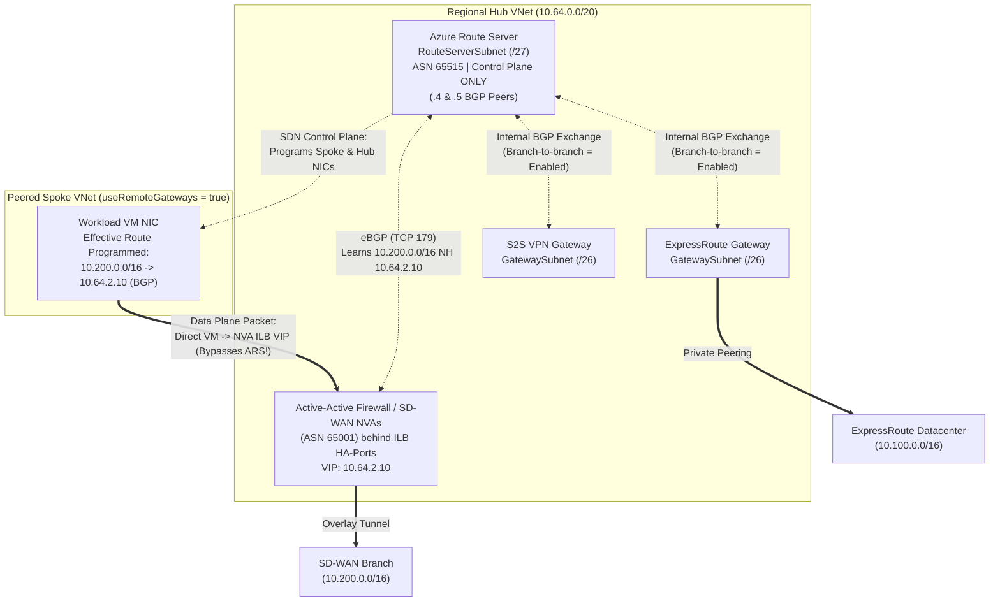

Customer-managed and AVNM-managed Hub-and-Spoke topologies give network architects complete control over subnet layout, dual-stack IPv4/IPv6 addressing, third-party NVA placement, and peering economics. That control comes with an explicit contract: **Azure will not automatically route transit traffic between two spokes or across two regional hubs for you**. Every transit hop must be engineered deliberately using VNet Peering flags, symmetric UDRs, AVNM Connected Groups, or **Azure Route Server (ARS)**.

---

## Single- and Multi-Region Hub-and-Spoke Mechanics

### The Non-Transitivity Rule & Gateway Transit Boundaries

VNet Peering (`VNetPeering` intra-region and `GlobalVNetPeering` cross-region) is **strictly non-transitive**: if Spoke A peers with Hub 1, and Spoke B peers with Hub 1, Spoke A and Spoke B cannot exchange a single packet unless a router or firewall inside Hub 1 forwards it (and IP forwarding is enabled on that appliance's NIC, or Azure Firewall is used).

Peering exposes two critical hybrid gateway flags that must be paired symmetrically:
- On the **Hub -> Spoke** peering: **`allowGatewayTransit: true`**
- On the **Spoke -> Hub** peering: **`useRemoteGateways: true`**

Observe three hard platform constraints on gateway transit:
1. **One Remote Gateway Hub per Spoke**: A spoke VNet can set `useRemoteGateways: true` on **at most one peering** (and cannot already contain its own `GatewaySubnet`).
2. **No Multi-Hop Gateway Chaining Across Regional Hubs**: If Spoke A (West Europe) uses Hub 1's gateway, and Hub 1 is globally peered to Hub 2 (North Europe), Spoke A **cannot** automatically use Hub 2's ExpressRoute/VPN gateway via `useRemoteGateways`. Cross-region hybrid failover goes either over ExpressRoute circuits dual-homed to both regional hubs (recommended; see [ExpressRoute Resiliency](/azure-networking/03-hybrid-connectivity/expressroute-resiliency/)) or through Hub 1's firewall -> Global VNet Peering -> Hub 2's firewall -> Hub 2's gateway via explicit UDRs.
3. **Global Peering + Internal Load Balancer Compatibility**: Standard SKU Internal Load Balancers (which front HA NVA clusters) fully support Global VNet Peering; Basic Load Balancers are retired/unsupported across global peerings.

### Multi-Region Hub-to-Hub Symmetric Inspection

In a two-region enterprise Hub-and-Spoke (for example, Hub 1 `10.64.0.0/20` summarizing Region 1 `10.64.0.0/14` and Hub 2 `10.68.0.0/20` summarizing Region 2 `10.68.0.0/14`):
- Peer Hub 1 <-> Hub 2 via **Global VNet Peering** (`allowForwardedTraffic: true` on both sides).
- Spoke subnets in Region 1 carry `0.0.0.0/0 -> Hub 1 Firewall (10.64.0.68)` (or explicit `10.0.0.0/8` RFC 1918 summary UDRs).
- `AzureFirewallSubnet` in Hub 1 carries a route table with `0.0.0.0/0 -> Internet` **plus** `10.68.0.0/14 -> Hub 2 Firewall (10.68.0.68)`.
- `AzureFirewallSubnet` in Hub 2 mirrors `10.64.0.0/14 -> Hub 1 Firewall (10.64.0.68)`.
- Both regional firewalls stay in the forward and return paths symmetrically without Private SNAT.

### AVNM Hub-and-Spoke vs. Connected Group Mesh

Managing `N` hub-spoke peerings and matching spoke route tables across hundreds of subscriptions via standalone Terraform state files creates cross-team pipeline locks. **Azure Virtual Network Manager (AVNM)** centralizes this at Management Group scope:

- **Hub-and-Spoke Connectivity Configuration**: Automatically maintains bi-directional VNet peerings for up to **1,000 spokes per hub**. Always set **`peeringEnforcement: Enforced`** so subscription owners cannot accidentally delete or tamper with hub peerings. *(Watch out: enabling "Use hub as a gateway" in AVNM before deploying a VPN/ER gateway in the hub causes the spoke-to-hub peering leg to fail provisioning.)*
- **Direct Connectivity (`ConnectedGroup` Mesh)**: Enabling *Direct connectivity* on a specific Spoke Network Group (for example, `ng-prod-data-mesh`) builds a platform-managed **Connected Group** (`nextHopType: ConnectedGroup`) directly among member VNets—scaling up to **250 VNets by default** (and **3,000 VNets / 20,000 Private Endpoints** with high-scale features enabled)—bypassing hub firewall bottlenecks for trusted intra-group east-west flows.
- **Guard Against Silent Overlap Drops**: By default, AVNM sets `ConnectedGroupAddressOverlap: Allowed` and silently drops traffic to overlapping CIDRs if someone adds a conflicting VNet to a mesh. **Always set `ConnectedGroupAddressOverlap: Disallowed`** so AVNM blocks overlapping VNets at configuration deployment time.

---

## Azure Route Server (ARS) Deep Dive

Before **Azure Route Server**, integrating third-party BGP-capable NVAs (SD-WAN headends, Palo Alto/Fortinet/Check Point firewalls, Linux FRR/BIRD routers) into a VNet required custom Failover API scripts that rewrote Azure Route Tables via ARM REST calls during NVA failovers—taking 1–3 minutes to converge and frequently hitting ARM throttling limits.

ARS solves this natively by acting as a **managed BGP route reflector (`ASN 65515`)** between your NVAs, your VNet's SDN control plane, and your VNet's ExpressRoute/VPN Gateways.

### Control Plane Only — Zero Data-Plane Packets

The most important mental model for ARS: **no workload packet ever passes through `RouteServerSubnet`**. ARS consists of two active-active control-plane instances inside a dedicated `/27` `RouteServerSubnet`. ARS speaks **TCP port 179 (BGP)** with your NVAs, learns their advertised prefixes + next-hop IPs, and programs those routes directly into the NIC effective route tables of every VM in the Hub VNet and directly peered Spoke VNets (`useRemoteGateways: true`).

### eBGP Peering Rules with NVAs

1. **Always Use eBGP with a Distinct Private ASN**: Azure Route Server is hardcoded to **`ASN 65515`**. Assign your NVA a distinct private 2-byte ASN (for example, `65001`–`65514`). Do not use Azure-reserved ASNs (`8074`, `8075`, `12076`, `65515`, `65517`–`65520`). If an NVA advertises any prefix whose `AS_PATH` already contains `65515`, ARS silently drops that route via standard BGP loop prevention.
2. **Peer Both ARS Instances & Enable eBGP Multihop**: Every ARS deployment exposes **two peer IPs** (typically `.4` and `.5` in `RouteServerSubnet`). Configure BGP sessions from every NVA instance to **both** ARS IPs. Because the NVA sits in a different subnet from `RouteServerSubnet`, enable **`ebgp-multihop` (TTL >= 2)** on your NVA BGP configuration so the TCP/179 session establishes cleanly.
3. **ARS `Branch-to-branch` Toggle (`allowBranchToBranchTraffic`)**:
   - **Disabled (default)**: ARS exchanges routes *only* between NVAs and the VNet/Spoke SDN fabric. ExpressRoute and S2S VPN gateways ignore ARS.
   - **Enabled**: ARS dynamically exchanges BGP prefixes between **ExpressRoute Gateways, S2S VPN Gateways, and your BGP NVAs**. Enabling `Branch-to-branch` unlocks three major enterprise patterns:
     - **Automated S2S VPN Failover for ExpressRoute** (ER and VPN gateways exchange routes dynamically).
     - **SD-WAN NVA <-> ExpressRoute Transit** (SD-WAN branches reach ExpressRoute datacenters or [Azure VMware Solution](/azure-networking/05-workload-networking/avs-networking/) through the hub).

### Next-Hop IP Programming & Active-Active Stateful NVA ECMP

ARS supports two distinct HA patterns for NVAs—picking the wrong one for stateful firewalls causes asymmetric packet drops:

- **Stateless Routers / SNATed SD-WAN Appliances -> Native BGP ECMP**: Up to **8 active-active NVA instances** can advertise the exact same prefix with their own individual NIC IPs as `NEXT_HOP`. ARS programs all equal-cost next-hops into VNet NICs using ECMP hashing. *Danger*: For **stateful east-west firewalls without SNAT**, ECMP across separate NVA NICs can hash forward `SYN` to NVA-1 and return `SYN-ACK` (from ExpressRoute or another spoke) to NVA-2, dropping the connection!
- **Stateful Firewalls & Azure Firewall -> BGP `NEXT_HOP` = ILB VIP (or AzFW IP)**: ARS honors explicit third-party BGP `NEXT_HOP` attributes!
  - **Third-Party Stateful NVA Cluster**: Place active-active NVAs behind a Standard Internal Load Balancer with **HA Ports** (`VIP: 10.64.2.10`), which hashes symmetric 5-tuples consistently, and set your NVA outbound route-map `set ip next-hop 10.64.2.10` toward ARS.
  - **Azure Firewall + Routing NVA (BIRD / FRR) Pattern**: Because Azure Firewall does not speak BGP natively, scenarios like [AVS internet/transit inspection](/azure-networking/05-workload-networking/avs-networking/) deploy two lightweight Linux VMs running BIRD/FRR (control plane only!) that peer with ARS and advertise `0.0.0.0/0` (or summary supernets) with **`NEXT_HOP = Azure Firewall Private IP`**. *(Critical loop guard: attach a UDR `0.0.0.0/0 -> Internet` on `AzureFirewallSubnet` so ARS does not program the firewall to route to itself!)* See runnable BIRD configs in our [Labs & Tools Guide](/azure-networking/06-operations-reviews/labs-and-tools-guide/).

### Hard Scale Limits & Guardrails

| Azure Route Server Resource / Metric | Platform Limit | Failure Mode When Exceeded |
| --- | --- | --- |
| **Max BGP peers per ARS** | **16** *(increased from the legacy 8-peer limit)* | Additional BGP peering creation rejected by ARM. |
| **Max routes advertised *per BGP peer* to ARS** | **4,000** | **Hard BGP session teardown!** Always enforce outbound prefix-lists / max-prefix guards on your NVA toward ARS. |
| **Max routes ARS + VNet advertise *toward ExpressRoute*** | **1,000** (when `Branch-to-branch` enabled) | Hits ExpressRoute circuit private-peering advertisement limit; summarize prefixes using **ARS Route Maps** before they hit ER. |
| **Max supported VNets (Hub + Peered Spokes)** | **500** (and up to **50,000 VMs** total) | Route programming latency or peering limits reached. |
| **Address Family Support** | **IPv4 only** | IPv6 prefixes cannot be exchanged or programmed by ARS. |

---

## The Classic `0.0.0.0/0` Advertisement Trap Over ExpressRoute

One of the most catastrophic production outages in Azure networking happens in less than ten seconds when an engineer combines three seemingly innocent settings:

1. Hub VNet has an **ExpressRoute Gateway** connected to corporate MPLS/datacenters.
2. Engineer deploys **Azure Route Server** with **`Branch-to-branch: Enabled`** so an SD-WAN or Firewall NVA can learn on-premises routes.
3. Engineer configures the Firewall NVA to advertise **`0.0.0.0/0`** to ARS so spoke VMs automatically send internet traffic to the firewall without UDRs.

**What immediately happens**: Because `Branch-to-branch` is enabled, ARS dutifully takes `0.0.0.0/0` from the NVA and **advertises `0.0.0.0/0` out the ExpressRoute Gateway to your on-premises core routers**! Within seconds, every datacenter, hospital, or factory on your corporate WAN that lacks an inbound default-route filter swings its entire internet egress across ExpressRoute into Azure—saturating your ExpressRoute circuit and blackholing corporate internet access!

### How to Prevent the `0.0.0.0/0` Hybrid Hijack

1. **Outbound Route Maps on ARS / Inbound BGP Filters On-Premises**: Configure an **Azure Route Server Route Map** (or inbound prefix-list on your on-premises CE/MSEE peerings) that explicitly **drops `0.0.0.0/0`** toward ExpressRoute and S2S VPN connections unless forced-tunneling from on-premises into Azure is an intentional, signed-off requirement (such as dedicated AVS private clouds).
2. **Use Spoke UDRs (via AVNM) for `0.0.0.0/0` Instead of ARS**: In standard Hub-and-Spoke designs, advertise only specific SD-WAN/extranet prefixes via ARS, and push `0.0.0.0/0 -> Firewall` to spoke subnets declaratively via AVNM UDR configurations. That way `0.0.0.0/0` never enters BGP at all.

---

:::tip[What I Recommend]
1. **Manage Hub-and-Spoke Peerings & UDRs with AVNM Above 20 Spokes**: Enable `peeringEnforcement: Enforced` and `ConnectedGroupAddressOverlap: Disallowed`. Use Connected Groups selectively for high-bandwidth, same-trust-zone spoke groups to eliminate unnecessary hub firewall hairpins.
2. **Use ILB HA-Ports (`NEXT_HOP = VIP`) Whenever Pairing ARS with Stateful NVAs**: Never let ARS program raw active-active stateful firewall NIC IPs via ECMP unless flows are SNATed; front the NVA pair with a zone-redundant Standard Internal Load Balancer and rewrite BGP `NEXT_HOP` to the ILB VIP.
3. **Enforce `max-prefix` and Block `0.0.0.0/0` Before Enabling `Branch-to-branch` on ARS**: Protect against accidental 4,000-route BGP session drops and never let an NVA leak `0.0.0.0/0` onto corporate ExpressRoute circuits without explicit outbound Route Map filters.
4. **Keep `RouteServerSubnet` (`/27`) and NVA Untrusted NICs Loop-Free**: Disable gateway route propagation (`disableBgpRoutePropagation: true`) on NVA internet/untrusted subnets, and place an explicit `0.0.0.0/0 -> Internet` UDR on `AzureFirewallSubnet` whenever BIRD/FRR NVAs inject default routes into ARS.
:::
