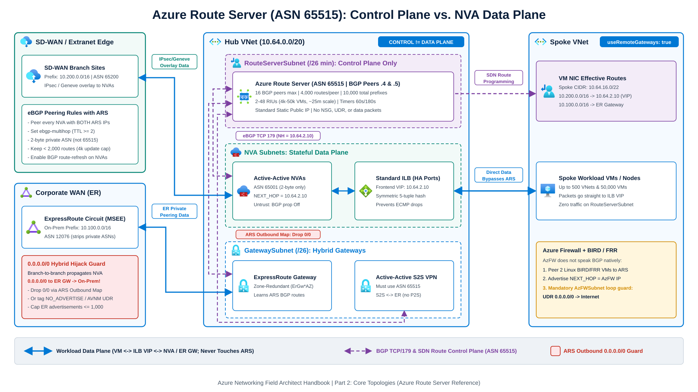
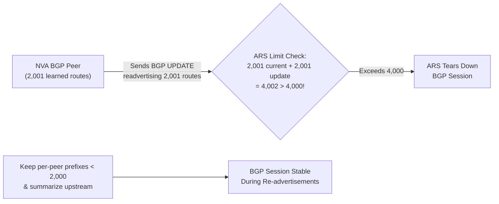

Customer-managed and [Azure Virtual Network Manager (AVNM)](https://learn.microsoft.com/en-us/azure/virtual-network-manager/overview) Hub-and-Spoke topologies give network teams direct control over subnet layout, dual-stack IPv4/IPv6 addressing, third-party Network Virtual Appliance (NVA) placement, and peering cost. In exchange, Azure does not automatically route transit packets between two spokes or across two regional hubs. Every transit hop must be configured explicitly through [virtual network peering](https://learn.microsoft.com/en-us/azure/virtual-network/virtual-network-peering-overview) flags, symmetric [user-defined routes (UDRs)](https://learn.microsoft.com/en-us/azure/virtual-network/virtual-networks-udr-overview), AVNM Connected Groups, or [Azure Route Server](https://learn.microsoft.com/en-us/azure/route-server/overview).

---

## Single- and multi-region Hub-and-Spoke mechanics

### Non-transitivity and gateway transit boundaries

Virtual network peering (`VNetPeering` within a region and `GlobalVNetPeering` across regions) is non-transitive. When Spoke A and Spoke B both peer with Hub 1, packets between Spoke A and Spoke B drop unless UDRs steer them to an IP-forwarding NVA or Azure Firewall inside Hub 1 and `allowForwardedTraffic: true` is set on the spoke peerings.

Sharing a hub ExpressRoute or VPN gateway with spokes requires symmetric gateway-transit flags:

- Set `allowGatewayTransit: true` on the Hub-to-Spoke peering.
- Set `useRemoteGateways: true` on the Spoke-to-Hub peering.

Three platform boundaries govern gateway transit:

1. A spoke VNet can enable `useRemoteGateways: true` on at most one peering and cannot contain its own `GatewaySubnet`.
2. Gateway transit does not chain across two peered regional hubs. If Spoke A in West Europe uses Hub 1's gateway and Hub 1 peers globally with Hub 2 in North Europe, Spoke A cannot traverse Hub 2's ExpressRoute or VPN gateway through `useRemoteGateways`. Cross-region hybrid failover instead uses ExpressRoute circuits connected directly to both regional hubs (see [ExpressRoute Resiliency](/azure-networking/03-hybrid-connectivity/expressroute-resiliency/)) or explicit UDR forwarding between Hub 1's firewall and Hub 2's firewall.
3. Standard SKU Internal Load Balancers (which front active-active NVA clusters) work across Global VNet Peering; retired Basic Load Balancers do not.

### Multi-region hub-to-hub symmetric routing

Consider a two-region design where Hub 1 (`10.64.0.0/20`) summarizes Region 1 (`10.64.0.0/14`) and Hub 2 (`10.68.0.0/20`) summarizes Region 2 (`10.68.0.0/14`):

1. Connect Hub 1 and Hub 2 with Global VNet Peering and set `allowForwardedTraffic: true` on both peerings.
2. Associate spoke subnets in Region 1 with a route table containing `0.0.0.0/0 -> 10.64.0.68` (Hub 1 Azure Firewall) or RFC 1918 summary routes.
3. Associate `AzureFirewallSubnet` in Hub 1 with a route table containing `0.0.0.0/0 -> Internet` and `10.68.0.0/14 -> 10.68.0.68` (Hub 2 Azure Firewall).
4. Associate `AzureFirewallSubnet` in Hub 2 with a mirrored route table containing `0.0.0.0/0 -> Internet` and `10.64.0.0/14 -> 10.64.0.68`.

Both regional firewalls remain in the forward and return paths symmetrically without requiring source NAT on private traffic.

### AVNM peering, UDR, and Security Admin Rule guardrails

Managing hundreds of spoke peerings and route tables across separate workload Terraform states creates pipeline contention. Deploying [AVNM at management-group scope](https://learn.microsoft.com/en-us/azure/virtual-network-manager/how-to-manage-user-defined-routes-multiple-hub-spoke-topologies) (supported on management groups with fewer than 15,000 subscriptions) centralizes connectivity, routing, and baseline L4 security:

#### Hub-and-Spoke connectivity and peering enforcement
An AVNM hub-and-spoke configuration maintains bi-directional peerings for up to 1,000 spokes per hub (compared with the 500 CAF baseline and 650 ARM standalone VNet peering limit). Set `peeringEnforcement: Enforced` so subscription owners cannot delete hub peerings. Deploy the hub's VPN or ExpressRoute gateway before you turn on "Use hub as a gateway" in AVNM, or spoke peering provisioning fails.

#### Automated UDR rule collections
[AVNM UDR management](https://learn.microsoft.com/en-us/azure/virtual-network-manager/concept-user-defined-routes) attaches managed `NM_*` route tables (up to 1,000 UDRs per route table) to target network groups of spoke VNets or hub `GatewaySubnet` and `AzureFirewallSubnet` subnets. Selecting "Import Azure firewall private IP address" in a routing rule populates the regional firewall next hop automatically as new spokes join dynamic Azure Policy network groups.

#### Connected Group overlap, scale, and BareMetal limits
A VNet can belong to up to two Connected Groups by default, and scaling a Connected Group past 250 VNets (to 3,000 in regional preview via `AllowHighScaleConnectedGroup`, or to 5,000 VNets and past 128,000 peered private IP addresses) requires Microsoft's [high-scale enablement and scaling forms](https://learn.microsoft.com/en-us/azure/virtual-network-manager/concept-limitations#limitations-for-connected-groups). By default, AVNM permits overlapping CIDRs inside a Connected Group and drops packets destined for overlapped addresses; set `ConnectedGroupAddressOverlap: Disallowed` so deployments reject conflicting VNets up front. Also watch external peerings: if a Connected Group member peers with an external VNet that overlaps another group member's CIDR, traffic to that range becomes unreachable across the rest of the group. BareMetal services ([Azure VMware Solution](/azure-networking/05-workload-networking/avs-networking/), Nutanix Cloud Clusters on Azure, Oracle Database@Azure, and Azure Payment HSM) cannot join Connected Groups and must attach through standard hub VNet gateways.

#### Security Admin Rules
[Security Admin Rules](https://learn.microsoft.com/en-us/azure/virtual-network-manager/concept-security-admins) evaluate at the VM vSwitch before spoke NSGs (up to 100 admin rules and 20,000 combined IP prefixes per AVNM instance). Use `Deny` to block high-risk inbound management ports (`TCP 3389`, `TCP 22`) from untrusted external ranges, `Allow` to pass traffic on to spoke NSGs for workload-level filtering, and `AlwaysAllow` sparingly for mandatory platform telemetry or scanner flows that spoke NSGs must not block. Avoid `Deny` rules between internal spoke CIDRs that still need hub-firewall-inspected communication, because Admin Rules drop matching destination prefixes at the source NIC before UDRs forward packets to the hub firewall. Note that `AzurePlatformDNS`, `AzurePlatformIMDS`, and `AzurePlatformLKM` service tags are unsupported in Security Admin Rules.

---

## Azure Route Server architecture

Integrating BGP-capable third-party NVAs (SD-WAN appliances, NGFW clusters, or Linux BIRD/FRR daemons) into a standard VNet without [Azure Route Server (ARS)](https://learn.microsoft.com/en-us/azure/route-server/overview) requires custom failover scripts that rewrite Azure Route Tables through ARM APIs and take minutes to converge. ARS replaces API polling with a zone-redundant, managed BGP control plane (`ASN 65515`).



### Control plane only: zero data-plane transit

No workload packet ever traverses `RouteServerSubnet`. ARS runs two active-active control-plane instances inside a dedicated `RouteServerSubnet` of `/26` or larger and requires a Standard static IPv4 public IP for certificate-authenticated Azure management access. ARS exchanges BGP routes over TCP port 179 with your NVAs and programs learned prefixes plus next-hop IPs directly into the SDN effective route tables of VMs in the hub VNet and peered spoke VNets (`useRemoteGateways: true`).

Do not attach an NSG, UDR table, or service endpoint policy to `RouteServerSubnet`; [ARS does not support them](https://learn.microsoft.com/en-us/azure/route-server/secure-route-server#network-security) and they can destabilize management communication. Also note that ARS BGP routes never override `VirtualNetwork`, `VNetPeering`, or `ServiceEndpoint` system routes, even when the BGP prefix is more specific; steering traffic between subnets inside the same VNet still requires UDRs.

### eBGP peering and gateway coexistence rules

Follow five rules from the [Azure Route Server FAQ](https://learn.microsoft.com/en-us/azure/route-server/route-server-faq) when peering NVAs and gateways:

1. Assign your NVA a distinct 16-bit (2-byte) ASN such as `65001` to `65514`. ARS is fixed to `ASN 65515`, does not support 32-bit (4-byte) ASNs, and rejects Azure-reserved ASNs (`8074`, `8075`, `12076`, `65515`, `65517` to `65520`) and IANA special-use ASNs (`23456`, `64496` to `64511`, `65535` to `65551`). Any route advertised to ARS with `65515` already in its `AS_PATH` is dropped by BGP loop prevention.
2. Peer every NVA instance with both ARS private IPs (typically `.4` and `.5` in `RouteServerSubnet`) so maintenance on one ARS instance never drops routing. Enable `ebgp-multihop` (TTL >= 2) on the NVA because ARS resides in its own subnet. ARS uses a 60-second keepalive and 180-second hold timer.
3. Ensure your NVA supports BGP route refresh. Adding a new hub-to-spoke VNet peering triggers an ARS BGP soft reset toward all peered NVAs; if an NVA lacks route-refresh capability, ARS falls back to a hard BGP reset and briefly disrupts transit traffic.
4. Configure coexisting Azure VPN Gateways in active-active mode with `ASN 65515` (BGP does not have to be enabled on the VPN gateway itself to exchange routes with ARS). Schedule a 60-minute maintenance window when creating or deleting ARS in a VNet that already contains an ExpressRoute or VPN gateway, as existing gateways experience roughly 10 minutes of downtime.
5. Turn on `Branch-to-branch` (`allowBranchToBranchTraffic: true`) when ARS must exchange routes among NVAs, ExpressRoute gateways, and S2S VPN gateways. `Branch-to-branch` supports transit between ExpressRoute and S2S VPN, not Point-to-Site (P2S) VPN. Also note that NVA-advertised routes do not propagate from one ARS VNet through an ExpressRoute MSEE bow-tie into a second ARS VNet; the second ARS drops them.

### Stateful NVA high availability vs. native ECMP

ARS handles multiple NVA peers differently depending on `AS_PATH` length and `NEXT_HOP`:

- For stateless routers or source-NATed SD-WAN headends, multiple active-active NVAs can advertise the same prefix with equal `AS_PATH` length and their own NIC IPs as `NEXT_HOP`. ARS programs equal-cost multi-path (ECMP) next hops onto VM NICs. Do not use raw NIC ECMP for stateful east-west firewalls without SNAT, because forward `SYN` and return `SYN-ACK` packets hash independently and drop asymmetric flows.
- For stateful third-party NGFW clusters, place the active-active NVA pair behind a zone-redundant Standard Internal Load Balancer configured with HA Ports (`VIP: 10.64.2.10`) and set the NVA outbound BGP route-map next hop to `10.64.2.10`. ARS preserves third-party BGP `NEXT_HOP` attributes so forward and return 5-tuples stay symmetric on the ILB. Add a UDR on NVA subnets for `RouteServerSubnet` with next hop `VirtualNetwork` so BGP control-plane TCP/179 packets never hairpin through another firewall.
- For Azure Firewall (which does not run BGP natively) in scenarios such as [AVS transit inspection](/azure-networking/05-workload-networking/avs-networking/), deploy two small Linux VMs running BIRD or FRR that peer with ARS and advertise `0.0.0.0/0` or summary supernets with `NEXT_HOP` set to the Azure Firewall private IP. Attach a UDR with `0.0.0.0/0 -> Internet` on `AzureFirewallSubnet` so ARS does not program Azure Firewall to route Internet traffic back to itself. Runnable BIRD configurations are available in the [Labs & Tools Guide](/azure-networking/06-operations-reviews/labs-and-tools-guide/).

### ARS scale limits and the 4,000-route update calculation

| Azure Route Server Metric | Platform Limit | Operational Behavior When Exceeded |
| --- | --- | --- |
| **Subnet minimum size** | `/26` (`RouteServerSubnet`) | Smaller prefixes fail validation or block platform scaling; no NSG or UDR allowed |
| **Max BGP peers per ARS** | 16 (raised from legacy 8) | ARM rejects additional BGP peering resources |
| **Max routes advertised per BGP peer** | 4,000 (current + update) | Immediate BGP session teardown; see update calculation note below |
| **Max routes advertised toward ExpressRoute** | 1,000 (`Branch-to-branch` enabled) | Exceeds ExpressRoute private-peering ceiling; summarize via [ARS Route Maps](https://learn.microsoft.com/en-us/azure/route-server/route-maps-about) or tag `NO_ADVERTISE` |
| **Max total prefixes (on-premises + VNet)** | 10,000 | Additional prefixes are not programmed |
| **Supported VNets, VMs, and RIUs** | 500 VNets; 50,000 VMs across 2 to 48 RIUs | Default 2 RIUs support 4,000 VMs; scale via `virtualRouterAutoScaleConfiguration.minCapacity` (+1,000 VMs/RIU; scale-out takes up to 25 minutes) |
| **Address family** | IPv4 GA ([dual-stack in regional preview](https://learn.microsoft.com/en-us/azure/route-server/route-maps-dual-stack-portal)) | Deploying GA IPv4 ARS in a dual-stack VNet breaks IPv6 inside that VNet |



Pay close attention to [how ARS calculates the 4,000-route limit](https://learn.microsoft.com/en-us/azure/route-server/route-server-faq#how-is-the-4000-route-limit-calculated-on-a-bgp-peering-session-between-an-nva-and-azure-route-server): during a BGP update, ARS sums the routes already learned from that peer plus the routes carried in the incoming update message. If an NVA advertises 2,001 prefixes and later re-advertises those same 2,001 prefixes in one BGP update, ARS evaluates `2,001 + 2,001 = 4,002` and drops the BGP session. Keep per-peer route counts below 2,000 prefixes and enforce outbound `max-prefix` and summarization policies on the NVA.

---

## Preventing `0.0.0.0/0` leaks onto ExpressRoute

A frequent hybrid outage occurs when three settings meet in the same hub VNet:

1. An ExpressRoute gateway connects the hub VNet to corporate MPLS or datacenter routers.
2. ARS runs with `Branch-to-branch` enabled so an NVA and ExpressRoute exchange routes.
3. A firewall NVA advertises `0.0.0.0/0` to ARS so spoke VMs send Internet traffic to the firewall without UDRs.

With `Branch-to-branch` enabled, ARS propagates `0.0.0.0/0` to the ExpressRoute gateway, which advertises `0.0.0.0/0` over ExpressRoute Private Peering to on-premises routers. Any corporate site lacking an inbound default-route filter immediately shifts its Internet egress over ExpressRoute into Azure and saturates circuits or drops traffic.

Use three layered defenses to prevent accidental default-route leaks:

1. Push `0.0.0.0/0 -> Firewall` to spoke subnets via AVNM UDR configurations instead of advertising `0.0.0.0/0` into ARS whenever hybrid ExpressRoute circuits share the hub without intentional on-premises forced tunneling.
2. Tag NVA-originated routes that should program VNet NICs without leaving Azure using the BGP `NO_ADVERTISE` community (`65535:65282`), which ARS honors by suppressing propagation to other BGP peers including ExpressRoute.
3. Apply an outbound [ARS Route Map](https://learn.microsoft.com/en-us/azure/route-server/route-maps-about) on the ExpressRoute connection to drop `0.0.0.0/0` and summarize spoke CIDRs below 1,000 prefixes (note that Route Maps incur extra charges, creating the first map triggers a one-time ~30-minute ARS upgrade, and creation fails if a coexisting VPN gateway has a P2S configuration). Pair this with inbound prefix-list filters on your on-premises Customer Edge routers.

### Inspecting ARS routes with Azure CLI

Verify learned and advertised prefixes before you turn on `Branch-to-branch` in production using [Azure CLI (`virtual-wan` extension)](https://learn.microsoft.com/en-us/azure/route-server/view-route-server-effective-routes):

```bash
# Check prefixes ARS learned from a specific NVA peer
az network routeserver peering list-learned-routes \
  --resource-group rg-hub-weu \
  --routeserver ars-hub-weu \
  --name nva-fw-01 -o table

# Check prefixes ARS advertises back to that NVA peer
az network routeserver peering list-advertised-routes \
  --resource-group rg-hub-weu \
  --routeserver ars-hub-weu \
  --name nva-fw-01 -o table

# Inspect overall ARS effective routes (uses the virtualHubs resource API)
az network vhub get-effective-routes \
  --resource-group rg-hub-weu \
  --name ars-hub-weu -o json
```

:::tip[Architecture recommendations]
1. Use AVNM with `peeringEnforcement: Enforced` and `ConnectedGroupAddressOverlap: Disallowed` once a hub-and-spoke estate exceeds 20 to 30 spokes, and manage spoke and `AzureFirewallSubnet` route tables through AVNM UDR rule collections.
2. Allocate at least a `/26` `RouteServerSubnet` with no NSG or UDR, peer every NVA with both ARS IP addresses over `ebgp-multihop`, and pre-scale `virtualRouterAutoScaleConfiguration.minCapacity` above 2 RIUs whenever connected spoke VMs exceed 4,000.
3. Front stateful active-active NVAs with a zone-redundant Standard ILB (`HA Ports`) and set BGP `NEXT_HOP` to the ILB VIP rather than exposing individual stateful firewall NICs to ECMP.
4. Keep per-peer NVA advertisements below 2,000 prefixes to avoid the 4,000-route transient update teardown, and block `0.0.0.0/0` toward ExpressRoute using `NO_ADVERTISE`, ARS outbound Route Maps, or AVNM UDRs.
:::

## References

- [What is Azure Route Server?](https://learn.microsoft.com/en-us/azure/route-server/overview)
- [Azure Route Server frequently asked questions and limits](https://learn.microsoft.com/en-us/azure/route-server/route-server-faq)
- [Azure Route Server capacity and Routing Infrastructure Units](https://learn.microsoft.com/en-us/azure/route-server/route-server-capacity)
- [Secure your Azure Route Server deployment](https://learn.microsoft.com/en-us/azure/route-server/secure-route-server)
- [About route maps for Azure Route Server](https://learn.microsoft.com/en-us/azure/route-server/route-maps-about)
- [Manage UDRs across multiple hub-and-spoke topologies with AVNM](https://learn.microsoft.com/en-us/azure/virtual-network-manager/how-to-manage-user-defined-routes-multiple-hub-spoke-topologies)
- [Limitations with Azure Virtual Network Manager](https://learn.microsoft.com/en-us/azure/virtual-network-manager/concept-limitations)
- [Security admin rules in Azure Virtual Network Manager](https://learn.microsoft.com/en-us/azure/virtual-network-manager/concept-security-admins)
