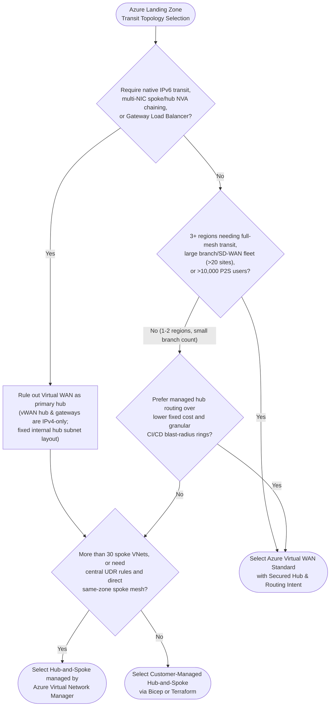
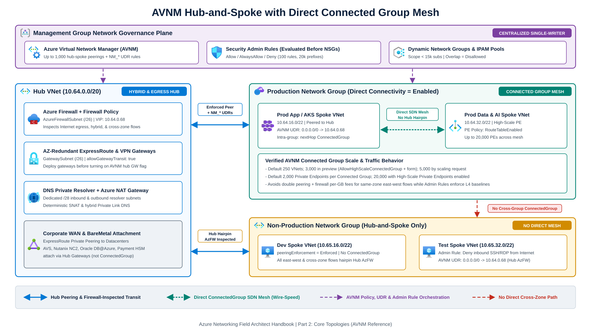

Selecting a transit topology is an early, high-consequence decision in an [Azure Landing Zone](https://learn.microsoft.com/en-us/azure/cloud-adoption-framework/ready/azure-best-practices/hub-spoke-network-topology). Migrating between a customer-managed hub-and-spoke network and [Azure Virtual WAN](https://learn.microsoft.com/en-us/azure/virtual-wan/virtual-wan-about) after dozens of production subscriptions are active requires deleting virtual network peerings, rebuilding ExpressRoute and VPN connections, replacing route tables, and scheduling maintenance outages.

Enterprise teams choose among three production operating models depending on regional count, Network Virtual Appliance (NVA) requirements, IPv6 plans, and platform automation maturity:

1. Customer-managed Hub-and-Spoke uses Bicep or Terraform to manage [virtual network peerings](https://learn.microsoft.com/en-us/azure/virtual-network/virtual-network-peering-overview), [user-defined routes (UDRs)](https://learn.microsoft.com/en-us/azure/virtual-network/virtual-networks-udr-overview), Azure Firewall or third-party NVAs, and optional [Azure Route Server](/azure-networking/02-core-topologies/hub-spoke-and-route-server/).
2. AVNM-managed Hub-and-Spoke layers [Azure Virtual Network Manager](https://learn.microsoft.com/en-us/azure/virtual-network-manager/overview) onto standard virtual networks to automate hub-spoke peerings, [UDR rule collections](https://learn.microsoft.com/en-us/azure/virtual-network-manager/concept-user-defined-routes), direct spoke-to-spoke meshes (`ConnectedGroup`), [IP Address Management (IPAM) pools](https://learn.microsoft.com/en-us/azure/virtual-network-manager/concept-ip-address-management), and [Security Admin Rules](https://learn.microsoft.com/en-us/azure/virtual-network-manager/concept-security-admins).
3. Azure Virtual WAN Standard runs a Microsoft-managed regional and global transit hub (`ASN 65515`) that integrates Site-to-Site (S2S) VPN, Point-to-Site (P2S) User VPN, ExpressRoute, certified SD-WAN or firewall NVAs, and [Routing Intent and Route Maps](/azure-networking/02-core-topologies/virtual-wan-and-routing-intent/). Virtual WAN Basic supports S2S VPN inside a single hub without inter-hub or VNet-to-VNet transit and is unsuitable for enterprise landing zones.

---

## Topology decision flow

Evaluate hard protocol and appliance constraints first, then weigh global branch scale against operating cost and deterministic change control.

---

## Architecture comparison matrix

Every row below reflects current [Azure subscription and service limits](https://learn.microsoft.com/en-us/azure/azure-resource-manager/management/azure-subscription-service-limits) and documented platform behavior.

| Dimension | Customer-Managed Hub-and-Spoke | Hub-and-Spoke with AVNM | Azure Virtual WAN (Standard) |
| --- | --- | --- | --- |
| **Spoke scale per hub** | 500 CAF baseline (650 ARM max VNet peerings per VNet) | Up to 1,000 spoke VNets peered per hub (`< 15,000` subscriptions per AVNM policy scope); 250 VNets per Connected Group by default (3,000 in regional preview via `AllowHighScaleConnectedGroup` + form; 5,000 or `> 128k` peered IPs by scaling request) | `500 - N_hubs` VNet connections per hub without Routing Intent; 600 directly connected VNet address spaces per hub with Private Routing Intent (add a new hub above 540) |
| **Private Endpoint scale** | 1,000 per VNet and 4,000 across peered VNets (5,000 per VNet and 20,000 peered with [High-Scale Private Endpoints](https://learn.microsoft.com/en-us/azure/private-link/increase-private-endpoint-vnet-limits)) | 2,000 per Connected Group by default; up to 20,000 across a Connected Group with High-Scale Private Endpoints (`Enabled` or `RouteTableEnabled`) | Bounded by hub route limit (10,000 routes); requires `RouteTableEnabled` or `Enabled` on spoke PE subnets when Private Routing Intent is active |
| **East-west spoke transit** | Hairpins through hub firewall or NVA via UDRs (`VNetPeering` is non-transitive) | Hairpins through hub firewall, or routes directly inside a trusted group via `ConnectedGroup` mesh | Managed by Virtual Hub Router (`defaultRouteTable`), or steered directly to the hub security appliance via Routing Intent |
| **Inter-region transit** | Global VNet Peering between regional hubs plus summary UDRs between regional firewalls | Global VNet Peering between hubs, or cross-region `ConnectedGroup` mesh for same-zone spokes | Built-in full-mesh hub-to-hub backbone (up to 50 Gbps aggregate VNet-to-VNet router throughput) |
| **BGP and ASN control** | Fixed `ASN 65515` on Azure Route Server, VPN, and ER gateways; custom 2-byte ASNs on self-managed NVAs | Same as customer-managed Hub-and-Spoke | Hub router fixed at `ASN 65515` (inter-hub prepends `65520 65520`); [Hub Routing Preference](https://learn.microsoft.com/en-us/azure/virtual-wan/about-virtual-hub-routing-preference) and [Route Maps](https://learn.microsoft.com/en-us/azure/virtual-wan/route-maps-about) |
| **Firewall and NVA options** | Unrestricted: Azure Firewall, multi-NIC NVAs, Gateway Load Balancer, Standard ILB HA-Ports | Unrestricted on the hub VNet; pairs with non-overridable Security Admin Rules | Azure Firewall, Palo Alto Cloud NGFW SaaS, or [certified in-hub NVAs](https://learn.microsoft.com/en-us/azure/virtual-wan/about-nva-hub) (Routing Intent next hop supports Check Point, Fortinet, and Cisco NGFW/dual-role NVAs) |
| **IPv6 support** | Supported across dual-stack VNets, peerings, UDRs, NSGs, dual-stack ER/AZ VPN gateways, and 3P NVAs (AzFW and ARS dual-stack are in preview) | Supported across dual-stack VNets and IPAM pools | IPv4 only; hub and gateways drop IPv6, and on-premises IPv6 advertisements break IPv4 connectivity |
| **Hub router capacity and scale-out** | No central hub software router for VNet peering; firewall or NVA scales per SKU | No central router on `VNetPeering` or `ConnectedGroup` data path | 2 to 50 Routing Infrastructure Units (3 to 50 Gbps, 2,000 to 50,000 VMs); scale-out takes up to 25 minutes |
| **Operational blast radius** | Scoped per route table or peering | Management-group scope; a broad dynamic Network Group or routing rule can alter hundreds of spokes at once | Hub-wide or WAN-wide; removing Routing Intent resets connections to `Default` propagation without restoring old routes |
| **Cost structure** | Gateways, firewall/NVA, and VNet peering only | Peering/Connected Group plus per-managed-subscription AVNM fee; avoids hub firewall fees for intra-group mesh traffic | Base hub fee, RIUs, connection units, VNet peering, firewall fees, and hub router per-GB fees (router per-GB fee is waived on flows steered by Routing Intent) |

---

## Trade-off analysis

### Hub hairpinning versus AVNM Connected Groups

Sending intra-zone east-west traffic through a central hub firewall (for example, an AKS compute spoke streaming telemetry or embeddings to a sibling storage spoke in the same `Production` zone) incurs both inbound and outbound VNet peering charges plus per-GB firewall data-processing charges and adds an extra hop.

[AVNM connectivity configurations](https://learn.microsoft.com/en-us/azure/virtual-network-manager/concept-connectivity-configuration) separate trusted intra-zone east-west traffic from cross-zone and hybrid inspection.

Production spokes peer with the regional Hub VNet for hybrid ExpressRoute/VPN connectivity, Internet egress, and cross-zone inspection through Azure Firewall (`0.0.0.0/0 -> 10.64.0.68`). When you turn on Direct Connectivity for the `Production` spoke network group, AVNM also places those VNets into a `ConnectedGroup` (`nextHopType: ConnectedGroup`). Intra-group packets travel directly between spokes without hairpins through the hub firewall, while AVNM Security Admin Rules enforce baseline L4 guardrails ahead of spoke NSGs. Non-production spokes use a hub-and-spoke-only group without Direct Connectivity, so every cross-environment flow hairpins through the hub firewall. See [Hub-and-Spoke, AVNM & Azure Route Server](/azure-networking/02-core-topologies/hub-spoke-and-route-server/) for peering enforcement, UDR rule collections, and BareMetal exclusions ([Azure VMware Solution](/azure-networking/05-workload-networking/avs-networking/), Nutanix NC2, Oracle Database@Azure, and Azure Payment HSM).

### Virtual WAN router cost and scale-out versus Routing Intent

Standard Virtual WAN hubs introduce two cost and capacity mechanics that differ from native VNet peering:

- Without Routing Intent, VNet-to-VNet and inter-hub transit passes through the [Virtual Hub Router](https://learn.microsoft.com/en-us/azure/virtual-wan/hub-settings#virtual-hub-capacity), which incurs per-GB router data-processing fees and requires up to 25 minutes to autoscale additional Routing Infrastructure Units (RIUs) above its 3 Gbps / 2,000-VM default.
- With [Routing Intent](https://learn.microsoft.com/en-us/azure/virtual-wan/how-to-routing-policies#considerations) enabled on a Secured Virtual Hub, Azure SDN steers VNet and branch traffic directly to the hub security appliance, waiving Virtual Hub Router per-GB data-processing fees (VNet peering and firewall data-processing fees still apply, and RIUs must still cover total connected spoke VMs). See [Virtual WAN, Routing Intent & Route Maps](/azure-networking/02-core-topologies/virtual-wan-and-routing-intent/) for RIU sizing, `/22` Secured Hub addressing, and SNAT planning.

### Where Virtual WAN Standard fits best

Maintaining custom BGP route reflectors and full-mesh regional UDR matrices across four or more Azure regions creates fragile operational overhead. [Virtual WAN Standard](https://learn.microsoft.com/en-us/azure/networking/design-guide/virtual-wan) is the stronger fit when:

- Three or more Azure regions require full-mesh transit across ExpressRoute circuits, S2S VPN branches, and regional spokes without maintaining $O(N^2)$ Global VNet Peerings and regional summary UDRs.
- Branch connectivity exceeds standard VNet VPN Gateway tunnel limits (100 tunnels max on `VpnGw*`) and requires up to 1,000 S2S branch connections (20 Gbps aggregate) or 100,000 P2S users (200 Gbps aggregate) per virtual hub.
- Security teams want declarative private and Internet inspection across spokes, branches, and inter-hub links via Secured Virtual Hub Routing Intent without managing per-subnet UDRs in spoke subscriptions.

### Attaching a specialized DMZ or services VNet to Virtual WAN

Enterprise estates rarely fit inside a managed virtual hub alone. Organizations that standardize on Virtual WAN globally often attach a dedicated services or DMZ spoke VNet to each regional virtual hub to host resources that cannot deploy inside a virtual hub, including Azure DNS Private Resolver, Azure Bastion, NAT Gateway, Application Gateway, multi-NIC ADCs, or partner extranet IPsec appliances. Keep static route entries minimal on that spoke connection; see the [Virtual WAN Architecture FAQ](/azure-networking/06-operations-reviews/vwan-architecture-faq/) for peering and BGP options.

---

## Validation labs and review checklists

Deploy a multi-spoke Virtual WAN environment with Bicep and inspect effective routes using the [Virtual WAN Playground Lab on GitHub](https://github.com/jonathan-vella/azure-networking/tree/main/labs/virtual-wan-playground) and the [Labs & Tools Guide](/azure-networking/06-operations-reviews/labs-and-tools-guide/). For architecture sign-off, audit designs against the [Virtual WAN Review Checklist](/azure-networking/06-operations-reviews/vwan-review-checklist/) and [Virtual WAN Review Addendum](/azure-networking/06-operations-reviews/vwan-review-addendum/).

:::tip[Architecture recommendations]
1. Choose AVNM-managed Hub-and-Spoke when operating in 1 or 2 regions, optimizing fixed transit cost, running dual-stack IPv6 workloads, or chaining custom multi-NIC NVAs. Size regional Hub VNets at `/20` or larger, enforce hub peerings via AVNM, and use Connected Groups selectively for high-throughput, same-trust-zone spoke traffic.
2. Choose Azure Virtual WAN Standard when operating across 3 or more regions with any-to-any hybrid transit, large S2S/SD-WAN branch fleets, or global P2S user pools. Allocate at least `/22` per Secured Virtual Hub with Azure Firewall, enable Routing Intent uniformly across all hubs, pre-size RIU `minCapacity` for total connected VMs and non-Intent router throughput, and summarize routes with Route Maps.
3. Keep topology ownership single-writer in IaC. Mixing ad-hoc portal VNet peerings or manual spoke UDRs into an AVNM or Virtual WAN estate causes asymmetric routing during regional failovers.
:::

## References

- [Hub-spoke network topology in Azure (Cloud Adoption Framework)](https://learn.microsoft.com/en-us/azure/cloud-adoption-framework/ready/azure-best-practices/hub-spoke-network-topology)
- [Hub-and-spoke network topology design guide](https://learn.microsoft.com/en-us/azure/networking/design-guide/hub-spoke)
- [Azure Virtual WAN network topology design guide](https://learn.microsoft.com/en-us/azure/networking/design-guide/virtual-wan)
- [Connectivity configurations in Azure Virtual Network Manager](https://learn.microsoft.com/en-us/azure/virtual-network-manager/concept-connectivity-configuration)
- [IPv6 hub-and-spoke network topology](https://learn.microsoft.com/en-us/azure/architecture/networking/guide/ipv6-architecture)
- [Azure subscription and service limits, quotas, and constraints](https://learn.microsoft.com/en-us/azure/azure-resource-manager/management/azure-subscription-service-limits)
