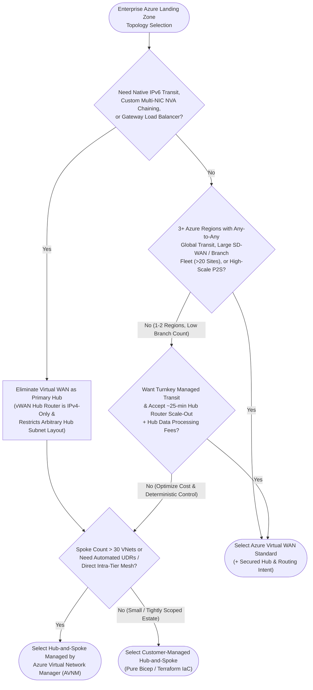

Choosing your core Azure transit topology is the foundational architecture decision of any Cloud Adoption Framework (CAF) landing zone. Migrating between a customer-managed hub-and-spoke VNet and Azure Virtual WAN after fifty production subscriptions are live requires tearing down VNet peerings, rebuilding ExpressRoute/VPN gateway connections, rewriting route tables, and absorbing maintenance outages.

Today, enterprise architects do not face a binary choice between manual peering scripts and Virtual WAN. Three distinct production operating models exist—each solving a different combination of global footprint, NVA customizability, IPv6 readiness, and platform-team maturity:

1. **Customer-Managed Hub-and-Spoke**: Platform IaC explicitly manages VNet peerings, User-Defined Routes (UDRs), Azure Firewall or third-party NVAs, and optional [Azure Route Server](/azure-networking/02-core-topologies/hub-spoke-and-route-server/).
2. **AVNM-Managed Hub-and-Spoke (+ Connected Groups)**: **Azure Virtual Network Manager** automates hub-spoke peerings, declarative UDR orchestration, high-scale direct spoke-to-spoke meshes (`ConnectedGroup`), IPAM pools, and baseline Security Admin Rules on top of standard VNets.
3. **Azure Virtual WAN Standard**: Microsoft operates a managed full-mesh regional and global transit router (`ASN 65515`) per virtual hub, integrating S2S/P2S VPN, ExpressRoute, SD-WAN appliances, [Routing Intent, and Route Maps](/azure-networking/02-core-topologies/virtual-wan-and-routing-intent/). *(Virtual WAN Basic supports S2S VPN within a single hub only—never deploy Basic in enterprise environments.)*

---

## Topology Decision Flow

Use this decision tree before defaulting to Virtual WAN because "it sounds more modern" or defaulting to DIY Hub-and-Spoke because "that is how we built Azure in 2019":

---

## Definitive Architecture Comparison Matrix

Every row below reflects verified platform behavior and hard subscription/service limits:

| Dimension | Customer-Managed Hub-and-Spoke | Hub-and-Spoke with AVNM | Azure Virtual WAN (Standard) |
| --- | --- | --- | --- |
| **Spoke Scale per Hub** | **500** VNet peerings per hub VNet (default limit) | **Up to 1,000** spoke peerings per hub VNet; **250 VNets** per Connected Group mesh (up to **3,000–5,000** via high-scale registration) | **500** VNet connections per virtual hub (practical limit bounded by prefix count and VM/NIC ceilings across connected hubs) |
| **Private Endpoint Scale** | Standard VNet peering limits (4,000 PEs across peered VNets unless high-scale PE enabled) | **Up to 20,000 Private Endpoints** across a Connected Group with High-Scale PE enabled (`RouteTableEnabled`) | Bounded by hub route-table and connected-VNet limits; requires `RouteTableEnabled` on PE subnets for Routing Intent symmetry |
| **East-West Spoke Transit** | Hairpins through Hub Firewall/NVA via UDRs (`VNetPeering` is non-transitive) | Hairpins through Hub **OR** bypasses hub directly for trusted spoke groups via **`ConnectedGroup`** mesh (regional or global) | Automatic any-to-any via managed Hub Router (`defaultRouteTable`), optionally steered through Secured Hub Firewall via Routing Intent |
| **Inter-Region Transit** | Explicit **Global VNet Peering** between regional Hub VNets + summary UDRs between regional firewalls/NVAs | Global VNet Peering between hubs **OR** Global Mesh (`ConnectedGroup`) directly between trusted cross-region spokes | **Built-in full-mesh Hub-to-Hub** over Microsoft backbone (**~50 Gbps** aggregate inter-hub throughput ceiling) |
| **BGP & ASN Control** | Fixed `ASN 65515` on Azure Route Server / VPN / ER Gateways; full eBGP freedom on self-managed NVAs | Same as Customer-Managed Hub-and-Spoke | Hub router locked to `ASN 65515` (inter-hub prepends `65520-65520`); GA **Route Maps** & **Hub Routing Preference** (`ExpressRoute` / `VPN` / `ASPath`) |
| **Firewall & NVA Flexibility** | **Unrestricted**: Azure Firewall, multi-NIC L2/L3 NVAs, Gateway Load Balancer chaining, custom ILB HA-ports | **Unrestricted** (operates on standard Hub VNet; pairs cleanly with Security Admin Rules) | **Curated ecosystem only**: Azure Firewall Secured Hub, Palo Alto Cloud NGFW SaaS, or Microsoft-certified integrated NVAs (Fortinet, Check Point, Cisco, Versa, Aruba, VMware SD-WAN) |
| **IPv6 Support** | **Supported** (Dual-stack VNets, peerings, UDRs, NSGs, dual-stack 3P NVAs; note AzFW/ARS remain IPv4-only) | **Supported** (Dual-stack VNets and IPAM pools) | **IPv4 Only** (vWAN virtual hubs do not route IPv6) |
| **Hub Router Scale-Out Latency** | N/A for native VNet fabric; Azure Firewall / NVA VMSS scales per appliance rules | N/A for `VNetPeering` / `ConnectedGroup` fabric (wire-speed SDN) | Managed Hub Router auto-scales Routing Infrastructure Units (RIUs), taking **up to ~25 minutes**—must pre-provision `minCapacity` above baseline spikes |
| **Operational Blast Radius** | Localized per route table or peering; bad UDR affects associated subnets only | Centralized policy power—a mis-scoped dynamic Network Group or UDR config can touch hundreds of spokes simultaneously without CI/CD rings | **Hub-wide / Global**: Enabling Routing Intent is a one-way rewrite of `defaultRouteTable`; misconfigured Route Maps or labels propagate across all hubs |
| **Cost Profile** | **Lowest baseline**: Pay only for Gateways, Firewall/NVAs, and VNet Peering (`$0.01/GB` in + `$0.01/GB` out intra-region) | VNet Peering / Connected Group + **per-managed-subscription AVNM hourly fee** (often offset by eliminating hub hairpin fees for trusted intra-group mesh traffic) | **Highest fixed + variable**: Base Virtual Hub fee + Routing Infrastructure Units + Connection Units + **Hub Data Processing per-GB fee** *on top of* VNet peering and Firewall charges |

---

## Deep-Dive Trade-Off Analysis

### 1. The Hidden Cost & Latency of Hub Hairpinning vs. AVNM Connected Groups

In both classic Hub-and-Spoke and Secured Virtual WAN, routing every gigabyte of intra-environment traffic (for example, an AKS worker spoke streaming terabytes of telemetry or AI embeddings to a sibling data spoke in the same `Production` security zone) through a central hub incurs **double peering charges plus hub router/firewall per-GB data processing charges** and adds millisecond latency.

**AVNM Hub-and-Spoke with Direct Connectivity** solves this cleanly:
- Production spokes peer to the Hub VNet for hybrid (ExpressRoute/VPN), egress (Azure Firewall), and cross-zone (Prod-to-Shared-Services) inspection.
- Simultaneously, AVNM places trusted spokes within the same `Production` Network Group into a **`ConnectedGroup`** (`nextHopType: ConnectedGroup`), enabling low-latency, direct VNet-to-VNet communication guarded by **AVNM Security Admin Rules** (which evaluate *before* spoke NSGs and cannot be overridden by workload owners) while `Non-Production` spokes remain strictly isolated.

*(Note: BareMetal infrastructures such as [Azure VMware Solution](/azure-networking/05-workload-networking/avs-networking/), Nutanix NC2, and Oracle Database@Azure are not supported directly inside AVNM Connected Groups—attach them via standard hub VNet gateways/Route Server.)*

### 2. Virtual WAN's 25-Minute Router Scale-Out Reality

Unlike a standard VNet—which has no central software router in the data path for VNet peering—every packet traversing a Virtual WAN hub (spoke-to-spoke, spoke-to-hub-firewall, branch-to-branch across hubs) passes through the **Virtual Hub Router** VM scale infrastructure.

Each Routing Infrastructure Unit (RIU) adds aggregate bandwidth and VM capacity, and while the hub router auto-scales under sustained load, **provisioning additional capacity takes approximately 25 minutes**. During sudden failover storms, batch AI/analytics jobs, or DR cutovers, relying on default minimum capacity (`minCapacity = 2`) risks packet drops before autoscale finishes. Production Virtual WAN architects always pre-size `virtualRouterAutoScaleConfiguration.minCapacity` for peak failover throughput and monitor `RouterPeakUtilizationCpu`.

### 3. When Virtual WAN Standard Wins Hands-Down

Do not build custom BGP route reflectors across six Azure regions just to avoid Virtual WAN hub fees. **Virtual WAN Standard is the clear architectural winner when**:
- You operate **3 or more Azure regions** requiring seamless any-to-any global transit across ExpressRoute circuits, S2S VPN branches, and regional spokes without maintaining an $O(N^2)$ matrix of Global VNet Peerings and static regional UDRs.
- You connect **dozens to hundreds of retail/industrial SD-WAN or IPsec branch sites** (up to 1,000 S2S connections / 20 Gbps aggregate VPN per hub) or **thousands of global Point-to-Site remote users** (up to 100,000 P2S users with global profile automatic hub selection).
- Your security team wants turnkey **Secured Virtual Hub with Routing Intent** (Azure Firewall or Palo Alto Cloud NGFW SaaS) where symmetric private + internet inspection works across spokes, branches, and inter-hub links without touching per-subnet UDRs.

### 4. Hybrid Coexistence: Attaching a Specialized Hub VNet as a vWAN Spoke

Enterprise architectures rarely stay 100% pure. If you standardize on Virtual WAN globally, you can still attach a specialized **Transit / DMZ Spoke VNet** to a Virtual WAN hub to host workloads that cannot live inside the managed vWAN hub—such as **Azure DNS Private Resolver**, third-party multi-NIC F5/Application Delivery Controllers, Gateway Load Balancer inspection appliances, or partner IPsec extranets with non-standard NAT/crypto rules. Keep static-route sprawl minimal on that VNet connection (see the [Virtual WAN Architecture FAQ](/azure-networking/06-operations-reviews/vwan-architecture-faq/)).

---

## Hands-On Validation & Architecture Review Pack

- **Deploy & Test Live**: Provision a multi-spoke Virtual WAN lab with Bicep and inspect effective route tables firsthand using the [Virtual WAN Playground Lab on GitHub](https://github.com/jonathan-vella/azure-networking/tree/main/labs/virtual-wan-playground) and the companion [Labs & Tools Guide](/azure-networking/06-operations-reviews/labs-and-tools-guide/).
- **Audit Production Designs**: Walk any proposed or live Virtual WAN design against our 50+ WAF/CAF controls in the [Virtual WAN Review Checklist](/azure-networking/06-operations-reviews/vwan-review-checklist/) and [Virtual WAN Review Addendum](/azure-networking/06-operations-reviews/vwan-review-addendum/).

---

:::tip[What I Recommend]
1. **1–2 Regions, Cloud-Native / PaaS-Heavy, Cost-Sensitive or IPv6-Enabled -> Choose AVNM Hub-and-Spoke**: Deploy standard regional Hub VNets (`>= /20`) with Azure Firewall + NAT Gateway + DNS Private Resolver, and use **Azure Virtual Network Manager** to enforce hub-spoke peerings (`peeringEnforcement: Enforced`), orchestrate spoke UDRs, and enforce non-overridable Security Admin Rules.
2. **3+ Regions, Global Any-to-Any Transit, Heavy SD-WAN / Branch / Global P2S Footprint -> Choose Azure Virtual WAN Standard**: Deploy paired/multi-region Standard hubs (`>= /23`), enable **Secured Virtual Hub with Routing Intent** uniformly across *all* hubs, pre-provision hub router `minCapacity` to absorb the 25-minute scale-out window, and govern BGP advertisements with **Route Maps**.
3. **Never Mix Unmanaged Manual Peerings Into an AVNM or vWAN Estate**: Treat topology automation as single-writer IaC. Mixing ad-hoc portal peerings or bespoke spoke-to-spoke UDRs creates asymmetric blackholes during regional failovers.
:::
