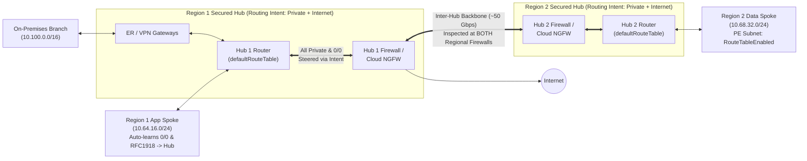

Azure Virtual WAN (Standard) replaces customer-managed `GatewaySubnet`, `RouteServerSubnet`, manual VNet peering transit matrices, and spoke-by-spoke UDR plumbing with a globally meshed, Microsoft-managed routing plane. Yet Virtual WAN is **not** "zero-configuration networking." Misunderstanding how connection **association vs. propagation** works, enabling **Routing Intent** without preparing Private Endpoint subnets, or leaving **Hub Routing Preference** at defaults in multi-hub hybrid topologies produces subtle asymmetric blackholes.

---

## Virtual WAN Standard Hub Anatomy

Every regional Virtual WAN Standard hub is a Microsoft-managed VNet hidden inside a subscription-visible `virtualHubs` resource. Inside that hub, Azure provisions:

1. **The Virtual Hub Router (`ASN 65515`)**: A managed BGP route-reflector and packet-forwarding cluster scaled in **Routing Infrastructure Units (RIUs)**. Remember two operational laws:
   - Inter-hub transit across regions caps at **~50 Gbps aggregate bandwidth**.
   - Auto-scaling additional RIUs takes **up to ~25 minutes**—always set `virtualRouterAutoScaleConfiguration.minCapacity` above baseline peak load rather than relying on reactive autoscale during failover storms.
2. **Managed Gateways & Security Appliances**: ExpressRoute Gateway, Site-to-Site VPN Gateway, Point-to-Site User VPN Gateway, and optional in-hub security (**Azure Firewall**, **Palo Alto Cloud NGFW SaaS**, or certified third-party SD-WAN/NGFW NVA).

### Sizing the Hub Address Space (`/23` Floor, `/22` for Heavy Hubs)

Azure requires at least a `/24` to create a virtual hub, **but `/24` is a trap**. Azure dynamically carves internal subnets from your hub CIDR for the hub router, ExpressRoute gateway, S2S gateway, P2S gateway, Azure Firewall, and integrated NVAs—and **you cannot shrink or replace the primary hub prefix in place later**. Standardize on **`/23` (512 IPs)** for standard Secured Hubs, or **`/22` (1,024 IPs)** if co-deploying ExpressRoute + S2S + P2S + third-party NVA scale units, with zero overlap against spoke or on-premises CIDRs.

### Route Tables, Labels, Association, and Propagation

Every Standard hub starts with two built-in route tables:
- **`defaultRouteTable`**: Automatically associated with and propagated to by every new VNet, VPN, P2S, and ExpressRoute connection via the built-in `Default` label (which spans `defaultRouteTable` across **all hubs** in the Virtual WAN).
- **`noneRouteTable`**: Drops/suppresses route propagation when a connection must not advertise its prefixes to peers.

Keep these two directional concepts crystal clear:

| Concept | Cardinality | Direction & Meaning |
| --- | --- | --- |
| **Association** | **1-to-1** (One connection -> exactly one Route Table) | Controls **egress lookup from that connection**: *"When packets enter the hub from Spoke A, which route table decides where they go next?"* |
| **Propagation** | **1-to-Many** (One connection -> zero or more Route Tables / Labels) | Controls **ingress route advertisement**: *"Which route tables (local and remote hubs via Labels) learn Spoke A's address prefixes?"* |

:::note[Fundamental Virtual Hub Routing Rules]
- **`0.0.0.0/0` Never Crosses Hubs Automatically**: A default route learned or configured in Hub 1 is strictly hub-local; Hub 2 never inherits `0.0.0.0/0` from Hub 1 unless you explicitly configure internet breakout / Routing Intent per hub.
- **All Branch Connections Share One Association Table**: Within a single hub, S2S VPN, ExpressRoute, and P2S connections must associate to the **same** route table (`defaultRouteTable`).
- **Intra-VNet Subnets Cannot Be Steered Through the Hub**: Virtual WAN ignores any route equal to or more-specific than a connected spoke VNet's own CIDR for intra-VNet traffic; microsegment subnets inside a single spoke using NSGs, ASGs, or local spoke appliances.
:::

---

## Secured Virtual Hub & Routing Intent

In early Virtual WAN deployments, forcing spoke-to-spoke, spoke-to-branch, and inter-hub traffic symmetrically through Azure Firewall required complex custom hub route tables (`RT_Spokes`, `RT_Branches`), manual static routes (`10.0.0.0/8`), disabled propagation labels, and un-inspected inter-hub gaps.

**Routing Intent and Routing Policies** replace all of that manual route-table gymnastics with two declarative policies on `defaultRouteTable`:

1. **Internet Traffic Policy (`_policy_PublicTraffic`)**: Injects `0.0.0.0/0 -> Next Hop (Azure Firewall / Cloud NGFW / SaaS / NVA)` onto all spoke VNet connections (and optionally P2S/branches for forced tunneling).
2. **Private Traffic Policy (`_policy_PrivateTraffic`)**: Intercepts all RFC 1918 supernets (`10.0.0.0/8`, `172.16.0.0/12`, `192.168.0.0/16` plus any custom non-RFC1918 private prefixes you add) across **Spoke <-> Spoke, Spoke <-> On-Premises, Branch <-> Branch, and Hub <-> Hub** flows, steering both directions symmetrically through each hub's firewall!

### Why Enabling Routing Intent Is a One-Way Operational Commitment

Treat enabling Routing Intent as a **high-impact, one-way architectural commitment**:
- **Prerequisites**: You **cannot** enable Routing Intent while custom hub route tables exist or while custom static routes exist inside `defaultRouteTable` (other than supported spoke-NVA static routes on VNet connections).
- **No Automatic Undo**: Enabling Routing Intent rewrites `defaultRouteTable` system policies. Disabling it later does *not* restore prior custom route tables or propagation topology—always export ARM/Bicep snapshots of `virtualHubs`, `hubRouteTables`, and `hubVirtualNetworkConnections` beforehand.
- **Enable Uniformly Across All Hubs**: In multi-hub Virtual WANs, remote hubs automatically prefer routes from hubs **with** Private Routing Intent over ExpressRoute routes from hubs **without** Routing Intent (to prevent uninspected security bypasses). Leaving Routing Intent enabled on Hub 1 but disabled on Hub 2 causes cross-region traffic hairpins and asymmetric flows!

### Critical Routing Intent Edge Cases

1. **Private Endpoints in Spokes Bypass the Firewall Unless Network Policies Are Enabled**:
   - By default, a Private Endpoint in Spoke 2 (`10.68.32.10/32`) injects a `/32` `InterfaceEndpoint` route into the Virtual WAN hub. Because `/32` beats Routing Intent's `10.0.0.0/8` policy via [Longest Prefix Match](/azure-networking/01-foundations/routing-and-traffic-engineering/), traffic from On-Premises to the Private Endpoint **bypasses the hub firewall on ingress**, while return or related flows hit the firewall—breaking stateful inspection! Adding `/32` to "Private Traffic Prefixes" does *not* fix this.
   - **Mandatory Fix**: Enable **`privateEndpointNetworkPolicies: RouteTableEnabled`** (or `Enabled`) on every spoke subnet hosting Private Endpoints so `/32` system routes do not override hub Private Routing Intent.
2. **ExpressRoute FastPath & Encrypted ExpressRoute**:
   - **FastPath** bypasses the ExpressRoute Gateway and Virtual Hub Router directly to spoke NICs, which is fundamentally incompatible with Secured Hub Private Routing Intent inspection—keep FastPath off for firewall-inspected spokes (see [ExpressRoute FastPath & SKUs](/azure-networking/03-hybrid-connectivity/expressroute-fastpath-and-skus/)).
   - **Encrypted ExpressRoute (IPsec S2S VPN over ER Private Peering)**: With Private Routing Intent active, outer IPsec `ESP` / UDP `500`/`4500` packets between on-premises VPN routers and the vWAN S2S VPN Gateway's private tunnel IPs traverse the hub firewall—you **must add an explicit Network Rule allowing ESP/IKE** on the firewall or tunnels will drop!
3. **Spoke-NVA Static Routes + `Propagate Static Route`**:
   - When Private Routing Intent is enabled *and* `Propagate static route = Yes` is set on a VNet connection containing a spoke NVA, Virtual WAN treats `Bypass Next-Hop IP` as enabled—inspecting traffic at the hub firewall and delivering directly to the spoke workload rather than double-chaining through the spoke NVA unless carefully architected.

---

## Traffic Engineering: Hub Routing Preference & GA Route Maps

Historically, Virtual WAN hubs were criticized as "BGP black boxes" where you could neither summarize 300 spoke `/24`s toward on-premises nor stop ExpressRoute from beating a preferred VPN/SD-WAN path. Two General Availability (GA) features give architects deterministic control without spoke UDR hacks:

### 1. Hub Routing Preference (HRP)

When a virtual hub learns the **same prefix length** (after LPM and static routes) from multiple hybrid connections, **Hub Routing Preference** (`virtualRouterAsn` / `hubRoutingPreference`) controls tie-breaking:

| HRP Mode | Selection Order (After LPM & Static Routes) | When to Use It |
| --- | --- | --- |
| **`ExpressRoute` *(Default)*** | 1. Local hub connections > Remote hub connections 2. Local ExpressRoute > Local S2S VPN *(note: among remote-only paths, remote S2S VPN beats remote ER)* 3. Shortest BGP `AS_PATH` | Standard enterprise hybrid model where ExpressRoute is primary and S2S VPN / SD-WAN is backup in each region. |
| **`VPN`** | 1. Local hub connections > Remote hub connections 2. S2S VPN > ExpressRoute 3. Shortest BGP `AS_PATH` | SD-WAN-first or IPsec-encrypted-first networks where ExpressRoute is used only for unencrypted bulk backup or migration. |
| **`ASPath`** | 1. **Shortest BGP `AS_PATH` globally** *(except remote-hub ER circuits, which always rank last)* 2. Local hub > Remote hub 3. Local ER > Local VPN | Active/standby multi-datacenter designs where **a remote hub's shorter-AS-path connection must beat a local hub's heavily prepended backup path**. |

:::caution[Two Subtle HRP Traps in Multi-Hub Failover]
1. **Always Prepend AS-Path on Backup VPN Links Even When `HRP = ExpressRoute`**: If an ExpressRoute circuit flaps down, active flows shift to your backup S2S VPN. When ExpressRoute recovers, **existing/stickier route selections may remain on VPN unless your on-premises router prepends a strictly longer `AS_PATH` on the S2S VPN advertisement** than on ExpressRoute!
2. **Inter-Hub `65520-65520` Prepend & Race Condition**: Whenever Hub 1 advertises a route to Hub 2, Virtual WAN prepends **`65520 65520`** (+2 AS hops). Avoid prepending your *local* on-premises VPN/ER path by 2+ more ASNs than a remote hub's path while using `HRP = ExpressRoute` or `VPN`, as Microsoft documents a known tie-breaker race condition—switch to `HRP = ASPath` if you intentionally engineer cross-hub AS-path preference.
:::

### 2. Virtual WAN Route Maps (GA)

**Route Maps** attach **inbound** and/or **outbound** on VNet, ExpressRoute, S2S VPN, and P2S connections to filter prefixes, summarize CIDRs, and manipulate BGP `AS_PATH` and `Community` attributes directly on the hub router:

- **Summarizing Regional Spokes Toward On-Premises**: Match `Route-prefix Contains 10.64.0.0/14` outbound on your ExpressRoute connection -> `Modify: Route-prefix Replace 10.64.0.0/14` -> `Next step: Terminate`. Hundreds of spoke VNet CIDRs collapse into one clean `/14` advertisement, staying well below ExpressRoute's 1,000-route ceiling.
- **Dropping Unwanted Default or Overlapping Branch Leaks**: Match `0.0.0.0/0` or rogue branch lab subnets inbound on S2S VPN connections -> `Action: Drop`.

**Hard Route Map Rules Every Architect Must Respect**:
1. **Summarization Strips Attributes**: Summarizing routes (`Route-prefix Replace`) **strips all `BGP Community` and `AS-PATH` attributes** from the summarized prefix (both inbound and outbound). Re-attach any required communities in a subsequent rule (`Next step: Continue`).
2. **Never Strip Azure Internal Communities or Prepend Reserved ASNs**: Never remove internal Virtual WAN BGP communities (`65515:10000`, `65515:20000`, `65517:*`, `65518:*`) and never prepend private ASNs on ExpressRoute or Azure-reserved ASNs (`8074`, `8075`, `12076`, `65515`, `65517`–`65520`). Route Maps support **2-byte ASNs only**.
3. **Unmatched Routes Default to `Allow`**: Unlike firewall ACLs, a Route Map ends with an **implicit Permit/Allow**—if you build an allow-list filter, add an explicit catch-all `Drop` rule at the bottom!
4. **Outbound Route Maps Do Not Alter Azure's Own Path Selection**: Hub best-path selection (HRP) runs *before* outbound Route Maps execute. Use **inbound** Route Maps to influence how Virtual WAN routes traffic; use **outbound** Route Maps to influence what on-premises or spoke connections learn.

For production readiness audits, pair this chapter with the [Virtual WAN Review Checklist](/azure-networking/06-operations-reviews/vwan-review-checklist/), [Virtual WAN Review Addendum](/azure-networking/06-operations-reviews/vwan-review-addendum/), and [Virtual WAN Architecture FAQ](/azure-networking/06-operations-reviews/vwan-architecture-faq/).

---

:::tip[What I Recommend]
1. **Standardize on `defaultRouteTable` + Secured Hub Routing Intent Across Every Hub**: Avoid bespoke custom hub route tables unless strict M&A or regulatory tenant isolation demands `RT_Isolated` segments that can never inspect through a shared policy.
2. **Allocate `/23` Minimum per Hub & Pre-Scale Hub Router `minCapacity`**: Never deploy `/24` production hubs, and size `virtualRouterAutoScaleConfiguration.minCapacity` for failover peaks so you are never waiting 25 minutes for RIU scale-out during an outage.
3. **Mandate `RouteTableEnabled` on All Spoke Private Endpoint Subnets**: Enforce via Azure Policy across every VNet connected to a Routing-Intent-enabled Virtual WAN so `/32` Private Endpoint routes never break stateful firewall symmetry.
4. **Use Outbound Route Maps to Summarize Regional Supernets to On-Premises**: Collapse spoke `/24` churn into regional `/14` or `/16` summaries on ExpressRoute and S2S connections, isolating corporate WAN BGP tables from cloud spoke provisioning noise.
5. **Pair `HRP = ExpressRoute` with Explicit AS-Path Prepending on S2S Backup**: Always prepend 2–3 copies of your public/enterprise ASN on backup S2S VPN tunnels from on-premises so traffic deterministically fails *back* to ExpressRoute once circuit health restores.
:::
