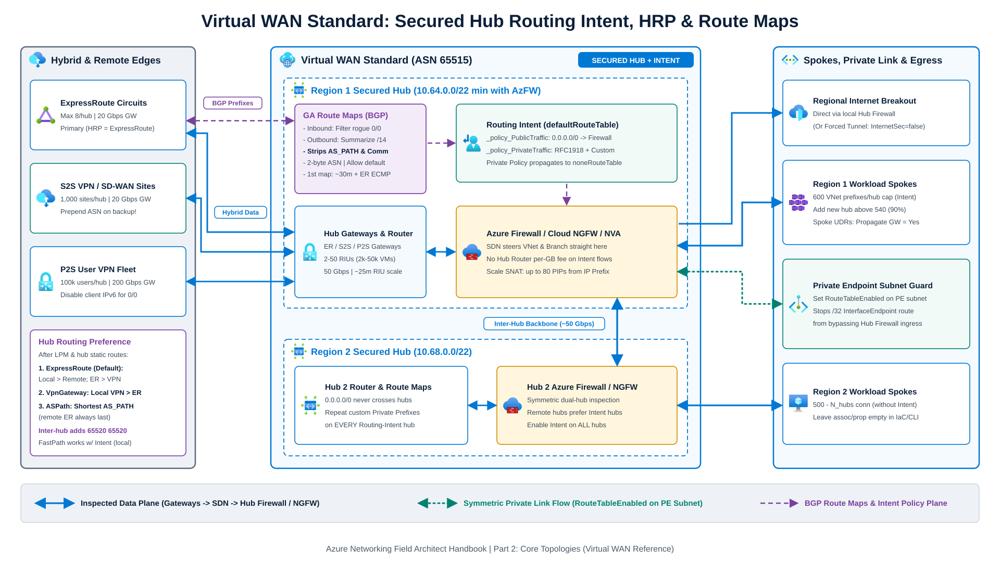
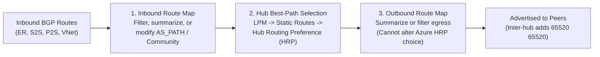

[Azure Virtual WAN](https://learn.microsoft.com/en-us/azure/virtual-wan/virtual-wan-about) Standard replaces customer-managed `GatewaySubnet` and `RouteServerSubnet` deployments, manual VNet peering transit matrices, and spoke-by-spoke UDR tables with a Microsoft-managed regional and global transit control plane. Reliable operation depends on four design choices: sizing the immutable hub prefix before creation, understanding connection association versus propagation, pairing [Routing Intent](https://learn.microsoft.com/en-us/azure/virtual-wan/how-to-routing-policies) with spoke Private Endpoint network policies, and coordinating [Hub Routing Preference](https://learn.microsoft.com/en-us/azure/virtual-wan/about-virtual-hub-routing-preference) with [Route Maps](https://learn.microsoft.com/en-us/azure/virtual-wan/route-maps-about).

---

## Virtual WAN Standard hub components and sizing

Each regional Virtual WAN Standard hub is a Microsoft-managed virtual network exposed as a `Microsoft.Network/virtualHubs` resource. Inside the hub, Azure provisions:

1. The [Virtual Hub Router](https://learn.microsoft.com/en-us/azure/virtual-wan/hub-settings#virtual-hub-capacity) (`ASN 65515`), which scales in Routing Infrastructure Units (RIUs) from 2 RIUs (3 Gbps aggregate throughput, 2,000 VMs) up to 50 RIUs (50 Gbps VNet-to-VNet throughput, 50,000 VMs) and accepts at most 10,000 routes per hub. Scale-out takes up to 25 minutes, and single TCP flows degrade above 1.5 Gbps.
2. Optional hub gateways (ExpressRoute up to 20 Gbps and 8 circuits, S2S VPN up to 20 Gbps and 1,000 branches, P2S User VPN up to 200 Gbps and 100,000 users) plus in-hub security (Azure Firewall, Palo Alto Cloud NGFW, or [certified third-party NVAs](https://learn.microsoft.com/en-us/azure/virtual-wan/about-nva-hub)).

### Hub address space and SNAT scaling

A virtual hub's address space [cannot be modified after creation](https://learn.microsoft.com/en-us/azure/virtual-wan/hub-settings#virtual-hub-address-space) and must never overlap other hubs, connected spokes, or on-premises ranges:

- ARM accepts `/24` as a technical minimum, and Microsoft recommends `/23` (512 IPs) or larger for standard non-firewall hubs.
- Deploying Azure Firewall inside a Virtual WAN hub requires at least a `/22` (1,024 IPs) hub address space so Azure Firewall can allocate enough internal IPs to scale to maximum throughput. Standardize on `/22` for all Secured Virtual Hubs, especially when co-deploying ExpressRoute, S2S VPN, P2S VPN, or third-party NVA scale units.
- Azure NAT Gateway is [not supported inside a Virtual WAN hub](https://learn.microsoft.com/en-us/azure/architecture/networking/architecture/hub-spoke-virtual-wan-architecture#recommendations), and ARM does not allow attaching a `PublicIPPrefix` resource directly to Azure Firewall. Instead, provision individual Standard static public IP addresses from a [Public IP Prefix and associate those individual IPs](https://learn.microsoft.com/en-us/azure/firewall/secured-hub-customer-public-ip) with the Secured Hub Azure Firewall (up to 80 public IPs standard, or 250 with customer-provided public IP preview) to scale SNAT ports within a contiguous partner allow-list block.

### Route tables, labels, association, and propagation

Every Standard hub includes two built-in route tables: `defaultRouteTable` (grouped across all hubs by the `Default` label) and `noneRouteTable` (which suppresses route propagation).

| Concept | Cardinality | Direction and Effect |
| --- | --- | --- |
| **Association** | 1-to-1 (connection to one route table) | Governs egress lookup when packets enter the hub from that connection |
| **Propagation** | 1-to-Many (connection to zero or more tables/labels) | Governs which local and remote hub route tables learn that connection's prefixes |

:::note[Core virtual hub routing rules]
- Default routes (`0.0.0.0/0`) remain hub-local and never propagate automatically from Hub 1 to Hub 2.
- Within a single hub, all branch connections (ExpressRoute, S2S VPN, and P2S VPN) must associate with the same route table (`defaultRouteTable`).
- Virtual WAN ignores routes equal to or more specific than a connected spoke VNet's own address space for intra-VNet traffic; segment subnets inside a spoke using NSGs or spoke appliances.
- Virtual WAN hubs and gateways are IPv4-only. Advertising IPv6 prefixes from on-premises breaks IPv4 connectivity, and P2S clients forcing Internet breakout through the hub should disable local IPv6 stacks.
:::

---

## Secured Virtual Hub and Routing Intent

[Virtual WAN Hub Routing Intent](https://learn.microsoft.com/en-us/azure/virtual-wan/how-to-routing-policies) replaces custom hub route tables with two declarative policies on `defaultRouteTable`:

1. **Internet Traffic Policy (`_policy_PublicTraffic`)** advertises `0.0.0.0/0` to spoke VNets and connections where `Propagate default route` (`enableInternetSecurity`) is `true` and steers Internet egress to the hub security resource (*direct access*).
2. **Private Traffic Policy (`_policy_PrivateTraffic`)** installs `10.0.0.0/8`, `172.16.0.0/12`, and `192.168.0.0/16` (plus any custom non-RFC 1918 or bare-metal delegated prefixes you add) toward the hub security resource so VNet-to-VNet, VNet-to-branch, branch-to-branch, and inter-hub flows undergo symmetric inspection. Combining Private Policy with an on-premises branch or NVA advertising `0.0.0.0/0` enables [*forced tunneling*](https://learn.microsoft.com/en-us/azure/virtual-wan/about-internet-routing#special-note-for-forced-tunnel-hubs); you must set `Propagate default route` (`enableInternetSecurity`) to `false` on the `0.0.0.0/0`-originating connection so Virtual WAN learns the default route without routing loops.



As documented in [Routing Intent considerations](https://learn.microsoft.com/en-us/azure/virtual-wan/how-to-routing-policies#considerations), Virtual WAN programs the Azure SDN platform to route VNet and branch traffic directly to the hub security appliance rather than passing packets through the Virtual Hub Router. Hub Router per-GB data-processing charges are waived for traffic steered by Routing Intent; size hub RIUs based on total VMs across connected spokes (2,000 VMs at default 2 RIUs, +1,000 VMs per RIU).

### Connection state, prerequisites, and rollback mechanics

Once Routing Intent is active, Virtual WAN manages connection route-table settings automatically (new or updated connections deployed via Bicep, ARM, or CLI must leave optional associated and propagated route-table properties empty):

| Active Routing Intent Policies | Managed Association | Managed Propagation |
| --- | --- | --- |
| **Internet only** | `defaultRouteTable` | `Default` label (`defaultRouteTable` of all hubs) |
| **Private only**, or **Internet + Private** | `defaultRouteTable` | `noneRouteTable` |

Verify three operational rules before you configure Routing Intent:

#### Pre-enablement prerequisites and the 600-prefix limit
Routing Intent cannot be created if custom hub route tables exist or if `defaultRouteTable` contains static routes whose next hop is a `Virtual Network Connection` (static routes pointing to `Azure Firewall` are permitted; Firewall Manager requires existing route names to match `private_traffic`, `internet_traffic`, or `all_traffic`). Eligible next-hop resources are Azure Firewall, Palo Alto Cloud NGFW (`SaaS solution`), and certified NGFW or dual-role NVAs (`checkpoint`, `fortinet-ngfw`, `fortinet-ngfw-and-sdwan`, `cisco-tdv-vwan-nva`). You cannot run a standalone SD-WAN connectivity NVA and a separate Firewall NVA or SaaS solution in the same hub under Routing Intent. Each hub also enforces a non-adjustable limit of 600 address spaces across directly connected spoke VNets; deploy an additional hub before exceeding 540 address spaces (90%).

#### Disabling and rollback behavior
You can disable and remove Routing Intent from a hub at any time by clearing its Private and Internet routing policies (or deleting the `routingIntent` resource). What does not reverse automatically is the mutation of `defaultRouteTable`: turning on Routing Intent deletes matching `0.0.0.0/0` and RFC 1918 static routes, and removing Routing Intent resets every connection on the hub to propagate to the `Default` label without restoring your previous route tables or static routes. Export ARM or Bicep snapshots of gateways, connections, and route tables beforehand so you can re-apply prior configurations manually if you roll back.

#### Uniform multi-hub enablement and custom prefixes
Remote hubs always prefer routes from hubs configured with Private Routing Intent over ExpressRoute routes from hubs without Routing Intent. Turn on Routing Intent across all hubs in the Virtual WAN to avoid cross-region hairpins. If you use non-RFC 1918 private prefixes or bare-metal delegated subnets (Azure NetApp Files, Nutanix NC2, Oracle Database@Azure), add those exact prefixes to `Private Traffic Prefixes` on every Routing-Intent hub (they do not propagate across hubs automatically) and disable SNAT for non-RFC 1918 private ranges in your Firewall Policy.

### Routing Intent edge cases

#### Private Endpoints in spoke VNets
By default, a spoke Private Endpoint injects a `/32` `InterfaceEndpoint` system route into the hub. Because `/32` wins [Longest Prefix Match](/azure-networking/01-foundations/routing-and-traffic-engineering/) over `10.0.0.0/8`, on-premises ingress to the Private Endpoint bypasses the hub firewall while return packets hit the firewall, and stateful TCP sessions drop. Adding `/32` prefixes to Private Traffic Prefixes does not fix this. Set `privateEndpointNetworkPolicies: RouteTableEnabled` (or `Enabled`) on every spoke Private Endpoint subnet, and keep `Propagate gateway routes` set to `Yes` on spoke UDR tables.

#### ExpressRoute FastPath, Global Reach, and Encrypted ExpressRoute
- In Virtual WAN, [ExpressRoute FastPath](https://learn.microsoft.com/en-us/azure/virtual-wan/virtual-wan-expressroute-about#expressroute-fastpath-in-virtual-wan) activates automatically when an ExpressRoute Direct circuit connects to a Virtual WAN ExpressRoute Gateway provisioned with 5 or more scale units (`10 Gbps+`). Under Private Routing Intent, FastPath bypasses only the ExpressRoute Gateway while still steering same-region spoke VMs, spoke Internal Load Balancers, spoke Private Endpoints, and bare-metal workloads (ANF, Nutanix NC2) through the hub security appliance. Cross-region spokes, indirect spokes, and prefixes above the port IP limit (100,000 IPs on 10G ER Direct; 200,000 IPs on 100G/400G ER Direct) fall back through the ExpressRoute Gateway (see [ExpressRoute FastPath & SKUs](/azure-networking/03-hybrid-connectivity/expressroute-fastpath-and-skus/)).
- By default, one ExpressRoute circuit does not advertise prefixes to another ExpressRoute circuit unless Global Reach is enabled (which bypasses the hub). Inspecting ER-to-ER transit through the hub firewall requires disabling Global Reach and opening a Microsoft Support request, which causes the hub to advertise RFC 1918 supernets to ExpressRoute on-premises.
- For [Encrypted ExpressRoute](https://learn.microsoft.com/en-us/azure/virtual-wan/vpn-over-expressroute) (IPsec S2S VPN over ExpressRoute Private Peering), outer IPsec packets traverse the hub firewall (`~1 Gbps` max per tunnel). Add a top-priority firewall Network Rule permitting `Protocol: Any` (covering `UDP 500`, `UDP 4500`, and IPsec ESP protocol `50`) between the vWAN S2S VPN Gateway private tunnel IPs (`Instance0`/`Instance1`) and on-premises VPN endpoint IPs, exclude those tunnel IPs from IDPS deep-packet inspection, and use `GCMAES256`. Ensure the S2S VPN BGP session uses a non-APIPA loopback IP distinct from the tunnel IP and advertises more-specific or disjoint prefixes than ExpressRoute Private Peering; identical prefixes route unencrypted over ExpressRoute.

#### Spoke NVA static routes and dual-role hub NVAs
When Private Routing Intent is active and `Propagate static route` is enabled on a VNet connection, Virtual WAN forces `Bypass Next-Hop IP` behavior for destinations inside that spoke VNet's address space and delivers hub-inspected packets directly to the spoke workload VM rather than chaining through the spoke NVA. For dual-role (SD-WAN + NGFW) NVAs inside the hub, prefer active-passive BGP (or AS-path prepending on the secondary instance) unless the vendor supports asymmetric stateful flow sharing across ECMP instances.

---

## Hub Routing Preference and Route Maps



### Hub Routing Preference (HRP)

When a virtual hub learns equal-length prefixes from multiple hybrid connections, [Hub Routing Preference](https://learn.microsoft.com/en-us/azure/virtual-wan/about-virtual-hub-routing-preference) (`hubRoutingPreference` in ARM/Bicep/PowerShell: `ExpressRoute`, `VpnGateway`, or `ASPath`) determines tie-breaking after Longest Prefix Match and hub static routes:

| Portal / ARM Setting | Tie-Breaker Sequence (After LPM and Static Routes) | Target Design |
| --- | --- | --- |
| **`ExpressRoute` / `ExpressRoute` (Default)** | 1. Local hub connections beat remote hub connections<br/>2. Local ExpressRoute beats local S2S VPN (if all paths are remote, remote S2S VPN beats remote ER)<br/>3. Shortest BGP `AS_PATH` | ExpressRoute primary with S2S VPN or SD-WAN backup in each region |
| **`VPN` / `VpnGateway`** | 1. Local hub connections beat remote hub connections<br/>2. S2S VPN beats ExpressRoute<br/>3. Shortest BGP `AS_PATH` | Encrypted IPsec or SD-WAN primary over ExpressRoute backup |
| **`AS Path` / `ASPath`** | 1. Shortest BGP `AS_PATH` across local and remote hubs (remote-hub ExpressRoute circuits always rank last)<br/>2. Local hub beats remote hub<br/>3. Local ExpressRoute beats local S2S VPN | Multi-region active/standby WANs where a remote primary hub must beat a prepended local backup tunnel, or bow-tie hubs preferring direct inter-hub links |

:::caution[Two multi-hub failover traps]
1. Even with `hubRoutingPreference` set to `ExpressRoute`, if an ExpressRoute connection flaps down and recovers, traffic can stick to S2S VPN or SD-WAN unless your on-premises router prepends a longer `AS_PATH` on the VPN/NVA path than on ExpressRoute.
2. Virtual WAN prepends `65520 65520` (+2 AS hops) whenever advertising routes between hubs. When using `ExpressRoute` or `VpnGateway` preference, avoid prepending a local on-premises backup route to 2 or more AS hops longer than a remote hub's route, which triggers a documented route-selection race condition; switch to `ASPath` preference if you intentionally steer across hubs via AS-path length.
:::

### Virtual WAN Route Maps

[Route Maps](https://learn.microsoft.com/en-us/azure/virtual-wan/route-maps-about) attach inbound and/or outbound (one map per direction) on VNet, ExpressRoute, S2S VPN, and P2S connections to drop unwanted prefixes, summarize spoke CIDRs below ExpressRoute's 1,000-route limit, and modify `AS_PATH` or BGP communities.

Respect seven [Route Map operational rules](https://learn.microsoft.com/en-us/azure/virtual-wan/route-maps-about#considerations-and-limitations):

1. Creating the first Route Map on an existing hub triggers a one-time software upgrade of the hub router and gateways that takes roughly 30 minutes, permanently turns on outbound ExpressRoute ECMP on the hub, and incurs additional Route Map billing. After the upgrade, spoke VNet prefixes must propagate to `defaultRouteTable` to advertise to on-premises, and deleting the map does not revert the software version.
2. Summarizing prefixes (`Route-prefix Replace`) strips all `BGP Community` and `AS-PATH` attributes on both inbound and outbound maps; re-add required communities in a follow-on rule with `Next step: Continue`, and never use Route Maps to split a prefix into more-specific routes.
3. Route Maps support 2-byte ASNs only. Never prepend private ASNs on ExpressRoute connections, never prepend Azure-reserved ASNs (`8074`, `8075`, `12076`, `65515`, `65517` to `65520`), and never strip Azure internal BGP communities (`65517:12001`, `65517:12002`, `65517:12003`, `65517:12005`, `65517:12006`, `65517:65517`, `65517:12076`, `65518:65518`, `65518:12076`, `65515:10000`, `65515:20000`).
4. Modifying the default route (`0.0.0.0/0`) is supported only when `0.0.0.0/0` is learned from on-premises or an NVA, not when originated by the virtual hub.
5. Unmatched routes default to Allow; end any allow-list Route Map with an explicit catch-all `Drop` rule.
6. Outbound Route Maps run after HRP best-path selection and only change what peers receive; use inbound Route Maps to influence Azure's own path selection.
7. On a VNet connection containing a spoke NVA, a Route Map can target either the spoke VNet address space or NVA-advertised prefixes. Route Maps do not apply to the virtual hub's own address space, MSEE routers, connections between on-premises and in-hub SD-WAN/Firewall NVAs, or prefixes already modified by NAT.

### Auditing Virtual WAN routing with Azure CLI

Verify `defaultRouteTable` and firewall effective routes with [Azure CLI](https://learn.microsoft.com/en-us/cli/azure/network/vhub#az-network-vhub-get-effective-routes):

```bash
# Inspect effective routes on defaultRouteTable (_policy_PrivateTraffic & _policy_PublicTraffic)
RT_ID=$(az network vhub route-table show \
  -g rg-vwan-prod --vhub-name vhub-weu -n defaultRouteTable --query id -o tsv)

az network vhub get-effective-routes \
  -g rg-vwan-prod -n vhub-weu \
  --resource-type RouteTable --resource-id "$RT_ID" -o table

# Check current Hub Routing Preference (ExpressRoute | VpnGateway | ASPath)
az network vhub show -g rg-vwan-prod -n vhub-weu --query hubRoutingPreference -o tsv
```

Pair these checks with the [Virtual WAN Review Checklist](/azure-networking/06-operations-reviews/vwan-review-checklist/), [Virtual WAN Review Addendum](/azure-networking/06-operations-reviews/vwan-review-addendum/), and [Virtual WAN Architecture FAQ](/azure-networking/06-operations-reviews/vwan-architecture-faq/).

:::tip[Architecture recommendations]
1. Allocate at least `/22` per Secured Virtual Hub hosting Azure Firewall, scale SNAT by associating individual Standard public IPs generated from a Public IP Prefix, and export Bicep/ARM snapshots before you turn on Routing Intent.
2. Turn on Secured Hub Routing Intent uniformly across all hubs, monitor connected spoke address-space counts against the 600-prefix cap (add a new hub above 540), and repeat custom non-RFC 1918 Private Prefixes on every hub.
3. Enforce `privateEndpointNetworkPolicies: RouteTableEnabled` via Azure Policy on every spoke subnet hosting Private Endpoints so `/32` system routes cannot bypass the hub firewall.
4. Summarize regional spoke supernets outbound on ExpressRoute and S2S connections with Route Maps (plan a 30-minute maintenance window for the first map on a hub), and prepend backup S2S VPN AS-paths on-premises so flows fail back cleanly to ExpressRoute.
:::

## References

- [How to configure Virtual WAN Hub routing intent and routing policies](https://learn.microsoft.com/en-us/azure/virtual-wan/how-to-routing-policies)
- [About virtual hub settings and capacity](https://learn.microsoft.com/en-us/azure/virtual-wan/hub-settings)
- [About virtual hub routing preference](https://learn.microsoft.com/en-us/azure/virtual-wan/about-virtual-hub-routing-preference)
- [About Route-maps for virtual hubs](https://learn.microsoft.com/en-us/azure/virtual-wan/route-maps-about)
- [ExpressRoute FastPath in Virtual WAN](https://learn.microsoft.com/en-us/azure/virtual-wan/virtual-wan-expressroute-about#expressroute-fastpath-in-virtual-wan)
- [IPsec over ExpressRoute for Virtual WAN](https://learn.microsoft.com/en-us/azure/virtual-wan/vpn-over-expressroute)
- [Customer-provided public IP addresses in secured virtual hubs](https://learn.microsoft.com/en-us/azure/firewall/secured-hub-customer-public-ip)
- [Virtual WAN frequently asked questions](https://learn.microsoft.com/en-us/azure/virtual-wan/virtual-wan-faq)
