When architects debate whether **ExpressRoute cross-connections ("Bow-Tie" topologies)** are worth the operational complexity and connection footprint, the conversation frequently stalls because participants conflate two completely different disaster scenarios:

1. **Failure of an ExpressRoute Peering Location (Circuit Failure)**: Both primary and secondary MSEE links of Circuit 1 (`C1`) fail completely at the colocation facility, while **Azure Region A remains 100% healthy**.
2. **Failure of an Entire Azure Region (Region Failure)**: **Azure Region A** (including its hub VNet/vHub and ExpressRoute Gateway) suffers a catastrophic regional outage, while **Peering Location 1 (`C1`) and the Microsoft WAN backbone remain healthy**.

This chapter is the canonical reference for how **Standard Hub-and-Spoke** and **Azure Virtual WAN (vWAN)** behave across all four topology permutations—including the real-world nuances of customer MPLS hairpinning, isolated branches, **ExpressRoute Global Reach**, and vWAN inter-hub routing.

---

## Baseline Reference Assumptions

Every scenario below evaluates a dual-region, dual-datacenter enterprise footprint:
- **Two Azure Regions** (`Region A` and `Region B`), each hosting a regional hub (`HUB 1` / `HUB 2` or `vHUB 1` / `vHUB 2`).
- **Two ExpressRoute Circuits** (`C1` and `C2`) in two geo-diverse peering locations, sized with Standard (same geo) or Premium (cross-geo) SKUs so cross-region connections are permitted.
- **Two On-Premises Datacenters / Branches** (`Branch 1` and `Branch 2`):
  - **Connected WAN case**: `Branch 1` and `Branch 2` share an enterprise MPLS/IPVPN or SD-WAN backbone.
  - **Isolated branch case**: `Branch 1` and `Branch 2` have **no** private WAN link between them and rely exclusively on their local ExpressRoute circuit(s).

:::note[Standard Hub Inter-Region Peering]
In Scenarios 1 and 2 below, the original Standard Hub-and-Spoke diagrams intentionally omit global VNet peering between `HUB 1` and `HUB 2` to isolate pure ExpressRoute behavior. In modern production Hub-and-Spoke architectures, you should **always pair Bow-Tie circuits with Global VNet Peering** between regional hubs (using NVAs/Azure Firewall + UDRs or [Azure Route Server](/azure-networking/02-core-topologies/hub-spoke-and-route-server/) topologies) rather than hairpinning Azure-to-Azure traffic through MSEEs.
:::

---

## 1. Standard Hub-and-Spoke Without Bow-Tie

Each regional Hub VNet connects solely to its local ExpressRoute circuit (`HUB 1 ↔ C1`, `HUB 2 ↔ C2`).

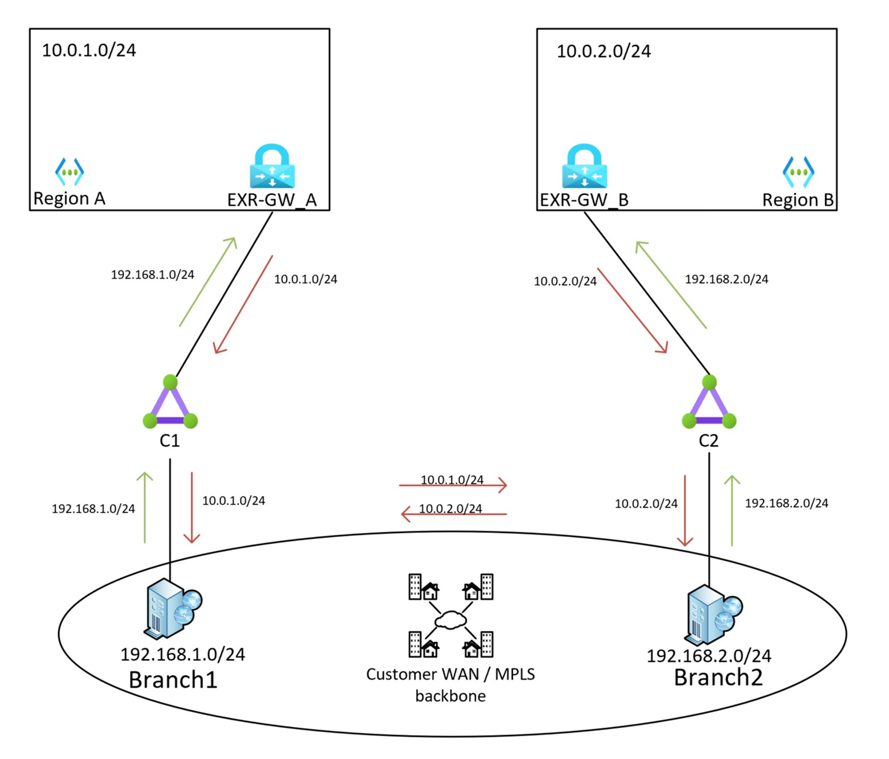

### 1.A Peering Location / Circuit `C1` Failure

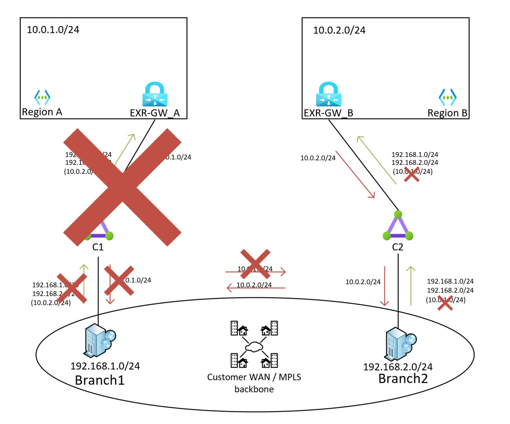

When `C1` fails completely while `Region A` workloads are still running:
- **Region A is completely marooned from on-premises.** Because `HUB 1` has no connection to `C2` (and standard VNet peering does not transit ExpressRoute gateways across regions natively without NVA/ARS transit), neither `Branch 1` nor `Branch 2` can reach `Region A` over ExpressRoute.
- Both branches remain able to reach `Region B` (`Branch 1` traverses the customer MPLS WAN to `Branch 2` → `C2` → `Region B`).
- **Isolated Branches (No MPLS)**: `Branch 1` loses connectivity to **all** Azure regions.

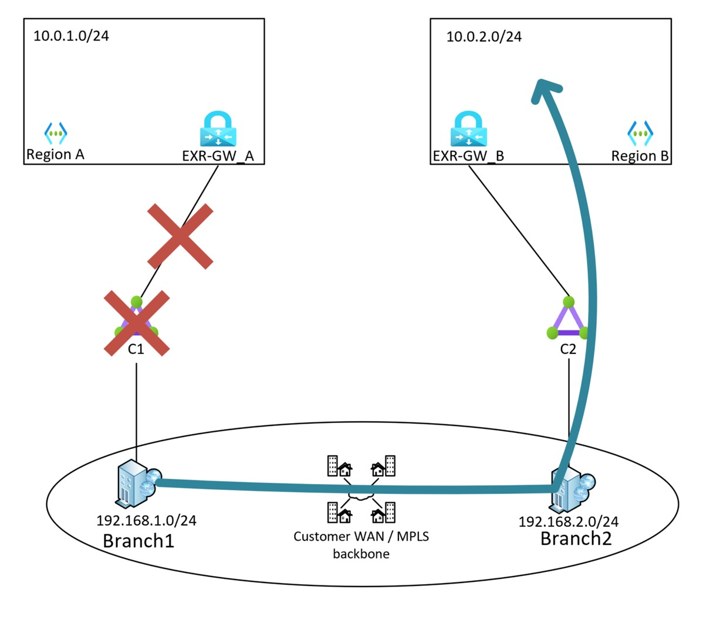

### 1.B Entire `Region A` Failure

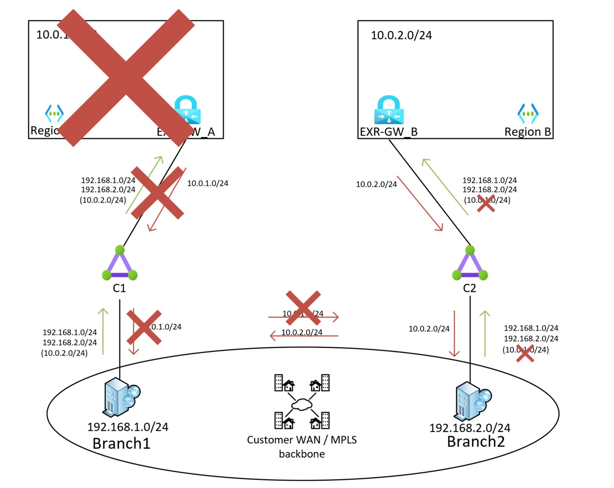

When `Region A` fails (and DR workloads activate in `Region B`):
- `C1` is still physically up at Peering Location 1, **but `C1` has no VNet connection to `HUB 2` (`Region B`)**.
- `Branch 1` is forced to haul all failover traffic across the **customer MPLS backbone** to `Branch 2` → `C2` → `Region B`, adding latency and potentially saturating expensive MPLS WAN links during a disaster recovery event.
- **Isolated Branches (No MPLS)**: `Branch 1` is completely cut off from `Region B` DR workloads even though its local `C1` ExpressRoute circuit is healthy!

---

## 2. Standard Hub-and-Spoke With Bow-Tie

Each ExpressRoute circuit connects to **both** regional Hub ExpressRoute Gateways (`HUB 1` connects to `C1` + `C2`; `HUB 2` connects to `C2` + `C1`). Higher `ConnectionWeight` (e.g., `100` vs. `0`) and symmetric on-premises BGP `Local Preference` keep steady-state traffic on the local circuit.

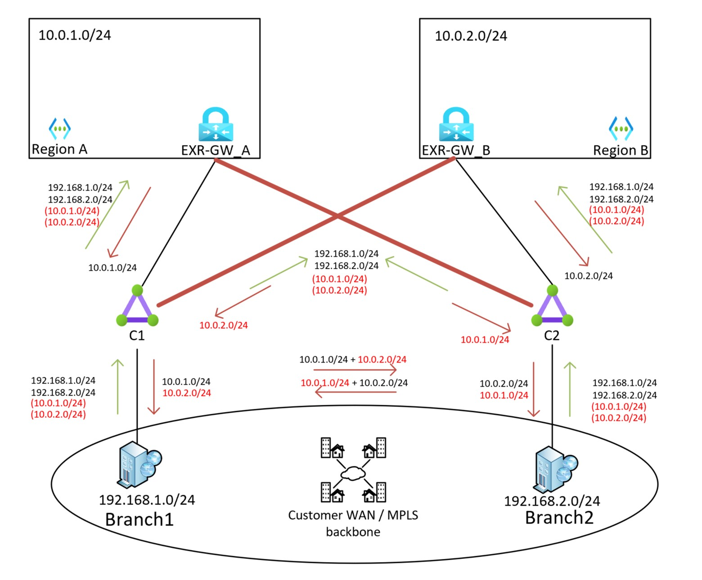

### 2.A Peering Location / Circuit `C1` Failure

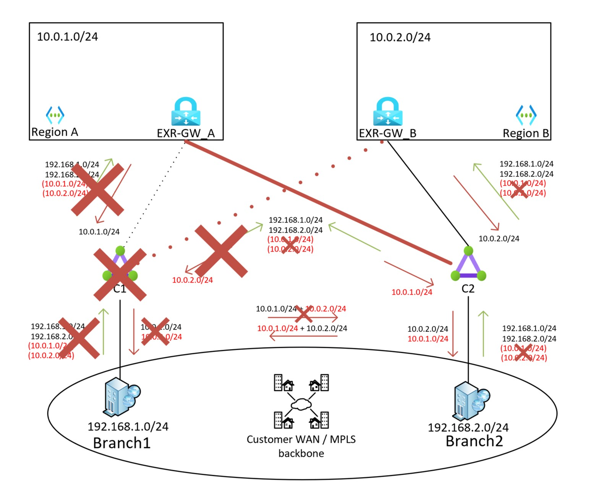

When `C1` fails:
- **Both `Region A` and `Region B` remain reachable from both branches!**
- `Branch 1` routes across the customer MPLS WAN to `Branch 2`, enters the Microsoft backbone at `C2`, and uses the `C2 → HUB 1` cross-connection to reach `Region A`.
- **Latency Hairpin**: `Branch 1 → Region A` experiences double tromboning (`Branch 1 → MPLS → Branch 2 → C2 → Microsoft Backbone → Region A`), which is higher latency than steady state—but preserves business continuity without invoking regional DR.
- **Isolated Branches (No MPLS)**: If `Branch 1` only terminates `C1` locally and has no WAN path to `Branch 2`/`C2`, losing `C1` still isolates `Branch 1` (unless `Branch 1` also has a S2S VPN or secondary WAN path).

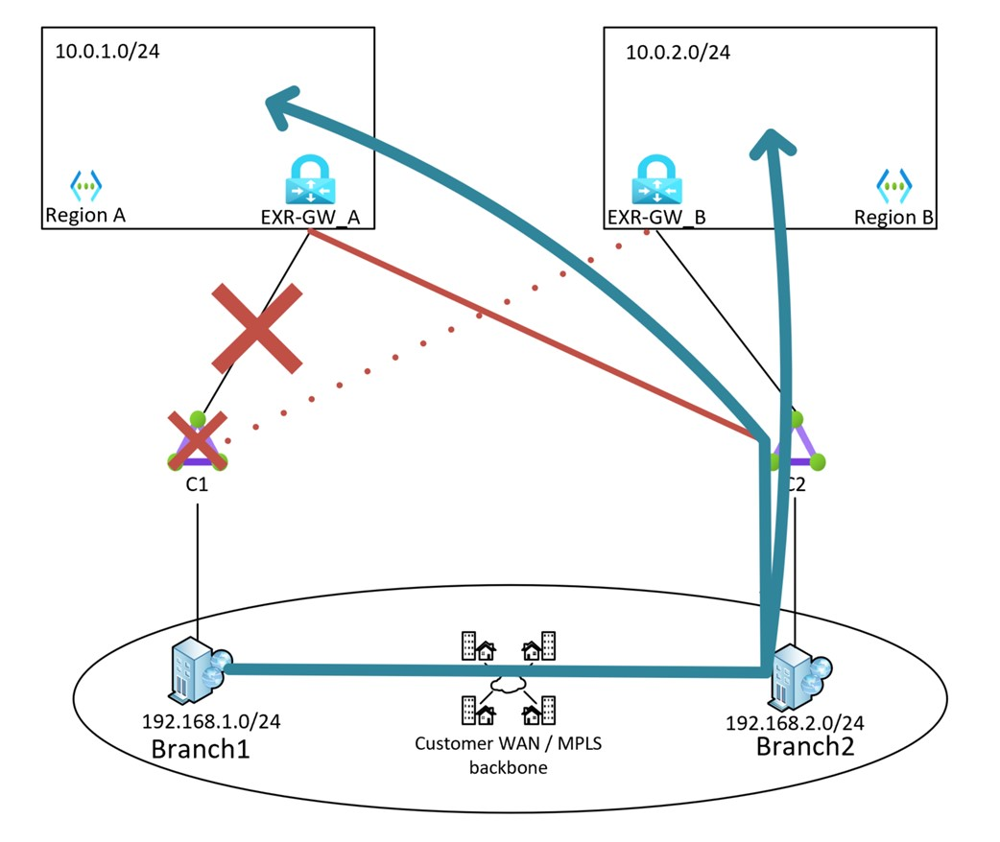

### 2.B Entire `Region A` Failure

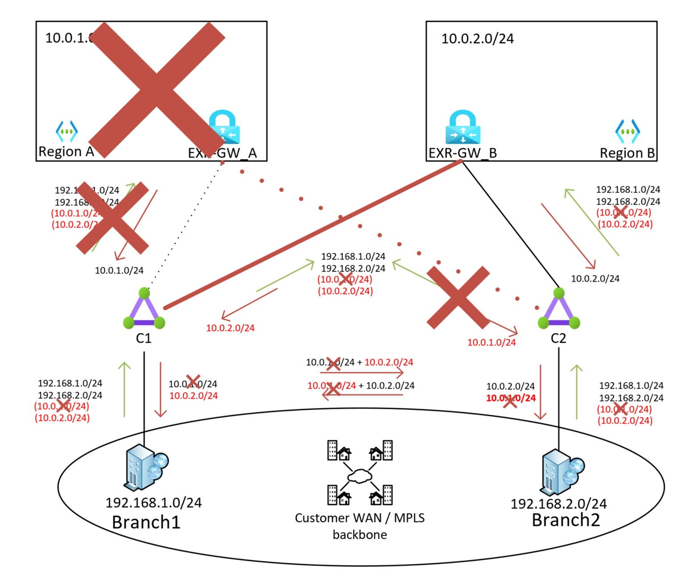

When `Region A` fails while `C1` remains healthy:
- **Zero MPLS Tromboning**: `Branch 1` ingresses onto the high-speed Microsoft backbone immediately at local Peering Location `C1` and rides the `C1 → HUB 2` cross-connection directly to `Region B`.
- Customer MPLS bandwidth is completely offloaded during DR, and latency follows Microsoft's optical fiber backbone.
- **Isolated Branches (No MPLS)**: Even without an MPLS link between branches, **isolated `Branch 1` retains full connectivity to `Region B`** via `C1 → HUB 2`!

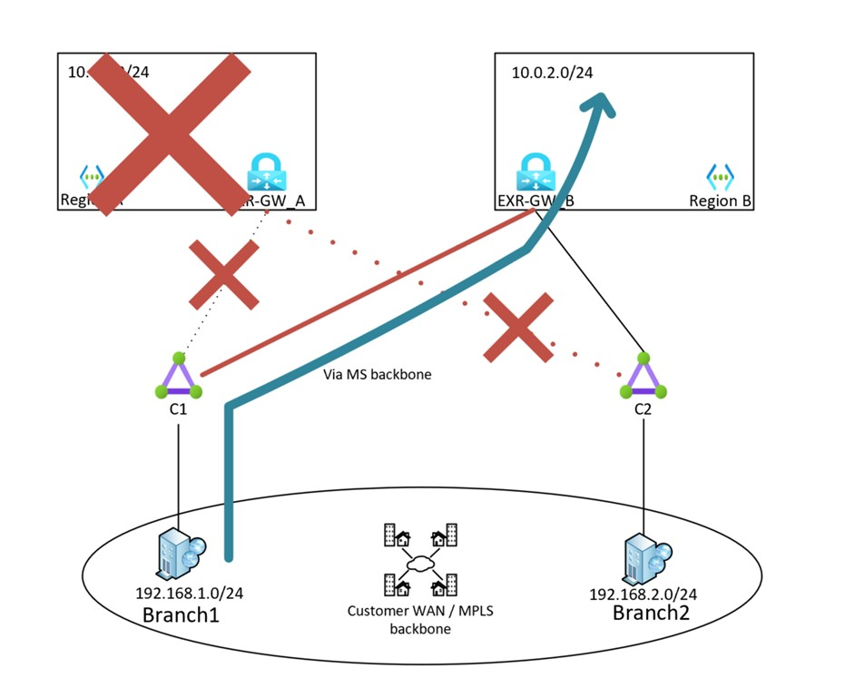

---

## 3. Azure Virtual WAN Without Bow-Tie

In **[Azure Virtual WAN Standard](/azure-networking/02-core-topologies/virtual-wan-and-routing-intent/)**, `vHUB 1` (`Region A`) and `vHUB 2` (`Region B`) automatically form an any-to-any transit mesh over the Microsoft backbone. Here, `vHUB 1` connects only to `C1` and `vHUB 2` connects only to `C2`.

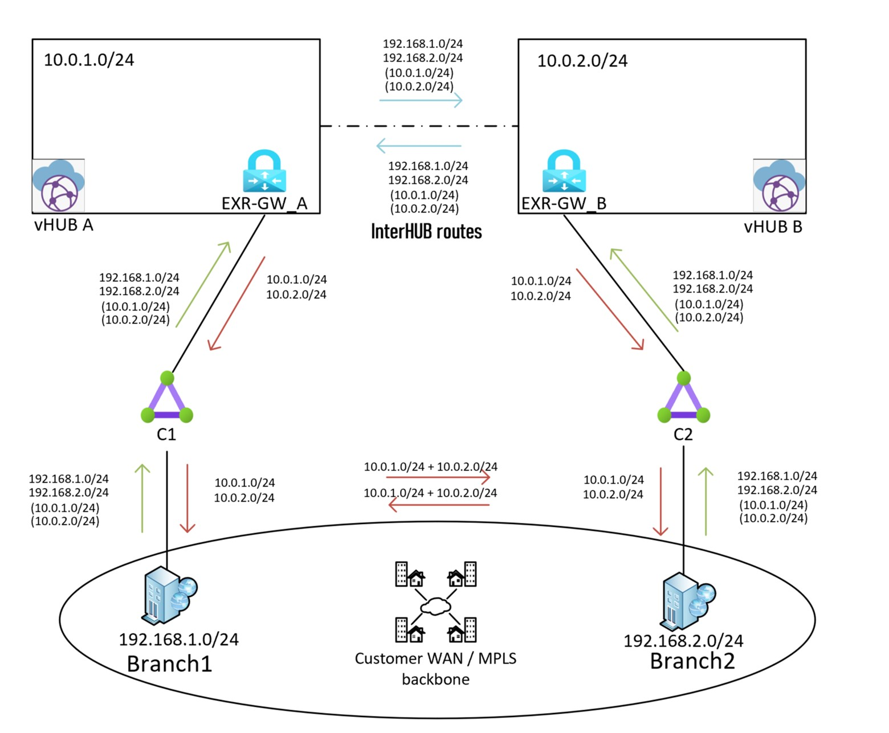

### 3.A Peering Location / Circuit `C1` Failure

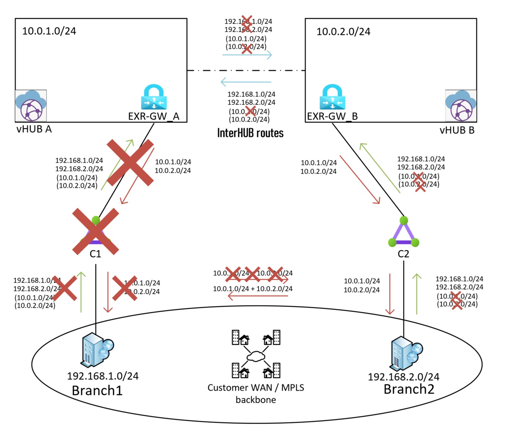

Here Virtual WAN delivers a major architectural advantage over unpeered Hub-and-Spoke:
- **Even without Bow-Tie cross-connections, both `Region A` and `Region B` remain reachable!**
- Traffic from `Branch 1` traverses the customer MPLS WAN to `Branch 2` → enters `vHUB 2` via `C2` → **transits the vWAN inter-hub backbone (`vHUB 2 → vHUB 1`)** to reach spokes in `Region A`.
- Trade-off: `Branch 1` traffic must ride the customer MPLS WAN to reach `C2`, consuming MPLS capacity and adding WAN latency.
- **Isolated Branches (No MPLS)**: Without a WAN path to `C2`, `Branch 1` loses Azure access when `C1` fails.

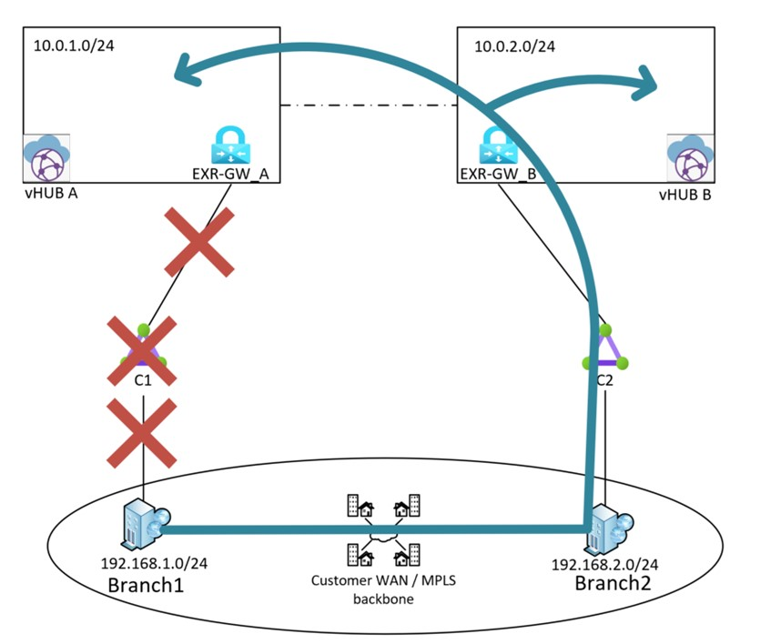

### 3.B Entire `Region A` Failure

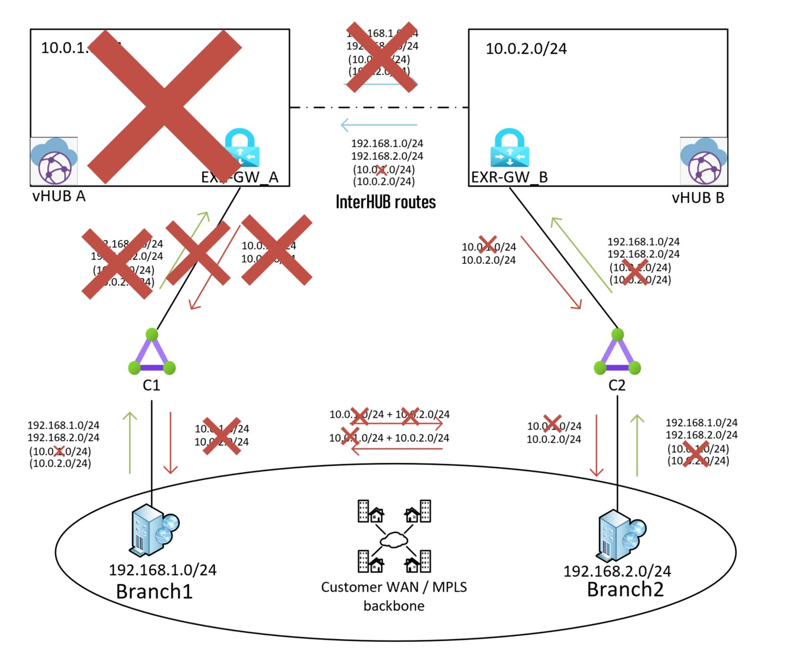

Look closely at what happens when `Region A` (and therefore `vHUB 1`) goes down in a **Non-Bow-Tie vWAN**:
- Because `C1` was **only** connected to `vHUB 1`, losing `Region A` orphans `C1` from Virtual WAN!
- `Branch 1` **cannot** enter the Microsoft backbone at `C1` to reach `Region B`; it is forced onto the customer MPLS WAN to `Branch 2 → C2 → vHUB 2`.
- **Isolated Branches (No MPLS)**: `Branch 1` loses all connectivity to `Region B`, despite `C1` being completely healthy!

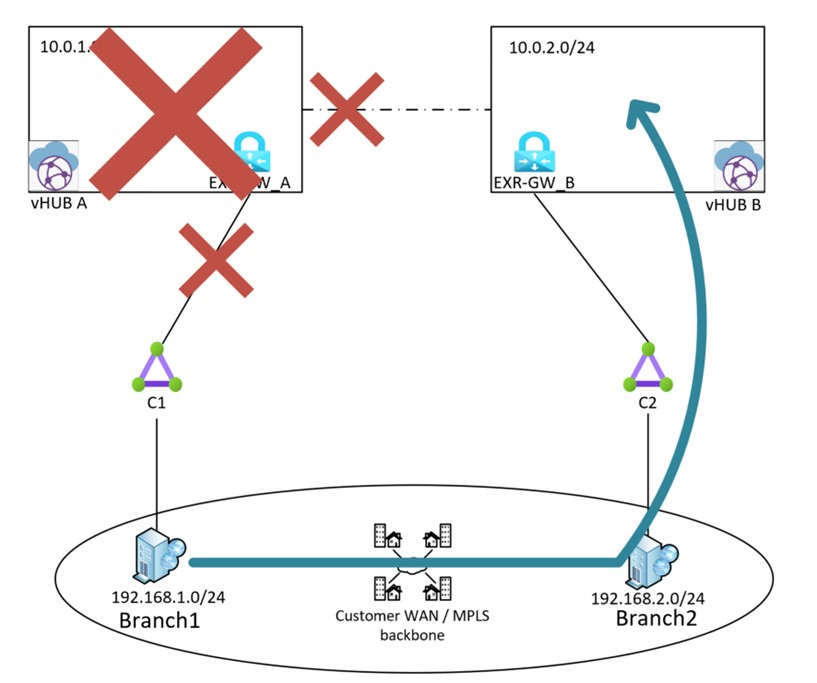

---

## 4. Azure Virtual WAN With Bow-Tie

Each ExpressRoute circuit connects to **both** `vHUB 1` and `vHUB 2`, combining Virtual WAN's inter-hub mesh with direct circuit cross-connections.

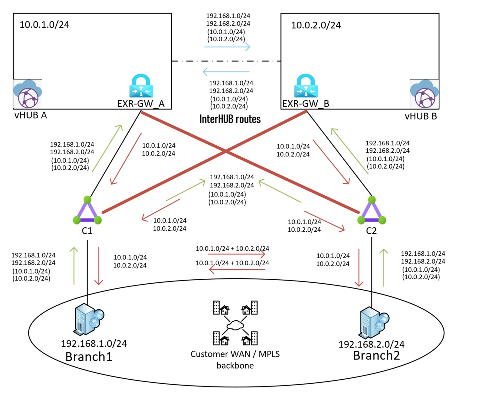

### 4.A Peering Location / Circuit `C1` Failure

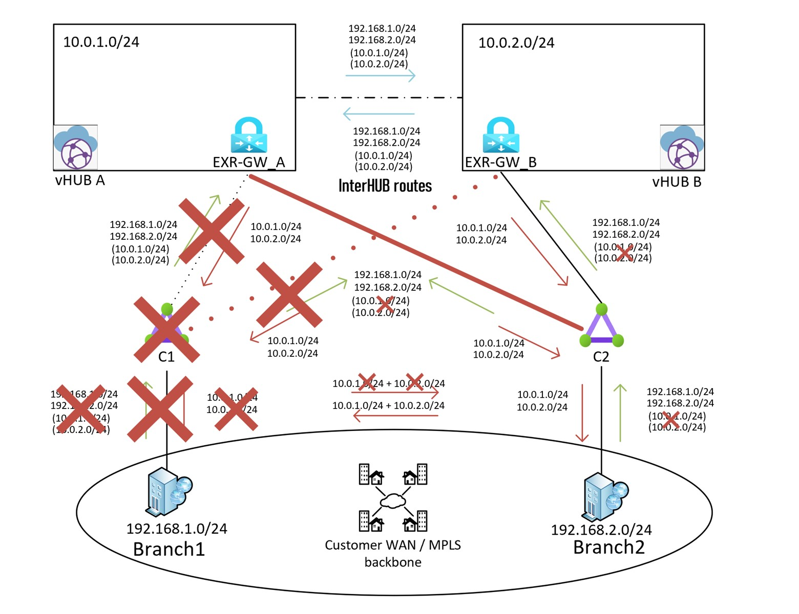

When `C1` fails:
- Both `Region A` and `Region B` remain reachable from all branches (`Branch 1` traverses MPLS to `C2`, which connects directly into both `vHUB 1` and `vHUB 2`).
- Inter-region VNet-to-VNet traffic (`Region A ↔ Region B`) seamlessly uses the vWAN inter-hub Microsoft backbone (avoiding MSEE hairpinning, provided `Hub Routing Preference` and route advertisements are properly configured—see Section 5).
- **Isolated Branches (No MPLS)**: Losing `C1` isolates `Branch 1` unless backed up by S2S VPN / SD-WAN into vWAN.

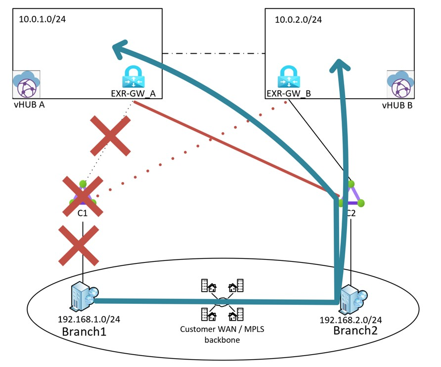

### 4.B Entire `Region A` Failure

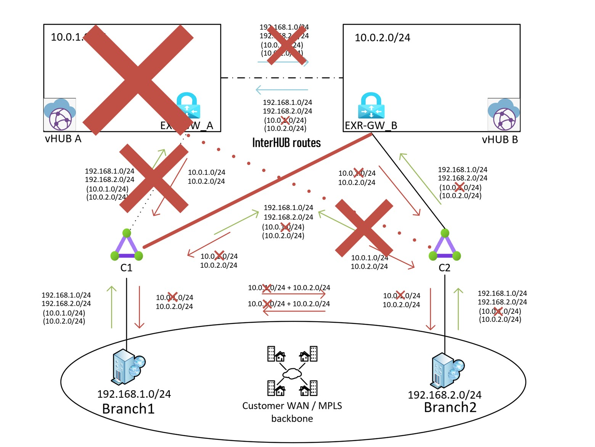

When `Region A` (`vHUB 1`) fails:
- `Branch 1` enters the Microsoft backbone locally at `C1` and rides `C1 → vHUB 2` directly into `Region B`—**zero MPLS saturation and optimal backbone latency**.
- **Isolated Branches (No MPLS)**: Isolated `Branch 1` **survives the `Region A` outage completely**, reaching `Region B` directly over `C1 → vHUB 2`!

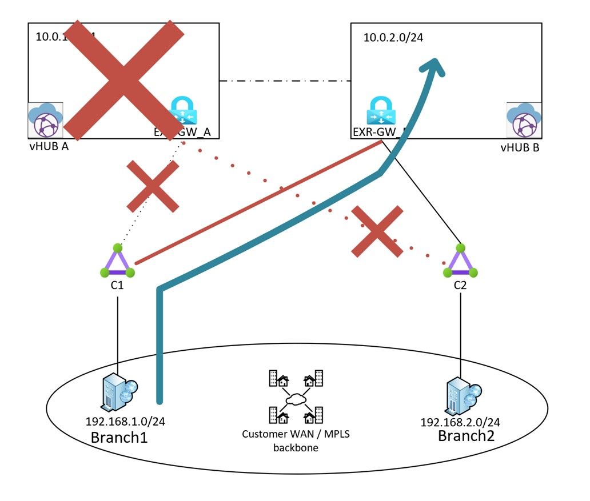

---

## 5. Crucial Nuances: Global Reach, MPLS Hairpinning & vWAN Routing

Before blindly wiring Bow-Tie cross-connections in production, validate three subtle routing interactions:

### 1. ExpressRoute Global Reach vs. Branch-to-Branch Transit
Neither Standard Hub-and-Spoke nor Virtual WAN allows two ExpressRoute circuits (`C1` and `C2`) to transit **on-premises Branch-to-Branch** traffic simply through an ExpressRoute Gateway alone.
- To route `Branch 1 ↔ Branch 2` across the Microsoft backbone (for isolated branches or MPLS offload), enable **[ExpressRoute Global Reach](https://learn.microsoft.com/en-us/azure/expressroute/expressroute-global-reach)** directly between `C1` and `C2` at the MSEE layer.
- **Critical Failure Interaction**: If `Branch 1` and `Branch 2` are linked via **ExpressRoute Global Reach** between `C1` and `C2` (even without an MPLS WAN!), then:
  - During a **`Region A` failure**, Global Reach isn't even needed if Bow-Tie (`C1 → HUB 2`) exists—and even *without* Bow-Tie, `Branch 1` can ride **Global Reach (`C1 → MSEE backbone → C2 → HUB 2`)** to reach `Region B`!
  - During a **Peering Location `C1` failure**, Global Reach at `C1` also goes down because `C1`'s MSEE routers are in the failed peering facility.

### 2. Preventing VNet-to-VNet Hairpinning Over MSEEs in vWAN Bow-Tie
By default in Virtual WAN, the hub router prefers routes learned directly from a local **ExpressRoute connection** over **Inter-Hub** routes when Virtual Hub Routing Preference is set to `ExpressRoute`.
- In a **vWAN Bow-Tie** where both `vHUB 1` and `vHUB 2` connect to `C1` and `C2`, if your on-premises/MPLS provider **re-advertises Azure prefixes** learned on `C1` back into Azure or if MSEE VNet-to-VNet transit is enabled, `vHUB 1` could mistakenly prefer the MSEE path over the native vWAN inter-hub link!
- **Fix**: Never re-advertise Azure `10.x` supernets from CE/PE routers back toward MSEEs (filter outbound BGP on CE routers using prefix lists or [BGP communities](/azure-networking/03-hybrid-connectivity/expressroute-traffic-segregation/)), keep VNet-to-VNet over ExpressRoute disabled, and set **[Virtual Hub Routing Preference](https://learn.microsoft.com/en-us/azure/virtual-wan/about-virtual-hub-routing-preference)** to **`AS-Path`** when engineering multi-hub paths.

### 3. Stateful On-Premises Firewalls & Asymmetric Paths
In any Bow-Tie topology, `HUB 1` advertises `Region A` prefixes over **both `C1` and `C2`**. Without traffic engineering, Azure ECMPs return traffic across `C1` and `C2` while on-premises sends ingress via `C1`—causing stateful firewall drops.
- Always pair **Azure `ConnectionWeight`** (e.g., `Weight = 100` on `HUB 1 ↔ C1`, `Weight = 0` on `HUB 1 ↔ C2`) with **On-Premises BGP `Local Preference`** (or AS-path prepending) so steady-state forward and reverse flows pin symmetrically to the same circuit.

---

## Consolidated Failure-Mode Matrix

### Scenario Matrix A: Peering Location / Circuit `C1` Failure (`Region A` Healthy)

| Topology | Reach `Region A` (with MPLS)? | Reach `Region B` (with MPLS)? | Reach `Region B` (Isolated Branch 1, No MPLS)? | Inter-Region (`Region A ↔ B`) Survives? |
| --- | --- | --- | --- | --- |
| **Hub & Spoke — No Bow-Tie** | **No** (unless global peering + NVA/ARS transit exists) | Yes (via MPLS) | **No** | Only if globally VNet-peered |
| **Hub & Spoke — Bow-Tie** | **Yes** (via MPLS + `C2 → HUB 1`) | Yes (via MPLS) | **No** | Yes (Global Peering recommended; `C2` fallback) |
| **Virtual WAN — No Bow-Tie** | **Yes** (via MPLS + `C2 → vHUB 2 → vHUB 1`) | Yes (via MPLS) | **No** | **Yes** (Native vWAN backbone) |
| **Virtual WAN — Bow-Tie** | **Yes** (via MPLS + `C2 → vHUB 1`) | Yes (via MPLS) | **No** | **Yes** (Native vWAN backbone) |

### Scenario Matrix B: Full Azure `Region A` Failure (`C1` Peering Healthy)

| Topology | Reach `Region B` DR? | Offloads Customer MPLS WAN? | Isolated `Branch 1` (No MPLS) Reaches `Region B`? | Failover Path Taken by `Branch 1` |
| --- | --- | --- | --- | --- |
| **Hub & Spoke — No Bow-Tie** | Yes (if MPLS exists) | **No** (Saturates MPLS) | **No** (Unless ER Global Reach `C1↔C2` is enabled) | `Branch 1 → MPLS → Branch 2 → C2 → HUB 2` |
| **Hub & Spoke — Bow-Tie** | **Yes** | **Yes** (Uses MS Backbone) | **Yes** | `Branch 1 → C1 → MS Backbone → HUB 2` |
| **Virtual WAN — No Bow-Tie** | Yes (if MPLS exists) | **No** (Saturates MPLS) | **No** (Unless ER Global Reach `C1↔C2` is enabled) | `Branch 1 → MPLS → Branch 2 → C2 → vHUB 2` |
| **Virtual WAN — Bow-Tie** | **Yes** | **Yes** (Uses MS Backbone) | **Yes** | `Branch 1 → C1 → MS Backbone → vHUB 2` |

---

## What I Recommend

1. **Always wire Bow-Tie cross-connections for Standard Hub-and-Spoke.** Without Bow-Tie (or complex NVA/ARS cross-region transit), a single peering-location failure completely severs on-premises access to an otherwise healthy Azure region.
2. **Still wire Bow-Tie cross-connections in Virtual WAN if MPLS capacity is constrained or branches lack inter-site WAN links.** While vWAN survives a *circuit* outage without Bow-Tie via inter-hub transit, **only a Bow-Tie (or Global Reach)** prevents a *regional vHub* outage from forcing `Branch 1` traffic back onto your corporate MPLS network.
3. **Never use Bow-Tie ExpressRoute circuits for Azure-to-Azure east-west traffic.** Use Global VNet Peering (in Hub-and-Spoke) or native vWAN inter-hub routing, block CE re-advertisement of Azure prefixes, and enforce symmetric `ConnectionWeight` + BGP `Local Preference` on day one.
