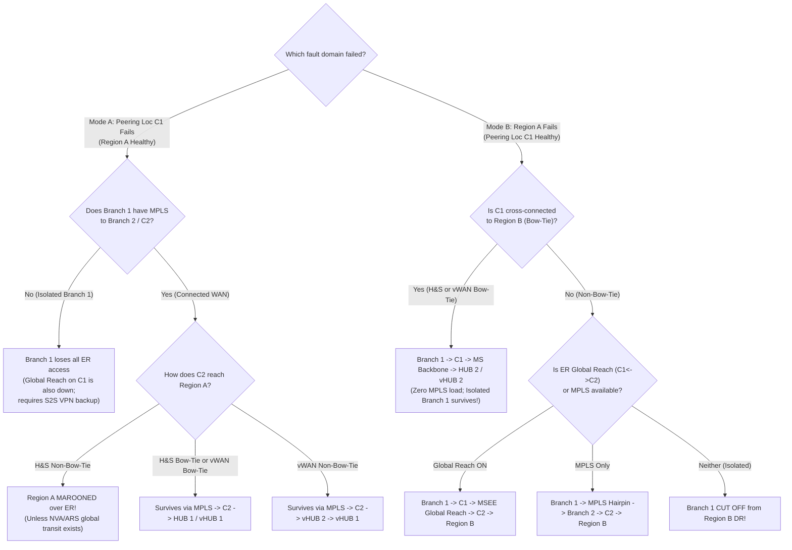
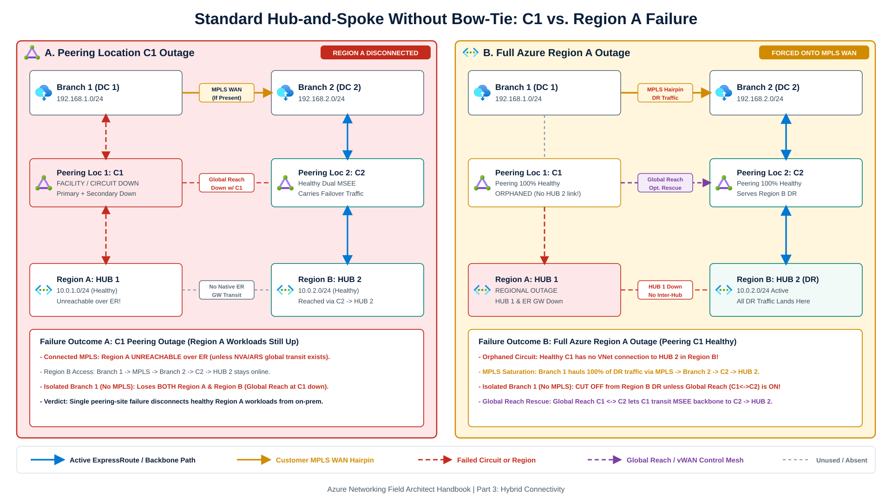
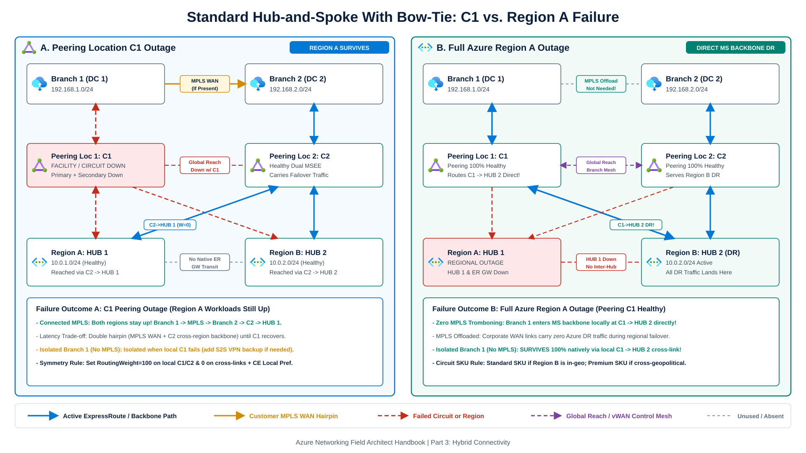
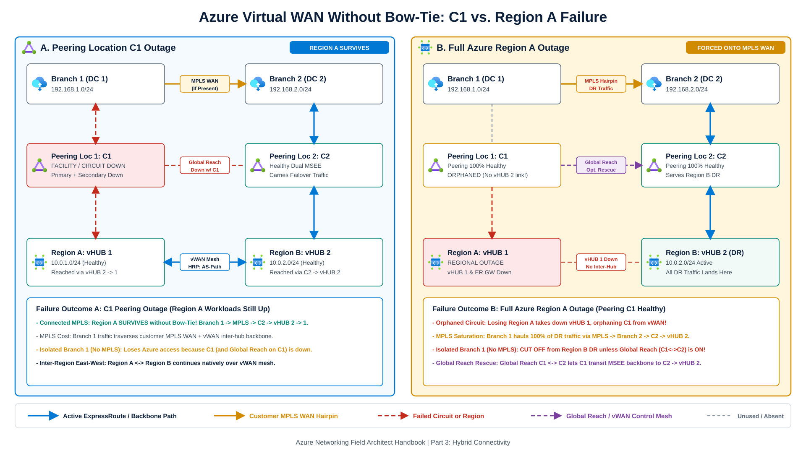
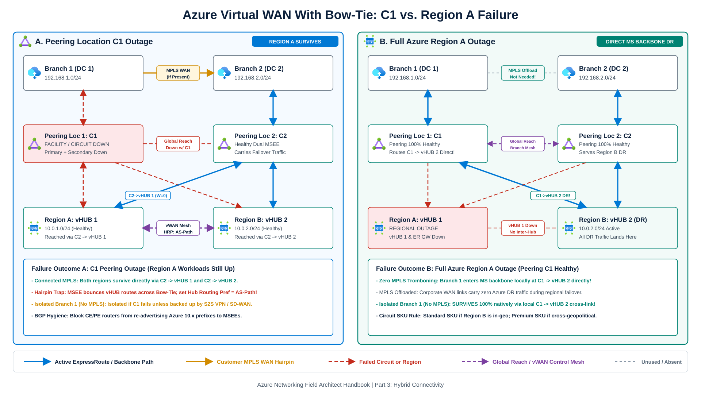
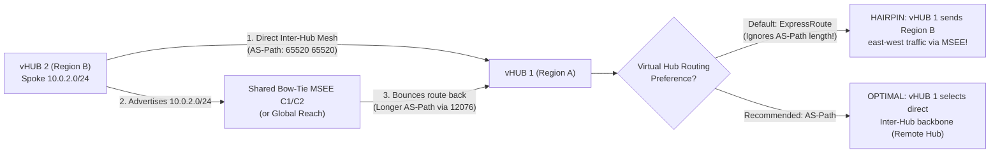

Architecture reviews over **ExpressRoute cross-connections ("Bow-Tie" topologies)** often stall because teams mix up two separate disaster scenarios:

1. **Failure Mode A (Peering Location / Circuit `C1` Outage)**: Both Primary and Secondary MSEE connections of Circuit 1 (`C1`) fail at the colocation facility while **Azure Region A remains completely healthy**.
2. **Failure Mode B (Full Azure `Region A` Outage)**: **Azure Region A** (including its hub VNet or Virtual WAN hub and ExpressRoute Gateway) suffers a full regional outage while **Peering Location 1 (`C1`) and the Microsoft WAN backbone remain healthy**.

This chapter compares how **customer-managed Hub-and-Spoke** and **Azure Virtual WAN Standard** behave across all four topology combinations, accounting for customer MPLS hairpinning, isolated branches without inter-site WAN links, **ExpressRoute Global Reach**, and Virtual WAN hub routing preference. For single-region circuit, Metro, BFD, and S2S VPN resiliency rules, see **[ExpressRoute Architecture & Resiliency](/azure-networking/03-hybrid-connectivity/expressroute-resiliency/)**.

---

## Baseline topology assumptions

All four architectures below evaluate the same dual-region, dual-location enterprise footprint:
- **Two Azure regions** (`Region A` hosting `10.0.1.0/24` and `Region B` hosting `10.0.2.0/24`), each running a zone-redundant regional hub (`HUB 1` / `HUB 2` or `vHUB 1` / `vHUB 2`).
- **Two ExpressRoute circuits** (`C1` and `C2`) in two geographically distinct peering locations. Both circuits use **Standard SKU** when `Region A` and `Region B` sit in the same geopolitical zone, or **Premium SKU** on both circuits when spanning geopolitical zones.
- **Two on-premises datacenters or branches** (`Branch 1` on `192.168.1.0/24` connected to `C1`, and `Branch 2` on `192.168.2.0/24` connected to `C2`), evaluated under two WAN conditions:
  - **Connected WAN**: `Branch 1` and `Branch 2` share a private MPLS/IPVPN or SD-WAN backbone.
  - **Isolated branch**: `Branch 1` and `Branch 2` have **no** private WAN path between them and depend solely on their local ExpressRoute circuit.

:::note[Global VNet Peering in Customer-Managed Hub-and-Spoke]
Sections 1 and 2 omit NVA-routed Global VNet Peering transit between `HUB 1` and `HUB 2` so pure ExpressRoute gateway behavior is visible. Standard Global VNet Peering never transits one regional ExpressRoute Gateway through another natively. In production customer-managed Hub-and-Spoke estates, always pair Bow-Tie circuits with Global VNet Peering between regional hubs (using firewall/NVA UDRs or [Azure Route Server](/azure-networking/02-core-topologies/hub-spoke-and-route-server/)) for east-west Azure traffic rather than bouncing VNet-to-VNet packets through MSEE routers.
:::

---

## 1. Customer-managed hub-and-spoke without Bow-Tie

Each regional Hub VNet connects only to its local ExpressRoute circuit (`HUB 1` to `C1`, `HUB 2` to `C2`).

### 1.A Peering location / circuit `C1` outage (`Region A` healthy)

When Peering Location 1 fails completely while workloads in `Region A` remain up:
- **`Region A` is disconnected from on-premises over ExpressRoute.** Because `HUB 1` has no connection to `C2` and standard VNet peering does not transit ExpressRoute gateways across regions without custom NVA or Route Server transit, neither `Branch 1` nor `Branch 2` can reach `Region A` over ExpressRoute.
- With a connected MPLS WAN, `Branch 1` still reaches `Region B` by routing across the customer WAN (`Branch 1 -> MPLS -> Branch 2 -> C2 -> HUB 2`).
- An isolated `Branch 1` without inter-branch MPLS loses connectivity to **both** `Region A` and `Region B`.

### 1.B Full Azure `Region A` outage (`C1` peering healthy)

When `Region A` suffers a regional outage and disaster recovery workloads activate in `Region B`:
- Peering Location 1 and `C1` remain healthy, yet `C1` is orphaned because it has no ExpressRoute connection to `HUB 2`.
- With a connected MPLS WAN, `Branch 1` must send 100% of its `Region B` disaster recovery traffic across the customer MPLS network to `Branch 2 -> C2 -> HUB 2`, adding WAN latency and risking MPLS congestion during failover.
- An isolated `Branch 1` without MPLS is cut off from `Region B` DR workloads unless **ExpressRoute Global Reach** links `C1` and `C2` across the MSEE backbone.

---

## 2. Customer-managed hub-and-spoke with Bow-Tie

Each ExpressRoute circuit connects to **both** regional Hub ExpressRoute Gateways (`HUB 1` connects to `C1` and `C2`; `HUB 2` connects to `C2` and `C1`). Setting higher `RoutingWeight` on local connections (`RoutingWeight = 100` on `HUB 1 <-> C1` and `HUB 2 <-> C2`; `RoutingWeight = 0` on cross-connections) paired with matching on-premises BGP `Local Preference` pins steady-state traffic symmetrically to the local circuit.

### 2.A Peering location / circuit `C1` outage (`Region A` healthy)

When `C1` fails:
- With a connected MPLS WAN, both `Region A` and `Region B` remain reachable from all branches without invoking regional application DR. `Branch 1` traverses the customer MPLS WAN to `Branch 2`, enters the Microsoft backbone at `C2`, and crosses the `C2 -> HUB 1` backup connection into `Region A`.
- That failover path introduces a double hairpin (`Branch 1 -> MPLS -> Branch 2 -> C2 -> Microsoft Backbone -> HUB 1`) and higher RTT until `C1` recovers.
- An isolated `Branch 1` without MPLS still loses ExpressRoute access when its sole local circuit `C1` fails, requiring S2S VPN backup if branch isolation must be tolerated.

### 2.B Full Azure `Region A` outage (`C1` peering healthy)

When `Region A` fails while `C1` remains healthy:
- `Branch 1` enters the Microsoft network locally at `C1` and routes over the `C1 -> HUB 2` cross-connection directly to `Region B`.
- Corporate MPLS links between `Branch 1` and `Branch 2` carry zero Azure failover traffic.
- An isolated `Branch 1` without MPLS retains full connectivity to `Region B` natively over `C1 -> HUB 2`.

---

## 3. Azure Virtual WAN without Bow-Tie

In **[Azure Virtual WAN Standard](/azure-networking/02-core-topologies/virtual-wan-and-routing-intent/)**, `vHUB 1` (`Region A`) and `vHUB 2` (`Region B`) establish an automatic any-to-any transit mesh (`ASN 65520`) across the Microsoft backbone. Here, `vHUB 1` connects only to `C1` and `vHUB 2` connects only to `C2`.

### 3.A Peering location / circuit `C1` outage (`Region A` healthy)

Virtual WAN changes the circuit-failure outcome compared to unpeered Hub-and-Spoke:
- With a connected MPLS WAN, **both `Region A` and `Region B` stay reachable without Bow-Tie cross-connections.** `Branch 1` routes over the customer MPLS WAN to `Branch 2 -> C2 -> vHUB 2`, and Virtual WAN forwards packets across the inter-hub mesh (`vHUB 2 -> vHUB 1`) to spokes in `Region A`.
- `Branch 1` traffic still traverses the customer MPLS WAN to reach `C2`, consuming corporate WAN bandwidth during the `C1` outage.
- An isolated `Branch 1` without MPLS loses Azure connectivity when `C1` fails unless backed up by S2S VPN or SD-WAN into Virtual WAN.

### 3.B Full Azure `Region A` outage (`C1` peering healthy)

Regional failure exposes the hidden gap in Non-Bow-Tie Virtual WAN designs:
- **Losing `Region A` takes down `vHUB 1`, orphaning `C1` from Virtual WAN.** Because `C1` has no connection to `vHUB 2`, `Branch 1` cannot enter Virtual WAN at `C1`.
- With a connected MPLS WAN, `Branch 1` must send all `Region B` DR traffic over the customer MPLS WAN (`Branch 1 -> MPLS -> Branch 2 -> C2 -> vHUB 2`).
- An isolated `Branch 1` without MPLS loses all connectivity to `Region B` despite `C1` being completely healthy, unless **ExpressRoute Global Reach** links `C1` to `C2`.

---

## 4. Azure Virtual WAN with Bow-Tie

Each ExpressRoute circuit connects to **both** `vHUB 1` and `vHUB 2`, combining Virtual WAN inter-hub transit with direct cross-regional MSEE paths.

### 4.A Peering location / circuit `C1` outage (`Region A` healthy)

When `C1` fails:
- With a connected MPLS WAN, both `Region A` and `Region B` remain reachable directly from `C2` (`C2 -> vHUB 1` and `C2 -> vHUB 2`), while east-west spoke traffic (`Region A <-> Region B`) stays on the Virtual WAN inter-hub mesh once Hub Routing Preference is set to `AS-Path` (see Section 5).
- An isolated `Branch 1` without MPLS loses ExpressRoute access when `C1` fails unless backed up by S2S VPN or SD-WAN.

### 4.B Full Azure `Region A` outage (`C1` peering healthy)

When `Region A` (`vHUB 1`) fails:
- `Branch 1` enters the Microsoft network locally at `C1` and routes over `C1 -> vHUB 2` directly into `Region B` without touching corporate MPLS links.
- An isolated `Branch 1` without MPLS survives the `Region A` outage completely via `C1 -> vHUB 2`.

---

## 5. Production routing traps: Global Reach, vWAN route bounce, and symmetry

Wiring cross-connections without adjusting BGP policies introduces three well-documented routing pathologies on Azure:

### 1. ExpressRoute Global Reach vs. hub transit

Neither standard ExpressRoute Gateways nor Virtual WAN hubs transit on-premises **branch-to-branch** traffic between two ExpressRoute circuits (`C1 <-> C2`) through the gateway alone (`vHUB 1` does not re-advertise remote `C2` ExpressRoute prefixes down `C1`).
- Enable **[ExpressRoute Global Reach](https://learn.microsoft.com/en-us/azure/expressroute/expressroute-global-reach)** between `C1` and `C2` when branches need private communication across the Microsoft backbone (`ASN 12076` prepended on Global Reach routes; **Premium SKU** required on both circuits across geopolitical zones).
- In Non-Bow-Tie topologies (Sections 1.B and 3.B), Global Reach between `C1` and `C2` allows an isolated `Branch 1` to survive a full `Region A` outage (`Branch 1 -> C1 -> MSEE Global Reach -> C2 -> HUB 2 / vHUB 2`). During a **Peering Location `C1` outage**, Global Reach at `C1` fails alongside `C1` because both terminate on `C1`'s MSEE pair.

### 2. Stopping east-west VNet hairpinning in Virtual WAN Bow-Tie

In **[Virtual WAN routing](https://learn.microsoft.com/en-us/azure/virtual-wan/routing-deep-dive)**, cross-connecting `C1` and `C2` to both hubs (or enabling Global Reach between `C1` and `C2`) creates an east-west routing trap when Virtual Hub Routing Preference stays at its default setting (`ExpressRoute`):

An ExpressRoute circuit connected to multiple hubs bounces routes learned from `vHUB 2` back toward `vHUB 1` (and Global Reach similarly propagates routes with `12076` prepended). Because Virtual WAN's default **`ExpressRoute`** [hub routing preference](https://learn.microsoft.com/en-us/azure/virtual-wan/about-virtual-hub-routing-preference) prefers local ExpressRoute-learned routes over remote inter-hub routes regardless of AS-path length, `vHUB 1` hairpins east-west `Region A <-> Region B` VNet traffic through the MSEE routers.

Apply three controls to prevent east-west hairpinning:
1. Change **Virtual Hub Routing Preference** to **`AS-Path`** on both virtual hubs so shorter inter-hub paths beat bounced MSEE paths (note that routes from ExpressRoute circuits attached only to *remote* hubs are always evaluated last by a local hub).
2. If S2S VPN or SD-WAN branches coexist in the hub and advertise the same on-premises prefixes as ExpressRoute, **prepend the on-premises VPN ASN** so `AS-Path` preference still selects ExpressRoute over VPN for hybrid traffic.
3. Filter outbound BGP on CE/PE routers (using prefix lists or [BGP communities](/azure-networking/03-hybrid-connectivity/expressroute-traffic-segregation/)) so customer MPLS routers never re-advertise Azure `10.x` supernets back into MSEEs, and keep VNet-to-VNet over ExpressRoute disabled on standard VNet gateways.

### 3. Symmetric path selection across parallel circuits

When an Azure VNet or Virtual WAN hub learns identical prefixes across parallel ExpressRoute circuits (`C1` and `C2`), [Azure selects outbound paths](https://learn.microsoft.com/en-us/azure/expressroute/designing-for-disaster-recovery-with-expressroute-privatepeering) in strict order:
1. **Longest Prefix Match (LPM)** (for example `/25` on preferred circuit, `/24` summary on standby circuit).
2. **Highest `RoutingWeight`** (`0` to `32000`, default `0`) on the ExpressRoute Connection resource.
3. **Shortest BGP AS-Path length** (via on-premises AS-path prepending on the secondary circuit).
4. **Equal-cost multipath (ECMP)**: Standalone ExpressRoute VNet Gateways (`ErGw3AZ` / `UltraPerformance` / `ErGwScale` at `>=10` scale units) load-balance per flow across up to **16** equal-cost circuits by default. Virtual WAN hub ExpressRoute gateways connect up to **8** circuits across peering locations (`4` per peering location) and keep multi-circuit ExpressRoute ECMP (up to 2 circuits) **disabled by default**.

Whenever you steer Azure-to-on-premises traffic with `RoutingWeight`, LPM, or AS-path prepending, apply a matching on-premises iBGP **`Local Preference`** (or IGP metric across your WAN inter-site link) so forward and reverse flows traverse the same circuit and never trigger stateful firewall drops.

---

## Consolidated failure-mode matrices

### Matrix A: Peering location / circuit `C1` outage (`Region A` healthy)

| Topology | Reach `Region A` (Connected MPLS)? | Reach `Region B` (Connected MPLS)? | Reach Azure (Isolated `Branch 1`, No MPLS)? | Inter-Region (`Region A <-> B`) Path |
| --- | --- | --- | --- | --- |
| **Hub-and-Spoke (No Bow-Tie)** | **No** (unless global peering + NVA/ARS transit exists) | Yes (`MPLS -> C2 -> HUB 2`) | **No** (`C1` and `C1` Global Reach down) | Global VNet Peering (if configured) |
| **Hub-and-Spoke (Bow-Tie)** | **Yes** (`MPLS -> C2 -> HUB 1`) | Yes (`MPLS -> C2 -> HUB 2`) | **No** (requires S2S VPN backup) | Global VNet Peering (`C2` not used when VNet-to-VNet over ER is disabled) |
| **Virtual WAN (No Bow-Tie)** | **Yes** (`MPLS -> C2 -> vHUB 2 -> vHUB 1`) | Yes (`MPLS -> C2 -> vHUB 2`) | **No** (requires S2S VPN / SD-WAN) | **Native vWAN inter-hub mesh** |
| **Virtual WAN (Bow-Tie)** | **Yes** (`MPLS -> C2 -> vHUB 1`) | Yes (`MPLS -> C2 -> vHUB 2`) | **No** (requires S2S VPN / SD-WAN) | **Native vWAN inter-hub mesh** (set Hub Routing Preference = `AS-Path`) |

### Matrix B: Full Azure `Region A` outage (`C1` peering healthy)

| Topology | Reach `Region B` DR (Connected MPLS)? | Offloads Customer MPLS WAN? | Isolated `Branch 1` (No MPLS) Reaches `Region B`? | Failover Path Taken by `Branch 1` |
| --- | --- | --- | --- | --- |
| **Hub-and-Spoke (No Bow-Tie)** | Yes | **No** (hauls DR traffic over MPLS) | **No** (unless Global Reach `C1<->C2` is enabled) | `Branch 1 -> MPLS -> Branch 2 -> C2 -> HUB 2` |
| **Hub-and-Spoke (Bow-Tie)** | **Yes** | **Yes** (uses Microsoft backbone) | **Yes** | `Branch 1 -> C1 -> Microsoft Backbone -> HUB 2` |
| **Virtual WAN (No Bow-Tie)** | Yes | **No** (orphans `C1`; hauls over MPLS) | **No** (unless Global Reach `C1<->C2` is enabled) | `Branch 1 -> MPLS -> Branch 2 -> C2 -> vHUB 2` |
| **Virtual WAN (Bow-Tie)** | **Yes** | **Yes** (uses Microsoft backbone) | **Yes** | `Branch 1 -> C1 -> Microsoft Backbone -> vHUB 2` |

---

## Architecture checklist

1. **Wire Bow-Tie cross-connections on all multi-region customer-managed Hub-and-Spoke deployments.** Without Bow-Tie (or custom cross-region NVA/ARS transit), losing one colocation peering site disconnects an entire healthy Azure region from on-premises.
2. **Add Bow-Tie cross-connections to Virtual WAN when MPLS bandwidth is constrained or branches are isolated.** Virtual WAN survives a *circuit* outage without Bow-Tie via inter-hub transit, whereas surviving a *regional vHub* outage without hauling failover traffic across your MPLS WAN requires Bow-Tie (`C1 -> vHUB 2`) or ExpressRoute Global Reach (`C1 <-> C2`).
3. **Set Virtual Hub Routing Preference to `AS-Path` on every vWAN Bow-Tie or Global Reach deployment.** Prepend coexisting S2S VPN ASNs, block CE/PE routers from re-advertising Azure `10.x` prefixes into MSEEs, and pair Azure `RoutingWeight` with on-premises BGP `Local Preference` so east-west and hybrid flows stay symmetric.

---

## Microsoft Learn references

- [Designing for disaster recovery with ExpressRoute private peering](https://learn.microsoft.com/en-us/azure/expressroute/designing-for-disaster-recovery-with-expressroute-privatepeering)
- [Virtual WAN routing deep dive (Global Reach and Bow-Tie scenarios)](https://learn.microsoft.com/en-us/azure/virtual-wan/routing-deep-dive)
- [Virtual hub routing preference in Azure Virtual WAN](https://learn.microsoft.com/en-us/azure/virtual-wan/about-virtual-hub-routing-preference)
- [Disaster recovery design for Azure Virtual WAN](https://learn.microsoft.com/en-us/azure/virtual-wan/disaster-recovery-design)
- [About ExpressRoute Global Reach](https://learn.microsoft.com/en-us/azure/expressroute/expressroute-global-reach)
- [Connectivity between virtual networks over ExpressRoute](https://learn.microsoft.com/en-us/azure/expressroute/virtual-network-connectivity-guidance)

