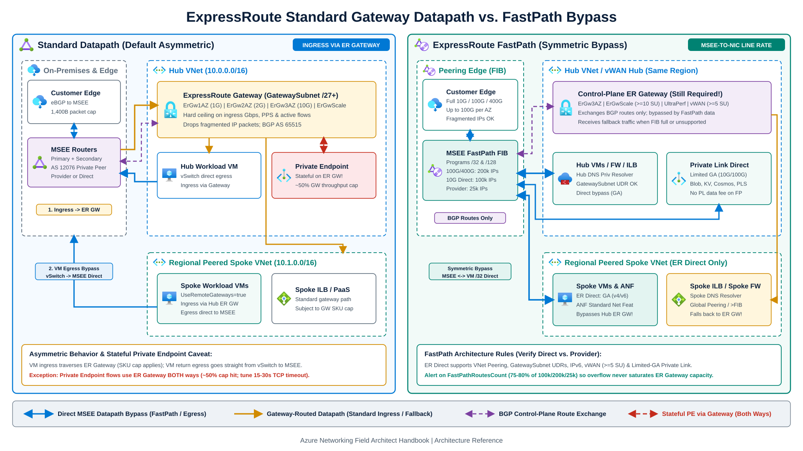
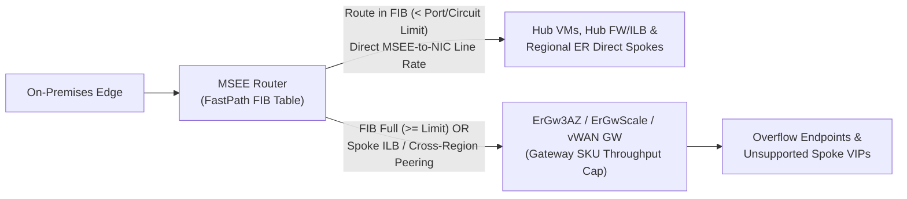

Selecting an undersized ExpressRoute virtual network gateway SKU, or misreading how return traffic bypasses it, creates throughput caps, zone-level outage exposure, and packet drops on Private Endpoints.

This chapter compares zone-redundant ExpressRoute gateway SKUs (including `ErGwScale` scalable gateways and Virtual WAN ExpressRoute gateways), contrasts the default asymmetric datapath against ExpressRoute FastPath, and documents verified circuit capabilities, IP route limits, and Azure Monitor alert metrics.

---

## 1. ExpressRoute gateway SKU selector

ExpressRoute virtual network gateways fall into two SKU families: **zone-redundant SKUs** (`ErGw1AZ`, `ErGw2AZ`, `ErGw3AZ`, and `ErGwScale`) and **legacy non-zone-redundant SKUs** (`Standard`, `HighPerformance`, and `UltraPerformance`).

:::danger[Retire Basic Public IPs and Migrate Legacy Non-AZ Gateways]
Legacy `Standard`, `HighPerformance`, and `UltraPerformance` SKUs deploy inside a single fault domain without Availability Zone redundancy, so a single zonal power or cooling event can take down regional hybrid BGP and ingress forwarding. Azure also retired Basic SKU Public IP addresses on **September 30, 2025** (with Azure Dedicated HSM Basic-IP ExpressRoute gateways extended only until **March 31, 2027**). Deploy `ErGw1AZ`, `ErGw2AZ`, `ErGw3AZ`, or `ErGwScale` for all production workloads.

Transition existing Basic-IP gateways (`Standard`, `HighPerformance`, `UltraPerformance`) using the guided [ExpressRoute gateway migration experience](https://learn.microsoft.com/en-us/azure/expressroute/gateway-migration) (`Validate` -> `Prepare` [up to 45 min] -> `Migrate` [up to 15 min] -> `Commit` [within 15 days]). Azure deploys a parallel gateway in `GatewaySubnet` with a Microsoft-managed Standard Public IP and tags it `CreatedBy: GatewaySKUMigration`. Microsoft also runs managed migrations to move remaining Basic-IP gateways onto Standard Public IPs. Do **not** run the standard gateway migration tool, modify, or recreate the gateway in a VNet containing **Azure Dedicated HSM**: doing so breaks its service-managed circuit. Instead, deploy a parallel Standard-IP Dedicated HSM environment and migrate workloads before March 31, 2027 ([Dedicated HSM gateway migration](https://learn.microsoft.com/en-us/azure/dedicated-hsm/migration-basic-standard)).

Gateways already running **`ErGw1AZ`, `ErGw2AZ`, or `ErGw3AZ`** upgrade **in place** directly to `ErGwScale` through the portal or PowerShell without the migration tool (takes up to 2 hours without data-plane downtime). By contrast, legacy non-AZ gateways (`Standard`, `HighPerformance`, `UltraPerformance`) that already use a Standard or auto-assigned Public IP can upgrade in place only within the non-AZ family; moving them to `ErGw1AZ/2AZ/3AZ` or `ErGwScale` requires deleting and recreating the gateway with a maintenance outage because the migration tool accepts only Basic-IP gateways.
:::

### Gateway capacity, limits, and feature matrix

| Gateway SKU | Zone redundant | Throughput | Packets / sec (PPS) | Connections / sec (CPS) | Max circuit connections¹ | Supported VMs / endpoints² | Flow count limit | Learned routes³ | FastPath support |
| --- | --- | --- | --- | --- | --- | --- | --- | --- | --- |
| **`ErGw1AZ`** *(replaces Standard)* | Yes | 1 Gbps *(1,000 Mbps)* | 100,000 | SKU-bound | 4 | 2,000 | 200,000 | 4,000 | No |
| **`ErGw2AZ`** *(replaces HighPerformance)* | Yes | 2 Gbps *(2,000 Mbps)* | 200,000 | SKU-bound | 8 | 4,500 | 400,000 | 9,500 | No |
| **`ErGw3AZ`** *(replaces UltraPerformance)* | Yes | 10 Gbps *(10,000 Mbps)* | 1,000,000 | SKU-bound | 16 | 11,000 | 1,000,000 | 9,500 | **Yes** *(also on legacy UltraPerformance)* |
| **`ErGwScale`** *(SU 1-10)* | Yes | 1 Gbps / SU *(up to 10 Gbps)* | 100,000 / SU *(1M @ 10 SU)* | 7,000 / SU *(70k @ 10 SU)* | 4 *(SU 1)* · 8 *(SU 2-9)* · 16 *(SU 10+)* | 2,000 / SU *(20k @ 10 SU)* | 100,000 / SU *(1M @ 10 SU)* | 9,500 total | **Yes** *(min 10 SU)* |
| **`ErGwScale`** *(SU 11-40)* | Yes | 1 Gbps / SU *(up to 40 Gbps)* | 200,000 / SU *(2M @ 20 SU; 8M @ 40 SU)* | 7,000 / SU *(280k @ 40 SU)* | 16 | +1,000 / SU *(30k @ 20 SU; 50k @ 40 SU)* | 100,000 / SU *(4M @ 40 SU)* | 9,500 total | **Yes** |
| **Virtual WAN ER Gateway** *(SU 1-10)* | Yes | 2 Gbps / SU *(2-20 Gbps)* | 200,000 / SU *(up to 2M)* | 14,000 / SU *(up to 140k)* | **8 per vHub** *(max 4 per peering location)* | vHub router limit *(up to 50k VMs)* | 200,000 / SU *(up to 2M)* | vHub limits | **Enabled by default** *(>= 5 SU + ER Direct)* |

*¹ Across both Standard VNet gateways and Virtual WAN hubs, at most **4 ExpressRoute circuits from the same peering location** can connect to the same VNet or virtual hub. A VNet with an ExpressRoute gateway supports up to **500 VNet peerings**.*
*² "Supported VMs / endpoints" counts every resource communicating through the gateway: hub VMs, peered spoke VMs, Private Endpoints, NVAs (Azure Firewall, Application Gateway), and VNet-injected PaaS backend instances (SQL Managed Instance, App Service Environment, API Management). If Hub VNet routing also uses Azure Route Server, Route Server caps total hub-and-spoke VMs at **4,000**.*
*³ Keep total routes across VNet address spaces, peerings, and on-premises advertisements at or below **11,000**. An ExpressRoute gateway advertises at most **1,000 IPv4 prefixes** (and **100 IPv6 prefixes**) to on-premises; use `summarizedGatewayPrefixes` ([Advertised gateway prefixes](https://learn.microsoft.com/en-us/azure/virtual-network/advertised-gateway-prefixes-overview)) on the hub gateway VNet to summarize spoke address spaces.*

### `ErGwScale` scaling, regional exclusions, and `GatewaySubnet` rules

#### Fixed vs. autoscale configuration on `ErGwScale`

`ErGwScale` supports `1` to `40` scale units (`MinScaleUnit >= 1`, `MaxScaleUnit <= 40`). Setting `MinScaleUnit == MaxScaleUnit` (such as `1/1`, `10/10`, `20/20`, or `40/40`) provisions a fixed-size gateway; when `MaxScaleUnit` is `1`, `MinScaleUnit` must also be `1`. Setting `MinScaleUnit >= 2` and `MaxScaleUnit` up to `40` enables autoscaling on bandwidth or flow count utilization, with scale operations taking **up to 30 minutes** to finish.

Microsoft requires **fixed scaling (`MinScaleUnit == MaxScaleUnit`)** rather than autoscaling whenever workloads include [Private Link](https://learn.microsoft.com/en-us/azure/expressroute/scalable-gateway) traffic. `ErGwScale` does not support IPsec-over-ExpressRoute transit or Basic Public IPs, and is currently unavailable in **West Europe, East US 2, West US 2, South Central US, Japan East, Southeast Asia, Belgium Central, Qatar Central, and West India**.

#### `GatewaySubnet` sizing and control-plane protection

Allocate at least **`/27`** (`32` IPv4 addresses) for `GatewaySubnet`. Provision **`/26`** (`64` addresses) whenever you plan to connect **16 ExpressRoute circuits**, run ExpressRoute/VPN coexistence, or execute side-by-side gateway migrations. Add a **`/64`** IPv6 range for dual-stack deployments.

Protect gateway control-plane availability with four configuration rules:
1. Never associate a Network Security Group (NSG) with `GatewaySubnet`.
2. Never apply a `0.0.0.0/0` User-Defined Route (UDR) or a UDR overlapping `GatewaySubnet` (with next-hop `None` or a dropping NVA) to `GatewaySubnet`, and keep **BGP route propagation enabled**.
3. Do not deploy [Azure DNS Private Resolver](/azure-networking/01-foundations/dns-and-private-resolver/) inside an ExpressRoute gateway VNet with wildcard (`*`) forwarding rules pointing all queries to a custom DNS server, which breaks gateway management controller resolution.
4. Use **auto-assigned Public IP** on IPv4-only Standard VNet ExpressRoute gateways so Microsoft provisions and encapsulates the Standard Public IP in a managed backend subscription. Two exceptions apply: auto-assigned Public IP is unavailable on Virtual WAN, and gateways using **IPv6-based ExpressRoute Private Peering** require an explicit **Standard Static Public IP** created via PowerShell or IaC ([Configure an ExpressRoute virtual network gateway](https://learn.microsoft.com/en-us/azure/expressroute/expressroute-howto-add-gateway-portal-resource-manager)). Note also that Virtual WAN ExpressRoute gateways experience throughput degradation on any single TCP flow exceeding **1.5 Gbps**, regardless of scale units.

#### Packet size, IP fragmentation, and stateful Private Endpoints

ExpressRoute gateways support a maximum TCP and UDP **packet size of 1,400 bytes** and **drop fragmented IP packets**. Clamp IPv4 TCP MSS to `<= 1,360` bytes (`<= 1,340` bytes for IPv6) and verify Path MTU discovery on endpoints and edge firewalls, or enable ExpressRoute FastPath when applications require IP fragmentation.

Without FastPath, Private Endpoint connections over ExpressRoute private peering are **stateful on ExpressRoute gateway backend instances in both inbound and outbound directions**:
- Effective throughput and control-plane capacity for Private Endpoint traffic can drop by **up to 50%** compared with VM traffic.
- Rolling host OS maintenance or SKU upgrades reboot gateway instances one at a time, causing brief Private Endpoint resets. Set on-premises client TCP timeouts between **15 and 30 seconds**.
- Enable Private Endpoint subnet network policies (at minimum for UDR support), and configure on-premises routers and firewalls so every IP 5-tuple stays pinned to a single MSEE next-hop outside maintenance windows.

---

## 2. Standard datapath vs. ExpressRoute FastPath

### Default asymmetric VM datapath (without FastPath)

When FastPath is off, VM traffic over ExpressRoute Private Peering follows an asymmetric path inside Azure. On ingress from on-premises to Azure, MSEE routers forward packets to the ExpressRoute gateway (`GatewaySubnet`), which sends them to the target VM NIC in the hub or peered spoke VNet; the gateway SKU's bandwidth, PPS, and flow limits govern all inbound traffic.

On egress from Azure to on-premises, return packets from hub and peered spoke VMs leave the Azure host virtual switch and travel **directly to the MSEE routers**, bypassing the ExpressRoute gateway. Stateful Private Endpoint connections are the exception and traverse a gateway backend instance in both directions. When multiple circuits advertise equal routes, Azure load-balances egress via 5-tuple ECMP across up to 4 same-location circuits unless steered with connection weights as covered in [ExpressRoute Bow-Tie and Failure Modes](/azure-networking/03-hybrid-connectivity/expressroute-bowtie-failures/).

### Symmetric gateway bypass with ExpressRoute FastPath

Enabling [ExpressRoute FastPath](https://learn.microsoft.com/en-us/azure/expressroute/about-fastpath) on an ExpressRoute connection programs `/32` IPv4 (and `/128` IPv6 on ExpressRoute Direct) endpoint host routes directly into the MSEE forwarding information base (FIB). Inbound and outbound packets then flow directly between MSEE routers and target VNet NICs without traversing the gateway data plane. FastPath accepts fragmented IP packets and delivers line-rate circuit throughput, up to **100 Gbps to a single Availability Zone** on 100 Gbps or 400 Gbps ExpressRoute Direct ports.

An eligible ExpressRoute gateway (`ErGw3AZ`, `ErGwScale` with **>= 10 scale units**, legacy `UltraPerformance`, or a Virtual WAN ExpressRoute gateway with **>= 5 scale units**) remains mandatory on the control plane and must stay healthy to exchange BGP routes with MSEE routers.

---

## 3. FastPath support matrix: ExpressRoute Direct vs. Provider circuits

Advanced FastPath capabilities (spoke VNet peering, `GatewaySubnet` UDRs, IPv6, Virtual WAN FastPath, and Private Link) require **ExpressRoute Direct** (`10 Gbps`, `100 Gbps`, or `400 Gbps`) and are unsupported on connectivity-provider circuits:

| Capability | ExpressRoute Direct (10G / 100G / 400G) | ExpressRoute Provider (<= 10G) | Architectural constraints |
| --- | --- | --- | --- |
| **Hub VNet VMs (IPv4)** | Supported (GA) | Supported (GA) | Direct MSEE-to-VM bypass inside the hub VNet linked to the circuit. |
| **Hub VNet VMs (IPv6)** | Supported (GA) | Not supported | Provider circuits support IPv4 FastPath only. |
| **VNet peering to spoke VMs** | Supported (GA, IPv4 & IPv6) | Not supported | Hub and spoke VNets must reside in the **same Azure region**; Global VNet Peering falls back to the ER gateway. |
| **User-Defined Routes (`GatewaySubnet` UDRs)** | Supported (GA, IPv4) | Not supported | Available in all public regions; steers ingress through a Hub Azure Firewall or NVA while preserving FastPath bypass. |
| **Azure Virtual WAN** | **Auto-enabled (GA)** | Not supported | Enabled automatically for ER Direct circuits attached to a vWAN ER gateway with **>= 5 scale units** (`10 Gbps+`). |
| **Private Link / Private Endpoints** | **Limited GA** *(10G / 100G)* | Not supported | Requires [enrollment](https://aka.ms/FPlimitedga) (4-6 week lead time). Supported in 16 regions⁴ for **Azure Storage, Key Vault, Cosmos DB, and 3rd-party PLS** in hub or regional peered spokes. No Private Link data charges apply on FastPath flows. |
| **Internal Load Balancer / Azure Firewall / DNS Private Resolver** | **Hub VNet only** | **Hub VNet only** *(IPv4)* | In Standard Hub-and-Spoke, instances deployed in **spoke VNets** fall back through the ExpressRoute gateway. |
| **Azure NetApp Files (ANF)** | Supported (GA) | Supported (GA, Hub VNet) | Volumes must use **Standard** network features (`Basic` network features are unsupported). |

*⁴ Limited-GA Private Link over FastPath regions: Australia East, Central Korea, East Asia, East US, East US 2, Japan East, North Central US, North Europe, South Central US, Southeast Asia, UK South, West Central US, West Europe, West US, West US 2, and West US 3.*

### Spoke fallback rules and Virtual WAN FastPath behavior

Even on ExpressRoute Direct, unsupported destinations fall back to the ExpressRoute gateway data plane (governed by `ErGw3AZ` `10 Gbps` or `ErGwScale` capacity).

#### Standard Hub-and-Spoke spoke VIPs

Internal Load Balancers (ILBs), PaaS services fronted by ILBs, Azure Firewall, and [Azure DNS Private Resolver](/azure-networking/01-foundations/dns-and-private-resolver/) bypass the gateway only when deployed in the **Hub VNet**. Deploying any of these inside a peered spoke VNet routes their traffic through the Hub ExpressRoute gateway.

#### Virtual WAN hub security path

In [Azure Virtual WAN](https://learn.microsoft.com/en-us/azure/virtual-wan/virtual-wan-expressroute-about#expressroute-fastpath-in-virtual-wan) (`>= 5 SU` + ER Direct), direct on-premises traffic to a regional spoke VM or bare-metal workload (ANF, Nutanix NC2) uses FastPath, while direct traffic to a spoke ILB or spoke Private Endpoint traverses the vWAN ER gateway. When on-premises-to-spoke traffic is steered through a **hub security solution** (Azure Firewall via Private Routing Intent or static routes), FastPath applies to regional spoke VMs, spoke ILBs, spoke Private Endpoints, and bare-metal workloads alike. Traffic destined directly to a hub NVA private IP, Azure Firewall SNAT flows, cross-region spokes, indirect spokes, inter-hub transit, and branch-to-branch transit always uses the vWAN ER gateway.

#### Dual-hub peering restrictions

When peering two Hub VNets connected to the same ExpressRoute circuit, set **`Allow Gateway Transit = false`** on the hub-to-hub peering. When peering one spoke VNet to two Hub VNets, configure **at most one hub gateway** as `Use Remote Gateways`.

---

## 4. FastPath IP route limits and Azure Monitor alerting

FastPath programs individual `/32` (and `/128`) host routes into MSEE hardware forwarding tables, so Azure enforces strict IP address ceilings:

| Circuit type | Port / circuit bandwidth | FastPath IP address limit | Enforcement scope |
| --- | --- | --- | --- |
| **ExpressRoute Direct** | `100 Gbps` or `400 Gbps` | **200,000 IPs** | **Cumulative across the physical ER Direct port** |
| **ExpressRoute Direct** | `10 Gbps` | **100,000 IPs** | **Cumulative across the physical ER Direct port** |
| **ExpressRoute Provider** | `<= 10 Gbps` | **25,000 IPs** | Per ExpressRoute circuit |

### How FastPath route consumption and overflow work

FastPath counts **allocated private IP configurations**, not VNet or subnet CIDR block sizes. A `/16` VNet running 50 single-IP VMs consumes 50 FastPath routes, whereas a 3-NIC NVA consumes 3 routes. Flat pod networking in AKS (legacy Azure CNI) can exhaust tens of thousands of MSEE FIB entries across a shared ExpressRoute Direct port; run [AKS with Azure CNI Overlay](/azure-networking/05-workload-networking/aks-networking/) so pod IPs stay encapsulated behind node NICs.

When a port or circuit reaches 100% of its FastPath IP limit, **FastPath stops programming routes for newly created endpoints and sends their traffic through the ExpressRoute gateway instead**. Existing FastPath endpoints keep bypassing the gateway, but high-throughput workloads landing on the fallback path can saturate an `ErGw3AZ` or `ErGwScale` gateway without warning.

### Verified Azure Monitor metrics to alert on

Set [Azure Monitor](https://learn.microsoft.com/en-us/azure/expressroute/monitor-expressroute-reference) alerts at 75-80% of port, circuit, and gateway ceilings (note the separate [VNet gateway metrics namespace](https://learn.microsoft.com/en-us/azure/azure-monitor/reference/supported-metrics/microsoft-network-virtualnetworkgateways-metrics) vs. Virtual WAN):

| Resource scope | Metric display name | REST API metric name | Aggregation & alert purpose |
| --- | --- | --- | --- |
| **ER Direct port** (`expressRoutePorts`) | `FastPathRoutesCount` | `FastPathRoutesCountForDirectPort` | `Max` against `100,000` (10G) or `200,000` (100G/400G) cumulative port limit |
| **ER circuit** (`expressRouteCircuits`) | `FastPathRoutesCount` | `FastPathRoutesCountForCircuit` | `Max` against `25,000` provider-circuit limit |
| **ER circuit QoS** (`expressRouteCircuits`) | `DroppedInBitsPerSecond` / `DroppedOutBitsPerSecond` | `QosDropBitsInPerSecond` / `QosDropBitsOutPerSecond` | `Avg` bandwidth-policer drops on ingress or egress |
| **VNet ER gateway (`ErGw1AZ-3AZ`)** (`virtualNetworkGateways`) | `CPU utilization` / `Bits Received Per second` / `Packets received per second` / `Active Flows` | `ExpressRouteGatewayCpuUtilization` / `ExpressRouteGatewayBitsPerSecond` / `ExpressRouteGatewayPacketsPerSecond` / `ExpressRouteGatewayActiveFlows` | `Avg`/`Max` split by `roleInstance` to catch unexpected FastPath fallback load (also applies to vWAN `expressRouteGateways`) |
| **VNet ER gateway (`ErGw1AZ-3AZ`)** (`virtualNetworkGateways`) | `Max Flows Created Per Second` / `Number of VMs in the Virtual Network` | `ExpressRouteGatewayMaxFlowsCreationRate` / `ExpressRouteGatewayNumberOfVmInVnet` | **`Max` only** against CPS and supported-VM endpoint ceilings |
| **`ErGwScale` gateway** (`virtualNetworkGateways`) | `Scalable Gateway CPU / Bits / Packets / Active Flows / Scale Units` | `ScalableExpressRouteGatewayCpuUtilization`, `*BitsPerSecond`, `*PacketsPerSecond`, `*ActiveFlows`, `*ScaleUnit` (`Avg`/`Max`); `*MaxFlowsCreationRate`, `*NumberOfVmInVnet` (**`Max` only**) | Gateway-wide metrics (no `roleInstance` dimension) tracking autoscale units and fallback saturation |

---

## Recommendations

1. **Deploy `ErGw1AZ` (`1 Gbps`), `ErGw2AZ` (`2 Gbps`), `ErGw3AZ` (`10 Gbps`), or `ErGwScale` (`1-40 Gbps`, using fixed `Min == Max` scale units whenever Private Link is present).** Block legacy non-AZ SKUs (`Standard`, `HighPerformance`, `UltraPerformance`) via Azure Policy and verify `ErGwScale` regional availability before finalizing hub regions.
2. **Require ExpressRoute Direct whenever FastPath must reach peered spoke VNets, coexist with `GatewaySubnet` firewall UDRs, use IPv6, or run in Virtual WAN (`>= 5 SU`).** Provider-circuit FastPath stops at hub IPv4 VMs (`25,000` IPs) and fits only single-VNet storage or HPC enclaves.
3. **Keep shared Azure Firewalls, DNS Private Resolvers (without wildcard `*` rules in the gateway VNet), and shared ILBs in the Hub VNet, and standardize AKS on Azure CNI Overlay** so FastPath traffic neither falls back to the gateway nor exhausts MSEE FIB capacity.

---

## References

- [About ExpressRoute virtual network gateways](https://learn.microsoft.com/en-us/azure/expressroute/expressroute-about-virtual-network-gateways)
- [About ExpressRoute scalable gateway (`ErGwScale`)](https://learn.microsoft.com/en-us/azure/expressroute/scalable-gateway)
- [About ExpressRoute gateway migration](https://learn.microsoft.com/en-us/azure/expressroute/gateway-migration)
- [Azure ExpressRoute FastPath: Features, availability, and limitations](https://learn.microsoft.com/en-us/azure/expressroute/about-fastpath)
- [About ExpressRoute connections and FastPath in Azure Virtual WAN](https://learn.microsoft.com/en-us/azure/virtual-wan/virtual-wan-expressroute-about)
- [Azure ExpressRoute monitoring data reference](https://learn.microsoft.com/en-us/azure/expressroute/monitor-expressroute-reference)

