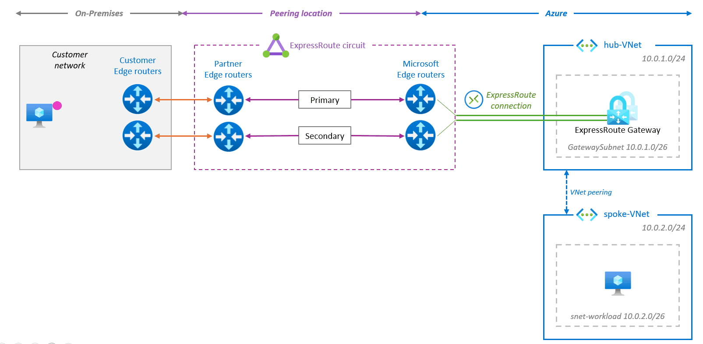
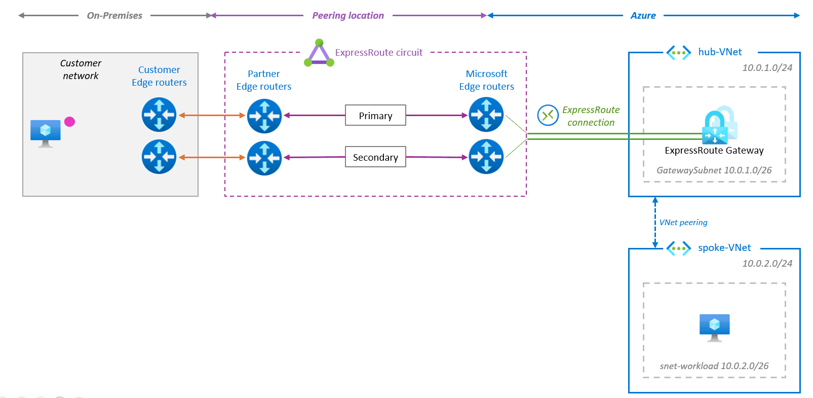
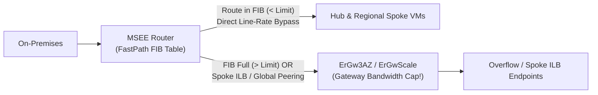

Selecting the wrong ExpressRoute Virtual Network Gateway SKU—or misunderstanding how traffic actually flows through it—creates silent throughput cliffs, Availability Zone blast-radius exposure, and packet-per-second drops on Private Endpoints.

This chapter provides a definitive **ExpressRoute Gateway SKU selector** (including **`ErGwScale`** autoscaling gateways) and demystifies **ExpressRoute FastPath**, its asymmetric vs. symmetric datapath behavior, General Availability (GA) capabilities, and port-level IP route limits.

---

## 1. ExpressRoute Gateway SKU Selector

ExpressRoute Gateways exist in two families: **Availability Zone-redundant SKUs** (`ErGw1AZ`, `ErGw2AZ`, `ErGw3AZ`, `ErGwScale`) and **legacy non-AZ SKUs** (`Standard`, `HighPerformance`, `UltraPerformance`).

:::danger[Never Deploy Legacy Non-AZ Gateway SKUs in Production]
Legacy `Standard`, `HighPerformance`, and `UltraPerformance` SKUs are **not zone-redundant**—a single Availability Zone power or cooling event can take down your regional hybrid control plane and ingress datapath. Always deploy **`ErGw1AZ`**, **`ErGw2AZ`**, **`ErGw3AZ`**, or **`ErGwScale`**. If you inherit a legacy non-AZ gateway, use the built-in **[ExpressRoute Gateway Migration experience](https://learn.microsoft.com/en-us/azure/expressroute/gateway-migration)** to transition to an AZ-redundant or `ErGwScale` SKU with minimal disruption. Existing `ErGw1AZ/2AZ/3AZ` gateways can upgrade directly in-place to `ErGwScale` without downtime (takes up to ~2 hours).
:::

### Gateway Capacity, Limits & Feature Matrix

| Gateway SKU | Zone Redundant | Throughput | Packets / Sec (PPS) | Max Circuit Connections¹ | Max VMs / Endpoints² | Max Flows | Learned Routes | FastPath Support |
| --- | --- | --- | --- | --- | --- | --- | --- | --- |
| **`ErGw1AZ`** *(replaces Standard)* | **Yes** | **1 Gbps** | 100,000 | 4 | 2,000 | 200,000 | 4,000 | No |
| **`ErGw2AZ`** *(replaces HighPerf)* | **Yes** | 2 Gbps | 200,000 | 8 | 4,500 | 400,000 | 9,500 | No |
| **`ErGw3AZ`** *(replaces UltraPerf)* | **Yes** | **10 Gbps** | 1,000,000 | 16 | 11,000 | 1,000,000 | 9,500 | **Yes** |
| **`ErGwScale`** *(1–10 Scale Units)* | **Yes** | **1–10 Gbps** *(1 Gbps/SU)* | 100k / SU *(up to 1M)* | 4 *(SU 1)* · 8 *(SU 2+)* · 16 *(SU 10+)* | 2,000 / SU *(up to 20k)* | 100k / SU *(up to 1M)* | 9,500 | **Yes** *(min 10 SU)* |
| **`ErGwScale`** *(11–40 Scale Units)* | **Yes** | **11–40 Gbps** *(1 Gbps/SU)* | +200k / SU *(up to 8M @ 40 SU)* | 16 | +1,000 / SU *(up to 50k @ 40 SU)* | +100k / SU *(up to 4M @ 40 SU)* | 9,500 | **Yes** |
| **vWAN ER Gateway** *(1–10 Scale Units)* | **Yes** | **2–20 Gbps** *(2 Gbps/SU)* | Scales per SU | Up to 16 | Managed by vHub | Scales per SU | vHub limits | **Auto-enabled** *(≥5 SU + ER Direct)* |

*¹ Across all SKUs, a maximum of **4 ExpressRoute circuits from the same peering location** can connect to the same VNet.*
*² "Supported VMs" counts **every endpoint communicating through the gateway**: hub VMs, peered spoke VMs, Private Endpoints, Azure Firewall / NVA instances, and VNet-injected PaaS instances (SQL MI, APIM, App Service Environment).*

### Critical `ErGwScale` & Gateway Design Rules

1. **Fixed vs. Autoscale Mode on `ErGwScale`**:
   - Setting `minScaleUnits == maxScaleUnits` (for example `10 / 10`, `20 / 20`, or `40 / 40`) creates a deterministic **fixed-capacity gateway**.
   - Setting `minScaleUnits >= 2` and `maxScaleUnits > min` enables **autoscaling** based on bandwidth or flow count—note that **scale-out operations take up to 30 minutes**.
   - **Private Link Rule**: Whenever workloads include **Private Link / Private Endpoint** traffic, configure `ErGwScale` with **fixed scaling (`min == max`)** rather than autoscaling. Verify regional availability for `ErGwScale` in older hero regions, and note that IPsec-over-ExpressRoute transit is not supported on `ErGwScale`.
2. **`GatewaySubnet` Sizing & Hygiene**:
   - Allocate **`/27` minimum** (`32` IPs); allocate **`/26` (`64` IPs)** whenever connecting up to **16 ExpressRoute circuits**, enabling S2S VPN coexistence, or running gateway migrations. Include a `/64` prefix for dual-stack IPv6.
   - **Never attach an NSG** and **never attach a `0.0.0.0/0` UDR** to `GatewaySubnet`—Azure blocks creation or breaks control-plane management heartbeats. Keep **BGP route propagation enabled** on `GatewaySubnet`.
   - **Auto-Assigned Public IP**: Standard VNet ExpressRoute Gateways support Microsoft-managed internal public IPs (eliminating exposed customer PIP resources). If specifying an explicit PIP on `ErGwScale`, it must use the `Standard` Public IP SKU.
3. **Packet Size, Fragmentation & Private Endpoint Halving**:
   - ExpressRoute Gateways enforce a **1,400-byte TCP/UDP payload ceiling for fragmented packets—fragmented IP packets are dropped by the ExpressRoute Gateway**. Clamp TCP MSS / Path MTU cleanly, or enable **FastPath** if IP fragmentation support is mandatory.
   - **Private Endpoint Penalty**: Stateful Private Endpoint connections traversing an ExpressRoute Gateway can **reduce effective gateway throughput and control-plane capacity by ~50%**, and experience brief resets during rolling gateway host maintenance (tune on-premises client TCP timeouts to **15–30 seconds**).

---

## 2. Normal Datapath vs. ExpressRoute FastPath

### Default Asymmetric Datapath (Without FastPath)

Without FastPath, ExpressRoute Private Peering is **asymmetric inside Azure by design**:
- **Ingress (On-Premises → Azure)**: MSEE forwards packets to the **ExpressRoute Gateway** (`GatewaySubnet`), which forwards them to the target VM in the hub or peered spoke VNet. Here, the gateway's throughput limit (`1 Gbps` on `ErGw1AZ`, `10 Gbps` on `ErGw3AZ`) acts as a hard ceiling.
- **Egress (Azure → On-Premises)**: Return packets leave the Azure VM's SDN host vSwitch and go **directly to the MSEE routers**, completely bypassing the ExpressRoute Gateway! (If multiple circuits advertise identical routes with equal attributes, egress flows are 5-tuple ECMP load-balanced across up to 4 circuits in the same peering location or up to 16 across locations unless engineered via [Bow-Tie `ConnectionWeight`](/azure-networking/03-hybrid-connectivity/expressroute-bowtie-failures/)).

### Symmetric Gateway Bypass With ExpressRoute FastPath

Enabling **[ExpressRoute FastPath](https://learn.microsoft.com/en-us/azure/expressroute/about-fastpath)** (configured **per ExpressRoute Connection**) programs `/32` (and `/128`) host routes for your VNet endpoints directly onto the MSEE routers at the peering edge:

- **Both Ingress and Egress bypass the ExpressRoute Gateway** on the data plane, eliminating extra SDN hops (lower latency and jitter), supporting fragmented IP packets, and unlocking **full circuit throughput** (`10 Gbps`, `100 Gbps`, or up to `100 Gbps` per Availability Zone on `100G/400G` ExpressRoute Direct ports).
- **The ExpressRoute Gateway is still required!** FastPath bypasses only the *data plane*. An eligible gateway (`ErGw3AZ`, `ErGwScale ≥ 10 SU`, `UltraPerformance`, or `vWAN ER Gateway ≥ 5 SU`) must still run continuously to exchange BGP routes between your VNet and MSEE routers.

---

## 3. FastPath GA Feature Matrix: Direct vs. Provider Circuits

A critical architectural distinction: advanced FastPath capabilities—**VNet Peering to spokes, UDRs on `GatewaySubnet`, IPv6, Virtual WAN FastPath, and Private Link**—are **GA exclusively on ExpressRoute Direct**, not on Telco/Provider circuits:

| Capability | ExpressRoute Direct (10G / 100G / 400G) | ExpressRoute Provider Circuit (≤ 10G) | Critical Architectural Notes |
| --- | --- | --- | --- |
| **Hub VNet VMs (IPv4)** | **GA** | **GA** | Direct MSEE-to-VM bypass in the hub VNet connected to the circuit. |
| **Hub VNet VMs (IPv6)** | **GA** | Not supported | Provider circuits support IPv4 FastPath only. |
| **VNet Peering (Spoke VMs)** | **GA** | Not supported | Hub and peered spoke VNets **must reside in the same Azure region** (Global VNet Peering falls back to the ER Gateway). |
| **User-Defined Routes (UDRs)** | **GA** | Not supported | Supports UDRs on `GatewaySubnet` (e.g., steering On-Prem → Spoke traffic through a **Hub Azure Firewall / NVA**) at FastPath line rate across all public regions. |
| **Azure Virtual WAN** | **GA (Auto-Enabled)** | Not supported | Enabled automatically by default when connecting an **ExpressRoute Direct** circuit to a vWAN ER Gateway with **≥ 5 scale units** (`10 Gbps+`). |
| **Private Link / Private Endpoints** | **Limited GA** *(Enrollment required)* | Not supported | Supported on 10G/100G ER Direct in major regions for **Storage, Key Vault, Cosmos DB, and 3rd-party PLS** (hub or regional peered spoke; no Private Link traffic charges over FastPath). Requires [enrollment](https://aka.ms/FPlimitedga). |
| **Azure Firewall / ILB / DNS Private Resolver** | **Hub VNet Only** | **Hub VNet Only** *(IPv4)* | Supported when deployed in the **Hub VNet**; instances deployed inside **spoke VNets** fall back through the ExpressRoute Gateway! |
| **Azure NetApp Files (ANF)** | **GA** *(Standard network features)* | **GA** *(Hub VNet, Standard network features)* | ANF volumes must use **Standard** network features (`Basic` is unsupported). |

### Peering & Spoke Fallback Gotchas

Even on **ExpressRoute Direct** with FastPath enabled, specific traffic patterns **silently fall back to traversing the ExpressRoute Gateway** (meaning your `ErGw3AZ` 10 Gbps or `ErGwScale` capacity still governs them):
1. **Internal Load Balancers (ILBs) and PaaS VIPs in Spoke VNets**: FastPath bypasses the gateway for ILBs, Azure Firewall, and [Azure DNS Private Resolver](/azure-networking/01-foundations/dns-and-private-resolver/) **only when hosted in the Hub VNet**. Traffic to an ILB frontend, Azure Firewall, or DNS Private Resolver inside a **peered Spoke VNet** flows through the ExpressRoute Gateway.
2. **Cross-Region (Global) VNet Peering**: Any cross-region spoke VM or cross-region Private Endpoint falls back through the ExpressRoute Gateway.
3. **Dual-Hub Peering Pitfalls**:
   - If you peer two Hub VNets connected to the same ExpressRoute circuit, you **must set `Allow Gateway Transit = false`** on that hub-to-hub peering.
   - Never configure a spoke VNet to use **two different hub gateways** simultaneously as remote gateways.

---

## 4. FastPath IP Route Ceilings & Monitoring

Because FastPath programs individual endpoint `/32` (or `/128`) host routes directly into MSEE hardware forwarding tables (FIB), Microsoft enforces strict **FastPath IP address limits**:

| Circuit Type & Port Speed | FastPath IP Limit | Scope of Enforcement |
| --- | --- | --- |
| **ExpressRoute Direct — 100 Gbps / 400 Gbps** | **200,000 IPs** | **Cumulative across the entire ER Direct physical port** |
| **ExpressRoute Direct — 10 Gbps** | **100,000 IPs** | **Cumulative across the entire ER Direct physical port** |
| **ExpressRoute Provider Circuit — ≤ 10 Gbps** | **25,000 IPs** | Per circuit |

### How FastPath IP Consumption Is Calculated

- **Assigned Private IPs Only—Not Subnet CIDR Size**: Provisioning a `/16` VNet (`65,536` addresses) containing 50 VMs consumes **50 FastPath routes**, not 65,536. Routes are reprogrammed dynamically as NICs and IP configurations are created or deleted.
- **Multi-NIC & Pod IP Multiplier**: Every assigned private IP counts individually—a VM with 3 NICs requires **3 FastPath routes** per FastPath-enabled connection. AKS clusters using flat VNet pod networking (legacy Azure CNI) can consume tens of thousands of FastPath routes rapidly; standardize on **[AKS Azure CNI Overlay](/azure-networking/05-workload-networking/aks-networking/)** to preserve MSEE FIB headroom!
- **Graceful Overflow Trap**: When an ExpressRoute Direct port hits 100% of its FastPath IP limit, **FastPath stops programming new host routes and routes newly provisioned endpoints through the ExpressRoute Gateway instead**. Existing FastPath flows stay up, *but* if high-bandwidth workloads suddenly spill onto a 10 Gbps `ErGw3AZ` gateway, the gateway will saturate and drop packets.

### Health & Capacity Metrics to Alert On

Configure Azure Monitor alerts at 75–80% thresholds across both the MSEE port and the Gateway:
- **`FastPathRoutesCount`** (ExpressRoute Direct port-level metric) against your `100,000` or `200,000` port ceiling.
- **Gateway `CpuUtilization`, `TunnelIngressBytes` / `BitsPerSecond`, and `PacketDropCount`** on `ErGw3AZ` / `ErGwScale` to detect unexpected fallback traffic traversing the gateway data plane.

---

## What I Recommend

1. **Standardize on `ErGw1AZ` / `ErGw2AZ` (< 2 Gbps), `ErGw3AZ` (up to 10 Gbps), or `ErGwScale` (10–40 Gbps, fixed scale units whenever Private Link is in path).** Block non-AZ gateway SKUs (`Standard`, `HighPerformance`, `UltraPerformance`) via Azure Policy.
2. **Mandate ExpressRoute Direct whenever FastPath must reach spoke VNets or coexist with Hub Firewall UDRs or Virtual WAN.** Provider-circuit FastPath stops at the Hub VNet (`25,000` IPs, no VNet Peering, no UDRs, no IPv6), making it useful only for single-VNet HPC/storage enclaves.
3. **Place shared Azure Firewalls, DNS Private Resolvers, and shared ILBs inside the Hub VNet—and run AKS on CNI Overlay**—so FastPath traffic neither falls back to the gateway nor exhausts MSEE FastPath IP ceilings.
