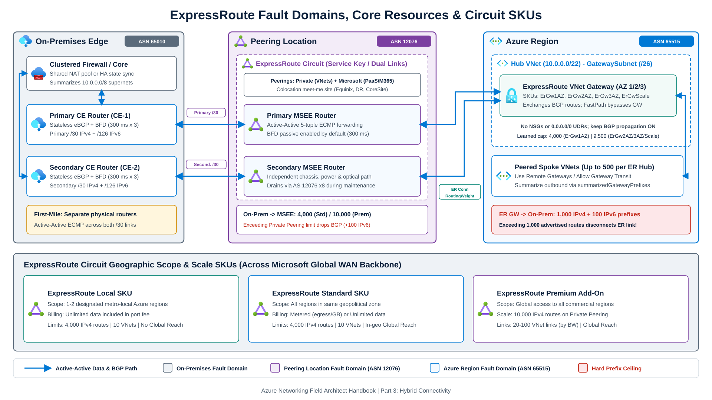
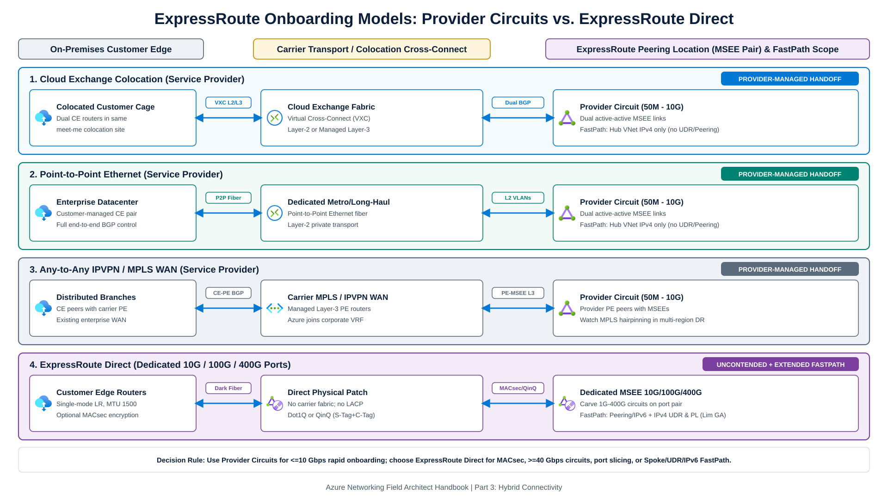
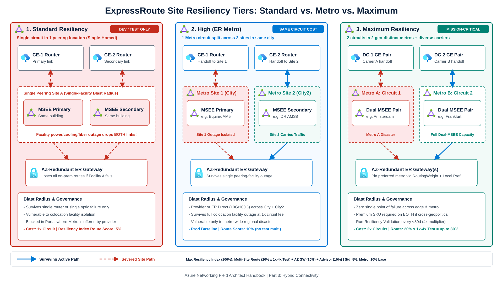
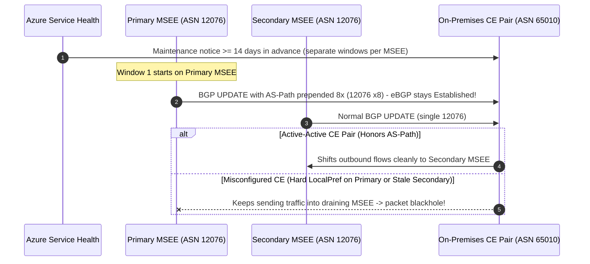
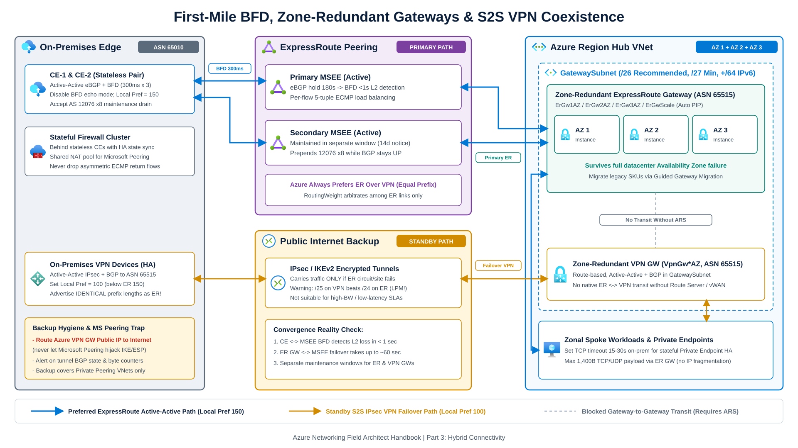
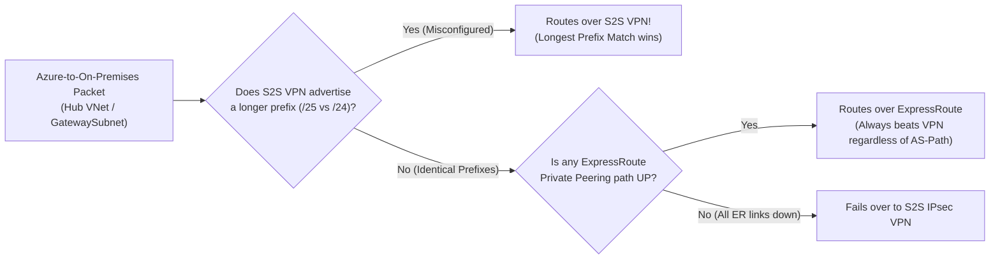

Enterprise hybrid outages rarely start inside the Microsoft global WAN backbone. Field post-mortems trace most ExpressRoute incidents to five architectural gaps: single-homed peering locations, active-passive Customer Edge (CE) BGP policies that break during Microsoft router maintenance, non-zone-redundant virtual network gateways, unmonitored BGP prefix limits, and untested Site-to-Site (S2S) VPN backup paths.

This chapter defines the physical and logical fault domains of **ExpressRoute Private Peering**, compares the three official site-resiliency tiers (**Standard**, **High / ExpressRoute Metro**, and **Maximum Resiliency**), and specifies the BGP, BFD, gateway, and coexistence rules needed to survive link, router, colocation facility, and Availability Zone failures.

---

## 1. Physical and logical fault domains

An ExpressRoute deployment spans three separate fault domains that architecture reviews must evaluate independently: the **on-premises customer edge**, the **ExpressRoute peering location**, and the **Azure region**.

**[ExpressRoute peering locations](https://learn.microsoft.com/en-us/azure/expressroute/expressroute-locations)** (carrier-neutral meet-me facilities such as Equinix, Digital Realty, or CoreSite) are physical entry points into the Microsoft global network (`ASN 12076`). **Azure regions** host Virtual Networks (`ASN 65515`), Virtual WAN hubs, and workloads. A peering facility in Amsterdam or Frankfurt is physically separate from `West Europe` or `Germany West Central` datacenters.

| Resource | Fault Domain | Physical and Control-Plane Role |
| --- | --- | --- |
| **ExpressRoute Circuit** (`expressRouteCircuits`) | **Peering Location** (Meet-me facility) | Logical resource identified by a service key (`s-key`) representing **two** physical connections terminating on independent Microsoft Enterprise Edge (**MSEE**) routers (Primary and Secondary). Supports Private Peering and Microsoft Peering. |
| **ExpressRoute Gateway** (`virtualNetworkGateways` / vHub GW) | **Azure Region** (`GatewaySubnet` or vWAN Hub) | Managed VM cluster (`ASN 65515`) exchanging BGP routes between the VNet and MSEEs and forwarding VNet traffic unless bypassed on ingress via [ExpressRoute FastPath](/azure-networking/03-hybrid-connectivity/expressroute-fastpath-and-skus/). |
| **ExpressRoute Connection** | **Microsoft Backbone** (Peering Location to Region) | Logical link binding an ExpressRoute Circuit to an ExpressRoute Gateway, carrying `RoutingWeight` (`0` to `32000`) and FastPath configuration. Up to 4 circuits from the *same* peering location can connect to one VNet. |

### Circuit geographic scope and billing SKUs

The [ExpressRoute circuit SKU](https://learn.microsoft.com/en-us/azure/expressroute/expressroute-introduction) governs how far across the Microsoft backbone a circuit can connect to Azure regions and how many routes it accepts:

| Circuit SKU | Regional Reach | Data Billing Model | On-Premises to MSEE IPv4 Limit | Max VNet Links per Circuit | Global Reach Support |
| --- | --- | --- | --- | --- | --- |
| **ExpressRoute Local** | Restricted to **1 or 2 metro-local Azure regions** mapped to that peering site | Unlimited ingress and egress included in monthly port charge | 4,000 prefixes (+100 IPv6) | Up to 10 | Not supported |
| **ExpressRoute Standard** | Any commercial Azure region within the **same geopolitical region** | Metered (free ingress, billed per-GB egress) or Unlimited | 4,000 prefixes (+100 IPv6) | Up to 10 | Supported within same geopolitical region |
| **ExpressRoute Premium** | **Global access** to any commercial Azure region worldwide (excludes national clouds) | Add-on over Metered or Unlimited Standard circuit | **10,000** prefixes (+100 IPv6) | **20 to 100** (scales by circuit bandwidth) | Supported across geopolitical regions |

:::note[Allowed SKU Transitions]
You can upgrade `Standard` to `Premium`, downgrade `Premium` to `Standard`, upgrade `Local` to `Standard` or `Premium` (retaining `UnlimitedData` billing), and switch `MeteredData` to `UnlimitedData`. Downgrading an `UnlimitedData` `Standard` or `Premium` circuit to `Local` is blocked in the Azure portal and requires Azure CLI or PowerShell. Moving an existing provider circuit from `UnlimitedData` back to `MeteredData` is not supported, though ExpressRoute Direct ports can switch between metered and unlimited billing.
:::

---

## 2. Onboarding models: service provider vs. ExpressRoute Direct

Microsoft supports four [physical connectivity models](https://learn.microsoft.com/en-us/azure/expressroute/expressroute-connectivity-models): three carrier-mediated circuit handoffs (`50 Mbps` to `10 Gbps`) and dedicated **ExpressRoute Direct** port pairs (`10 Gbps`, `100 Gbps`, or `400 Gbps`).

### Service provider models (`50 Mbps` to `10 Gbps`)

1. **Cloud Exchange Colocation**: Customer edge routers sit in the same colocation facility as the MSEE pair and connect across the facility's Ethernet exchange via Layer-2 virtual cross-connects or managed Layer-3 sessions.
2. **Point-to-Point Ethernet**: Dedicated Layer-2 fiber links an on-premises datacenter directly to the provider edge at the peering facility, leaving end-to-end BGP control with your network team.
3. **Any-to-Any (IPVPN / MPLS)**: ExpressRoute attaches directly to your carrier's MPLS VRF as a managed Layer-3 peer so Azure joins the corporate WAN alongside branch offices. Pay close attention to MPLS hairpinning during multi-region failovers, covered in [ExpressRoute Bow-Tie Topologies & Failure Modes](/azure-networking/03-hybrid-connectivity/expressroute-bowtie-failures/).

### ExpressRoute Direct (`10 Gbps` / `100 Gbps` / `400 Gbps`)

**[ExpressRoute Direct](https://learn.microsoft.com/en-us/azure/expressroute/expressroute-erdirect-about)** (`Microsoft.Network/expressRoutePorts`) allocates dedicated dual `10 Gbps`, `100 Gbps`, or `400 Gbps` (select metros, enrollment required) single-mode LR fiber ports directly on MSEE routers (`1,500-byte` IP MTU, `0x8100` Ethertype, no LACP or MLAG).

Choose ExpressRoute Direct when workloads require:
- Dedicated physical port isolation for regulated workloads with IEEE 802.1AE **MACsec** Layer-2 encryption between customer routers and MSEEs.
- Multiple isolated circuits (`Dot1Q` unique C-Tags or `QinQ` Microsoft-assigned S-Tags with per-peering C-Tags) carved across one port pair, including `40 Gbps`, `100 Gbps`, `200 Gbps`, and `400 Gbps` circuit SKUs.
- Extended [ExpressRoute FastPath](/azure-networking/03-hybrid-connectivity/expressroute-fastpath-and-skus/) scope beyond provider circuits (which restrict FastPath to IPv4 destinations inside the hub VNet). ExpressRoute Direct supports IPv4 and IPv6 FastPath to **peered spoke VNets**, IPv4 FastPath with **User-Defined Routes (UDRs)**, and **Private Link / Private Endpoints** over FastPath (Limited GA on `10 Gbps` and `100 Gbps` Direct ports for IPv4 Storage, Key Vault, Cosmos DB, and Private Link Services in supported regions).

---

## 3. Site resiliency tiers: Standard vs. Metro vs. Maximum

A single standard ExpressRoute circuit provides **router and link redundancy** inside one building, not **facility redundancy**. Power loss, cooling failure, or fiber cuts isolating that single colocation facility sever both Primary and Secondary MSEE links at the same time.

Microsoft defines three [site-resiliency architectures](https://learn.microsoft.com/en-us/azure/expressroute/design-architecture-for-resiliency):

| Resiliency Tier | Physical Topology | Facility Blast Radius | Circuit Cost | Production Guidance |
| --- | --- | --- | --- | --- |
| **Standard Resiliency** | 1 circuit (2 links) in **1 peering location** (`single-homed`) | Outage at the colocation facility drops both links | 1x circuit | **Non-production only.** Portal blocks creation where your selected provider offers Metro. |
| **High Resiliency ([ExpressRoute Metro](https://learn.microsoft.com/en-us/azure/expressroute/metro))** | 1 Metro circuit with Primary in `City` and Secondary in `City2` (**2 distinct sites in one metro**) | Survives complete failure of one peering site; exposed to city-wide disaster | **1x circuit** (same circuit fee as Standard; requires two physical handoffs) | **Minimum baseline** for single-region production in supported metros (provider circuits or ER Direct 10G/100G). |
| **Maximum Resiliency** | **2 independent circuits** in **2 geographically distinct peering locations** (ideally diverse providers) | Survives full colocation and metropolitan disaster | 2x circuits + connections | **Required for mission-critical and multi-region estates.** Both circuits need Premium SKU if placed in different geopolitical zones. |

### ExpressRoute Resiliency Insights and validation multipliers

**[Resiliency Insights](https://learn.microsoft.com/en-us/azure/expressroute/resiliency-insights)** on the ExpressRoute Gateway resource scores control-plane resiliency from `0%` to `100%` across Private Peering route sets:
- Single peering locations score `5%` for route resiliency, ExpressRoute Metro scores `10%`, and advertising identical prefixes across two distinct peering locations scores `20%`. Any MSEE-to-PE link failure in Standard or Metro drops the route score to `0%`.
- On multi-site deployments across two or more distinct peering locations (not supported on Standard or Metro circuits), running the built-in **Resiliency Validation** failover test on *both* peering sites within the last **30 days** multiplies the `20%` route score by **`4x`** (`80%` max contribution). Letting tests age past 90 days drops the multiplier to `1x`, and testing only one peering site cuts the multiplier in half.
- Zone-redundant `ErGw1AZ`, `ErGw2AZ`, `ErGw3AZ`, or `ErGwScale` (`>2` scale units / `>4` instances) adds `10%`, and resolving all open Advisor resiliency recommendations adds the final `10%`.

### Multi-region cross-connections (Bow-Tie)

Terminating two geo-diverse circuits onto a single regional hub delivers Maximum Resiliency for one Azure region. When your estate spans **two or more Azure regions**, cross-connecting each circuit to both regional hubs forms an **ExpressRoute Bow-Tie** topology. Parallel circuits introduce ECMP and potential asymmetric drops across stateful firewalls, while Virtual WAN hubs require explicit routing-preference tuning to avoid bouncing east-west VNet traffic through MSEEs. Follow the complete failure-mode analysis in **[ExpressRoute Bow-Tie Topologies & Failure Modes](/azure-networking/03-hybrid-connectivity/expressroute-bowtie-failures/)**.

---

## 4. First-mile HA, MSEE maintenance, and BFD timers

### Active-active links and MSEE maintenance drains

Microsoft operates the Primary and Secondary connections of every ExpressRoute circuit in **active-active per-flow (5-tuple) ECMP** mode. Both BGP sessions must remain simultaneously established to satisfy the ExpressRoute SLA.

Forcing a circuit into active-passive mode on-premises (for example, by pinning traffic to Primary with higher BGP `Local Preference` or static routes while leaving Secondary unmonitored) causes avoidable outages during [planned MSEE maintenance](https://learn.microsoft.com/en-us/azure/expressroute/planned-maintenance):

Enforce three first-mile rules on every ExpressRoute deployment:
1. **Run Primary and Secondary `/30` IPv4 (`/126` IPv6) links active-active** with identical prefixes and symmetric BGP policies so `AS 12076` `8x` prepending drains either link automatically even while its eBGP session stays `Established`.
2. **Terminate Primary and Secondary links on two physically separate CE routers.** Never land both VLANs as subinterfaces on one router, one chassis line card, or a merged Layer-2 switch.
3. **Keep stateful firewalls out of raw eBGP termination.** Terminate eBGP on stateless CE routers upstream of a clustered firewall with stateful HA session sync. For Microsoft Peering, place a **shared NAT pool** behind the CE split rather than per-link NAT pools so an MSEE link failure does not strand active public NAT translations.

### Bidirectional Forwarding Detection (BFD)

Default eBGP timers on MSEE routers use a **60-second keepalive** and **180-second hold time**. When an intermediate Layer-2 carrier switch drops frames without bringing down physical optics on the MSEE, BGP takes up to three minutes to detect the blackhole. Lowering BGP keepalive/hold timers (`3s` / `10s` minimum) taxes router control-plane CPUs and is not recommended.

Enable **[BFD over ExpressRoute](https://learn.microsoft.com/en-us/azure/expressroute/expressroute-bfd)** instead:
- MSEEs run BFD in passive mode by default on Private and Microsoft Peering interfaces with **`300 ms` transmit/receive intervals** (`750 ms` in select platform scenarios) and a **multiplier of `3`**, detecting Layer-2 CE-to-MSEE failures in **under one second (`~0.9s`)**.
- Configure BFD on both CE interfaces (`bfd interval 300 min_rx 300 multiplier 3`), bind `fall-over bfd` to the `ASN 12076` BGP neighbor, and **disable BFD echo mode** (`no bfd echo`) to avoid cross-vendor echo incompatibilities. The slower peer dictates the negotiated rate; CEs can negotiate intervals above `300 ms`, never below it.
- Circuits with IPv4 Private Peering created before August 2018, IPv4 Microsoft Peering before January 2020, or **IPv6 peering configured before November 2025** require a one-time peering reset in Azure before MSEE BFD activates.
- BFD cuts CE-to-MSEE link detection to `<1 second`, whereas control-plane reconvergence between the ExpressRoute VNet Gateway and MSEEs takes up to **~60 seconds** (and full multi-site geo-redundant reconvergence can take up to **180 seconds**).

---

## 5. Zone-redundant gateways and Site-to-Site VPN backup

### Availability Zone-redundant ExpressRoute gateways

Geo-redundant circuits cannot protect workloads if the regional ExpressRoute Gateway sits in a single zone or legacy non-AZ SKU. Deploy **zone-redundant SKUs** (`ErGw1AZ`, `ErGw2AZ`, `ErGw3AZ`, or `ErGwScale`), which distribute gateway instances across Availability Zones 1, 2, and 3 and support Microsoft-managed auto-assigned Public IPs (standard VNet deployments). Existing `Standard`, `HighPerformance`, or `UltraPerformance` gateways can transition via the [guided gateway migration](https://learn.microsoft.com/en-us/azure/expressroute/expressroute-about-virtual-network-gateways) workflow.

Protect `GatewaySubnet` health and datapath stability with four operational rules:
- Provision `GatewaySubnet` as **`/26` up front** (`/27` minimum for coexistence; `/26` required when connecting up to 16 ExpressRoute circuits; add `/64` IPv6 for dual-stack).
- Keep `GatewaySubnet` free of **NSGs and `0.0.0.0/0` UDRs**, and leave BGP route propagation enabled on it.
- Cap non-FastPath TCP/UDP payloads to **1,400 bytes** and avoid IP fragmentation, because ExpressRoute Gateways drop fragmented IP packets (use [ExpressRoute FastPath](/azure-networking/03-hybrid-connectivity/expressroute-fastpath-and-skus/) when IP fragmentation support is mandatory).
- Set on-premises application TCP timeouts between **15 and 30 seconds** when accessing Private Endpoints over ExpressRoute. Private Endpoint flows through an ExpressRoute Gateway are stateful per backend gateway VM (`~50%` gateway throughput ceiling), and shorter retry windows prevent stalls when gateway instances reboot sequentially during maintenance.

For complete gateway throughput, PPS, flow limits, VM counts, and `ErGwScale` sizing tables, see **[ExpressRoute Gateway SKUs & FastPath](/azure-networking/03-hybrid-connectivity/expressroute-fastpath-and-skus/)**.

### Site-to-Site VPN failover coexistence

For non-latency-critical workloads where a second ExpressRoute peering location is not justified, deploy a route-based, zone-redundant **Azure VPN Gateway** (`VpnGw*AZ`) alongside the ExpressRoute Gateway in the same `GatewaySubnet` as an [active-passive Private Peering backup](https://learn.microsoft.com/en-us/azure/architecture/reference-architectures/hybrid-networking/expressroute-vpn-failover). Microsoft Peering has no S2S VPN failover and fails over directly to the public internet.

Design S2S VPN coexistence around five routing rules:
1. Advertise **identical prefix lengths** on ExpressRoute and S2S VPN. When prefixes match, Azure always prefers ExpressRoute over S2S VPN regardless of BGP AS-path length (`RoutingWeight` only ranks ExpressRoute connections against each other). Longest Prefix Match (LPM) overrides everything: advertising a `/25` on VPN and a `/24` on ExpressRoute diverts live traffic onto the IPsec tunnel.
2. Set higher on-premises BGP **`Local Preference` (for example `150` vs. `100`)** on routes learned from ExpressRoute (`ASN 12076`) than from Azure VPN Gateway (`ASN 65515`). When using **[Azure Route Server](/azure-networking/02-core-topologies/hub-spoke-and-route-server/)** or **[Virtual WAN](/azure-networking/02-core-topologies/virtual-wan-and-routing-intent/)** with `AS-Path` routing preference, also prepend your on-premises ASN on the VPN BGP session so failback returns deterministically to ExpressRoute after recovery.
3. Pin on-premises routes for the **Azure VPN Gateway public IPs** to your public internet ISP edge whenever Microsoft Peering is enabled. Otherwise, Microsoft Peering can advertise the VPN Gateway public IPs over ExpressRoute and cause the backup IPsec tunnel to form inside the ExpressRoute circuit it backs up.
4. Deploy **Azure Route Server** (`allowBranchToBranchTraffic: true`) or **Virtual WAN** if VPN-connected branches must communicate with ExpressRoute-connected sites, because coexisting gateways in a standard VNet never exchange routes directly with each other.
5. Assign **separate customer-controlled maintenance windows** to coexisting ExpressRoute and VPN gateways, run Active-Active BGP tunnels, and alert continuously on VPN BGP state and tunnel byte counters to catch expired PSKs or firewall drift before an outage.

---

## 6. BGP route advertisement and prefix limits

ExpressRoute enforces asymmetric prefix ceilings depending on direction. Breaching either ceiling causes immediate connectivity loss rather than graceful degradation:

| Direction / Resource | Standard / Local Limit | Premium Limit | Failure Mode When Exceeded | Primary Mitigation |
| --- | --- | --- | --- | --- |
| **On-Premises to MSEE** (Private Peering) | **4,000** IPv4 + **100** IPv6 | **10,000** IPv4 + **100** IPv6 | **Drops the BGP session** between CE/PE and MSEE Private Peering | Summarize corporate supernets (`10.0.0.0/8` or regional `/12` blocks) outbound on CE routers; never leak Microsoft Peering prefixes (`200` IPv4/IPv6 limit) into Private Peering. |
| **Routes learned by ER VNet Gateway** | `4,000` (`ErGw1AZ`) / `9,500` (`ErGw2AZ`, `3AZ`, `Scale`) | `4,000` (`ErGw1AZ`) / `9,500` (`ErGw2AZ`, `3AZ`, `Scale`) | Packet drops and gateway instability (`11,000` max combined VNet + on-prem routes) | Upgrade `ErGw1AZ` to `ErGw2AZ`+ when using Premium circuits above 4,000 routes, and aggregate on-premises routes. |
| **Azure ER Gateway to MSEE** (Per ER Connection) | **1,000** IPv4 + **100** IPv6 | **1,000** IPv4 + **100** IPv6 | **Disconnects the ExpressRoute connection** between circuit and gateway (severing hub and all transit spokes) | Summarize spoke CIDRs via **`summarizedGatewayPrefixes`**, **Virtual WAN Route-maps**, or **Azure Route Server route maps**. |

### Controlling Azure-to-on-premises route scale

As spoke VNets peer with a regional hub (up to 500 peered VNets per ExpressRoute gateway VNet), every spoke prefix propagates toward on-premises by default. Choose the [route-scale control](https://learn.microsoft.com/en-us/azure/expressroute/expressroute-connection-manage-advertised-routes) matching your hub architecture:
- **Standard Hub VNet (`summarizedGatewayPrefixes`)**: Configure **[Advertised gateway prefixes](https://learn.microsoft.com/en-us/azure/virtual-network/advertised-gateway-prefixes-overview)** directly on the hub VNet resource (no Azure Route Server required). The gateway advertises your summary blocks (such as `10.10.0.0/16`) and suppresses individual hub and spoke prefixes covered by those summaries. Ensure summaries cover intended Azure ranges only so Azure does not attract unallocated corporate traffic.
- **Azure Virtual WAN (`Route-maps`)**: Apply an **outbound** Virtual WAN Route-map on the ExpressRoute connection to aggregate prefixes, filter routes, or modify BGP communities and 2-byte AS-PATHs. Note that creating the first route map on a vHub triggers a one-time ~30-minute software upgrade, spoke prefixes must exist in `defaultRouteTable`, and route summarization strips BGP communities and AS-PATH attributes.
- **Hub with Azure Route Server (`Route-maps`, Preview)**: Summarize or filter prefixes across ARS BGP peerings when integrating NVA firewalls or SD-WAN appliances.

For broader Azure route selection precedence, see **[Routing & Traffic Engineering](/azure-networking/01-foundations/routing-and-traffic-engineering/)**.

---

## Architecture checklist

1. **Eliminate single-site ExpressRoute circuits in production.** Deploy **ExpressRoute Metro** as the zero-extra-circuit-cost baseline for single-region workloads in supported cities, and **Maximum Resiliency** (two circuits across distinct peering locations and carriers) for mission-critical estates, validated every 30 days in **Resiliency Insights**.
2. **Operate both MSEE links active-active with BFD (`300 ms x 3`, echo disabled).** Terminate Primary and Secondary fibers on separate stateless CE routers, honor `AS 12076` `8x` prepends during 14-day scheduled maintenance windows, and alert on `BgpAvailability`, `ArpAvailability`, `QosDropBitsInPerSecond`, and `QosDropBitsOutPerSecond`.
3. **Standardize on zone-redundant gateways (`ErGw*AZ` or `ErGwScale`) in a `/26` `GatewaySubnet`.** Keep `GatewaySubnet` free of NSGs and `0.0.0.0/0` UDRs, and isolate S2S VPN backup public IPs onto your internet edge with aligned prefix lengths and symmetric BGP `Local Preference`.
4. **Summarize prefixes before approaching the 1,000-route outbound cliff.** Allocate contiguous regional CIDR blocks ([VNet & IP Addressing](/azure-networking/01-foundations/vnet-and-ip-addressing/)) and enforce outbound summarization via `summarizedGatewayPrefixes` or Virtual WAN Route-maps well before reaching 500+ spoke prefixes.

---

## Microsoft Learn references

- [Design and architect Azure ExpressRoute for resiliency](https://learn.microsoft.com/en-us/azure/expressroute/design-architecture-for-resiliency)
- [About ExpressRoute Metro](https://learn.microsoft.com/en-us/azure/expressroute/metro)
- [Designing for high availability with Azure ExpressRoute](https://learn.microsoft.com/en-us/azure/expressroute/designing-for-high-availability-with-expressroute)
- [Planned maintenance guidance for ExpressRoute](https://learn.microsoft.com/en-us/azure/expressroute/planned-maintenance)
- [Configure BFD over ExpressRoute](https://learn.microsoft.com/en-us/azure/expressroute/expressroute-bfd)
- [About ExpressRoute Direct](https://learn.microsoft.com/en-us/azure/expressroute/expressroute-erdirect-about)
- [About ExpressRoute virtual network gateways](https://learn.microsoft.com/en-us/azure/expressroute/expressroute-about-virtual-network-gateways)
- [Manage route scale for ExpressRoute virtual network gateways](https://learn.microsoft.com/en-us/azure/expressroute/expressroute-connection-manage-advertised-routes)
- [Resiliency Insights for ExpressRoute gateways](https://learn.microsoft.com/en-us/azure/expressroute/resiliency-insights)
- [Use site-to-site VPN as failover for Azure ExpressRoute](https://learn.microsoft.com/en-us/azure/architecture/reference-architectures/hybrid-networking/expressroute-vpn-failover)

