Enterprise hybrid outages rarely stem from a failure inside the Microsoft global WAN backbone itself. In field post-mortems, ExpressRoute outages almost always trace back to one of five architectural gaps: single-homed peering locations, active-passive Customer Edge (CE) BGP policies that collide with Microsoft maintenance events, non-zone-redundant virtual network gateways, unmonitored BGP route-table exhaustion, or untested Site-to-Site (S2S) VPN backup paths.

This chapter establishes the physical and logical anatomy of **ExpressRoute Private Peering**, maps the three official resiliency tiers (**Standard**, **High / ExpressRoute Metro**, and **Maximum Resiliency**), and details the exact control-plane mechanics required to survive link, router, peering-location, and Availability Zone failures.

---

## 1. Physical & Logical Anatomy

An ExpressRoute deployment spans three distinct fault domains that must never be conflated during architecture reviews: **On-Premises Customer Edge**, **ExpressRoute Peering Location**, and **Azure Region**.

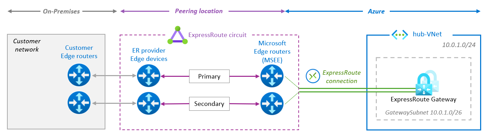

**ExpressRoute Peering Locations** (meet-me facilities such as Equinix, Digital Realty, or CoreSite) are physical entry points into the Microsoft global backbone (`ASN 12076`). **Azure Regions** host your Virtual Networks (`ASN 65515`), Virtual WAN hubs, and workloads. A peering location in Amsterdam or Frankfurt is physically independent from `West Europe` or `Germany West Central` datacenters.

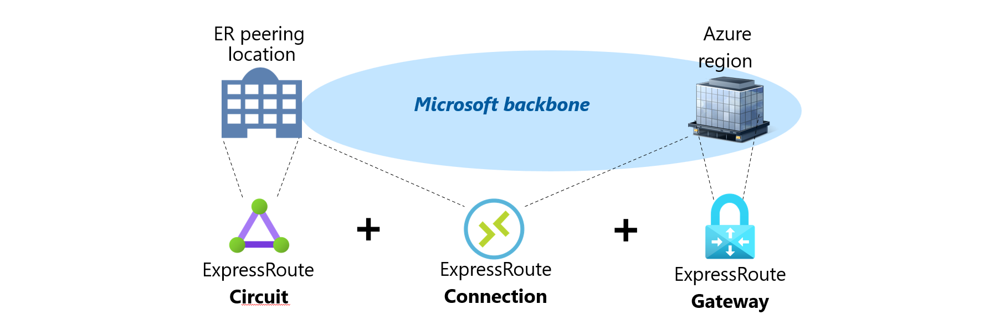

| Component | Fault Domain & Location | Physical / Logical Role |
| --- | --- | --- |
| **ExpressRoute Circuit** | **Peering Location** (Meet-me facility) | Logical resource representing **dual** physical fiber cross-connects terminating on two independent Microsoft Enterprise Edge (**MSEE**) routers (Primary and Secondary). |
| **ExpressRoute Gateway** | **Azure Region** (`GatewaySubnet` or vWAN Hub) | Managed compute cluster (`ASN 65515`) handling BGP control-plane route exchange between the VNet and MSEEs, plus ingress datapath forwarding (unless bypassed via [FastPath](/azure-networking/03-hybrid-connectivity/expressroute-fastpath-and-skus/)). |
| **ExpressRoute Connection** | **Microsoft Backbone** (Peering Location ↔ Region) | Logical object linking an ExpressRoute Circuit (`Microsoft.Network/expressRouteCircuits`) to an ExpressRoute Gateway, optionally carrying a `RoutingWeight` (`0–32000`) and FastPath flag. |

### Circuit Geographic Scope SKUs

The ExpressRoute Circuit SKU dictates how far across the Microsoft backbone a circuit in a given peering location can reach Azure regions:

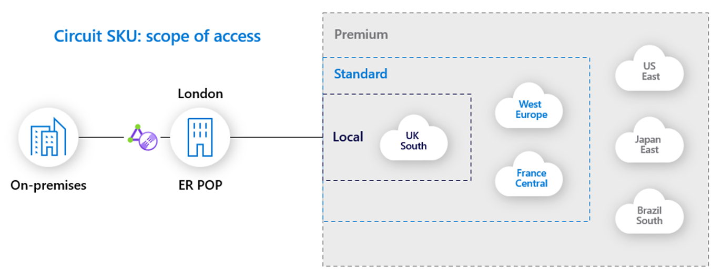

- **ExpressRoute Local**: Unlimited ingress/egress data included in the port fee, restricted strictly to the **1 or 2 local Azure regions** designated for that peering location. Cannot use Global Reach.
- **ExpressRoute Standard**: Connects to **any Azure region within the same geopolitical zone** (for example, any European commercial region from a European peering location). Supports up to **4,000** private peering IPv4 prefixes learned from on-premises.
- **ExpressRoute Premium**: Global reach to **any Azure region worldwide**, expands learned private peering IPv4 prefixes from on-premises up to **10,000**, and increases the maximum number of VNet connections per circuit (from 10 up to 100 depending on bandwidth).

---

## 2. Connectivity Models: Provider vs. ExpressRoute Direct

Microsoft supports four physical onboarding models split across **Service Provider** circuits and **ExpressRoute Direct**:

### Service Provider Models

1. **Cloud Exchange Colocation**: Customer routers are colocated in the same carrier-neutral facility as the MSEEs and cross-connected via a Cloud Exchange fabric (Layer 2 or Layer 3).
   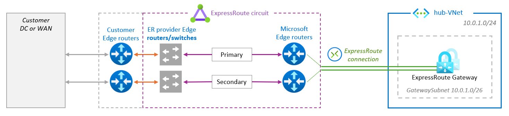
2. **Ethernet Point-to-Point (P2P)**: Dedicated Layer 2 or Layer 3 point-to-point fiber from an on-premises datacenter or branch directly to the provider edge at the peering facility.
   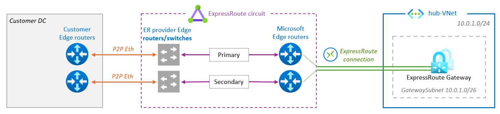
3. **Any-to-Any (IPVPN / MPLS)**: ExpressRoute terminates directly into the carrier's MPLS VRF, making Azure appear as another spoke site on the enterprise WAN backbone.
   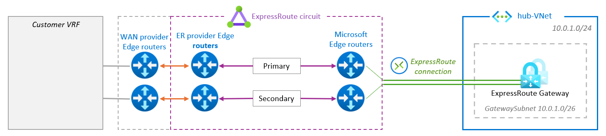

### ExpressRoute Direct

[**ExpressRoute Direct**](https://learn.microsoft.com/en-us/azure/expressroute/expressroute-erdirect-about) bypasses connectivity providers altogether by allocating dedicated dual **10 Gbps** or **100 Gbps** (and **400 Gbps** in select metros) physical MSEE ports directly to customer-owned edge routers via physical cross-connects (`Dot1Q` or `QinQ` tagging).

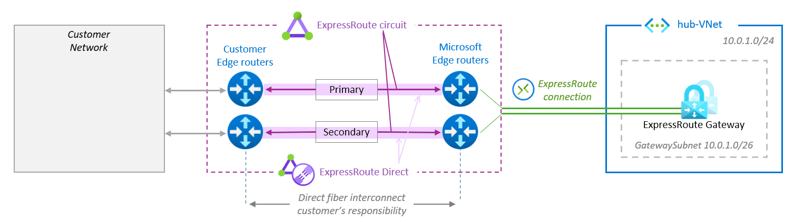

Choose **ExpressRoute Direct** when you require:
- Dedicated uncontended physical port capacity with MACsec Layer-2 encryption between CE and MSEE.
- Multiple isolated circuits carved out of a single physical port pair at no extra per-circuit port charge for Local/Standard circuits.
- Advanced [ExpressRoute FastPath](/azure-networking/03-hybrid-connectivity/expressroute-fastpath-and-skus/) capabilities (VNet Peering, UDRs, IPv6, Virtual WAN FastPath, and massive 100k–200k FastPath IP tables).

---

## 3. Site Resiliency Tiers: Standard vs. Metro vs. Maximum

A single standard ExpressRoute circuit provides **device and link redundancy** inside one peering facility (two MSEEs), **not facility redundancy**. If power, cooling, or fiber entrances fail at that single peering location, both primary and secondary links go dark simultaneously.

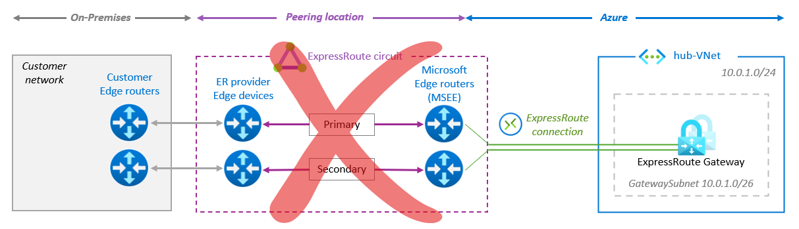

Microsoft defines three formal site-resiliency tiers:

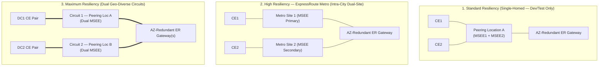

| Resiliency Tier | Topology | Facility Blast Radius | Cost Profile | Production Guidance |
| --- | --- | --- | --- | --- |
| **Standard Resiliency** | 1 Circuit (2 links) in **1 peering location** | Vulnerable to single colocation facility outage | 1x Circuit | **Avoid for critical production.** Disabled in the portal for providers/locations where Metro is available. |
| **High Resiliency ([ExpressRoute Metro](https://learn.microsoft.com/en-us/azure/expressroute/metro))** | 1 Metro Circuit with Primary & Secondary split across **2 distinct peering sites in the same city** | Survives single colocation facility failure; vulnerable to city-wide disaster | **Same price as Standard circuit** (requires dual physical handoffs) | **Minimum baseline** for single-region production workloads in supported metros (e.g., Amsterdam, Zurich, Singapore, Chicago, Dublin, Madrid, Milan, Atlanta). |
| **Maximum Resiliency** | **2 independent circuits** in **2 geographically distinct peering locations** (ideally diverse providers) | Survives complete facility and metropolitan outage | 2x Circuits + cross-connections | **Mandatory for mission-critical / multi-region enterprises.** |

### Geo-Redundant Circuits & Multi-Region Bow-Tie

To achieve **Maximum Resiliency** for a single Azure region, terminate two circuits from two distinct peering locations onto the same AZ-redundant ExpressRoute Gateway:

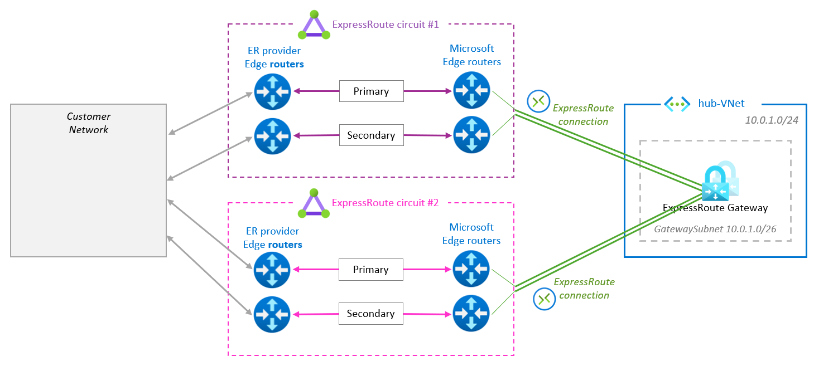

When your footprint spans **multiple Azure regions** and multiple peering locations, cross-connecting each circuit to both regional hubs creates an **ExpressRoute Bow-Tie** topology. Because parallel circuits introduce ECMP and potential asymmetric routing across stateful on-premises firewalls, traffic engineering (`ConnectionWeight`, BGP `Local Preference`, and AS-path prepending) is critical. See the dedicated failure-mode deep dive in **[ExpressRoute Bow-Tie Topologies & Failure Modes](/azure-networking/03-hybrid-connectivity/expressroute-bowtie-failures/)**.

---

## 4. First-Mile HA, MSEE Maintenance & BFD Timers

### Why Active-Active on Primary & Secondary Links Is Mandatory

Microsoft operates the Primary and Secondary MSEE connections of every ExpressRoute circuit in **Active-Active per-flow (5-tuple) ECMP** mode. Many traditional WAN teams mistakenly force ExpressRoute into Active-Passive mode (using aggressive AS-path prepending on the Secondary link or advertising more-specific prefixes only on Primary).

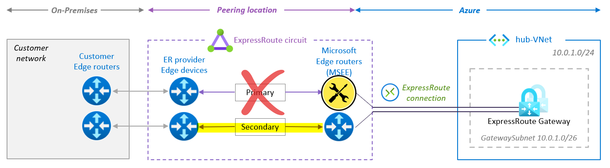

During planned MSEE software upgrades or hardware maintenance, Microsoft gracefully drains the MSEE under maintenance by **prepending `ASN 12076`** on advertisements leaving that router.
- If your on-premises network hard-pins traffic to the Primary link (ignoring AS-path length via higher `Local Preference` or static routes) or leaves the Secondary BGP session unmonitored/stale, **planned maintenance becomes a self-inflicted outage**:

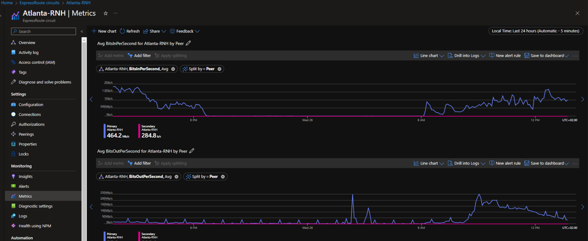

To eliminate first-mile single points of failure:
1. **Operate both Primary and Secondary `/30` links in Active-Active mode** with identical prefixes and BGP attributes.
2. **Terminate Primary and Secondary links on two physically separate Customer Edge (CE) routers** (never two sub-interfaces on one router or one line card).
3. **Do not terminate ExpressRoute eBGP directly on stateful firewalls** if those firewalls drop asymmetric return flows across the two links; either terminate eBGP on stateless CE routers upstream of a clustered firewall with a shared NAT/VIP pool, or enable stateful HA session sync across the firewall cluster.

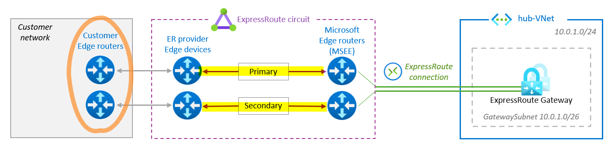

### Bidirectional Forwarding Detection (BFD)

Standard eBGP hold timers on MSEE routers default to **180 seconds** (keepalive every 60s × 3). If a Layer-2 carrier switch drops packets silently without bringing down the physical optical interface on the MSEE, traffic blackholes for up to 3 minutes.

- **Enable BFD on Private Peering**: MSEE routers are pre-configured as BFD **passive** peers with a `300 ms` echo/control interval and multiplier of `3`, cutting Layer-2 path failure detection from **~180 seconds to sub-second (~0.9s)**.
- Configure your CE routers as **active** BFD initiators matching `300 ms × 3` (or looser timers negotiated by the CE if hardware requires). Note that while BFD accelerates CE-to-MSEE link detection to <1 second, end-to-end multi-site BGP reconvergence across large WAN backbones can still take several seconds to ~180s depending on iBGP/IGP tuning.

---

## 5. Availability Zone-Redundant Gateways

Resilient circuits are useless if the ExpressRoute Virtual Network Gateway inside the Azure region is pinned to a single Availability Zone or fault domain.

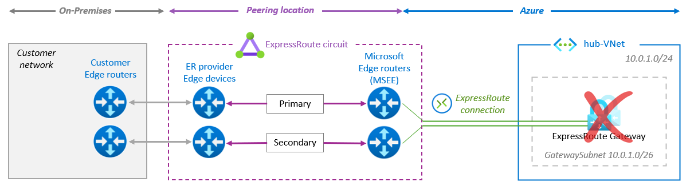

Always deploy **Availability Zone-redundant SKUs** (`ErGw1AZ`, `ErGw2AZ`, `ErGw3AZ`, or `ErGwScale`), which spread gateway VM instances across Availability Zones 1, 2, and 3:

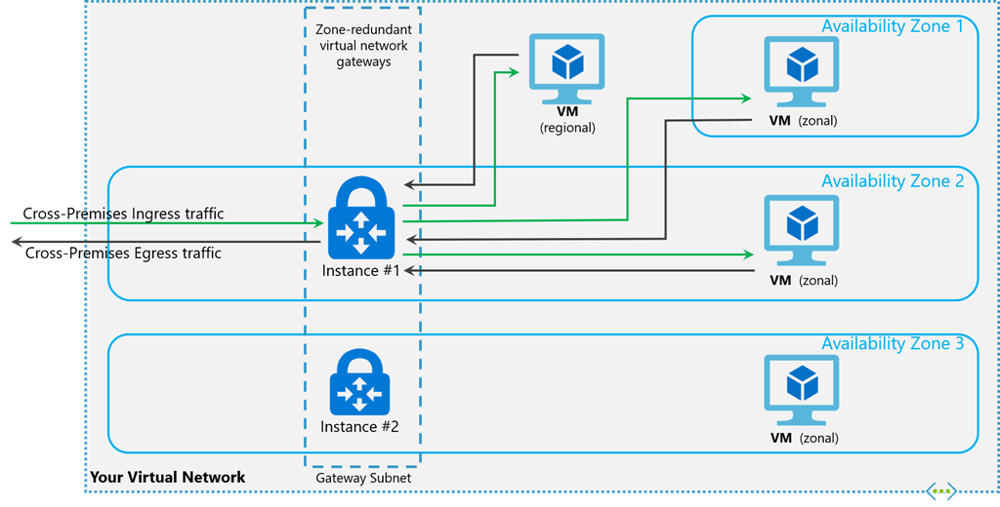

For full throughput, packet-per-second, VM count, and `ErGwScale` autoscale sizing tables—plus legacy gateway migration rules—see **[ExpressRoute Gateway SKUs & FastPath](/azure-networking/03-hybrid-connectivity/expressroute-fastpath-and-skus/)**.

---

## 6. Site-to-Site VPN as Backup for ExpressRoute

When a second geo-diverse ExpressRoute circuit is cost-prohibitive (for example, smaller regional branches or non-latency-critical workloads), you can coexist an **Azure VPN Gateway** alongside the **ExpressRoute Gateway** in the same `GatewaySubnet` (`/27` minimum; `/26` recommended).

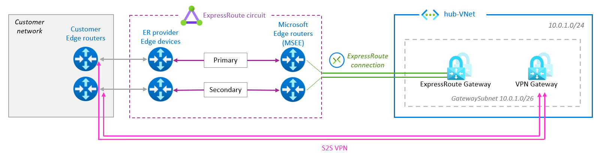

### Coexistence & Symmetry Rules

- **Strict Active-Passive Behavior**: For identical destination prefixes, Azure **always prefers ExpressRoute Private Peering over S2S VPN** regardless of BGP AS-path length or ExpressRoute `ConnectionWeight` (`ConnectionWeight` only arbitrates *among* ExpressRoute connections, though internally ExpressRoute routes carry a higher base preference than VPN).
- **Longest Prefix Match (LPM) Still Wins**: If your VPN advertises a `/25` while ExpressRoute advertises a `/24` summary, Azure will route traffic over the VPN! Advertise **identical prefix lengths** over both ExpressRoute and BGP-enabled S2S VPN.
- **Enforce On-Premises Symmetry**: On-premises routers/firewalls see both eBGP paths (`ASN 12076` from MSEE and `ASN 65515` from Azure VPN Gateway). Explicitly set higher BGP **`Local Preference` (e.g., `150` vs. `100`)** on routes learned from ExpressRoute so outbound on-premises traffic never takes the IPsec tunnel while ExpressRoute is healthy.
- **No Native Transit Between ER and VPN in Standard Hub**: Coexisting gateways in a customer-managed VNet do not exchange routes with each other unless you deploy **[Azure Route Server](/azure-networking/02-core-topologies/hub-spoke-and-route-server/)** (`allowBranchToBranchTraffic: true`) or use **[Azure Virtual WAN](/azure-networking/02-core-topologies/virtual-wan-and-routing-intent/)**.
- **Combat "Silent Passive Decay"**: Passive IPsec tunnels frequently fail silently due to expired PSKs, firewall rule drift, or stale BGP sessions—only discovered during an actual ExpressRoute outage. Deploy Active-Active VPN Gateways with BGP and continuously alert on BGP peer state and tunnel ingress/egress byte counters.

---

## 7. BGP Route Advertisement & Prefix Limits

Exceeding BGP prefix ceilings causes BGP session resets or silent prefix drops—one of the hardest hybrid incidents to diagnose under pressure. Notice the **steep asymmetry** between what Azure accepts *from* on-premises versus what an ExpressRoute Gateway can advertise *to* on-premises:

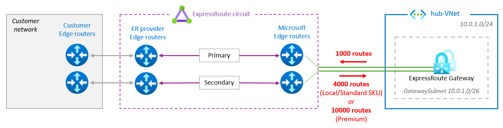

| Direction / Resource | ExpressRoute Standard | ExpressRoute Premium | Architectural Mitigation When Approaching Ceiling |
| --- | --- | --- | --- |
| **On-Premises → MSEE** (Private Peering IPv4) | **4,000** prefixes | **10,000** prefixes | Summarize on-premises branch/datacenter supernets (`10.0.0.0/8` or regional `/12` blocks) at CE routers before eBGP advertisement. Note: ER Gateways support up to **9,500** learned routes (`ErGw2AZ`/`ErGw3AZ`/`ErGwScale`; `4,000` on `ErGw1AZ`). |
| **Azure ER Gateway → MSEE** (Advertised to On-Premises) | **1,000** IPv4 / **100** IPv6 | **1,000** IPv4 / **100** IPv6 | Configure **Advertised Gateway Prefixes** (`summarizedGatewayPrefixes`) on Standard VNet Gateways, or apply outbound **[Virtual WAN Route Maps](/azure-networking/02-core-topologies/virtual-wan-and-routing-intent/)** to summarize spoke CIDRs before hitting 500+ peered spokes. |

:::caution[Monitor Prefix Watermarks Proactively]
Configure Azure Monitor metric alerts on `MaxRoutesAdvertised` / ARP & BGP availability and use **ExpressRoute Resiliency Insights** in the Azure Portal to audit single points of failure before onboarding new landing zones. For deeper routing precedence rules, see **[Routing & Traffic Engineering](/azure-networking/01-foundations/routing-and-traffic-engineering/)**.
:::

---

## What I Recommend

1. **Never deploy Standard Resiliency for production.** Use **ExpressRoute Metro** as your zero-extra-circuit-cost baseline in supported cities, and **Maximum Resiliency** (two circuits in distinct peering locations across diverse carriers) for tier-1 enterprise hubs.
2. **Run both circuit links Active-Active with BFD enabled.** Terminate Primary and Secondary fibers on separate stateless CE routers, advertise identical prefixes on both links, and enable BFD (`300ms × 3`) to drop L2 failure detection below one second.
3. **Mandate Zone-Redundant Gateways (`ErGw*AZ` or `ErGwScale`).** Size `GatewaySubnet` to `/26` up front so you never have to rebuild peered hub networks when scaling to 16 circuits, FastPath, or S2S VPN coexistence.
4. **Summarize routes on both sides from day one.** Keep Azure-to-on-premises advertisements well below the 1,000-prefix hard cliff using contiguous regional address blocks ([VNet & IP Addressing](/azure-networking/01-foundations/vnet-and-ip-addressing/)), `summarizedGatewayPrefixes`, or vWAN Route Maps.
