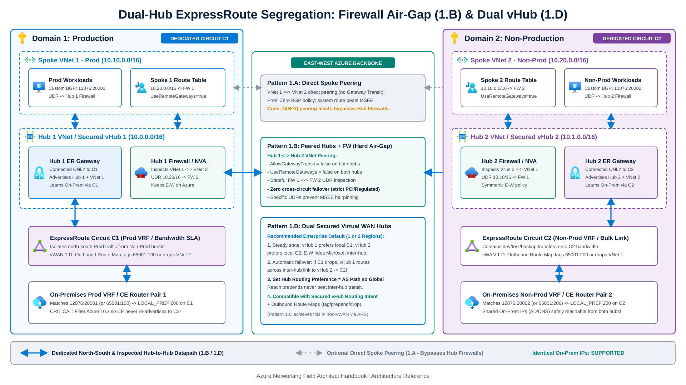
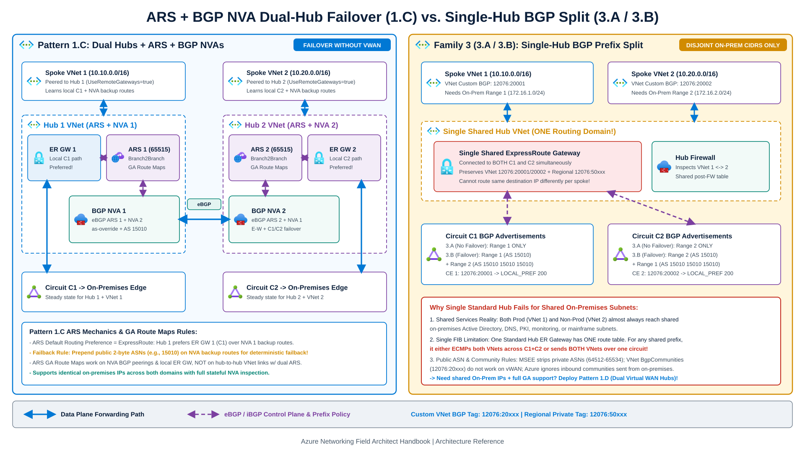
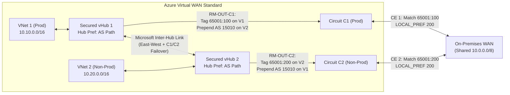
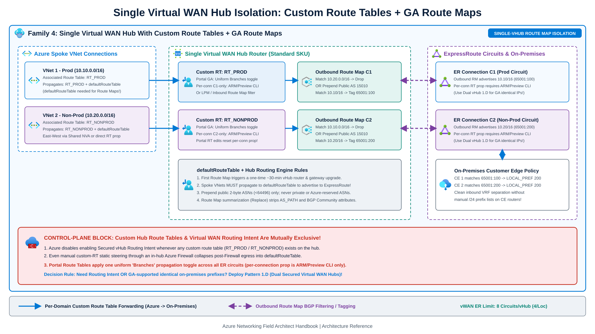
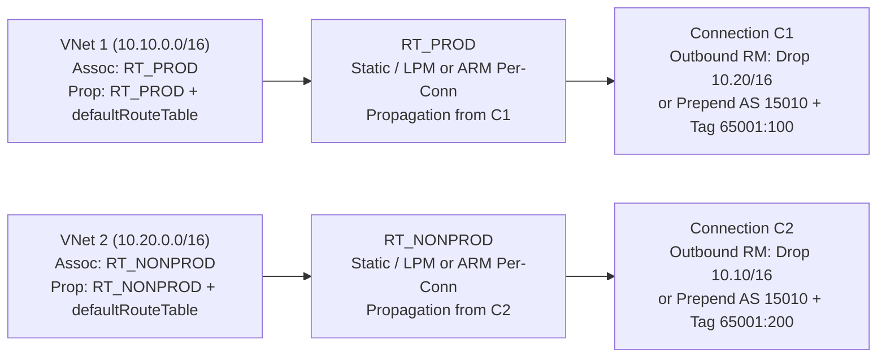
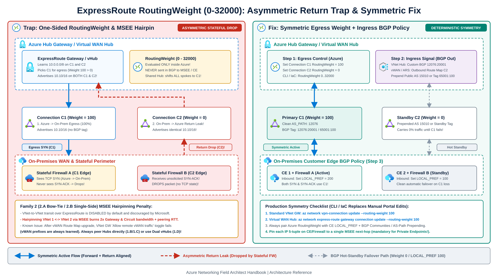

Regulated enterprises in financial services, healthcare, defense, and merger carve-outs often need to isolate hybrid traffic for separate workload domains (`VNet 1` Production vs. `VNet 2` Non-Production) across two dedicated ExpressRoute circuits (`C1` and `C2`) for VRF separation or bandwidth SLAs, while keeping inspected east-west connectivity between `VNet 1` and `VNet 2` inside Azure.

Connecting both circuits to a single Standard Hub VNet without route isolation fails in both directions. On egress from Azure to on-premises, when `C1` and `C2` advertise identical prefixes (`10.0.0.0/8`), a single Standard Hub gateway either load-balances both VNets across `C1` and `C2` via ECMP, or sends 100% of traffic from both `VNet 1` and `VNet 2` over whichever connection has the higher `RoutingWeight`. On ingress from on-premises to Azure, a shared gateway advertises both `VNet 1` and `VNet 2` prefixes out both `C1` and `C2` unless BGP communities or route maps differentiate them.

GA Route Maps in [Azure Virtual WAN](https://learn.microsoft.com/en-us/azure/virtual-wan/route-maps-about) and [Azure Route Server](https://learn.microsoft.com/en-us/azure/route-server/route-maps-about), GA [custom VNet BGP communities](https://learn.microsoft.com/en-us/azure/expressroute/how-to-configure-custom-bgp-communities), Virtual WAN custom route tables, and GA [Virtual Hub routing preference](https://learn.microsoft.com/en-us/azure/virtual-wan/about-virtual-hub-routing-preference) address these routing gaps. The sections that follow examine four architectural families, their BGP route-exchange rules, and the `RoutingWeight` asymmetric-return trap.

---

## Family 1: Dual-hub topologies (east-west on the Azure backbone)

Dual-hub designs terminate `C1` in `Hub 1` (`VNet 1` spokes) and `C2` in `Hub 2` (`VNet 2` spokes). Each ExpressRoute circuit carries only its own domain's north-south traffic in steady state, while east-west (`VNet 1 <-> VNet 2`) traffic stays on the Microsoft backbone.



### Pattern 1.A: Dual Standard Hubs with direct spoke-to-spoke peering

`Hub 1` connects only to `C1`, `Hub 2` connects only to `C2`, and `VNet 1` peers directly with `VNet 2` (`Allow Gateway Transit = false` between spokes). `C1` learns only `Hub 1 + VNet 1` and `C2` learns only `Hub 2 + VNet 2`. Even if the on-premises WAN re-advertises `VNet 2` back into `C1`, Azure's `VNet Peering` system route beats BGP so east-west traffic never hairpins through MSEE routers.

Direct spoke peering needs zero BGP policy, but scales poorly ($O(N^2)$ peerings), bypasses central hub firewalls unless spoke UDRs steer every prefix, and provides **no automatic circuit failover** if `C1` drops.

### Pattern 1.B: Dual Standard Hubs peered with central Firewall or NVA inspection

Instead of meshing spokes directly, peer `Hub 1 <-> Hub 2` (`Allow Gateway Transit = false` and `Use Remote Gateways = false` on both sides) and deploy an [Azure Firewall or NVA](/azure-networking/04-network-security/firewall-and-nva-patterns/) in each hub. Spoke and firewall UDRs steer `VNet 1 <-> VNet 2` across `FW 1 -> FW 2`, keeping east-west flows on the hub peering even if on-premises routers re-advertise Azure prefixes.

Pattern 1.B fits strict PCI or regulatory air-gapping where cross-circuit failover between Production (`C1`) and Non-Production (`C2`) is **prohibited by security policy**, while specific inter-domain flows require stateful firewall inspection.

### Pattern 1.C: Dual Standard Hubs with Azure Route Server and BGP NVAs

Organizations standardized on customer-managed Hub-and-Spoke ([Hub-and-Spoke and Azure Route Server](/azure-networking/02-core-topologies/hub-spoke-and-route-server/)) that need both steady-state segregation and automatic cross-circuit failover deploy Azure Route Server (`allowBranchToBranchTraffic: true`) and BGP NVAs in both hubs. The two NVAs peer (`NVA 1 <-> NVA 2`) over eBGP or iBGP and use `as-override` or ASN translation to strip ARS `ASN 65515`.



In steady state, ARS defaults to **`ExpressRoute` routing preference**, so `Hub 1` prefers local `ER GW 1` (`C1`) over backup routes received via `NVA 1` from `Hub 2`. When `C1` fails, `Hub 1` converges onto the `NVA 1 -> NVA 2 -> ER GW 2 -> C2` backup path. Observe three verified [Azure Route Server](https://learn.microsoft.com/en-us/azure/route-server/hub-routing-preference) rules:
1. When ExpressRoute recovers after a failure under `ExpressRoute` routing preference, ARS can remain pinned to NVA backup paths unless NVA/VPN routes carry a **longer BGP AS path** than the primary ExpressRoute path. Prepend customer-owned public 2-byte ASNs (`< 64496`, outside Azure-reserved ASNs) on the inter-hub NVA backup advertisement so failback is deterministic.
2. You can apply [ARS Route Maps](https://learn.microsoft.com/en-us/azure/route-server/route-maps-about) to NVA BGP peerings, the local ExpressRoute/VPN gateway connection, and peered spoke VNet connections (first creation triggers a one-time upgrade of up to 30 minutes and incurs extra billing). ARS Route Maps are **not supported on a VNet connection between two Hub VNets when ARS runs in both hubs**, cannot filter ARS's own Hub VNet address space, and fail creation if a Hub VPN Gateway uses Point-to-Site (P2S).
3. Filter Azure `10.x` prefixes outbound on Customer Edge (CE) routers so `C1` never re-advertises `VNet 2` directly into `ER GW 1` ahead of `NVA 1`.

### Pattern 1.D: Dual Virtual WAN Hubs (`vHub 1` + `vHub 2`)

Pattern 1.D implements dual-hub isolation and automatic failover inside [Azure Virtual WAN Standard](/azure-networking/02-core-topologies/virtual-wan-and-routing-intent/). Attach `VNet 1` to `vHub 1` (`C1`) and `VNet 2` to `vHub 2` (`C2`), deployed across two regions or inside the **same Azure region**.



| Link | Routes advertised by Azure | Routes learned by Azure |
| --- | --- | --- |
| **`C1`** (`vHub 1`) | `VNet 1` (`65001:100`) + `VNet 2` *(prepended or dropped via Outbound Route Map)* | `On-Premises` *(filter Azure `10.x` re-advertisement on CE 1)* |
| **`C2`** (`vHub 2`) | `VNet 2` (`65001:200`) + `VNet 1` *(prepended or dropped via Outbound Route Map)* | `On-Premises` *(filter Azure `10.x` re-advertisement on CE 2)* |

Two [Virtual Hub routing preference](https://learn.microsoft.com/en-us/azure/virtual-wan/about-virtual-hub-routing-preference) rules govern Pattern 1.D. First, set Hub Routing Preference to **`AS Path`** whenever ExpressRoute Global Reach or an MPLS carrier bridges `C1` and `C2`: under the default `ExpressRoute` hub routing preference, `vHub 1` prefers routes learned from its local ExpressRoute connection over the direct inter-hub link even when Global Reach prepends `AS 12076` multiple times ([Virtual WAN routing deep dive](https://learn.microsoft.com/en-us/azure/virtual-wan/routing-deep-dive)), whereas `AS Path` honors shorter AS paths so `VNet 1 <-> VNet 2` stays on the direct Microsoft inter-hub link.

Second, even under `AS Path` preference, Virtual WAN always selects routes learned from ExpressRoute circuits attached to **remote hubs** last, regardless of AS-path length. Consequently, `vHub 1` uses local `C1` in steady state and fails over across `vHub 1 -> vHub 2 -> C2` only if `C1` withdraws the on-premises route.

---

## Family 2: ExpressRoute MSEE hairpinning topologies (`2.A` and `2.B`)

In **Pattern 2.A (Bow-Tie)**, two unpeered Standard Hubs connect to both `C1` and `C2` (`Hub 1` sets higher `RoutingWeight` on `C1`; `Hub 2` sets higher `RoutingWeight` on `C2`), forcing `VNet 1 <-> VNet 2` traffic through the MSEE routers at the peering location. **Pattern 2.B** connects `Hub 1` only to `C1` while `Hub 2` connects to `C1` (low weight) and `C2` (high weight) so a `C1` failure never spills `VNet 1` traffic onto `C2`.

:::caution[Avoid VNet-to-VNet Hairpinning Over ExpressRoute]
VNet-to-VNet and VNet-to-Virtual-WAN transit over an ExpressRoute circuit is **disabled by default** on ExpressRoute gateways and [discouraged by Microsoft](https://learn.microsoft.com/en-us/azure/expressroute/expressroute-about-virtual-network-gateways). Hairpinning `VNet 1 <-> VNet 2` through MSEEs consumes **twice your gateway and circuit bandwidth**, adds peering-location round-trip latency, and skips hub firewall inspection unless spoke UDRs intervene. Note also a documented platform issue: once a Virtual WAN hub completes the software upgrade for Route Maps, a Standard VNet ExpressRoute gateway on the same circuit ignores its **Allow traffic from remote Virtual WAN network** toggle and always learns Virtual WAN prefixes. Peer hubs directly (Pattern 1.B/1.C) or use Dual Virtual WAN Hubs (Pattern 1.D) instead.
:::

---

## Family 3: Single-hub classic BGP prefix splitting (`3.A` and `3.B`)

When budget limits force a **single Standard Hub VNet** to terminate both `C1` and `C2` (right panel of the Pattern 1.C / Family 3 diagram above), north-south segregation works only when on-premises destinations occupy **non-overlapping CIDR blocks** (`On-Prem Range 1` for `VNet 1`; `On-Prem Range 2` for `VNet 2`). In **Pattern 3.A** (no failover), `C1` advertises only `Range 1` and `C2` advertises only `Range 2`. In **Pattern 3.B** (with failover), `C1` advertises `Range 1` clean (`AS 15010`) and `Range 2` prepended (`AS 15010 15010 15010`), while `C2` advertises `Range 2` clean and `Range 1` prepended. Always prepend a customer-registered **public 2-byte ASN** (`< 64496`, excluding `8074`, `8075`, `12076`, and `23456`): MSEE strips private ASNs (`64512-65534`) and rejects IANA documentation ASNs (`64496-64511`).

### Custom VNet BGP communities vs. regional BGP communities

To steer return traffic (`On-Premises -> Azure`) onto the matching circuit in Standard Hub-and-Spoke, configure [custom BGP communities](https://learn.microsoft.com/en-us/azure/expressroute/how-to-configure-custom-bgp-communities) on each spoke VNet (`VirtualNetworkCommunity`), prefixed with `12076:`:

```powershell
# Stamp distinct custom VNet BGP communities (12076:20000 range) on Prod and Non-Prod VNets
$vnet1 = Get-AzVirtualNetwork -Name "vnet-prod-01" -ResourceGroupName "rg-network"
$vnet1.BgpCommunities = @{ VirtualNetworkCommunity = "12076:20001" }
$vnet1 | Set-AzVirtualNetwork

$vnet2 = Get-AzVirtualNetwork -Name "vnet-nonprod-01" -ResourceGroupName "rg-network"
$vnet2.BgpCommunities = @{ VirtualNetworkCommunity = "12076:20002" }
$vnet2 | Set-AzVirtualNetwork
```

Keep three verified [ExpressRoute BGP community](https://learn.microsoft.com/en-us/azure/expressroute/expressroute-routing) rules straight:
1. Setting `VirtualNetworkCommunity` (such as `12076:20001`) causes Azure to advertise both your custom VNet tag and the predefined **`RegionalCommunity`** for Private Peering (`12076:50xxx`, such as `12076:50004` East US or `12076:50002` West Europe). Do not confuse `12076:51xxx` values (`12076:51004` East US Microsoft Peering; `12076:511xx` / `12076:513xx` National Clouds) with custom per-VNet tags.
2. Microsoft ignores BGP communities attached to routes advertised *from* on-premises *to* Azure, and VNet `BgpCommunities` are **not compatible with Azure Virtual WAN** (use Virtual WAN Route Maps instead).
3. Both Production (`VNet 1`) and Non-Production (`VNet 2`) almost always require shared on-premises Active Directory, DNS, PKI, or management subnets. Because a single Standard Hub ExpressRoute gateway maintains **one shared routing table**, it cannot route `VNet 1` over `C1` and `VNet 2` over `C2` toward the same on-premises IP address.

---

## Family 4: Single Virtual WAN Hub with custom route tables and GA Route Maps

A **single Azure Virtual WAN Standard Hub** combines custom hub route tables (`RT_PROD`, `RT_NONPROD`) with Inbound and Outbound Route Maps to control spoke-to-circuit advertisements without maintaining manual CE prefix lists, subject to two strict Virtual WAN platform constraints:





1. **On-premises-to-Azure isolation (GA)**: Apply an Outbound Route Map on `C1` that either drops `10.20.0.0/16` (hard VRF isolation) or prepends a public 2-byte ASN (`15010`) while adding community `65001:100` to `10.10.0.0/16`, mirrored symmetrically on `C2` (`65001:200`). Outbound Route Maps modify advertised routes **after** hub best-path selection and never alter Azure's own egress path choice.
2. **Uniform branch propagation constraint ([About virtual hub routing](https://learn.microsoft.com/en-us/azure/virtual-wan/about-virtual-hub-routing))**: Microsoft documents that all VPN, ExpressRoute, and User VPN branch connections in a virtual hub propagate routes to the **same set of route tables** (exposed in the portal as a single `Branches: Yes/No` toggle). While ARM templates and Preview CLI (`--propagated-route-tables`) expose per-connection `propagatedRouteTables` (`C1 -> RT_PROD` only, `C2 -> RT_NONPROD` only), any subsequent portal edit to `RT_PROD` or `RT_NONPROD` overwrites branch propagation uniformly across all circuits. For strictly GA portal-safe operation in a single vHub, differentiate prefixes via longest-prefix match or Inbound Route Maps; when `C1` and `C2` must advertise **identical overlapping prefixes** with full GA support, deploy **Pattern 1.D (Dual Virtual WAN Hubs)**.
3. **Mutual exclusion with Routing Intent ([Virtual WAN Routing Intent](/azure-networking/02-core-topologies/virtual-wan-and-routing-intent/))**: Custom hub route tables and Secured vHub Routing Intent are **mutually exclusive at the control plane**. Azure disables Routing Intent configuration whenever any custom route table exists beyond `defaultRouteTable` and `noneRouteTable`, and even manual custom-RT steering through an in-hub Azure Firewall collapses post-firewall hybrid egress into `defaultRouteTable`. Whenever **both** Routing Intent and per-circuit isolation are required, deploy **Pattern 1.D (Dual Secured vHubs)**.

:::note[Virtual WAN and ARS Route Map Rules]
- Creating the **first** Route Map on an existing Virtual WAN hub triggers a one-time ~30-minute software upgrade on the hub router and gateways, enables outbound ExpressRoute ECMP, incurs extra charges, and requires spoke VNet connections to propagate to **`defaultRouteTable`** to be advertised to on-premises.
- Route Maps support **2-byte ASNs only**, cannot be applied to hub address spaces, and strip both `BGP Community` and `AS_PATH` when summarizing prefixes (`Replace` action).
- Never prepend private ASNs or Azure-reserved ASNs (`8074`, `8075`, `12076`, `65515`, `65517-65520`), and never strip internal Azure BGP communities (`65517:12001-12006`, `65517:65517`, `65517:12076`, `65518:65518`, `65518:12076`, `65515:10000`, `65515:20000`).
:::

---

## `RoutingWeight` (`0-32000`) and the asymmetric-return trap

When a hub or virtual hub learns identical prefixes across multiple ExpressRoute connections (such as active/standby failover or [Bow-Tie topologies](/azure-networking/03-hybrid-connectivity/expressroute-bowtie-failures/)), Azure breaks egress ties using **`RoutingWeight`** (`0` to `32000`, highest wins):



### Why one-sided `RoutingWeight` breaks stateful inspection

`RoutingWeight` is evaluated **exclusively inside Azure** on the connection resource and is **never advertised in BGP** to MSEE or Customer Edge routers:
- Raising `RoutingWeight = 100` on `C1` (leaving `C2` at `0`) steers 100% of `Azure -> On-Premises` egress onto `C1`, **and** in a shared single hub shifts **every** spoke onto `C1` regardless of domain.
- Meanwhile, Azure still advertises identical VNet routes out both `C1` and `C2`. Without matching inbound BGP `LOCAL_PREF` policy on the on-premises CE routers, return packets (`SYN-ACK`) enter via `C2`, hit a stateful perimeter firewall that never saw the outbound `SYN`, and drop.

Always pair Azure `RoutingWeight` (egress) with VNet custom BGP communities (`12076:20xxx`) or Virtual WAN / ARS Outbound Route Maps plus CE `LOCAL_PREF` (ingress):

```bash
# 1. Standard VNet ExpressRoute Gateway Connection: set egress RoutingWeight (0-32000)
az network vpn-connection update \
  --resource-group rg-connectivity-prod \
  --name conn-er-hub1-c1 \
  --routing-weight 100

# 2. Virtual WAN Hub ExpressRoute Connection: set egress RoutingWeight (0-32000)
az network express-route gateway connection update \
  --resource-group rg-vwan-prod \
  --gateway-name ergw-vhub1 \
  --name conn-vhub1-c1 \
  --routing-weight 100
```

---

## Architecture decision matrix

| Pattern | Hub count | Shared / identical on-prem IPs? | Central east-west firewall? | Automatic circuit failover? | Operational complexity | Recommended fit |
| --- | --- | --- | --- | --- | --- | --- |
| **1.A Dual Hub + Spoke Peering** | 2 VNet Hubs | Yes | No *(unless spoke UDRs)* | No | Low *(<= 3 spokes)* | Small static footprints needing zero BGP policy |
| **1.B Dual Hub + Peered Hubs & FW** | 2 VNet Hubs | Yes | **Yes** | No *(hard air-gap)* | Medium | **Strict PCI / Prod vs. Non-Prod isolation** forbidding cross-circuit failover |
| **1.C Dual Hub + ARS + BGP NVA** | 2 VNet Hubs | Yes | **Yes** *(NVA)* | **Yes** *(prepend NVA path)* | High | Non-vWAN enterprises needing segregation + automatic cross-circuit failover |
| **1.D Dual Secured Virtual WAN Hubs** | 2 vHubs | Yes | **Yes** *(Routing Intent)* | **Yes** | **Low** | **Enterprise default** for segregation + Private Routing Intent + failover |
| **2.A / 2.B MSEE Hairpinning** | 2 VNet Hubs | Yes | No | Yes (`2.A`) / One-way (`2.B`) | Low | **Avoid** (2x bandwidth + RTT; disabled by default) |
| **3.A / 3.B Single-Hub BGP Split** | 1 Hub / vHub | **No** *(disjoint CIDRs only)* | Yes | No (`3.A`) / Yes (`3.B`) | High on CE/PE | Only when on-premises VRFs have zero shared destination subnets |
| **4. Single vHub Custom RTs + Route Maps** | 1 vHub | **ARM/Preview CLI only** *(GA portal uses uniform `Branches` propagation)* | Custom NVA *(mutually exclusive with Routing Intent)* | Optional *(via Route Map)* | Medium | Single-vHub outbound VRF filtering **without** Routing Intent |

---

## Recommendations

1. **Select Pattern 1.D (Dual Secured Virtual WAN Hubs + Outbound Route Maps + Hub Routing Preference = `AS Path`)** when you need dedicated ExpressRoute circuits per security domain alongside Azure Firewall Private Routing Intent and automatic cross-circuit failover. Deploy both vHubs in the same Azure region when single-region residency applies.
2. **Select Pattern 1.B (Dual Standard Hubs + Hub-to-Hub VNet Peering + Azure Firewall)** when customer-managed Hub-and-Spoke is mandatory and compliance rules prohibit Non-Production traffic from failing over onto Production circuits.
3. **Never change `RoutingWeight` in isolation.** Pair every Azure `RoutingWeight` adjustment with VNet custom BGP communities (`12076:20xxx` on Standard VNet hubs) or Outbound Route Map communities and public 2-byte AS-path prepending (on Virtual WAN and Azure Route Server) matched by CE `LOCAL_PREF` policies.

---

## References

- [About Route-maps for Azure Virtual WAN virtual hubs](https://learn.microsoft.com/en-us/azure/virtual-wan/route-maps-about)
- [How to configure Route-maps in Azure Virtual WAN](https://learn.microsoft.com/en-us/azure/virtual-wan/route-maps-how-to)
- [About virtual hub routing in Azure Virtual WAN](https://learn.microsoft.com/en-us/azure/virtual-wan/about-virtual-hub-routing)
- [Virtual WAN virtual hub routing preference](https://learn.microsoft.com/en-us/azure/virtual-wan/about-virtual-hub-routing-preference)
- [Virtual WAN routing deep dive (Global Reach and Hub Routing Preference)](https://learn.microsoft.com/en-us/azure/virtual-wan/routing-deep-dive)
- [About route maps for Azure Route Server](https://learn.microsoft.com/en-us/azure/route-server/route-maps-about)
- [Routing preference with Azure Route Server](https://learn.microsoft.com/en-us/azure/route-server/hub-routing-preference)
- [Configure custom BGP communities for Azure ExpressRoute private peering](https://learn.microsoft.com/en-us/azure/expressroute/how-to-configure-custom-bgp-communities)
- [ExpressRoute routing requirements and regional BGP communities](https://learn.microsoft.com/en-us/azure/expressroute/expressroute-routing)

