Regulated enterprises (financial services, healthcare, sovereign/defense, and M&A carve-outs) frequently face a strict hybrid requirement: **segregate hybrid traffic for distinct workload domains (`VNet 1` Prod vs. `VNet 2` Non-Prod, or Regulated vs. General) across two dedicated ExpressRoute circuits (`C1` and `C2`) to guarantee bandwidth SLAs or VRF isolation—while still allowing controlled, inspected east-west communication between `VNet 1` and `VNet 2` inside Azure.**

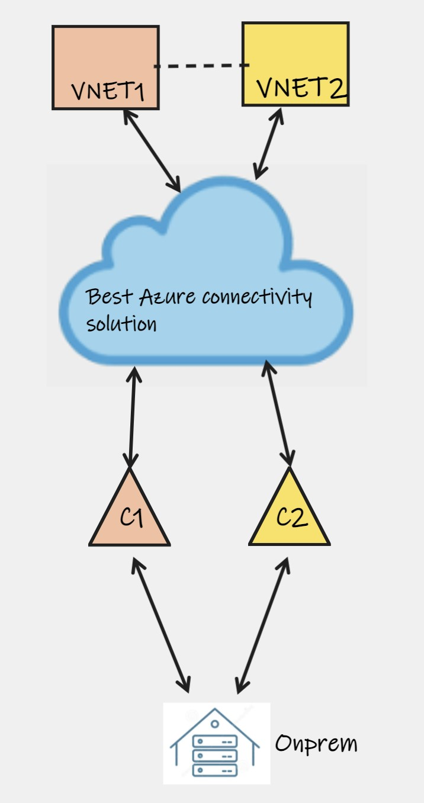

Historically, achieving this inside a single Azure hub was painful because Azure lacked native BGP route-filtering and attribute-manipulation controls—Connecting two circuits to one hub advertised every spoke to both circuits and learned identical on-premises prefixes on both links. Today, **GA Route Maps** (in both **[Azure Virtual WAN](/azure-networking/02-core-topologies/virtual-wan-and-routing-intent/)** and **[Azure Route Server](/azure-networking/02-core-topologies/hub-spoke-and-route-server/)**), **GA Custom BGP Communities**, **Virtual WAN Custom Route Tables**, and **GA Virtual Hub Routing Preference** unlock far cleaner architectures alongside proven dual-hub isolation models.

---

## Why Naive Single-Hub Connections Fail Segregation

If you simply attach Circuit `C1` and Circuit `C2` to the same Standard Hub ExpressRoute Gateway without route isolation:
1. **Outbound Leak (Azure → On-Premises)**: Both circuits advertise the exact same on-premises supernets (`10.0.0.0/8`), so Azure either **ECMP load-balances** both VNets across `C1` and `C2`, or—if you set a higher `ConnectionWeight` on `C1`—sends **100% of traffic from both `VNet 1` and `VNet 2` over `C1`**, defeating segregation.
2. **Inbound Leak (On-Premises → Azure)**: The Hub Gateway advertises *both* `VNet 1` and `VNet 2` prefixes identically out `C1` and `C2` unless BGP communities or route maps differentiate them.

Below are the **four architectural families**—from strict Dual-Hub physical separation to modern Virtual WAN Custom Route Tables + GA Route Maps—analyzed with exact link-level route advertisements and failure behavior.

---

## Family 1: Dual-Hub Topologies (East-West via Azure Backbone)

Dual-Hub designs terminate `C1` in `Hub 1` (`VNet 1` spokes) and `C2` in `Hub 2` (`VNet 2` spokes), guaranteeing clean circuit isolation while keeping east-west (`VNet 1 ↔ VNet 2`) traffic entirely on the Azure backbone.

### Pattern 1.A — Dual Standard Hubs + Direct Spoke-to-Spoke Peering

`Hub 1` connects only to `C1`; `Hub 2` connects only to `C2`. `VNet 1` and `VNet 2` communicate via direct VNet Peering (`Allow Gateway Transit = false` between spokes).

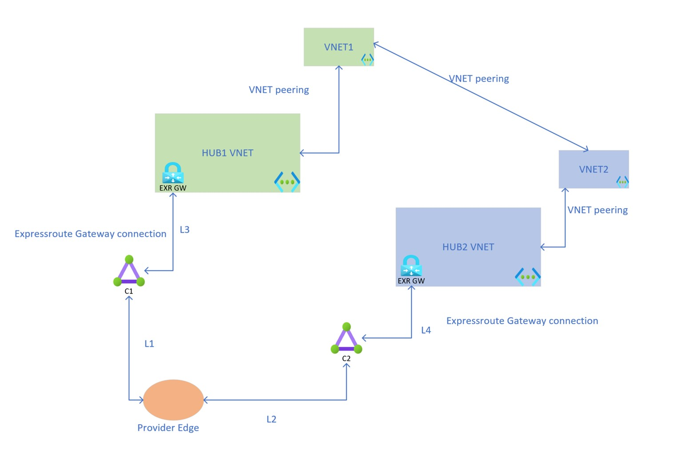

- **Routing Behavior**: `C1` learns only `Hub 1 + VNet 1`; `C2` learns only `Hub 2 + VNet 2`. Even if the on-premises WAN re-advertises `VNet 2` back into `C1`, Azure's direct `VNet Peering` system route overrides BGP so east-west never hairpins through MSEEs.
- **Verdict**: Zero BGP manipulation required, **but** direct spoke-to-spoke peering scales poorly ($O(N^2)$ mesh), bypasses central Hub Firewalls unless spoke UDRs exist, and provides **no automatic circuit failover** if `C1` goes down.

### Pattern 1.B — Dual Standard Hubs + Peered Hubs with Firewall / NVA Inspection

Instead of meshing spokes directly, peer `Hub 1 ↔ Hub 2` (`Use Remote Gateways = false`) and place an **[Azure Firewall or NVA](/azure-networking/04-network-security/firewall-and-nva-patterns/)** in each hub with spoke/firewall UDRs steering `VNet 1 ↔ VNet 2` across the hub-to-hub peering.

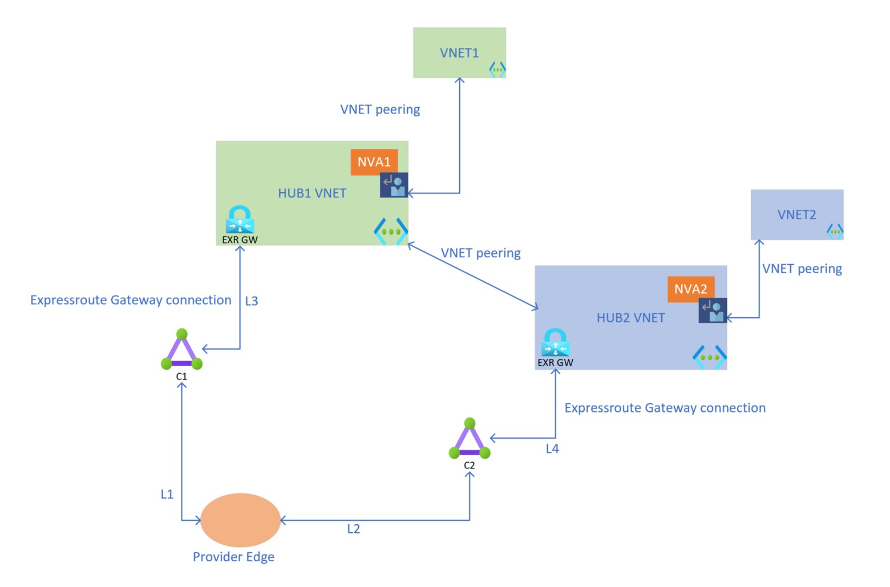

- **Routing Behavior**: `C1` still advertises only `Hub 1 + VNet 1` and `C2` advertises only `Hub 2 + VNet 2`. Specific UDRs on the Firewall/NVA subnets ensure `VNet 1 ↔ VNet 2` stays on the hub peering even if on-premises re-advertises Azure prefixes.
- **Verdict**: **Strong fit for strict regulatory air-gapping** where circuit failover between Prod (`C1`) and Non-Prod (`C2`) is *explicitly forbidden* by security policy, and all cross-domain east-west traffic must pass stateful firewall inspection.

### Pattern 1.C — Dual Standard Hubs + Azure Route Server + BGP NVAs

For teams prohibited from using Virtual WAN who need **both** segregation in steady state **and** automatic cross-circuit failover during an outage, deploy **[Azure Route Server (ARS)](/azure-networking/02-core-topologies/hub-spoke-and-route-server/)** (`allowBranchToBranchTraffic: true`) + BGP NVAs in both hubs, running eBGP/iBGP (with VXLAN/IPsec overlay or UDRs, stripping `ASN 65515` via `as-override`).

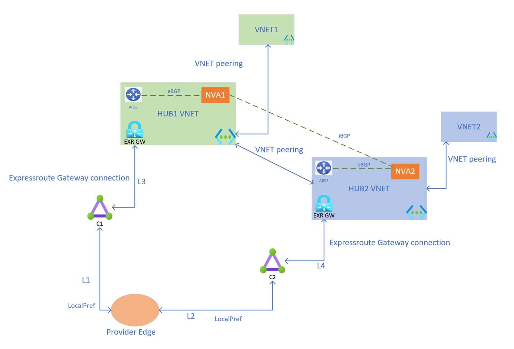

- **Routing Behavior**: Each hub learns local on-premises routes directly from its local ExpressRoute Gateway *and* backup paths via its NVA from the sibling hub. Because ExpressRoute Gateway routes beat ARS-NVA routes for identical prefixes in steady state, `VNet 1` uses `C1` and `VNet 2` uses `C2`, failing over automatically through the NVA bridge if `C1` drops!
- **Modern GA Upgrade**: **GA Route Maps for Azure Route Server** now allow tagging, filtering, and AS-path prepending directly on ARS BGP peerings without complex custom NVA policy hacks. Prevent on-premises CE routers from re-advertising Azure prefixes across circuits so inter-VNet traffic never prefers MSEE over the hub NVA.

### Pattern 1.D — Dual Virtual WAN Hubs (`vHub 1` + `vHub 2`)

This is the cloud-native turnkey equivalent of Pattern 1.C inside a single **[Azure Virtual WAN Standard](/azure-networking/02-core-topologies/virtual-wan-and-routing-intent/)**: `VNet 1` attaches to `vHub 1` (`C1`), and `VNet 2` attaches to `vHub 2` (`C2`)—either in two regions or within the same region.

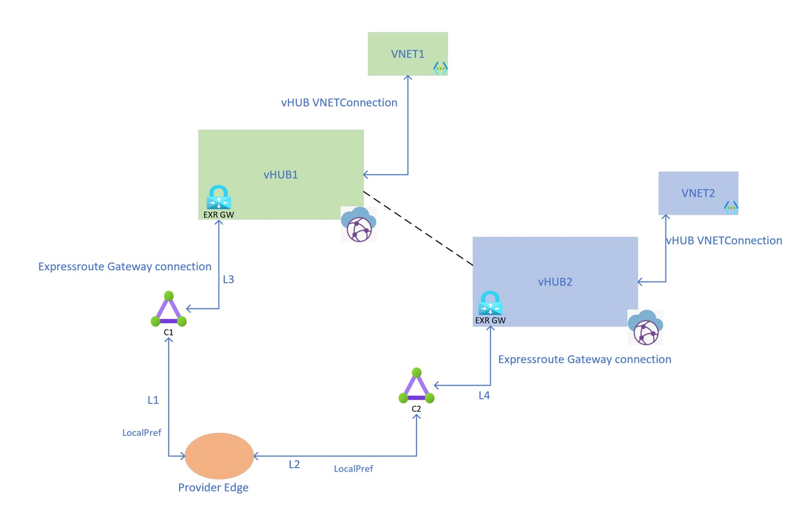

| Link | Routes Advertised by Azure | Routes Learned by Azure |
| --- | --- | --- |
| `C1` (`L1/L3`) | `VNet 1 + vHub 1 + VNet 2 + vHub 2` *(filterable via GA Route Maps!)* | `On-Premises` *(block Azure re-advertisement on CE)* |
| `C2` (`L2/L4`) | `VNet 1 + vHub 1 + VNet 2 + vHub 2` *(filterable via GA Route Maps!)* | `On-Premises` *(block Azure re-advertisement on CE)* |

- **Steady-State & Failover Mechanics**: By default, each `vHub` prefers its **local ExpressRoute connection** over inter-hub routes (`vHub 1` uses `C1`; `vHub 2` uses `C2`), while `VNet 1 ↔ VNet 2` rides the high-speed Microsoft inter-hub backbone. If `C1` fails, `vHub 1` automatically fails over across the inter-hub link to `vHub 2 → C2`!
- **GA Hub Routing Preference & GA Route Maps**:
  - **Virtual Hub Routing Preference (GA)** can be set to **`AS-Path`** so `vHub` best-path selection honors AS-path length ahead of connection type—preventing accidental MSEE hairpinning if an MPLS carrier re-advertises spoke routes.
  - **Virtual WAN Route Maps (GA)** applied **outbound** on `C1` and `C2` can tag `VNet 1` with BGP community `65000:100` and `VNet 2` with `65000:200` (or prepend ASNs / filter cross-domain prefixes entirely if failover is undesired), making CE `Local Preference` policy trivial.

---

## Family 2: ExpressRoute Hairpinning Topologies (Use Sparingly)

### Pattern 2.A & 2.B — Dual Hubs With Bow-Tie (`2.A`) or Asymmetric (`2.B`) Circuit Hairpinning

In **Pattern 2.A**, two unpeered Standard Hubs cross-connect to both `C1` and `C2` in a Bow-Tie (`Hub 1` sets `Weight = 100` on `C1`; `Hub 2` sets `Weight = 100` on `C2`), enabling VNet-to-VNet communication **through the MSEE routers**. **Pattern 2.B** connects `Hub 1` only to `C1` while `Hub 2` connects to both `C1` and `C2` (`Weight` higher on `C2`) to protect `C2` capacity during a `C1` failure.

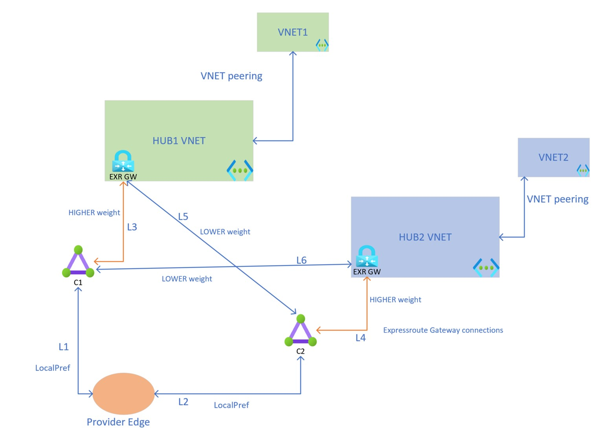

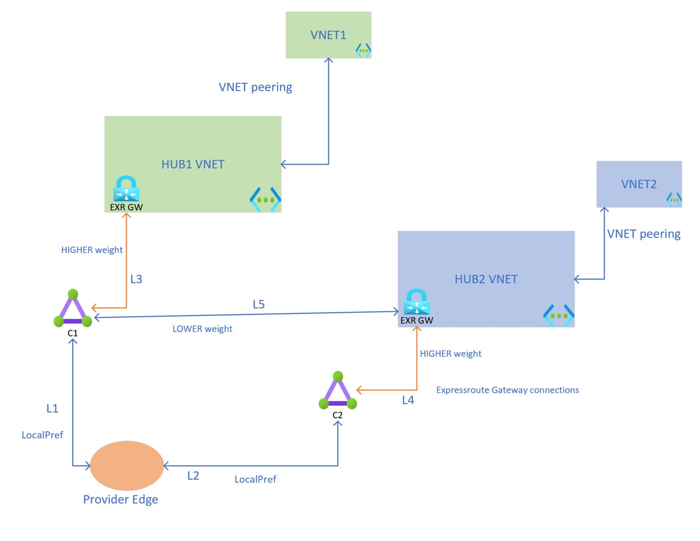

:::caution[Why Hairpinning East-West Traffic Over MSEEs Is Discouraged]
Microsoft explicitly discourages routing Azure VNet-to-VNet traffic through ExpressRoute MSEEs (it is disabled by default on ExpressRoute Gateways). Hairpinning `VNet 1 ↔ VNet 2` through the peering location **consumes twice your ExpressRoute Gateway and circuit bandwidth**, adds peering-location round-trip latency, and bypasses central Hub Firewalls unless spoke UDRs inspect first. Always add Hub-to-Hub VNet Peering (Pattern 1.B/1.C) or use Virtual WAN (Pattern 1.D / Family 4) instead.
:::

---

## Family 3: Single-Hub Classic BGP Prefix Splitting

### Pattern 3.A & 3.B — Single Hub With Disjoint On-Premises Prefixes (`3.A`) or AS-Path Prepending (`3.B`)

When cost constraints dictate a **single Hub VNet** terminating both `C1` and `C2`, segregation is only possible without custom route tables if **on-premises destinations themselves live in cleanly separable IP blocks** (`On-Prem Range 1` for `VNet 1` workloads; `On-Prem Range 2` for `VNet 2` workloads):
- **Pattern 3.A (Disjoint Advertisements — No Failover)**: `C1` advertises *only* `Range 1`; `C2` advertises *only* `Range 2`.
- **Pattern 3.B (AS-Path Prepending — With Failover)**: `C1` advertises `Range 1` clean + `Range 2` AS-prepended; `C2` advertises `Range 2` clean + `Range 1` AS-prepended.

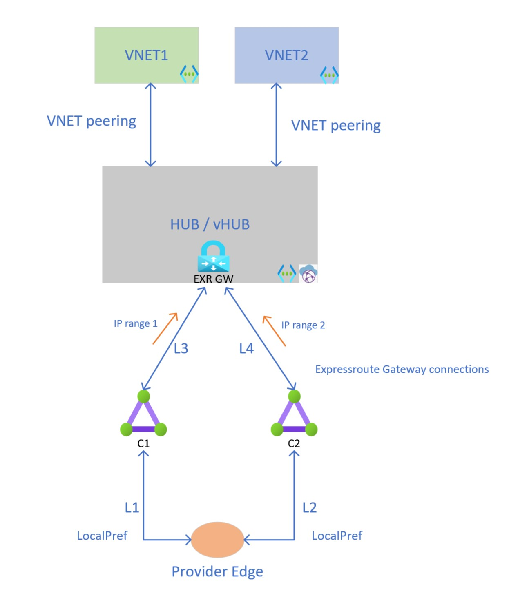

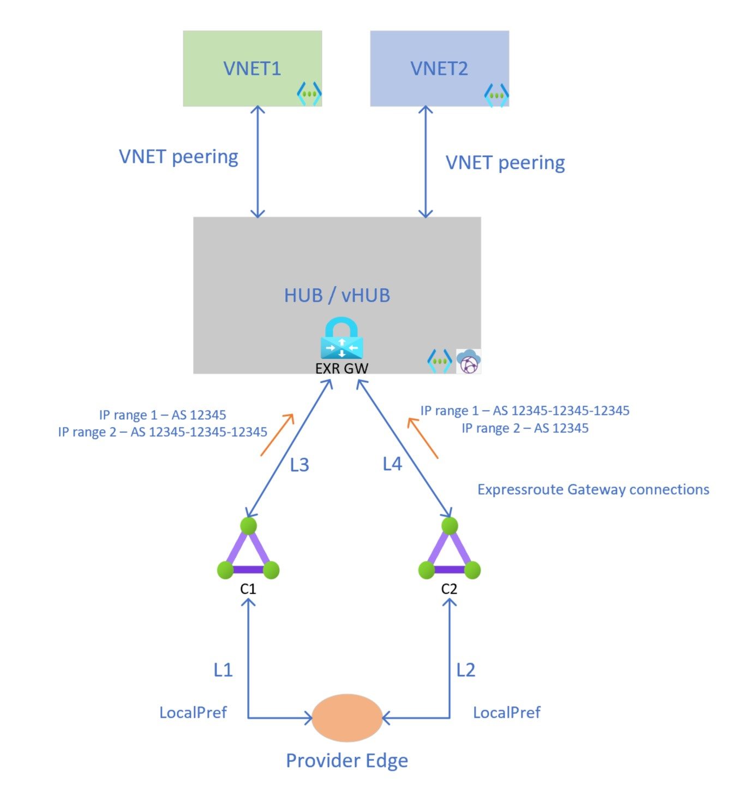

- **GA Custom BGP Communities (Upstream Return Path)**: In Standard Hub-and-Spoke, **Custom BGP Communities for ExpressRoute Private Peering (GA)** let you stamp a distinct regional/VNet community tag (e.g., `12076:51001` on `VNet 1`, `12076:51002` on `VNet 2`) directly on each VNet resource! On-premises CE routers match those communities to set `Local Preference` so `Range 1 → VNet 1` uses `C1` and `Range 2 → VNet 2` uses `C2`.
- **Limitation**: In practice, both `VNet 1` (Prod) and `VNet 2` (Non-Prod) usually need to reach **shared on-premises subnets** (Active Directory, DNS, PKI, shared mainframes). Because a single Standard Hub ExpressRoute Gateway shares **one routing domain**, `VNet 1` and `VNet 2` cannot pick *different* ExpressRoute circuits for the *exact same* on-premises destination IP in a single Standard Hub!

---

## Family 4: Single Virtual WAN Hub With Custom Route Tables + GA Route Maps

Unlike a Standard Hub VNet, a **single Azure Virtual WAN Hub (`vHub`)** *can* isolate `VNet 1` onto `C1` and `VNet 2` onto `C2`—even when `C1` and `C2` advertise **overlapping/identical on-premises prefixes**—provided you combine **Custom Hub Route Tables** with **GA Route Maps**:

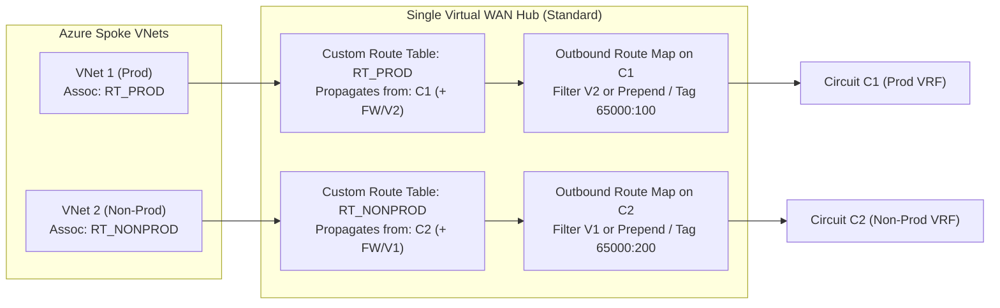

1. **Azure → On-Premises Isolation**: Associate `VNet 1` to custom route table `RT_PROD` (which receives route propagation **only** from connection `C1`) and `VNet 2` to `RT_NONPROD` (which receives propagation **only** from `C2`).
2. **On-Premises → Azure Isolation via GA Route Maps**: Apply an **Outbound Route Map** on ExpressRoute connection `C1` (dropping `VNet 2` prefixes for hard VRF isolation, or prepending ASNs / tagging BGP community `65000:100` for failover) and a symmetric Outbound Route Map on `C2`.
3. **Important Routing Intent Caveat**: If you enable **[Virtual WAN Routing Intent](/azure-networking/02-core-topologies/virtual-wan-and-routing-intent/)** for Private Traffic on a Secured vHub, Routing Intent overrides customspoke route-table associations and forces all private traffic through the Hub Azure Firewall (`defaultRouteTable`), which brings both circuits back into a shared post-firewall routing decision. Therefore, when **both** Routing Intent *and* strict per-circuit segregation to identical on-premises IPs are mandatory, **use Pattern 1.D (Dual Secured vHubs)**!

:::note[First Route-Map Activation Window]
Creating the **first** Route Map on an existing Virtual WAN hub triggers a one-time ~30-minute software upgrade on the virtual hub router and gateways, and requires spoke prefixes to propagate to `defaultRouteTable` to be advertised to on-premises. Never use Azure-reserved ASNs (`8074`, `8075`, `12076`, `65515`, `65517–65520`) when prepending in Route Maps, and note that Route Map summarization strips BGP communities and `AS_PATH`.
:::

---

## Configuring ExpressRoute Connection Weights

Whenever a hub learns identical prefixes across two circuits (such as Bow-Tie designs or Dual-Circuit failover), Azure breaks ties using **`RoutingWeight`** (`0–32000`, highest wins) on the ExpressRoute Connection object:

- **Standard VNet ExpressRoute Connection Weight**:
  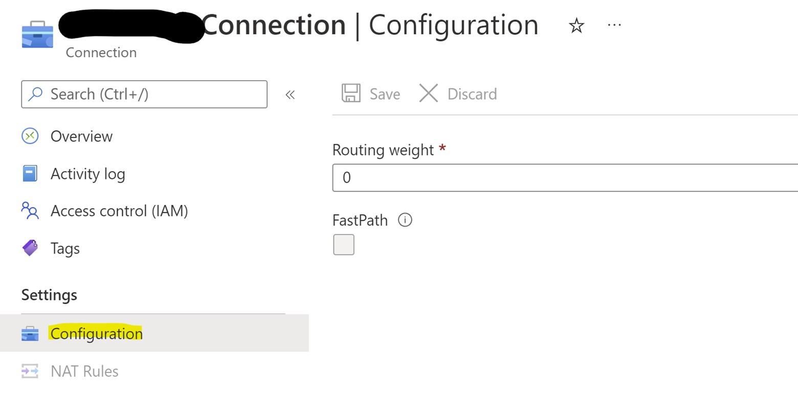

- **Virtual WAN Hub ExpressRoute Connection Weight**:
  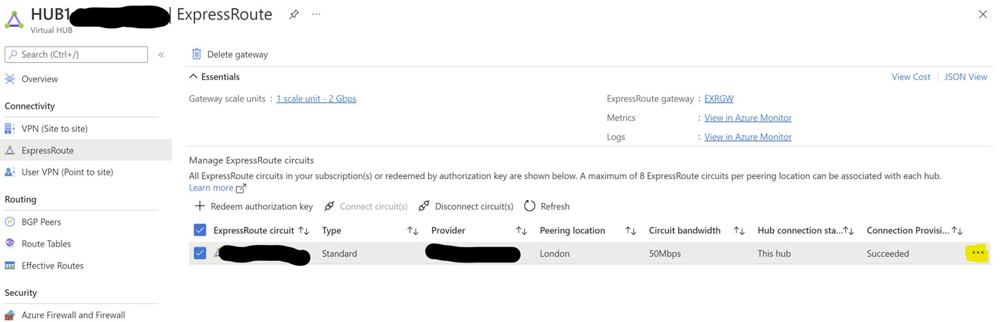
  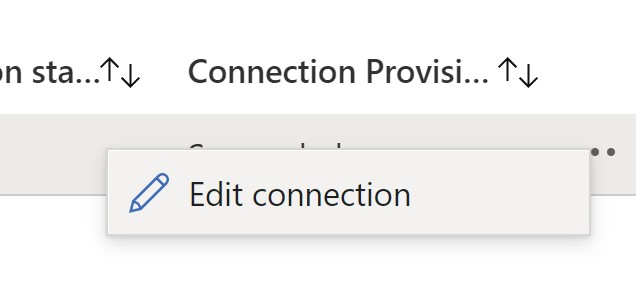
  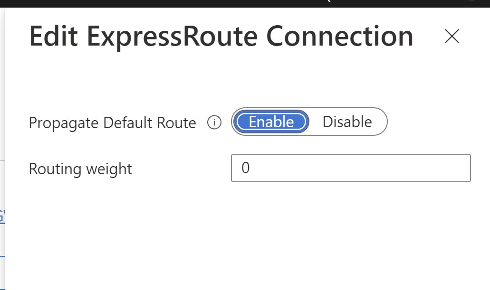

---

## Architecture Decision Matrix

| Pattern | Hubs | Identical On-Prem IPs Supported? | Central East-West Firewall? | Automatic Circuit Failover? | Operational Complexity | Best Use Case |
| --- | --- | --- | --- | --- | --- | --- |
| **1.A Dual Hub + Spoke Peering** | 2 VNet Hubs | Yes | No (unless spoke UDRs) | No | Low (for ≤3 spokes) | Tiny static footprints with zero BGP changes |
| **1.B Dual Hub + Hub Peering & FW** | 2 VNet Hubs | Yes | **Yes** | No *(Hard air-gap)* | Medium | **Strict Prod vs. Non-Prod / PCI isolation** where cross-circuit failover is prohibited |
| **1.C Dual Hub + ARS + BGP NVA** | 2 VNet Hubs | Yes | **Yes** (NVA) | **Yes** | High | Non-vWAN enterprises needing segregation + automatic cross-circuit failover |
| **1.D Dual Virtual WAN Hubs** | 2 vHubs | Yes | **Yes** (Secured vHub + Routing Intent) | **Yes** | **Low** | **Enterprise standard** for scalable segregation + Secured vHub Routing Intent + failover |
| **2.A / 2.B ER Hairpinning** | 2 VNet Hubs | Yes | No | Yes / Partial | Low | **Avoid** unless Hub-to-Hub VNet peering is organizationally impossible |
| **3.A / 3.B Single Hub BGP Split** | 1 Hub / vHub | **No** *(Requires disjoint on-prem CIDRs)* | Yes | No (`3.A`) / Yes (`3.B`) | High on CE/PE | Only when on-premises VRFs use non-overlapping destination CIDRs |
| **4. Single vHub Custom RTs + Route Maps** | 1 vHub | **Yes** | Custom NVA / No Routing Intent | Optional (via Route Map prepending) | Medium | Cost-optimized single-vHub isolation **without** Private Routing Intent |

---

## What I Recommend

1. **Lead with Pattern 1.D (Dual Secured Virtual WAN Hubs + GA Route Maps + Hub Routing Preference = `AS-Path`)** whenever an enterprise requires dedicated ExpressRoute circuits per security domain alongside **Azure Firewall Routing Intent** and automatic failover. Two vHubs can even coexist in the same Azure region when regulatory segmentation demands it.
2. **Use Pattern 1.B (Dual Standard Hubs + Hub-to-Hub Peering + Azure Firewall)** when customer-managed Hub-and-Spoke is the standard and **hard compliance air-gapping** forbids Non-Prod traffic from ever failing over onto the Production ExpressRoute circuit.
3. **Leverage GA Custom BGP Communities and GA Route Maps (in vWAN or Azure Route Server)** to tag spoke prefixes (`65000:100` Prod, `65000:200` Non-Prod) rather than maintaining brittle, manual `/24` prefix lists on on-premises Customer Edge routers.
