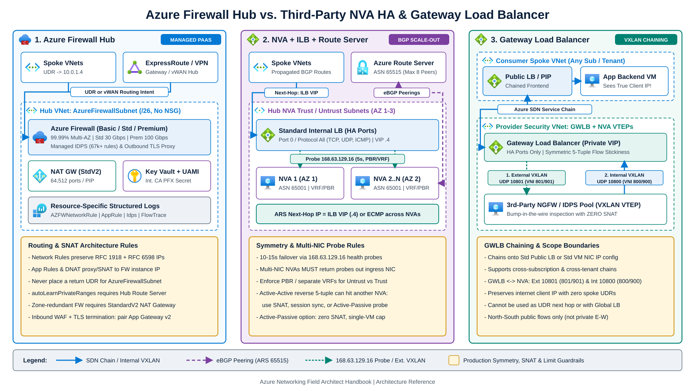
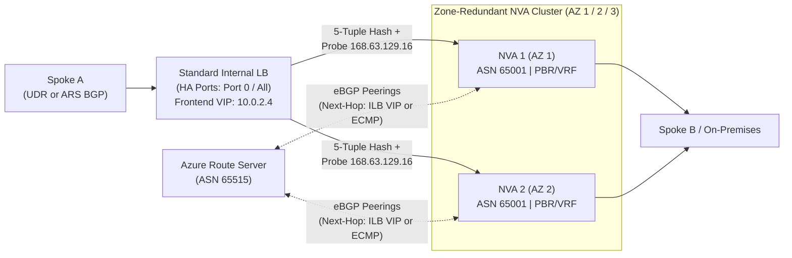
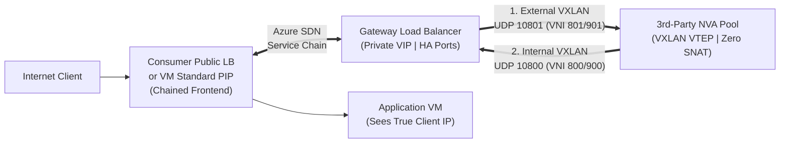

Centralized traffic inspection sits on the critical path of enterprise network flows. Poorly designed firewall tiers amplify single-zone outages, drop TCP sessions through asymmetric return paths, or blind security operations with unstructured logs and SNAT port exhaustion.

This chapter compares [Azure Firewall](https://learn.microsoft.com/en-us/azure/firewall/features-by-sku) (`Basic`, `Standard`, and `Premium`) against third-party Network Virtual Appliance (NVA) high-availability patterns: active-active clusters behind an Internal Load Balancer with [Azure Route Server](https://learn.microsoft.com/en-us/azure/route-server/next-hop-ip), active-passive failover pairs, and [Azure Gateway Load Balancer](https://learn.microsoft.com/en-us/azure/load-balancer/gateway-overview) VXLAN service chaining.



---

## 1. Azure Firewall architecture and SKU selection

Azure Firewall is a managed, stateful firewall deployed into a dedicated `/26` `AzureFirewallSubnet` (plus a dedicated `/26` `AzureFirewallManagementSubnet` required for the `Basic` SKU and Forced Tunneling). New deployments in regions with Availability Zones span zones automatically at no extra deployment fee. Never attach a Network Security Group (NSG) to `AzureFirewallSubnet`.

### Basic, Standard, and Premium SKU comparison

Figures below reflect documented [Azure Firewall SKU capabilities](https://learn.microsoft.com/en-us/azure/firewall/features-by-sku) and [tested performance limits](https://learn.microsoft.com/en-us/azure/firewall/firewall-performance) (up to 20 autoscale instances by default, or up to 50 instances with prescaling):

| Capability | Azure Firewall Basic | Azure Firewall Standard | Azure Firewall Premium |
| --- | --- | --- | --- |
| **Target workload** | SMB or isolated dev/test (< 250 Mbps) | Enterprise L3-L7 egress and east-west | Regulated, PCI-DSS, deep L7 inspection |
| **Aggregate throughput** | Up to **250 Mbps** (fixed 2 VMs, no autoscale) | Up to **30 Gbps** (~3 Gbps initial before autoscale) | Up to **100 Gbps** (~18 Gbps initial; **up to 22 Gbps** with TLS + IDPS Deny active) |
| **Single-flow ceiling** | Up to 250 Mbps | **1 Gbps** fat flow (up to 1.5 Gbps single TCP) | **10 Gbps** fat flow (up to 9 Gbps single TCP; ~600 Mbps with IDPS Deny) |
| **Public IP capacity** | Multiple PIPs (requires Mgmt `/26` subnet) | Up to **250 PIPs** (VNet) / **80 PIPs** (Secured vHub) | Up to **250 PIPs** (VNet) / **80 PIPs** (Secured vHub) |
| **Network-rule FQDN filtering** | No (HTTP/S and MSSQL SNI App rules only) | **Yes** (all TCP/UDP ports, requires DNS Proxy) | **Yes** (all TCP/UDP ports, requires DNS Proxy) |
| **Threat Intelligence** | **Alert mode only** | **Alert and Deny** modes | **Alert and Deny** modes |
| **DNS Proxy and Custom DNS** | No | **Yes** | **Yes** |
| **Web categories** | No | FQDN / SNI match only | **Full URL path match** (HTTP and inspected HTTPS) |
| **Outbound / east-west TLS inspection** | No | No | **Yes** (forward proxy via Key Vault Intermediate CA) |
| **Managed IDPS** | No | No | **Yes** (67,000+ rules in 50+ categories; up to 10,000 custom rules) |
| **Full URL path filtering** | No | No | **Yes** (`www.contoso.com/api/v1` vs. `www.contoso.com`) |
| **Forced Tunneling without PIP** | No | **Yes** | **Yes** |

### Outbound TLS inspection and Key Vault identity requirements

Azure Firewall Premium decrypts outbound and east-west HTTPS traffic by generating leaf certificates on the fly from a customer-supplied Intermediate CA certificate stored in Azure Key Vault. Production deployments must satisfy three [Azure Firewall Premium certificate requirements](https://learn.microsoft.com/en-us/azure/firewall/premium-certificates).

First, export a single Intermediate CA certificate (never a Root CA in production) valid for at least one year forward (renewed at least two months prior to expiration) as a password-less PKCS#12 (`.pfx`) archive with an exportable RSA >= 4096-bit private key, `basicConstraints = critical, CA:true` with `pathlen >= 1`, and `keyUsage = critical, keyCertSign`. PEM files and `.pfx` bundles containing the full certificate chain are rejected.

Second, import that `.pfx` through Key Vault Certificates (recommended for expiration alerts, because Key Vault creates the backing Secret automatically) or upload it directly as a Key Vault Secret. Azure Firewall reads certificates exclusively through the Key Vault Secrets API, so Certificate objects without a corresponding Secret fail.

Third, assign a User-Assigned Managed Identity to the Firewall Policy and grant it Key Vault Secret `Get` and `List` permissions via the `Key Vault Secrets User` RBAC role or a Vault Access Policy. Certificate-plane permissions alone do not work. Because Azure Firewall Premium is a Key Vault Trusted Service, Key Vault public network access can remain disabled.

:::tip[Inbound TLS termination]
Azure Firewall Premium acts as a TLS forward proxy for outbound and east-west traffic, not an inbound TLS reverse proxy on DNAT rules. For inbound HTTPS workloads needing OWASP WAF protection and TLS termination, place Azure Application Gateway WAF v2 or Azure Front Door Premium in front of or alongside Azure Firewall.
:::

---

## 2. Routing symmetry, SNAT, and DNAT rules

Stateful firewalls drop packets when a `SYN-ACK` arrives without a matching `SYN` session entry. Three routing and NAT behaviors cause most Azure Firewall connectivity incidents.

### DNAT return symmetry and the spoke UDR trap

When an external client hits an Azure Firewall Public IP matching a [DNAT rule](https://learn.microsoft.com/en-us/azure/firewall/tutorial-firewall-dnat-policy), Azure Firewall translates the destination IP to the workload's private IP and SNATs the packet source IP to the specific firewall backend instance inside `AzureFirewallSubnet` (for example, `10.20.0.6`), rather than the `.4` frontend load-balancer VIP.

Because the rewritten source IP belongs to `AzureFirewallSubnet`, the destination VM returns `SYN-ACK` directly to `10.20.0.6` over the VNet or peering system route. The original internet client IP is recorded in `AZFWNatRule` logs rather than the guest OS TCP header. Adding an explicit UDR on the workload subnet for `AzureFirewallSubnet` (such as `10.20.0.0/26 -> 10.20.0.4`) diverts return `SYN-ACK` packets away from backend instance `.6` to `.4` and drops the connection.

[DNAT is also unsupported when Forced Tunneling is enabled](https://learn.microsoft.com/en-us/troubleshoot/azure/firewall/firewall-known-issues) because inbound return packets follow the forced `0.0.0.0/0` path toward on-premises instead of returning through Azure Firewall. When workloads require the original internet client IP in-band, use Application Gateway WAF v2 (`X-Forwarded-For`) for HTTP/S or chain a third-party NVA to Azure Gateway Load Balancer (Section 4) for non-HTTP protocols.

### Private-range SNAT (`privateRanges` and `autoLearnPrivateRanges`)

By default on Network Rules, Azure Firewall [does not SNAT](https://learn.microsoft.com/en-us/azure/firewall/snat-private-range) traffic destined for IANA RFC 1918 (`10.0.0.0/8`, `172.16.0.0/12`, `192.168.0.0/16`) or shared RFC 6598 (`100.64.0.0/10`) address space (`IANAPrivateRanges`), so client source IPs stay intact across peered spokes and ExpressRoute.

Application Rules behave differently. They pass through a transparent HTTP/S/MSSQL proxy on the firewall instances and always SNAT the source IP to an `AzureFirewallSubnet` address, regardless of destination CIDR. When an internal server or Private Endpoint enforces source-IP allowlists, filter east-west traffic with Network Rules (paired with DNS Proxy FQDN filtering and Premium IDPS where needed) instead of Application Rules, and keep forward and reverse UDRs symmetric through the firewall private IP (`10.0.1.4`).

If your organization routes non-RFC 1918 public address blocks internally on-premises, configure `snat.privateRanges` in Firewall Policy (retaining the RFC 1918 prefixes alongside your custom CIDRs; `0.0.0.0/0` disables Network Rule SNAT entirely, while `255.255.255.255/32` forces SNAT on every Network Rule). Alternatively, set `snat.autoLearnPrivateRanges: 'Enabled'` (`-AutoLearnPrivateRange` in PowerShell), which requires Azure Route Server deployed in the same Hub VNet and linked to the firewall via `RouteServerId` (Secured Virtual Hubs include Route Server automatically) so the firewall learns internal routes every 30 minutes.

### Scaling SNAT ports with Azure NAT Gateway

Each Public IP attached directly to Azure Firewall supplies 2,496 SNAT ports per backend VMSS instance (4,992 ports initially across two instances). While you can associate up to 250 individual Standard Public IPs allocated from a Public IP Prefix, attaching an [Azure NAT Gateway V2 (`StandardV2` SKU) to `AzureFirewallSubnet`](https://learn.microsoft.com/en-us/azure/firewall/integrate-with-nat-gateway-v2) provides **64,512 ephemeral SNAT ports per Public IP** (up to 16 Public IPs) dynamically across active flows. Always choose the zone-redundant `StandardV2` NAT Gateway SKU (with `StandardV2` Public IPs) when integrating with a zone-redundant Hub VNet firewall; the zonal `Standard` (v1) NAT Gateway SKU does not support zone-redundant firewall deployments. In Virtual WAN, NAT Gateway cannot attach inside a Secured vHub and is placed on spoke subnets instead.

---

## 3. Observability with resource-specific structured logs

Route Azure Firewall diagnostic telemetry to **Resource-specific** Log Analytics tables rather than the legacy `AzureDiagnostics` table. See [Azure Firewall structured logs](https://learn.microsoft.com/en-us/azure/firewall/firewall-structured-logs) and the [monitoring data reference](https://learn.microsoft.com/en-us/azure/firewall/monitor-firewall-reference).

| Dimension | Legacy `AzureDiagnostics` Mode | Resource-Specific Structured Logs |
| --- | --- | --- |
| **Schema and query speed** | Unstructured strings packed into `msg_s`; slow query-time parsing; 500-column workspace ceiling risk | Strongly typed columns (`SourceIp`, `DestinationIp`, `DestinationPort`, `Fqdn`, `TargetUrl`, `Action`, `Rule`) |
| **Access and cost control** | All services share one monolithic table | Per-table RBAC, Data Collection Rule (DCR) filtering, and Basic log plan (~80% ingestion cost reduction) |
| **Exclusive log categories** | Application, Network, and DNS Proxy logs only | Adds `AZFWIdpsSignature`, `AZFWThreatIntel`, `AZFWFlowTrace`, `AZFWFatFlow`, `AZFWInternalFqdnResolutionFailure`, and Policy Analytics aggregation tables |

:::note[Log Analytics table plan constraint]
`Policy Analytics` and Microsoft Security Copilot integrations require the **Analytics** table plan on `AZFW*` rule and aggregation tables (`AZFWNetworkRuleAggregation`, `AZFWApplicationRuleAggregation`, `AZFWNatRuleAggregation`). Table plans can change at most once every 7 days.
:::

### Core structured log tables and KQL triage queries

Enable **Resource specific** mode in Diagnostic Settings for `AZFWNetworkRule`, `AZFWApplicationRule`, `AZFWNatRule`, `AZFWThreatIntel`, `AZFWIdpsSignature`, `AZFWDnsQuery`, and `AZFWFlowTrace` (`AZFWFatFlow` is enabled via Azure PowerShell; note that `AZFWNatRule` records matched DNAT translations via `TranslatedIp` and `TranslatedPort` without an `Action` column):

```kql
// 1. Unified deny/alert triage across Network, Application, ThreatIntel, and IDPS tables
AZFWNetworkRule
| union AZFWApplicationRule, AZFWThreatIntel, AZFWIdpsSignature
| where TimeGenerated > ago(1h)
| where Action has_any ("Deny", "Alert", "Drop")
| extend Target = coalesce(DestinationIp, Fqdn, TargetUrl)
| extend Detail = coalesce(Rule, strcat("IDPS ", tostring(SignatureId), ": ", Description), ThreatDescription, ActionReason)
| project TimeGenerated, Type, Action, Protocol, SourceIp, Target, DestinationPort, Policy, RuleCollection, Detail
| order by TimeGenerated desc
| take 100
```

```kql
// 2. Asymmetric routing & TCP state debugging via AZFWFlowTrace flags
AZFWFlowTrace
| where TimeGenerated > ago(30m)
| where Flag has_any ("INVALID", "RST", "SYN-ACK")
| project TimeGenerated, SourceIp, SourcePort, DestinationIp, DestinationPort, Protocol, Flag, Action, ActionReason
| order by TimeGenerated desc
```

:::tip[Real-time firewall stream analyzer]
To inspect live rule drops without waiting for Log Analytics ingestion, stream structured Azure Firewall logs over Azure Event Hubs into [Firewall Monitor (`tools/firewall-monitor`)](https://github.com/jonathan-vella/azure-networking/tree/main/tools/firewall-monitor), documented in the [Labs & Tools Guide](/azure-networking/06-operations-reviews/labs-and-tools-guide/).
:::

---

## 4. Third-party NVA high availability patterns

Organizations standardizing on third-party NGFWs (Palo Alto VM-Series, Fortinet FortiGate, Check Point CloudGuard) for central manager parity or specialized L7 decoders own appliance availability, routing symmetry, and health-probe paths. Avoid legacy control-plane scripts that rewrite Azure Route Tables on failure; ARM API updates take 30 to 90+ seconds and stall under throttling. Use one of three data-plane HA patterns instead.

### Pattern A: Active-active NVAs with Internal Load Balancer and Azure Route Server

This Hub-and-Spoke scale-out design pairs a Standard Internal Load Balancer (`HA Ports` rule: `protocol: All`, `port: 0`, covering TCP, UDP, and ICMP; Basic Load Balancer retired September 30, 2025) with [Azure Route Server](/azure-networking/02-core-topologies/hub-spoke-and-route-server/) (`ASN 65515`) across up to 8 eBGP-peered NVA instances:



Standard Load Balancer probes NVA listeners from wire-server IP `168.63.129.16` (for example every 5 seconds with a 2-probe threshold) and removes failed instances in 10 to 15 seconds. Ensure NSGs permit `AzureLoadBalancer` (`168.63.129.16`) inbound above any custom `Deny` rules.

On dual-NIC NVAs (`Untrust` NIC0 + `Trust` NIC1), both external and internal Load Balancer health probes arrive from `168.63.129.16`. If the NVA OS uses a single flat routing table, replies to `Trust` NIC1 probes egress via `Untrust` NIC0's default route and get dropped by Azure SDN, which marks healthy appliances down. Configure policy-based routing (PBR) or separate VRFs so [health probe responses](https://learn.microsoft.com/en-us/azure/load-balancer/load-balancer-custom-probe-overview) exit the exact interface that received the probe.

When `Spoke A -> ILB VIP -> NVA 1 -> Spoke B` forwards without SNAT, `Spoke B`'s reply hashes on the reverse 5-tuple and can land on `NVA 2`, which drops the unknown TCP session. Maintain return symmetry through one of three approaches:
1. Enable SNAT on the NVA for east-west flows (which hides original client IPs from target VMs).
2. Use [Azure Route Server Next-Hop IP support](https://learn.microsoft.com/en-us/azure/route-server/next-hop-ip) so NVAs advertise the ILB Frontend VIP as BGP next hop while only the active NVA answers `200 OK` on the health probe (Pattern B).
3. Use Gateway Load Balancer (Pattern C) for north-south public endpoints.

:::note[BGP NVA reference configuration]
For a working eBGP configuration peering with Azure Route Server (`ASN 65515`), `no-export` community handling, multihop settings, and ECMP route injection, inspect the [BGP BIRD NVA Sample (`samples/bgp-bird`)](https://github.com/jonathan-vella/azure-networking/tree/main/samples/bgp-bird).
:::

### Pattern B: Active-passive NVA pair behind Standard Load Balancers

Both NVA instances sit in the backend pools of an Internal Load Balancer (`Trust`) and Public Load Balancer (`Untrust`), synchronizing session state over an HA link. Only the active NVA returns `200 OK` to `168.63.129.16` probes; the passive NVA returns `503` or closes the probe port until failover.

Zero SNAT is required for east-west or hybrid traffic because forward and return packets always land on the single active NVA, with state tables replicated to the standby node. The trade-off is cost and scale: aggregate bandwidth caps at one VM's NIC limit while you pay compute and license costs for an idle standby.

### Pattern C: Azure Gateway Load Balancer VXLAN service chaining

[Azure Gateway Load Balancer (GWLB)](https://learn.microsoft.com/en-us/azure/load-balancer/gateway-overview) inserts third-party NVAs transparently into the north-south data path using native SDN chaining on the consumer side and two [VXLAN tunnel interfaces](https://learn.microsoft.com/en-us/azure/load-balancer/tutorial-create-gateway-load-balancer) between GWLB and the NVA backend pool:



Consumer resources never encapsulate VXLAN packets themselves; Azure's SDN fabric steers traffic between the chained consumer frontend and the GWLB private frontend. On the GWLB backend pool, you define up to two VXLAN tunnel interfaces toward the NVA VTEPs: the **External** tunnel (default UDP port `10801`; portal default VNI `801`, CLI tutorial VNI `901`) carries inbound internet traffic from GWLB to the NVA pool, and the **Internal** tunnel (default UDP port `10800`; portal default VNI `800`, CLI VNI `900`) returns inspected traffic from the NVA through GWLB to the consumer application (reversing symmetrically on outbound return packets).

Only a Standard Public Load Balancer frontend or a VM NIC Standard IP configuration can chain to a GWLB frontend (which is always a private IP). Cross-subscription and cross-tenant chaining is supported via CLI, ARM, or Bicep (`Microsoft.Network/loadBalancers/frontendIPConfigurations/join/action` plus guest RBAC; cross-tenant chaining is unavailable in the Azure portal). For outbound inspection behind a Standard Public Load Balancer, chain GWLB to the frontend IP selected in outbound rules.

GWLB guarantees 5-tuple symmetric flow stickiness to the same healthy NVA instance without SNAT or spoke UDRs, so the application VM sees the original internet client IP. GWLB cannot be used as a UDR next hop, does not work with Global Load Balancer, and inspects north-south public endpoints only. Combine GWLB for internet edges with ILB/ARS or Azure Firewall for private east-west flows.

---

## 5. Architecture trade-off matrix

| Evaluation criteria | Azure Firewall (Standard / Premium) | 3rd-Party NVA (active-active ILB + ARS) | 3rd-Party NVA (active-passive ILB/ELB) | 3rd-Party NVA + Gateway Load Balancer |
| --- | --- | --- | --- | --- |
| **HA and zone failover** | Built-in (`99.99%` multi-AZ SLA), zero LB config | 10-15s probe failover; requires PBR per NIC for `168.63.129.16` | 10-15s stateful failover via HA session sync | Symmetric multi-AZ flow stickiness via HA Ports |
| **Throughput scale** | **30 Gbps** (Std) / **100 Gbps** (Prem; 22 Gbps TLS+IDPS Deny) | Horizontal scale (up to 8 BGP peers on ARS) | Capped at **1 VM SKU** bandwidth | Horizontal scale across NVA VMSS/pool |
| **Traffic scope** | North-south, east-west, and hybrid (Hub and vWAN) | East-west, hybrid, and egress | North-south, east-west, and hybrid | **North-south Standard Public LB / VM PIP only** |
| **Source IP preservation** | Yes on Network Rules; SNATed on App Rules and DNAT | Requires SNAT unless paired with state sync or active-passive probe | **Yes** (no SNAT needed) | **Yes** (transparent VXLAN bump-in-the-wire) |
| **OS patching and ops** | **Zero** (managed PaaS) | Customer manages VM images, certs, BGP, and PBR | Customer manages VM images and HA cluster | Customer manages NVA VMs and VXLAN VTEPs |
| **Virtual WAN integration** | Native **Secured Virtual Hub + Routing Intent** | Certified integrated SaaS/NVA in-hub or NVA spoke | NVA spoke peering | Chains onto Public LBs / PIPs outside vHub |

---

## Recommendations

1. Default to **Azure Firewall Standard** (or **Premium** when TLS inspection, IDPS, or full-path URL filtering is required) for greenfield Hub-and-Spoke and [Virtual WAN Routing Intent](/azure-networking/02-core-topologies/virtual-wan-and-routing-intent/) estates. Pair `AzureFirewallSubnet` with a zone-redundant **StandardV2 NAT Gateway** in VNet hubs to prevent SNAT port starvation.
2. Enable **Resource-specific structured logs** (`AZFWNetworkRule`, `AZFWApplicationRule`, `AZFWNatRule`, `AZFWIdpsSignature`, `AZFWThreatIntel`, `AZFWDnsQuery`, `AZFWFlowTrace`) on the **Analytics** table plan when using Policy Analytics, and keep [Firewall Monitor](https://github.com/jonathan-vella/azure-networking/tree/main/tools/firewall-monitor) available for live Event Hub troubleshooting.
3. Chain **Gateway Load Balancer** (`UDP 10801` External / `UDP 10800` Internal VXLAN to NVA VTEPs) onto Standard Public Load Balancers or VM PIPs when third-party NGFWs must inspect north-south internet traffic without SNAT or spoke UDRs.
4. For third-party NGFW east-west and hybrid inspection, deploy **active-passive NVAs behind Standard ILB (`HA Ports`)** with ARS Next-Hop VIP when preserving source IPs matters more than single-VM bandwidth, or **active-active NVAs + Azure Route Server** (modeled on [`samples/bgp-bird`](https://github.com/jonathan-vella/azure-networking/tree/main/samples/bgp-bird)) with per-NIC PBR when multi-AZ scale-out throughput is required.

