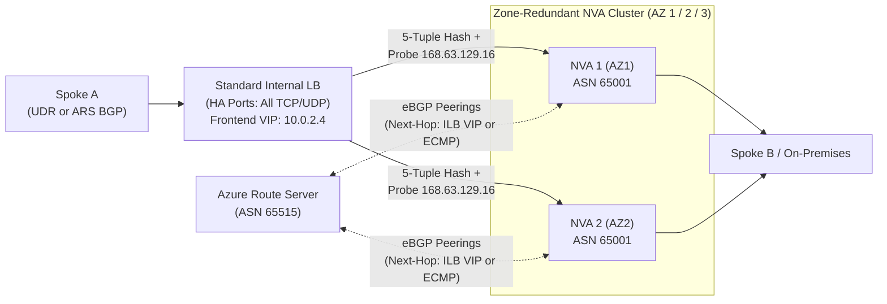
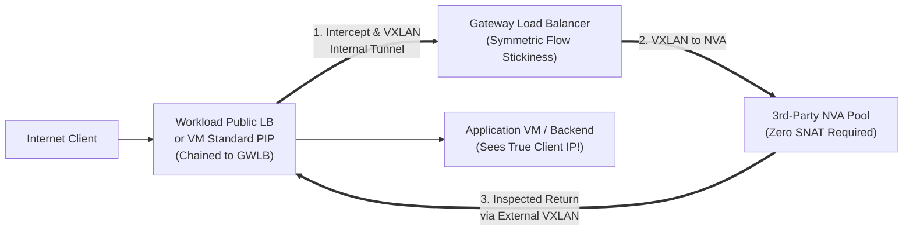

Centralized traffic inspection sits on the critical path of every enterprise packet. A poorly architected firewall tier either becomes a single-zone outage amplifier, breaks TCP state via asymmetric return routing, or blinds SecOps with unstructured diagnostic logs and SNAT port exhaustion.

This chapter compares **Azure Firewall** (`Basic`, `Standard`, and `Premium`) against **Third-Party Network Virtual Appliance (NVA)** high-availability topologies—including **Active-Active with Internal Load Balancer + Azure Route Server BGP/ECMP**, **Active-Passive**, and **Azure Gateway Load Balancer (GWLB)** transparent bump-in-the-wire service chaining.

---

## 1. Azure Firewall Architecture & SKU Selector

**Azure Firewall** is a cloud-native, zone-redundant, stateful Firewall-as-a-Service deployed into a dedicated `/26` `AzureFirewallSubnet` (plus an optional `/26` `AzureFirewallManagementSubnet` required for `Basic` SKU and Forced Tunneling). For new deployments in Availability Zone-enabled regions, Azure Firewall allocates across zones automatically at no extra cost—never attach a subnet-level NSG to `AzureFirewallSubnet`.

### Basic vs. Standard vs. Premium SKU Matrix

| Capability | Azure Firewall Basic | Azure Firewall Standard | Azure Firewall Premium |
| --- | --- | --- | --- |
| **Target Footprint** | SMB / Isolated Dev-Test (< 250 Mbps) | Enterprise L3–L7 Egress & East-West | Regulated, Zero-Trust, PCI-DSS, Deep L7 |
| **Autoscaling Throughput** | Fixed 2 backend VMs (**~250 Mbps**) | Autoscales up to **30 Gbps** | Autoscales up to **100 Gbps** |
| **Single "Fat Flow" Ceiling** | N/A | **1 Gbps** per flow | **10 Gbps** per flow |
| **Stateful 5-Tuple + SNAT/DNAT** | Yes (Requires Mgmt Subnet) | Yes (Up to 250 Public IPs) | Yes (Up to 250 Public IPs) |
| **Network-Level FQDN Filtering** | No *(HTTP/S & MSSQL SNI App rules only)* | **Yes** (All TCP/UDP ports — requires **DNS Proxy**) | **Yes** (All TCP/UDP ports — requires **DNS Proxy**) |
| **Threat Intelligence** | **Alert mode only** | Alert **and Deny** modes | Alert **and Deny** modes |
| **DNS Proxy & Custom DNS** | No | **Yes** | **Yes** |
| **Web Categories** | No | Domain/SNI level | **Full URL path level** (with TLS inspection) |
| **Outbound TLS Inspection** | No | No | **Yes** (Forward proxy via Key Vault intermediate CA) |
| **Managed IDPS** | No | No | **Yes** (58,000+ signatures, East-West & North-South) |
| **Full URL Path Filtering** | No | No | **Yes** (`contoso.com/api/v1` vs. `contoso.com/*`) |
| **Forced Tunneling without PIP** | No | **Yes** | **Yes** |

:::tip[Inbound TLS Inspection Architecture]
Azure Firewall Premium performs **outbound** and **east-west** TLS forward-proxy inspection natively, but **does not terminate inbound TLS** on DNAT rules. For inbound HTTPS web workloads requiring WAF (OWASP CRS / bot protection) and end-to-end TLS inspection, place **Azure Application Gateway WAF v2** (or Azure Front Door Premium + Private Link) in front of—or in parallel with—Azure Firewall rather than exposing raw DNAT ports.
:::

---

## 2. Azure Firewall Routing Symmetry, SNAT & DNAT Rules

Stateful firewalls drop packets immediately if they see a `SYN-ACK` without having inspected the initial `SYN`. Three symmetry traps account for most Azure Firewall production incidents:

### 1. DNAT Asymmetric Return Routing
When an external client hits an Azure Firewall Public IP via a **DNAT rule**, Azure Firewall translates the destination IP to the spoke VM's private IP **and automatically SNATs the source IP** to one of the firewall's private `AzureFirewallSubnet` instance IPs (`10.x.x.x`).
- **Why it works by default**: Because the packet's source IP is rewritten to `AzureFirewallSubnet`, the spoke VM naturally returns `SYN-ACK` to the exact firewall backend instance via the VNet peering system route—preserving client IP visibility only in `AZFWNatRule` logs, **not** inside the guest OS TCP header.
- **When you need original client IPs**: Use **Application Gateway WAF v2** (`X-Forwarded-For` header) for HTTP/S, or use **Azure Gateway Load Balancer** chaining (Section 4) for non-HTTP protocols where source IP preservation is mandatory.

### 2. Private-to-Private SNAT (`IANAPrivateRanges`) & Application Rules
By default, Azure Firewall **does not SNAT** traffic destined to RFC 1918 private ranges (`10.0.0.0/8`, `172.16.0.0/12`, `192.168.0.0/16`, `100.64.0.0/10`) when matched by **Network Rules**, preserving true source IPs across spokes and ExpressRoute.
- **Hidden Application Rule Caveat**: **Application Rules** run through a user-space HTTP/S/MSSQL proxy on Azure Firewall backend instances. Consequently, **Application Rules implicitly SNAT source IPs to an `AzureFirewallSubnet` private IP even for private destinations!** If a target Private Endpoint or internal server enforces client-IP allowlists, inspect internal east-west flows using **Network Rules + IDPS** (on Premium) rather than Application Rules, and ensure both forward and reverse UDRs point symmetrically to the firewall's private IP (`10.0.1.4`).
- If your enterprise uses non-RFC1918 public address space internally on-premises, add those CIDRs to **`IANAPrivateRanges` (Private IP Ranges — Do Not SNAT)** in Firewall Policy so hybrid flows aren't accidentally SNATed to the firewall's Public IP!

### 3. SNAT Port Exhaustion at Scale
Each Public IP attached to Azure Firewall (or an associated **NAT Gateway**—the preferred high-scale egress pairing!) provides finite ephemeral SNAT ports. Attach an **Azure NAT Gateway** to `AzureFirewallSubnet` (supported on Hub VNet deployments) or assign multiple Public IPs via IP Prefixes to provide up to **64,512 SNAT ports per IP** with zero cross-flow port starvation.

---

## 3. Observability: Resource-Specific Structured Logs vs. Legacy Diagnostics

Stop sending Azure Firewall telemetry into the monolithic legacy **`AzureDiagnostics`** Log Analytics table!

| Dimension | Legacy `AzureDiagnostics` Mode | Modern **Resource-Specific (Structured) Logs** |
| --- | --- | --- |
| **Schema & Parsing** | Free-form text stuffed into `msg_s`, slow regex parsing at query time, 500-column table ceiling risk | Strongly typed dedicated tables (`SrcIp`, `DstIp`, `DstPort`, `Action`, `Policy`, `RuleCollection`, `Rule`) |
| **Table Granularity & RBAC** | All services mixed in one table | Per-table RBAC, retention, Basic/Auxiliary log tiers, and Data Collection Rule (DCR) transformations |
| **Advanced Telemetry** | Application, Network, DNS Proxy only | Unlocks **`AZFWIdpsSignature`**, **`AZFWThreatIntel`**, **`AZFWFatFlow`**, **`AZFWFlowTrace`**, **`AZFWInternalFqdnResolutionFailure`**, and rule aggregations |

### Core Structured Log Tables & KQL Triage Query

Enable **Resource-specific** destination mode in Diagnostic Settings for `AZFWNetworkRule`, `AZFWApplicationRule`, `AZFWNatRule`, `AZFWThreatIntel`, `AZFWIdpsSignature`, `AZFWDnsQuery`, and `AZFWFatFlow`:

```kql
// Unified real-time triage across all structured Azure Firewall decision tables
AZFWNetworkRule
| union AZFWApplicationRule, AZFWNatRule, AZFWThreatIntel, AZFWIdpsSignature
| where TimeGenerated > ago(1h)
| where Action in ("Deny", "Alert", "Drop")
| project TimeGenerated, Type, Action, Protocol, SourceIp, DestinationIp, Fqdn, DestinationPort, Policy, RuleCollection, Rule
| order by TimeGenerated desc
| take 100
```

:::tip[Live Real-Time Firewall Diagnostic Tool]
When troubleshooting live rule drops without waiting 2–5 minutes for Log Analytics ingestion, stream structured Azure Firewall logs via **Azure Event Hubs** directly into our real-time web analyzer: **[Firewall Monitor (`tools/firewall-monitor`)](https://github.com/jonathan-vella/azure-networking/tree/main/tools/firewall-monitor)** (also walked through in the **[Labs & Tools Guide](/azure-networking/06-operations-reviews/labs-and-tools-guide/)**).
:::

---

## 4. Third-Party NVA High Availability Patterns

When your security team standardizes on third-party NGFWs (Palo Alto VM-Series, Fortinet FortiGate, Check Point CloudGuard) for unified Panorama/FortiManager policy parity or specialized L7 decoders, **you own high availability, symmetry, and health-probe routing**. Never rely on legacy Azure API route-table rewrite scripts during failover (API control-plane calls take 30–90+ seconds and fail during ARM throttling).

Use one of three cloud-native HA architectures:

### Pattern A: Active-Active NVAs + Internal Load Balancer (HA Ports) + Azure Route Server

This is the classic Hub-and-Spoke scale-out design for east-west and hybrid inspection, optionally paired with **[Azure Route Server (ARS)](/azure-networking/02-core-topologies/hub-spoke-and-route-server/)** for dynamic route injection across up to 8 BGP NVA instances:



- **Convergence Speed**: Standard Internal Load Balancer (`HA Ports` rule) probes NVAs from Azure wire-server IP **`168.63.129.16`** every 5 seconds (`2` or `3` probe threshold), failing over dead NVA instances in **10–15 seconds**.
- **The Multi-NIC `168.63.129.16` Probe Trap**: On dual-NIC NVAs (`Untrust` NIC0 + `Trust` NIC1), **both** external Public LB and Internal LB health probes originate from `168.63.129.16`. If the NVA guest OS uses a single default route table, health probe replies for `Trust` NIC1 accidentally egress out `Untrust` NIC0 and get dropped by Azure SDN—marking healthy NVAs completely down! Configure **policy-based routing (PBR) / separate VRFs** inside the NVA so `168.63.129.16` probes return strictly out the ingress interface.
- **Asymmetry Trap Without SNAT**: When `Spoke A → ILB VIP → NVA 1 → Spoke B` forwards without SNAT, `Spoke B`'s reply (`Spoke B → ILB VIP`) hashes on the *reverse* 5-tuple—which can land on **`NVA 2`** and be dropped! Either:
  1. Enable **SNAT** on the NVA for inter-zone flows (loses source IP visibility on destination VMs), **or**
  2. Advertise next-hop **`ILB VIP`** via ARS while running an active-passive health-probe responder (only the primary NVA answers HTTP `200 OK` on the probe port—Pattern B), **or**
  3. Use **Gateway Load Balancer** (Pattern C) for true zero-SNAT flow stickiness on north-south endpoints.

:::note[Hands-On BGP NVA Config Sample]
Need a working reference configuration for eBGP peering with Azure Route Server (`ASN 65515`), `no-export` / community filtering, multi-hop settings, and ECMP route injection? Inspect our **[BGP BIRD NVA Sample (`samples/bgp-bird`)](https://github.com/jonathan-vella/azure-networking/tree/main/samples/bgp-bird)**.
:::

### Pattern B: Active-Passive NVA Pair Behind Standard Load Balancers

Both NVA instances sit in the backend pool of an Internal LB (`Trust`) and External LB (`Untrust`), syncing session state over a dedicated HA heartbeat link. Only the **Active** NVA responds `200 OK` to the Load Balancer health probe (`168.63.129.16`), while the **Passive** NVA intentionally returns `503` / drops probes until failover.
- **Pros**: **Zero SNAT required** for east-west or hybrid traffic because 100% of forward and reverse flows land on the single Active NVA, and state tables sync continuously to the standby unit.
- **Cons**: Throughput is capped at a **single VM's NIC ceiling** while you pay 2x VM + license costs for an idle standby.

### Pattern C: Azure Gateway Load Balancer (GWLB) Bump-in-the-Wire Chaining

[**Azure Gateway Load Balancer**](https://learn.microsoft.com/en-us/azure/load-balancer/gateway-overview) solves the north-south NVA symmetry and UDR-sprawl problem via transparent **VXLAN encapsulation** (ports `10800`/`10801` by default):



- **How It Works**: You chain a workload's `Standard` Public Load Balancer frontend (or VM `Standard` Public IP)—even **across different subscriptions or tenants**—directly to the Gateway Load Balancer frontend in a single property setting.
- **Why Architects Love GWLB**:
  1. **Guaranteed Flow Symmetry Without SNAT**: GWLB hashes both inbound and outbound packets of the same 5-tuple to the **exact same healthy NVA backend instance**, preserving the **true internet client IP** all the way to the application VM without complex UDRs.
  2. **Bump-in-the-Wire Insertion**: Insert or remove IDPS, packet brokers, DDoS scrubbers, or NGFWs transparently without re-IPing workloads or touching spoke route tables.
- **Scope Boundary**: GWLB chains onto **Public endpoints** (`Standard` Public Load Balancer frontends or `Standard` VM Public IPs) for **north-south internet ingress/egress**. It does **not** intercept private east-west VNet-to-VNet or ExpressRoute private flows (combine GWLB for north-south with ILB/ARS or Azure Firewall for east-west).

---

## 5. Architecture Trade-Off Matrix

| Evaluation Criteria | Azure Firewall (Standard / Premium) | 3rd-Party NVA (Active-Active ILB + ARS) | 3rd-Party NVA (Active-Passive ILB/ELB) | 3rd-Party NVA + Gateway Load Balancer |
| --- | --- | --- | --- | --- |
| **HA & Zone Failover** | Built-in (`99.99%` SLA multi-AZ), zero LB config | 10–15s probe failover; requires PBR for `168.63.129.16` | 10–15s stateful failover via HA sync | Built-in symmetric flow stickiness across AZs |
| **Max Scale** | **30 Gbps** (Std) / **100 Gbps** (Prem) | Scales horizontally (up to 8 BGP peers on ARS) | Capped at **1 VM SKU** bandwidth | Scales horizontally across NVA pool |
| **Traffic Scope** | North-South + East-West + Hybrid (`vWAN` & Hub) | East-West + Hybrid + Egress | North-South + East-West + Hybrid | **North-South Public IP / Public LB flows only** |
| **Source IP Preservation** | Yes on Network Rules; SNATed on App Rules & DNAT | Requires SNAT unless paired with symmetric hashing/VRFs | **Yes** (No SNAT needed) | **Yes** (True bump-in-the-wire via VXLAN) |
| **Day-2 Patching & OS Ops** | **Zero** (Fully managed PaaS) | Customer owns VM OS upgrades, certs, state scale | Customer owns VM upgrades & HA cluster | Customer owns NVA VMs & VXLAN tunnel config |
| **Virtual WAN Support** | Native **Secured Virtual Hub + Routing Intent** | Certified SaaS/NVA integrated in-hub or spoke NVA | Spoke / custom NVA peering | Chains to Public LBs / PIPs outside vHub |

---

## What I Recommend

1. **Default to Azure Firewall Standard (or Premium when TLS inspection, IDPS, or full-path URL filtering is required)** for greenfield Hub-and-Spoke and **[Virtual WAN Routing Intent](/azure-networking/02-core-topologies/virtual-wan-and-routing-intent/)** deployments—eliminating NVA OS patching, asymmetric SNAT headaches, and manual BGP plumbing.
2. **Mandate Resource-Specific Structured Logs** (`AZFWNetworkRule`, `AZFWApplicationRule`, `AZFWIdpsSignature`, `AZFWThreatIntel`) from day one, pair `AzureFirewallSubnet` with an **Azure NAT Gateway** for high-scale egress SNAT, and keep **[Firewall Monitor](https://github.com/jonathan-vella/azure-networking/tree/main/tools/firewall-monitor)** ready for live Event Hub packet-drop debugging.
3. **When third-party NGFWs are non-negotiable**:
   - Use **Gateway Load Balancer (GWLB)** for transparent, zero-SNAT north-south public endpoint inspection.
   - Use **Active-Passive NVAs behind Standard ILB (`HA Ports`)** for moderate throughput (< 5–10 Gbps) where preserving east-west source IPs without SNAT matters most, or **Active-Active NVAs + Azure Route Server** (modeled on **[`samples/bgp-bird`](https://github.com/jonathan-vella/azure-networking/tree/main/samples/bgp-bird)**) when horizontal multi-AZ throughput is paramount.
