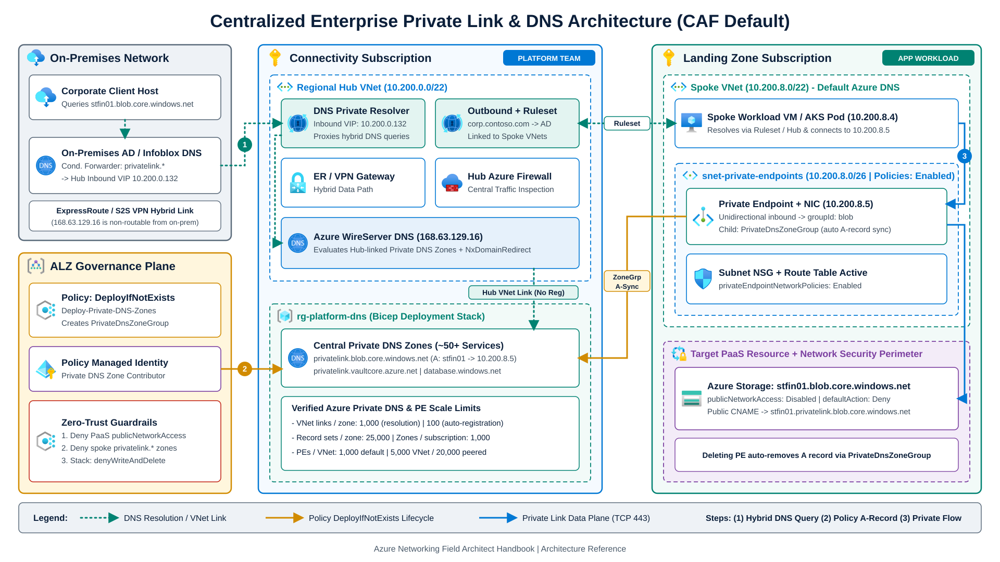
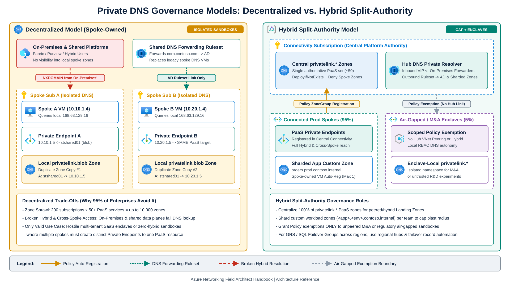
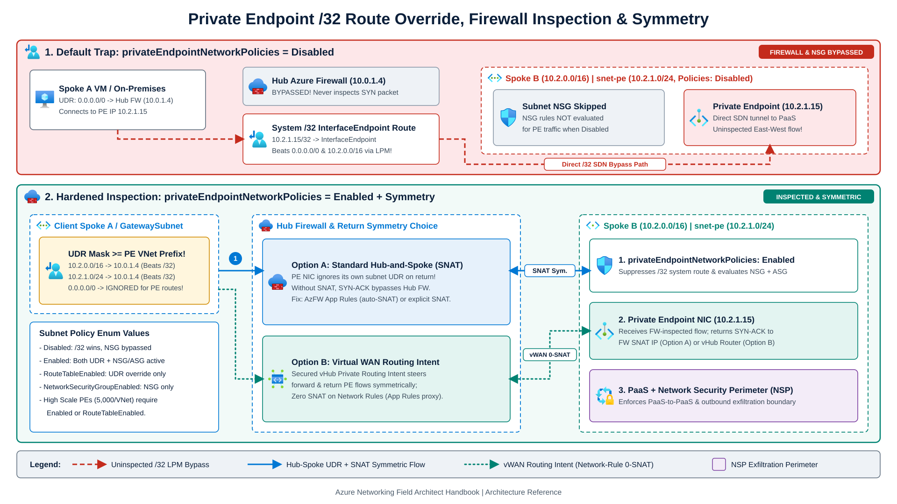
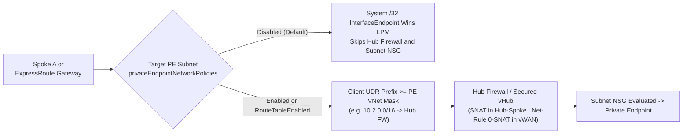

Creating a single Azure Private Endpoint in a test VNet takes minutes. Operating thousands of Private Endpoints across hundreds of Cloud Adoption Framework (CAF) landing-zone subscriptions requires automated DNS lifecycle management, strict zone quotas, deliberate `/32` route overrides, and PaaS data-exfiltration controls.

This chapter covers [Private Link and DNS integration at scale](https://learn.microsoft.com/en-us/azure/cloud-adoption-framework/ready/azure-best-practices/private-link-and-dns-integration-at-scale): comparing Centralized, Decentralized, and Hybrid Private DNS topologies, automating `PrivateDnsZoneGroup` registration with Azure Policy (`DeployIfNotExists`) and [Azure Deployment Stacks](https://learn.microsoft.com/en-us/azure/azure-resource-manager/bicep/deployment-stacks), enforcing Hub Firewall inspection via [`PrivateEndpointNetworkPolicies`](https://learn.microsoft.com/en-us/azure/private-link/disable-private-endpoint-network-policy), and bounding PaaS-to-PaaS communication with [Azure Network Security Perimeter (NSP)](https://learn.microsoft.com/en-us/azure/private-link/network-security-perimeter-concepts).

---

## 1. Private Endpoint mechanics, `PrivateDnsZoneGroup`, and platform quotas

An [Azure Private Endpoint](https://learn.microsoft.com/en-us/azure/private-link/private-endpoint-overview) projects a read-only network interface (`<pe-name>.nic.<guid>`) with a static private IP from your subnet onto a specific PaaS subresource (`blob`, `sqlServer`, `vault`, `sites`, or a custom Private Link Service behind a Standard Internal Load Balancer). Traffic is **unidirectional**: VNet and hybrid clients open connections *to* the Private Endpoint, and the PaaS resource cannot initiate inbound connections into your VNet.

When a Private Endpoint exists on a PaaS resource, Microsoft's public authoritative DNS aliases the public FQDN (`stfin01.blob.core.windows.net`) via CNAME to a reserved `privatelink.*` subdomain (`stfin01.privatelink.blob.core.windows.net`). Inside linked VNets, or from on-premises forwarders targeting an [Azure DNS Private Resolver](/azure-networking/01-foundations/dns-and-private-resolver/) Inbound Endpoint, Azure resolves that CNAME against the linked `privatelink.*` Private DNS Zone to return the Private Endpoint's private `A` record. Full `168.63.129.16` recursion behavior, Private Resolver QPS scaling, and `NxDomainRedirect` fallback for external SaaS endpoints are covered in [Hybrid DNS & Azure DNS Private Resolver](/azure-networking/01-foundations/dns-and-private-resolver/).

### Automated record lifecycle via `PrivateDnsZoneGroup`

A [`PrivateDnsZoneGroup`](https://learn.microsoft.com/en-us/azure/templates/microsoft.network/privateendpoints/privatednszonegroups) child resource attaches a Private Endpoint to its corresponding `privatelink.*` Private DNS Zone. Writing a `PrivateDnsZoneGroup` requires `Microsoft.Network/privateDnsZones/join/action` (included in `Private DNS Zone Contributor`) on the target zone, which in enterprise estates is held by an Azure Policy Managed Identity rather than application teams. Once linked, `Microsoft.Network` creates the `A` record (default TTL 10 seconds) and deletes that `A` record automatically when the Private Endpoint is deleted, so recycled subnet IPs never inherit stale DNS records.

### Verified Azure Private DNS and Private Endpoint limits

Large landing-zone estates hit hard [Azure Private DNS limits](https://learn.microsoft.com/en-us/azure/dns/private-dns-privatednszone) and [Private Endpoint VNet quotas](https://learn.microsoft.com/en-us/azure/private-link/increase-private-endpoint-vnet-limits) if every spoke links directly to every central zone:

| Resource or quota | Verified limit | Architectural impact |
| --- | --- | --- |
| **Private DNS zones per subscription** | **1,000** | Easily accommodates all ~80+ `privatelink.*` zones in one central `Connectivity` subscription; exceeded rapidly if decentralized zones accumulate in shared subscriptions. |
| **Record sets per Private DNS zone** | **25,000** (up to **20** records per set) | Monitor `RecordSetCapacityUtilization` in Azure Monitor; shard custom internal zones before approaching 25,000 records. |
| **VNet links per Private DNS zone (resolution only)** | **1,000** (`registrationEnabled: false`) | **Hard architectural pivot at 1,000 spoke VNets**: past 1,000 spokes, link `privatelink.*` zones only to regional Hub VNets and resolve from spokes via Hub DNS Private Resolver / Forwarding Rulesets instead of linking every spoke VNet directly. |
| **VNet links per Private DNS zone (with autoregistration)** | **100** (`registrationEnabled: true`) | VM autoregistration is never needed on `privatelink.*` zones (`PrivateDnsZoneGroup` writes records via ARM). Each VNet can link to at most **1** autoregistration zone and **1,000** resolution zones. |
| **Private Endpoints per VNet / peered mesh** | **1,000** per VNet / **4,000** peered default; **5,000** per VNet / **20,000** peered High Scale | Exceeding 1,000 PEs in one VNet or 4,000 across peered VNets requires **High Scale Private Endpoints** (`privateEndpointVNetPolicies: 'Basic'`, CLI `--pe-vnet-policies Basic`) plus `privateEndpointNetworkPolicies` set to `Enabled` or `RouteTableEnabled` on all PE subnets. Enabling High Scale causes a one-time connection reset (use a maintenance window) and disables Bytes In/Out PE metrics; [Virtual WAN hubs](https://learn.microsoft.com/en-us/azure/virtual-wan/howto-private-link) remain capped at **4,000** PEs across attached VNets. |

---

## 2. Enterprise topologies: centralized, decentralized, and hybrid

In Cloud Adoption Framework (Azure Landing Zones) estates, workload teams manage spoke `Landing Zone` subscriptions while the platform team owns the `Connectivity` subscription (Hub VNets or Virtual WAN hubs, ExpressRoute/VPN gateways, Azure Firewall, and central DNS).

### Centralized private DNS zones (CAF default)

A single authoritative set of `privatelink.*` Private DNS Zones resides in the central `Connectivity` subscription and links (`registrationEnabled: false`) to each regional Hub VNet (or dedicated DNS VNet in Virtual WAN). Spoke VNets keep Azure-provided default DNS (`168.63.129.16`) and resolve hybrid or hub-linked domains through a regional [Azure DNS Private Resolver](/azure-networking/01-foundations/dns-and-private-resolver/) and DNS Forwarding Ruleset (or direct VNet links when total spokes stay well under 1,000).



This centralized topology avoids `privatelink.*` zone duplication, supports immediate hybrid resolution from on-premises conditional forwarders (`privatelink.<service>` -> Hub Inbound Endpoint IP) and peered spokes, and requires zero IaaS DNS forwarder VMs.

Two design constraints apply. First, because a single global zone holds one record set per resource name, active-passive PaaS services with built-in disaster recovery (such as GRS Storage or Azure SQL Failover Groups) that expose regional Private Endpoints in two regions require automated failover record updates or regional hub zones. Second, when spoke workloads rely on FQDN filtering inside Azure Firewall Network Rules, enable DNS Proxy on Azure Firewall and point those spoke VNets' custom DNS server setting to the firewall private IP (which forwards upstream to DNS Private Resolver).

:::caution[ExpressRoute Gateway and DNS Private Resolver coexistence]
Deploying Azure DNS Private Resolver inside the same Hub VNet as an ExpressRoute Virtual Network Gateway is supported only if public Azure management FQDNs still resolve cleanly. Never link a DNS Forwarding Ruleset with a wildcard catch-all rule (`.`) to the Hub VNet if the target server drops public Azure names, or ExpressRoute Gateway health checks will fail.
:::

### Decentralized and hybrid split-authority models



In the **decentralized model**, each spoke subscription creates its own local `privatelink.*` zones linked only to its spoke VNet. Linking a shared DNS Forwarding Ruleset for corporate AD domains removes the legacy need for per-spoke Linux or Windows DNS VMs, and isolated spokes can each create their own Private Endpoint to the same PaaS instance. However, on-premises users and shared platforms (Microsoft Fabric, Purview, Databricks) cannot resolve spoke Private Endpoints without brittle per-resource conditional forwarders, and zone counts multiply across subscriptions. Reserve decentralized zones for hostile multi-tenant SaaS enclaves or unpeered sandboxes.

In the **hybrid split-authority model**, platform teams centralize all `privatelink.*` zones in `Connectivity` for connected production and non-production landing zones, delegate [sharded workload-owned custom zones](https://learn.microsoft.com/en-us/azure/dns/sharding-private-dns-zones) (such as `orders.prod.contoso.internal`, using the single VM autoregistration slot per spoke VNet) to application teams, and grant scoped Azure Policy exemptions only to unpeered M&A or regulatory air-gapped sandboxes.

| Criterion | Centralized model (CAF default) | Decentralized model | Hybrid split-authority model |
| --- | --- | --- | --- |
| **`privatelink.*` zone count (200 subs x 50 services)** | **~50 zones total** | Up to **10,000 zones** | ~50 central + isolated enclave copies |
| **On-premises -> spoke PE resolution** | **Native** (via Hub Private Resolver Inbound IP) | Fails without per-resource forwarding | Native for connected spokes; isolated in enclaves |
| **Multiple PEs to same PaaS resource** | 1 canonical PE per global DNS scope | **Supported** per isolated spoke VNet | Supported inside air-gapped enclaves |
| **Workload team autonomy** | Automated via **`DeployIfNotExists` Policy** | Direct RBAC in spoke subscription | Policy for connected spokes; local RBAC on custom/enclave zones |
| **Recommended fit** | **95%+ of enterprise landing zones** | Multi-tenant SaaS / zero-hybrid sandboxes | Enterprises combining standard ALZ spokes, sharded app zones, and air-gapped M&A enclaves |

---

## 3. Governance with Deployment Stacks and Azure Policy

Azure Blueprints is retired. Modern Azure Landing Zones combine **Bicep Deployment Stacks** for lifecycle locks with **Azure Policy** for zero-ticket Private DNS registration.

### Layer 1: Bicep Deployment Stacks (`denySettings`)

Deploy central `Connectivity` Private DNS Zones, Hub VNet links, and baseline spoke networking through [Azure Deployment Stacks](https://learn.microsoft.com/en-us/azure/azure-resource-manager/bicep/deployment-stacks) (`az stack sub create` or `az stack mg create`).

Setting `denySettingsMode` (`denySettings.mode` in Bicep) to `'denyWriteAndDelete'` or `'denyDelete'` prevents unauthorized principals from deleting central Private DNS Zones, removing Hub VNet links, or detaching spoke route tables. Because `excludedPrincipals` accepts **at most 5 Microsoft Entra object IDs** (entries past five are ignored without an error), consolidate CI/CD workload identities, break-glass admins, and Azure Policy remediation Managed Identities into Microsoft Entra security groups and exclude those group IDs. On central Private DNS Zones, either leave `applyToChildScopes` set to `false` or exclude `Microsoft.Network/privateDnsZones/A/*` and the Policy Managed Identity group so `DeployIfNotExists` remediation can write and delete child `A` records.

For lifecycle safety, set `--action-on-unmanage detachAll` (`resources: 'detach'` in Bicep) on shared central DNS stacks to prevent accidental bulk zone deletion during template refactoring, while using `deleteResources` or `deleteAll` on ephemeral sandbox spokes.

### Layer 2: Four-part Azure Policy guardrails

Assign four complementary policy controls at the `Landing Zones` Management Group (per [CAF Private Link at scale](https://learn.microsoft.com/en-us/azure/cloud-adoption-framework/ready/azure-best-practices/private-link-and-dns-integration-at-scale)):

1. Reject (`Deny` or `Modify`) creation or update of PaaS resources where `publicNetworkAccess == 'Enabled'` or `networkAcls.defaultAction != 'Deny'` (using built-in policies such as *Storage accounts should disable public network access*).
2. Audit (`AuditIfNotExists`) PaaS resources lacking an `Approved` `privateEndpointConnections` link.
3. Deny creation of `Microsoft.Network/privateDnsZones` where `name` contains `privatelink.` inside spoke subscriptions. Developers leave *"Integrate with private DNS zone"* set to **No** in the portal so Azure Policy binds the central zone instead of creating a local split-brain copy.
4. Remediate (`DeployIfNotExists`) missing `PrivateDnsZoneGroup` links via the built-in Azure Landing Zone *Configure Azure PaaS services to use private DNS zones* (`Deploy-Private-DNS-Zones`) initiative, using a Managed Identity granted `Network Contributor` (`4d97b98b-1d4f-4787-a291-c67834d212e7`) on landing zones and `Private DNS Zone Contributor` (`b12aa53e-6015-4669-85d0-8515ebb3ae7f`) on the central `Connectivity` DNS resource group:

```json
{
  "mode": "Indexed",
  "parameters": {
    "privateDnsZoneId": {
      "type": "String",
      "metadata": {
        "displayName": "Private DNS Zone ID",
        "strongType": "Microsoft.Network/privateDnsZones"
      }
    },
    "privateEndpointGroupId": {
      "type": "String",
      "metadata": {
        "displayName": "Private Endpoint Subresource Group ID"
      }
    },
    "privateLinkServiceType": {
      "type": "String",
      "metadata": {
        "displayName": "Target Resource Provider Type (e.g. Microsoft.Storage/storageAccounts)"
      }
    }
  },
  "policyRule": {
    "if": {
      "allOf": [
        { "field": "type", "equals": "Microsoft.Network/privateEndpoints" },
        {
          "count": {
            "field": "Microsoft.Network/privateEndpoints/privateLinkServiceConnections[*]",
            "where": {
              "allOf": [
                {
                  "field": "Microsoft.Network/privateEndpoints/privateLinkServiceConnections[*].privateLinkServiceId",
                  "contains": "[parameters('privateLinkServiceType')]"
                },
                {
                  "field": "Microsoft.Network/privateEndpoints/privateLinkServiceConnections[*].groupIds[*]",
                  "equals": "[parameters('privateEndpointGroupId')]"
                }
              ]
            }
          },
          "greaterOrEquals": 1
        }
      ]
    },
    "then": {
      "effect": "deployIfNotExists",
      "details": {
        "type": "Microsoft.Network/privateEndpoints/privateDnsZoneGroups",
        "roleDefinitionIds": [
          "/providers/Microsoft.Authorization/roleDefinitions/4d97b98b-1d4f-4787-a291-c67834d212e7",
          "/providers/Microsoft.Authorization/roleDefinitions/b12aa53e-6015-4669-85d0-8515ebb3ae7f"
        ],
        "existenceCondition": {
          "field": "Microsoft.Network/privateEndpoints/privateDnsZoneGroups/privateDnsZoneConfigs[*].privateDnsZoneId",
          "equals": "[parameters('privateDnsZoneId')]"
        },
        "deployment": {
          "properties": {
            "mode": "incremental",
            "parameters": {
              "privateDnsZoneId": { "value": "[parameters('privateDnsZoneId')]" },
              "privateEndpointName": { "value": "[field('name')]" },
              "location": { "value": "[field('location')]" }
            },
            "template": {
              "$schema": "https://schema.management.azure.com/schemas/2019-04-01/deploymentTemplate.json#",
              "contentVersion": "1.0.0.0",
              "parameters": {
                "privateDnsZoneId": { "type": "string" },
                "privateEndpointName": { "type": "string" },
                "location": { "type": "string" }
              },
              "resources": [
                {
                  "name": "[concat(parameters('privateEndpointName'), '/deployedByPolicy')]",
                  "type": "Microsoft.Network/privateEndpoints/privateDnsZoneGroups",
                  "apiVersion": "2023-11-01",
                  "location": "[parameters('location')]",
                  "properties": {
                    "privateDnsZoneConfigs": [
                      {
                        "name": "central-privatelink-dns",
                        "properties": {
                          "privateDnsZoneId": "[parameters('privateDnsZoneId')]"
                        }
                      }
                    ]
                  }
                }
              ]
            }
          }
        }
      }
    }
  }
}
```

:::tip[Subresource `groupId` collisions]
Multiple Azure services share generic `groupId` values (`sqlServer` is used by both Azure SQL Database and Azure Synapse Analytics; `sites` is shared across App Service variants). Use the built-in Azure Landing Zone policy definitions, which match **both** the target resource provider type (`privateLinkServiceId`) and `groupId`.
:::

---

## 4. Routing and inspection: `/32` host routes, `PrivateEndpointNetworkPolicies`, and SNAT

### Why Private Endpoints bypass your Hub Firewall by default

Deploying a Private Endpoint (`10.2.1.15`) into a spoke subnet injects a **`/32` `InterfaceEndpoint` system route** (`10.2.1.15/32 -> InterfaceEndpoint`) into the local VNet and every peered VNet. Under [Longest Prefix Match (LPM)](/azure-networking/01-foundations/routing-and-traffic-engineering/), `/32` beats broader UDRs (`0.0.0.0/0` or `10.0.0.0/8` -> Hub Firewall) and sends traffic from peered spokes and ExpressRoute gateways directly to the Private Endpoint without traversing the Hub Firewall or target subnet NSG.





### Configuring `PrivateEndpointNetworkPolicies` and the UDR prefix-length rule

Set [`privateEndpointNetworkPolicies`](https://learn.microsoft.com/en-us/azure/private-link/disable-private-endpoint-network-policy) on every subnet hosting Private Endpoints to one of four ARM/Bicep values:

| `privateEndpointNetworkPolicies` value | NSG and ASG evaluation on PE | UDR `/32` route override | Tooling support |
| --- | --- | --- | --- |
| **`Disabled`** *(default)* | Bypassed | Disabled (`/32` wins LPM) | Portal, Bicep, ARM, PowerShell, CLI |
| **`Enabled`** | Enforced | Enabled | Portal, Bicep, ARM, PowerShell, CLI |
| **`RouteTableEnabled`** | Bypassed | Enabled | Portal, Bicep, ARM, PowerShell, CLI |
| **`NetworkSecurityGroupEnabled`** | Enforced | Disabled (`/32` wins LPM) | Portal, Bicep, ARM, PowerShell, CLI |

In Azure CLI, use `az network vnet subnet update --private-endpoint-network-policies <Disabled|Enabled|RouteTableEnabled|NetworkSecurityGroupEnabled>` (`--ple-network-policies`); the older boolean `--disable-private-endpoint-network-policies` flag is deprecated and toggles only `Enabled` versus `Disabled`.

```bicep
resource peSubnet 'Microsoft.Network/virtualNetworks/subnets@2024-05-01' = {
  parent: spokeVnet // Address space: 10.2.0.0/16
  name: 'snet-private-endpoints'
  properties: {
    addressPrefix: '10.2.1.0/24'
    privateEndpointNetworkPolicies: 'Enabled'
  }
}
```

:::danger[UDR prefix-length rule (`0.0.0.0/0` never overrides Private Endpoints)]
Even when `privateEndpointNetworkPolicies` is set to `'Enabled'` or `'RouteTableEnabled'` on the destination subnet, **a `0.0.0.0/0` default UDR on client subnets will not override a Private Endpoint route**. Your client or `GatewaySubnet` UDR must specify an address prefix **equal to or more specific (longer mask) than the VNet address space** hosting the Private Endpoint. If the Private Endpoint lives in a `10.2.0.0/16` VNet, a UDR for `10.2.0.0/16` or `10.2.1.0/24 -> Hub Firewall` overrides the `/32` route, whereas `0.0.0.0/0` or `10.0.0.0/8` does not.
:::

### Return-path symmetry in hub-and-spoke vs. Virtual WAN

A Private Endpoint NIC cannot initiate flows, ignores UDRs attached to its own subnet on return packets, and forwards `SYN-ACK` directly along system routes toward the packet's source IP.

#### Customer-managed hub-and-spoke

If `Spoke A VM -> Hub Firewall -> Spoke B Private Endpoint` (or `On-Premises -> GatewaySubnet UDR -> Hub Firewall -> Spoke B Private Endpoint`) crosses the firewall without SNAT, the Private Endpoint sees the original client IP and returns `SYN-ACK` directly over peering or `GatewaySubnet`, which bypasses the stateful firewall and drops the TCP connection. Perform SNAT at the Hub Firewall or NVA (automatic on Azure Firewall Application Rules; configure explicit SNAT to the firewall or NVA private IP when inspecting via TCP Network Rules or third-party NVAs).

#### Virtual WAN Secured Hub

When `privateEndpointNetworkPolicies` is `Enabled` (or `RouteTableEnabled`) on the spoke PE subnet and [Private Routing Intent](/azure-networking/02-core-topologies/virtual-wan-and-routing-intent/) is active on the Secured vHub, Virtual WAN routes both forward and return Private Endpoint flows symmetrically through the Secured Hub Firewall without SNAT on Network Rules for RFC 1918/6598 ranges. Azure Firewall Application Rules still proxy and SNAT to the firewall instance IP, non-RFC 1918 internal prefixes still require `snat.privateRanges` / `autoLearnPrivateRanges` to avoid SNAT, and `/32` Private Endpoint IPs must never be added to Routing Intent's Private Traffic Prefixes list.

---

## 5. Network Security Perimeter (NSP) for PaaS exfiltration boundaries

Private Endpoints lock down **VNet-to-PaaS inbound connectivity**, yet two gaps remain in large PaaS estates:
1. PaaS-to-PaaS service traffic that originates outside a customer VNet (for example, Azure AI Search or Microsoft Foundry indexing an Azure Storage Account or reading keys from Azure Key Vault).
2. Outbound data exfiltration where a compromised identity or function attempts to copy data from an internal PaaS resource to an external unauthorized storage account or endpoint.

[Azure Network Security Perimeter (NSP)](https://learn.microsoft.com/en-us/azure/private-link/network-security-perimeter-concepts) wraps supported PaaS resources inside a logical network boundary (GA in Azure Public cloud for Azure Storage, Key Vault, Event Hubs, Service Bus, Azure Monitor / Log Analytics, Azure AI Search, and Microsoft Foundry, with Storage, Key Vault, and Microsoft Foundry also GA in Azure Government; Public Preview for Azure SQL DB, Cosmos DB, Azure OpenAI, App Configuration, and Event Grid).

Associating a PaaS resource with an NSP in **Enforced mode** denies all public inbound and outbound traffic outside the perimeter by default while continuing to allow inbound Private Endpoint connections without extra NSP rules. Resources inside the same NSP communicate privately with each other and block exfiltration to non-member accounts. External exceptions are defined on the NSP Profile: inbound rules match source IP prefixes, subscriptions, or service tags (including Standard Service Endpoint network identifiers), and outbound rules restrict external destinations by FQDN.

Roll out NSP on existing workloads in **Transition mode** (formerly Learning mode) first. Enable [NSP diagnostic settings](https://learn.microsoft.com/en-us/azure/private-link/network-security-perimeter-diagnostic-logs) (`allLogs`) to stream access evaluations into the **`NSPAccessLogs`** Log Analytics table (`Category` values such as `NspPublicInboundPerimeterRulesAllowed`, `NspPublicInboundResourceRulesAllowed`, `NspIntraPerimeterInboundAllowed`, `NspPublicOutboundResourceRulesAllowed`, and `NspPrivateInboundAllowed`) and verify legitimate dependencies before switching the association to **Enforced mode**.

Before onboarding production resources, check three platform constraints:
1. Intra-perimeter calls and subscription-based inbound rules reject Shared Access Signature (SAS) tokens; workloads must authenticate with Microsoft Entra ID Managed Identities.
2. NSP is unsupported on Log Analytics workspaces enabled for Microsoft Sentinel (enabling NSP disables Sentinel analytic rules) and on Storage Accounts protected by Azure Backup.
3. Target PaaS resource names cannot exceed 44 characters (portal association names append `-{perimeter-guid}` within an 80-character limit). Recommended scale limits are 1,000 PaaS resources and 200 profiles per NSP, with a hard ceiling of 200 inbound and 200 outbound rule elements per profile.

---

## Recommendations

1. Standardize on **Centralized `privatelink.*` Private DNS Zones** in your `Connectivity` subscription fronted by [Azure DNS Private Resolver](/azure-networking/01-foundations/dns-and-private-resolver/) and protected with **Bicep Deployment Stacks** (`denyWriteAndDelete`, grouping CI/CD and Policy identities inside the 5-principal `excludedPrincipals` limit). Past 1,000 spoke VNets, link `privatelink.*` zones only to regional Hub VNets rather than individual spokes.
2. Assign the **four-part Azure Policy guardrail set** at the `Landing Zones` Management Group (`Deny` PaaS public access, `AuditIfNotExists` PE compliance, `Deny` spoke `privatelink.*` zones, and `DeployIfNotExists` `PrivateDnsZoneGroup` registration matching both `privateLinkServiceId` and `groupId`).
3. Provision a dedicated **`snet-private-endpoints` subnet per spoke with `privateEndpointNetworkPolicies: 'Enabled'`**, use `/16` to `/24` UDR prefixes (never `0.0.0.0/0` alone) when steering Private Endpoint flows through a [Hub Firewall](/azure-networking/04-network-security/firewall-and-nva-patterns/), and enforce return symmetry via SNAT in Hub-and-Spoke or Private Routing Intent in Virtual WAN.
4. Layer **Network Security Perimeter (NSP)** onto supported PaaS data stores (auditing `NSPAccessLogs` in Transition mode before Enforced mode, using Microsoft Entra Managed Identities instead of SAS tokens) alongside [Foundry & Fabric Networking](/azure-networking/05-workload-networking/foundry-and-fabric-networking/) to close PaaS-to-PaaS and outbound exfiltration paths.

