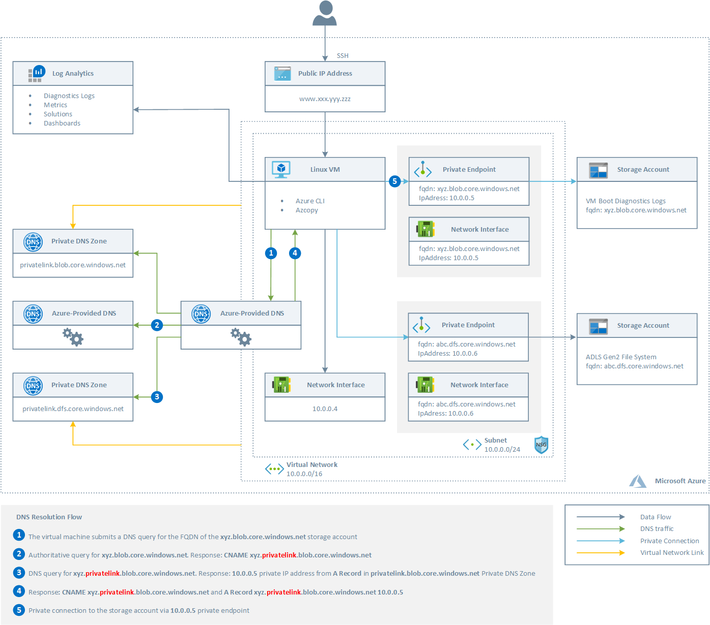
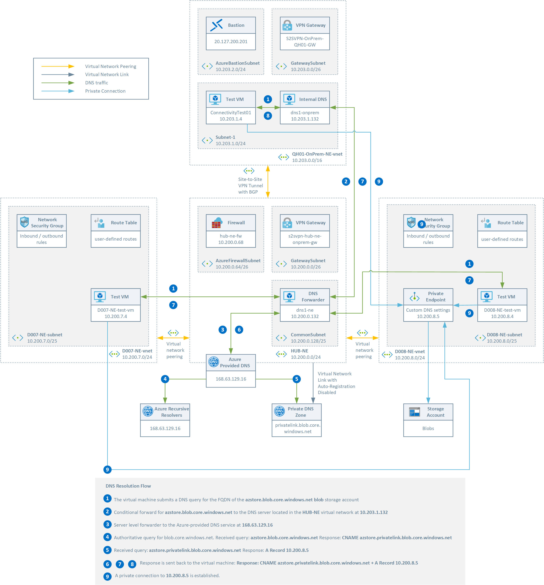
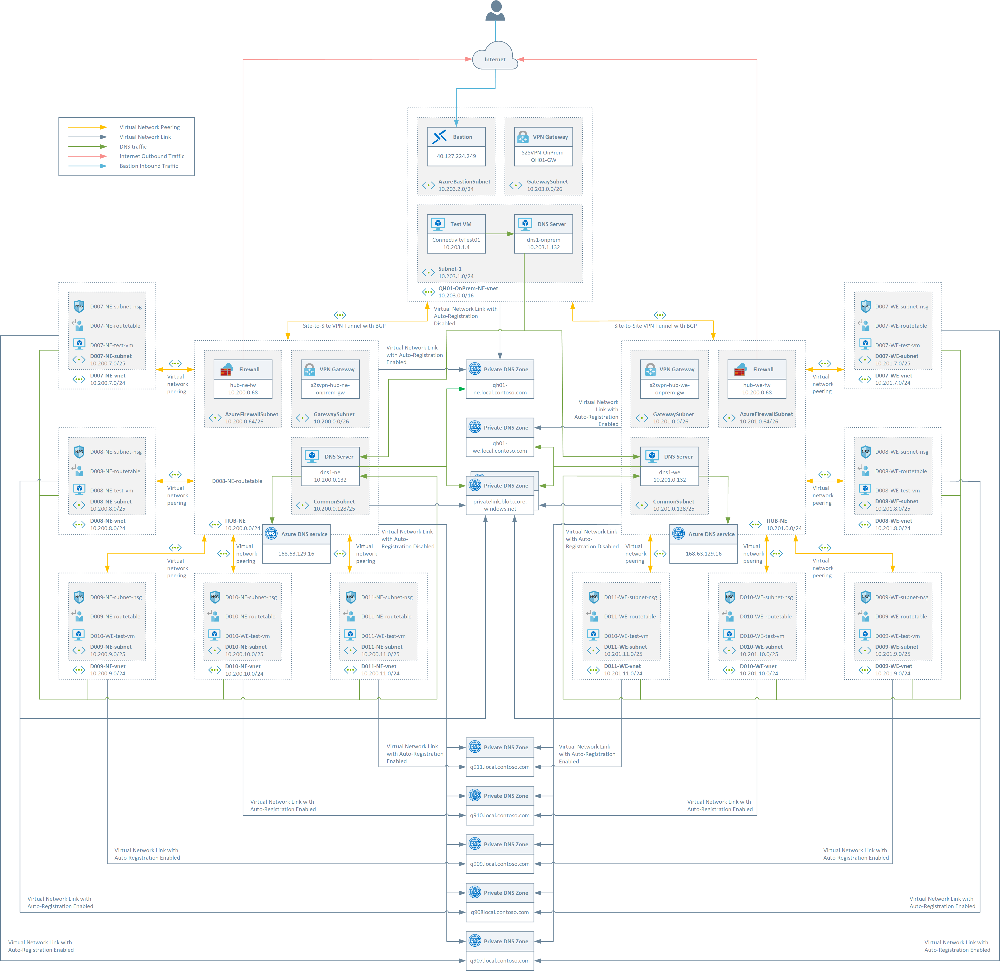
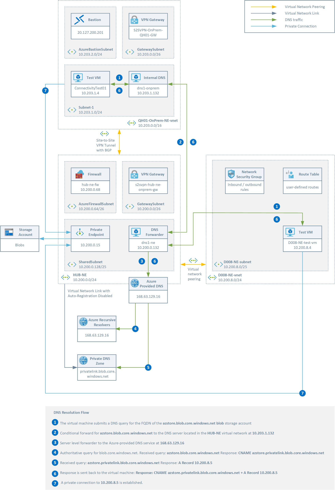
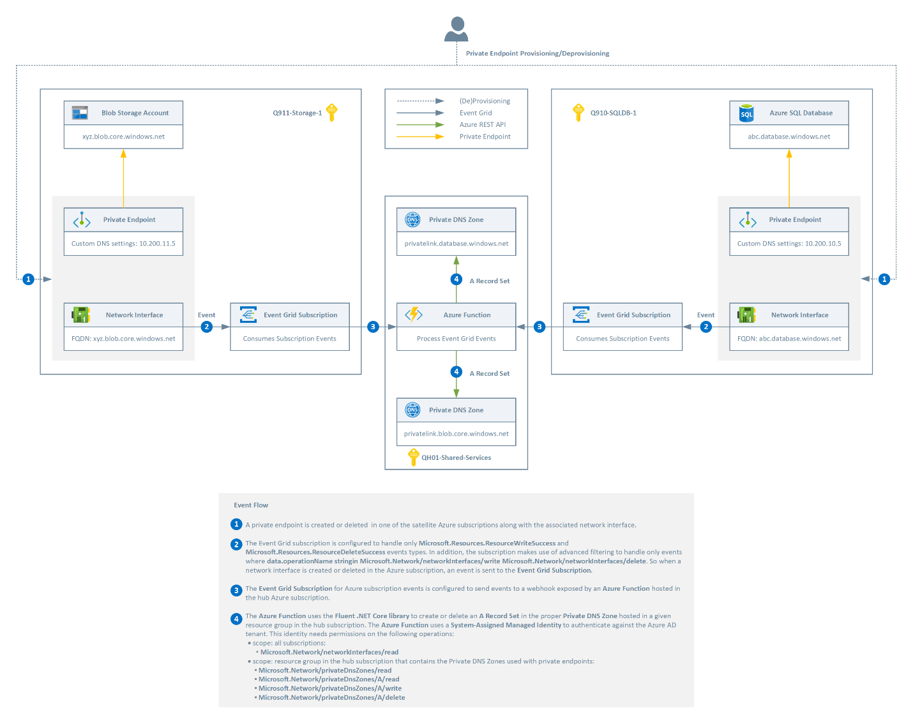
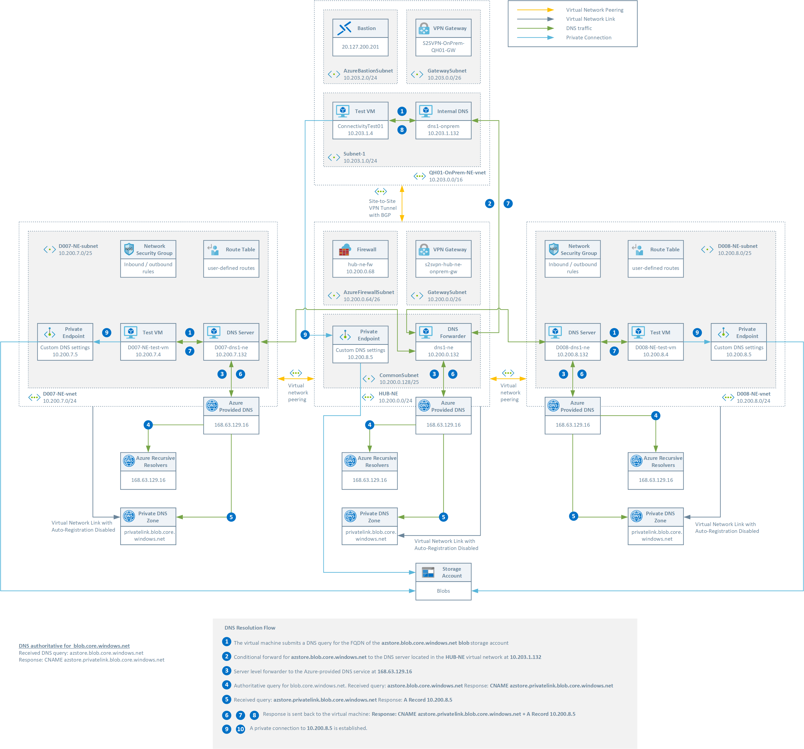
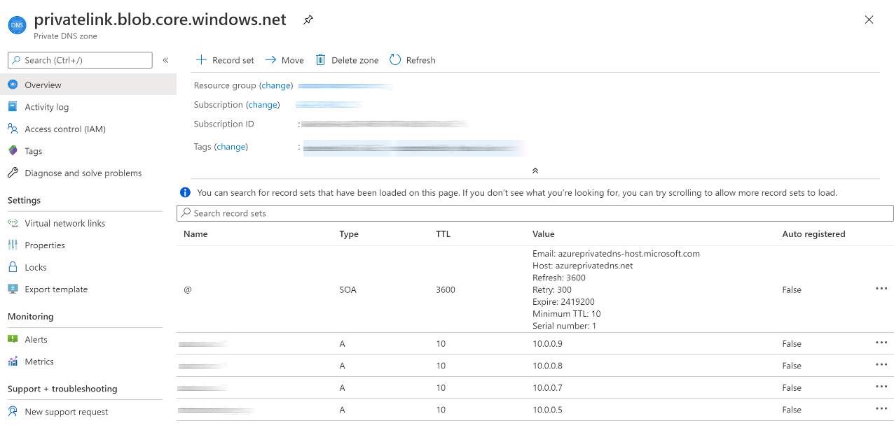
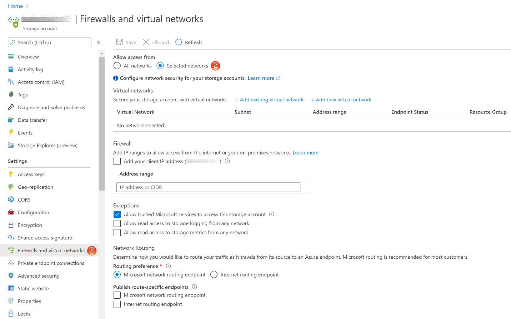
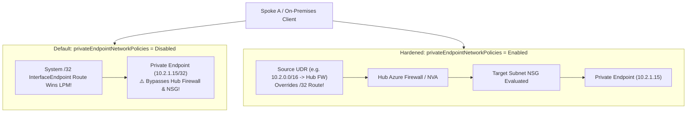

Deploying a single Azure Private Endpoint in a sandbox takes two minutes. Operating **thousands of Private Endpoints across hundreds of Cloud Adoption Framework (CAF) landing-zone subscriptions**—without central IT ticket queues, split-brain DNS outages, or bypassed Hub Firewalls—is one of the most consequential design decisions in enterprise Azure networking.

This chapter establishes the modern governance and routing blueprint for **Azure Private Link at scale**: comparing **Centralized, Decentralized, and Hybrid Private DNS topologies**, replacing retired Azure Blueprints and spoke DNS VMs with **Azure Policy (`DeployIfNotExists`)**, **Azure Deployment Stacks**, and **[Azure DNS Private Resolver](/azure-networking/01-foundations/dns-and-private-resolver/)**, and mastering **`/32` system-route overrides (`PrivateEndpointNetworkPolicies`)** and SNAT symmetry.

---

## 1. Anatomy of a Private Endpoint & `PrivateDnsZoneGroup`

An **Azure Private Endpoint** injects a read-only network interface (`<pe-name>.nic.<guid>`) with a static-for-life private IP from your VNet subnet directly onto a specific PaaS resource instance (`blob`, `sqlServer`, `vault`, `sites`, or a custom **Private Link Service** behind a Standard Internal Load Balancer). Connections are **strictly unidirectional** (consumers initiate flows *to* the Private Endpoint; the PaaS service can never initiate inbound connections into your VNet).



### How Private DNS CNAME Resolution Works End-to-End

When a PaaS resource enables a Private Endpoint, Microsoft updates public authoritative DNS for that service to return a **CNAME** pointing to a reserved `privatelink.*` subdomain (for example, `azstore.blob.core.windows.net` → CNAME `azstore.privatelink.blob.core.windows.net`).



1. **Client Query**: An on-premises host or spoke VM queries its configured DNS resolver for `azstore.blob.core.windows.net`.
2. **Conditional Forwarding to Hub**: On-premises DNS servers conditionally forward `blob.core.windows.net` (the *public* service zone, not just `privatelink.*`) to the **Hub Azure DNS Private Resolver Inbound Endpoint** (`10.200.0.132` in the reference flow above, replacing legacy DNS forwarder VMs).
3. **Azure Wire Server (`168.63.129.16`)**: The Hub DNS Private Resolver queries Azure DNS (`168.63.129.16`) inside the Hub VNet—which has a **Virtual Network Link** (`registrationEnabled: false`) to `privatelink.blob.core.windows.net`.
4. **CNAME Chase & Private `A` Record**: Public DNS returns the CNAME `azstore.privatelink.blob.core.windows.net`; Azure DNS matches the linked Private DNS Zone and returns **`A -> 10.200.8.5`**, enabling direct private connectivity over ExpressRoute/VPN or VNet Peering.

### Why `PrivateDnsZoneGroup` Is the Key to Lifecycle Automation

A **[`PrivateDnsZoneGroup`](https://learn.microsoft.com/en-us/azure/templates/microsoft.network/privateendpoints/privatednszonegroups)** is a child resource of a Private Endpoint referencing the target `privatelink.*` Private DNS Zone ID.
- **Creation**: Creating the `PrivateDnsZoneGroup` requires write permission on the Private DNS Zone (handled by Azure Policy's Managed Identity—never granted directly to app teams!).
- **Automatic Deletion**: Once linked, the `Microsoft.Network` resource provider automatically creates the `A` record **and automatically deletes that `A` record whenever the application team deletes their Private Endpoint**, preventing stale DNS records from pointing recycled private IPs to the wrong service!

---

## 2. Enterprise Topologies: Centralized vs. Decentralized vs. Hybrid

In a multi-region CAF Enterprise-Scale topology, workload teams own spoke subscriptions (`Landing Zones`) while the Platform/NetOps team owns the `Connectivity` subscription (Hub VNets / vHubs, ExpressRoute/VPN, Azure Firewall, and DNS):



### Model A: Centralized Private DNS Zones (Recommended Reference Standard)

A **single authoritative set** of `privatelink.*` Private DNS Zones lives in the central **`Connectivity` subscription**, linked to the regional Hub VNets (or a dedicated central DNS VNet peered/linked to **[Azure DNS Private Resolver](/azure-networking/01-foundations/dns-and-private-resolver/)** in Virtual WAN or Hub-and-Spoke). All spoke VNets either point their custom VNet DNS setting to the Hub Private Resolver Inbound IP **or** link to a central **DNS Forwarding Ruleset** via Private Resolver Outbound Endpoints!



- **Pros**:
  - **Zero zone sprawl**: Exactly one `privatelink.blob.core.windows.net` zone across hundreds of subscriptions.
  - **Seamless hybrid & cross-VNet resolution**: On-premises networks and peered spokes resolve every approved Private Endpoint automatically without complex per-spoke forwarding meshes.
  - **Zero DNS VMs**: Fully serverless using **Azure DNS Private Resolver** in the Hub (`Inbound Endpoint` for on-premises → Azure; `Outbound Endpoint + Ruleset` for Azure → on-premises AD domains).
- **Cons / Constraints**:
  - **Single `A` record per PaaS FQDN**: Because one zone holds one record per resource name, you generally deploy **one canonical Private Endpoint per PaaS resource** (though multi-region active-passive PaaS resources like GRS Storage or SQL Failover Groups require regional DNS zones or traffic-manager/failover record updates).
  - Requires **Azure Policy (`DeployIfNotExists`)** so spoke app teams can deploy Private Endpoints autonomously without direct RBAC write access to central DNS zones.

:::caution[ExpressRoute Gateway + DNS Private Resolver Coexistence Rule]
You *can* deploy **Azure DNS Private Resolver** inside the same Hub VNet as an ExpressRoute Virtual Network Gateway, **provided you never attach a wildcard catch-all forwarding rule (`.`)** on a DNS Forwarding Ruleset linked to that Hub VNet that breaks public Azure FQDN resolution! ExpressRoute Gateway VMs depend on resolving public Azure management FQDNs to stay healthy. For cleaner separation in Virtual WAN or large hubs, many enterprises place DNS Private Resolver in a dedicated **Shared DNS Spoke VNet**.
:::

### Model B: Decentralized Private DNS Zones (Strict Sandbox Isolation Only)

Every spoke/workload subscription deploys its own isolated copy of `privatelink.*` Private DNS Zones linked locally to its spoke VNet.





- **Historical Pain Eliminated by DNS Private Resolver**: Previously, decentralized DNS forced every spoke team to maintain two custom Linux/Windows DNS forwarder VMs per spoke VNet just to forward between `168.63.129.16` and central AD DNS! Today, linking a shared **Azure DNS Private Resolver Outbound Ruleset** to spoke VNets allows spokes to resolve local VNet-linked `privatelink.*` zones natively via `168.63.129.16` while forwarding corporate `contoso.internal` queries to on-premises—**with zero spoke DNS VMs**.
- **Remaining Drawbacks (Why It Is Still Niche)**:
  - **Breaks On-Premises & Cross-Spoke Private Endpoint Access**: Because each spoke hides its `A` records in an isolated local zone, **on-premises clients and shared Data/AI platforms (e.g., Fabric, Databricks, Purview) cannot resolve spoke Private Endpoints** without complex conditional forwarding per resource!
  - Multiplies Private DNS Zone count by $N$ subscriptions × ~60+ `privatelink.*` zone types.

### Topology Decision Matrix (Including Hybrid)

| Criterion | Centralized Model *(CAF Default)* | Decentralized Model | Hybrid Model *(Central Default + Isolated Enclaves)* |
| --- | --- | --- | --- |
| **Zone Count (200 Subs × 50 Services)** | **~50 Zones total** | Up to **10,000 Zones** | ~50 Central + Dedicated Sandbox copies |
| **On-Premises → Spoke PE Resolution** | **Native** (via Hub Private Resolver Inbound IP) | Broken / Requires per-resource forwarding | Native for standard spokes; isolated for sandboxes |
| **Multiple PEs to Same PaaS Resource** | 1 PE per global DNS scope *(or regional zones)* | **Supported** per isolated spoke VNet | Supported inside isolated sandbox spokes |
| **App Team Autonomy** | Automated via **`DeployIfNotExists` Policy** | Direct RBAC in spoke subscription | Policy for standard spokes; local RBAC in sandboxes |
| **Recommended For** | **95%+ of enterprise landing zones** | Multi-tenant SaaS / hostile tenant sandboxes | Enterprises with standard prod + air-gapped R&D/M&A enclaves |

---

## 3. Modern Governance: Deployment Stacks + Azure Policy (`DeployIfNotExists`)

:::note[Modernizing Off Retired Azure Blueprints]
Earlier CAF guides relied on **Azure Blueprints** (now retired) to stamp landing-zone VNets, UDRs, and Private DNS infrastructure. In modern Cloud Adoption Framework (Azure Landing Zones) estates, pair **[Azure Deployment Stacks](https://learn.microsoft.com/en-us/azure/azure-resource-manager/bicep/deployment-stacks)** for deterministic resource lifecycle + **`denySettings`** guardrails with **Azure Policy** for event-driven Private DNS registration.
:::

### Guardrail Layer 1: Azure Deployment Stacks (`denySettings`)
Package your central `Connectivity` Private DNS Zones (`privatelink.blob.core.windows.net`, `privatelink.vaultcore.azure.net`, `privatelink.database.windows.net`, etc.), Hub VNet links, and spoke baseline networking (VNet, Route Table, NSG) as Bicep **Deployment Stacks** (`az stack sub create` / `az stack mg create`):
- **`denySettingsMode: 'denyWriteAndDelete'`** with **`excludedPrincipals`** (allowing the Azure Policy Managed Identity) and **`excludedActions`** prevents spoke Contributors from deleting VNet links, detaching route tables, or tampering with central Private DNS zones—replacing Blueprint locks cleanly!
- **`actionOnUnmanage: 'deleteAll'` or `'detachAll'`** provides clean lifecycle pruning when retiring spoke landing zones or decommissioning obsolete zones.

### Guardrail Layer 2: Four-Part Azure Policy Enforcement

To give application teams **zero-ticket autonomy** while enforcing Zero-Trust Private Link across Management Groups:





1. **`Deny` (or `Modify`) Public Network Access on PaaS Resources**: Block creation of PaaS services with `publicNetworkAccess: 'Enabled'` or `networkAcls.defaultAction != 'Deny'` (using built-in Azure Landing Zone policies such as *Storage accounts should disable public network access*).
2. **`AuditIfNotExists` Private Endpoint Compliance**: Continuously audit PaaS resources lacking an `Approved` `privateEndpointConnections` link.
3. **`Deny` Rogue `privatelink.*` Zones in Spoke Subscriptions**: Assign a policy at the `Landing Zones` Management Group denying creation of `Microsoft.Network/privateDnsZones` where `name` contains `privatelink.`—preventing developers from clicking *"Integrate with private DNS zone: Yes"* in the Portal and creating shadow split-brain zones in their spoke!
4. **`DeployIfNotExists` (`Configure Azure PaaS services to use private DNS zones` Initiative)**: Assign the built-in ALZ **`Deploy-Private-DNS-Zones`** policy initiative at the `Landing Zones` Management Group using a System-Assigned or User-Assigned Managed Identity granted **`Network Contributor`** (on spokes) + **`Private DNS Zone Contributor`** (on central zones):

```json
{
  "mode": "Indexed",
  "policyRule": {
    "if": {
      "allOf": [
        { "field": "type", "equals": "Microsoft.Network/privateEndpoints" },
        {
          "count": {
            "field": "Microsoft.Network/privateEndpoints/privateLinkServiceConnections[*].groupIds[*]",
            "where": {
              "field": "Microsoft.Network/privateEndpoints/privateLinkServiceConnections[*].groupIds[*]",
              "equals": "[parameters('groupId')]"
            }
          },
          "greaterOrEquals": 1
        }
      ]
    },
    "then": {
      "effect": "deployIfNotExists",
      "details": {
        "type": "Microsoft.Network/privateEndpoints/privateDnsZoneGroups",
        "roleDefinitionIds": [
          "/providers/Microsoft.Authorization/roleDefinitions/4d97b98b-1d4f-4787-a291-c67834d212e7"
        ],
        "existenceCondition": {
          "field": "Microsoft.Network/privateEndpoints/privateDnsZoneGroups/privateDnsZoneConfigs[*].privateDnsZoneId",
          "equals": "[parameters('privateDnsZoneId')]"
        },
        "deployment": {
          "properties": {
            "mode": "incremental",
            "parameters": {
              "privateDnsZoneId": { "value": "[parameters('privateDnsZoneId')]" },
              "privateEndpointName": { "value": "[field('name')]" },
              "location": { "value": "[field('location')]" }
            },
            "template": {
              "$schema": "https://schema.management.azure.com/schemas/2019-04-01/deploymentTemplate.json#",
              "contentVersion": "1.0.0.0",
              "parameters": {
                "privateDnsZoneId": { "type": "string" },
                "privateEndpointName": { "type": "string" },
                "location": { "type": "string" }
              },
              "resources": [
                {
                  "name": "[concat(parameters('privateEndpointName'), '/deployedByPolicy')]",
                  "type": "Microsoft.Network/privateEndpoints/privateDnsZoneGroups",
                  "apiVersion": "2023-11-01",
                  "location": "[parameters('location')]",
                  "properties": {
                    "privateDnsZoneConfigs": [
                      {
                        "name": "central-privatelink-dns",
                        "properties": {
                          "privateDnsZoneId": "[parameters('privateDnsZoneId')]"
                        }
                      }
                    ]
                  }
                }
              ]
            }
          }
        }
      }
    }
  }
}
```

:::tip[Avoiding `groupId` Collisions]
Several Azure resource types share generic subresource `groupId` names (such as `sqlServer` or `sites`). Always prefer the **built-in Azure Landing Zone policy definitions**, which match **both** `privateLinkServiceId` resource type *and* `groupId` so a Synapse workspace never accidentally registers into the Azure SQL Database Private DNS zone!
:::

---

## 4. Routing & Inspection: `/32` Host Routes, `PrivateEndpointNetworkPolicies` & SNAT

### Why Private Endpoints Bypass Your Hub Firewall by Default

Whenever you deploy a Private Endpoint into a spoke subnet (`10.2.1.0/24`), Azure automatically injects a **`/32` `InterfaceEndpoint` system route** (e.g., `10.2.1.15/32 -> InterfaceEndpoint`) into the Hub VNet and every peered VNet!
- Because **[Longest Prefix Match (LPM)](/azure-networking/01-foundations/routing-and-traffic-engineering/)** always prefers `/32` over a spoke's `0.0.0.0/0` or `10.0.0.0/8` UDR pointing to Azure Firewall, **peered spokes and ExpressRoute gateways bypass your Hub Firewall and talk directly to the `/32` Private Endpoint—unless you enable Private Endpoint Network Policies!**



### Enabling `PrivateEndpointNetworkPolicies` & The Exact UDR Prefix Rule

Set `privateEndpointNetworkPolicies` on every subnet hosting Private Endpoints to **`Enabled`** (enables both NSGs and UDR overrides), **`RouteTableEnabled`**, or **`NetworkSecurityGroupEnabled`**:

```bicep
resource peSubnet 'Microsoft.Network/virtualNetworks/subnets@2024-01-01' = {
  parent: spokeVnet
  name: 'snet-private-endpoints'
  properties: {
    addressPrefix: '10.2.1.0/24'
    // Enables both NSG filtering and UDR /32 route suppression for all PEs in this subnet
    privateEndpointNetworkPolicies: 'Enabled'
  }
}
```

:::danger[The UDR Prefix-Length Gotcha (`0.0.0.0/0` Does NOT Override Private Endpoints!)]
Even after setting `privateEndpointNetworkPolicies: 'Enabled'` (or `'RouteTableEnabled'`) on the Private Endpoint's subnet, **a `0.0.0.0/0` default UDR on client subnets will NOT override the Private Endpoint route!**
To override a Private Endpoint's `/32` route, your UDR prefix must be **equal to or more specific (longer mask) than the VNet address space** hosting the Private Endpoint (for example, if the PE lives in a `10.2.0.0/16` spoke VNet, a UDR for `10.2.0.0/16` or `10.2.1.0/24 -> Hub Firewall` overrides the `/32`, whereas `0.0.0.0/0` or `10.0.0.0/8` does **not** unless `10.0.0.0/8` is the VNet's own address space or Virtual WAN Routing Intent manages private prefixes).
:::

### Symmetry & SNAT Rules in Hub-and-Spoke vs. Virtual WAN

Because a **Private Endpoint cannot initiate connections and does not evaluate UDRs on its own subnet for return packets**, return traffic emitted by a Private Endpoint NIC (`InterfaceEndpoint`) always takes the direct system route back toward the packet's source IP:
1. **Standard Hub-and-Spoke (SNAT Requirement)**: When `Spoke A VM → Hub Firewall → Spoke B Private Endpoint` (or `On-Premises → ER Gateway → Hub Firewall → Spoke B Private Endpoint`) is inspected by a Hub Firewall/NVA without SNAT, the Private Endpoint sees `Spoke A`'s (or On-Premises') original IP and sends `SYN-ACK` directly back via `GatewaySubnet` or VNet routing—**bypassing the Hub Firewall on the return leg and breaking TCP state!**
   - **Fix in Standard Hub-and-Spoke**: Perform **SNAT** at the Hub Firewall/NVA for flows destined to Private Endpoints (for HTTPS/MSSQL workloads, Azure Firewall **Application Rules** automatically SNAT to `AzureFirewallSubnet`; for TCP Network Rules or 3rd-party NVAs, configure explicit SNAT to the firewall/NVA private IP so the Private Endpoint returns `SYN-ACK` symmetrically to the firewall).
2. **Virtual WAN Secured Hub ([Routing Intent](/azure-networking/02-core-topologies/virtual-wan-and-routing-intent/))**: When `privateEndpointNetworkPolicies: 'Enabled'` is set on the spoke PE subnet and Private Routing Intent is enabled on the Secured vHub, Virtual WAN's SDN router steers **both** forward and return flows between spokes/branches and Private Endpoints symmetrically through the Secured Hub Firewall **without requiring manual UDRs or SNAT workarounds**.
3. **ExpressRoute Ingress UDR**: In Standard Hub-and-Spoke, always attach a UDR on `GatewaySubnet` (`10.2.1.0/24 -> Hub Firewall`) alongside `privateEndpointNetworkPolicies: 'Enabled'` on the PE subnet (and SNAT on the firewall) if regulatory policy mandates inspecting On-Premises-to-Private-Endpoint traffic.

---

## What I Recommend

1. **Adopt the Centralized Private DNS Zone model in your `Connectivity` subscription for 95%+ of workloads**, fronted by **[Azure DNS Private Resolver](/azure-networking/01-foundations/dns-and-private-resolver/)** (zero DNS VMs) and governed via **Bicep Deployment Stacks (`denyWriteAndDelete`)**.
2. **Automate `PrivateDnsZoneGroup` registration with the built-in Azure Landing Zones `DeployIfNotExists` policy initiative** paired with a **`Deny` policy blocking `privatelink.*` zones** in spoke subscriptions—giving app teams instant self-service Private Endpoints with zero ticket queues and zero split-brain zones.
3. **Carve out a dedicated `snet-private-endpoints` subnet in each spoke with `privateEndpointNetworkPolicies: 'Enabled'`** so NSGs apply and `/16`–`/24` UDRs (or Virtual WAN Routing Intent) cleanly steer Private Endpoint traffic through your **[Hub Azure Firewall](/azure-networking/04-network-security/firewall-and-nva-patterns/)**. For AI/Analytics workloads (`Microsoft Foundry` and `Fabric`), pair these rules with **[Foundry & Fabric Networking](/azure-networking/05-workload-networking/foundry-and-fabric-networking/)**.
