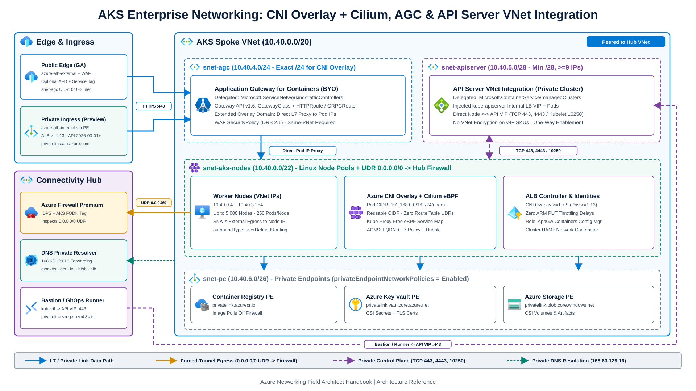
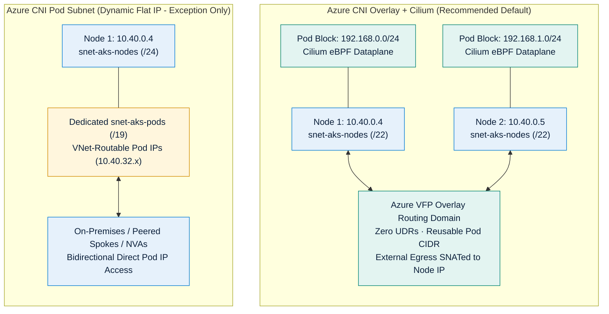
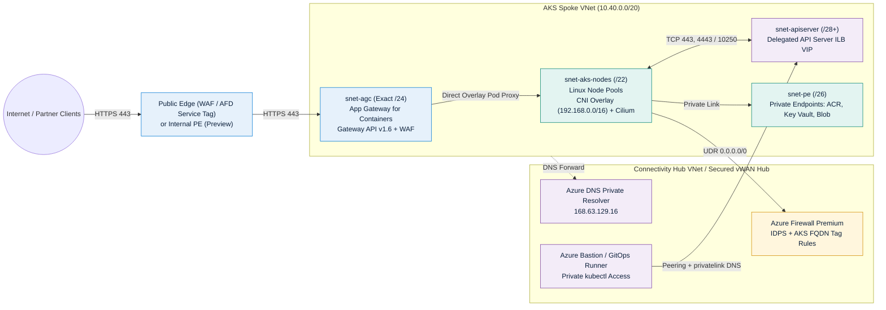

Enterprise Azure Kubernetes Service (AKS) deployments routinely fail network readiness reviews for three avoidable reasons: exhausting RFC 1918 address space with legacy flat pod IP allocation, coupling cluster ingress to retiring or control-plane-throttled controllers, and leaving worker nodes with uninspected outbound internet access.

This chapter defines a production architecture for **CNI and data-plane selection**, **Kubernetes Gateway API ingress with Application Gateway for Containers**, **zero-trust egress routing**, and **API Server VNet Integration**. Before sizing node and ingress subnets, review CIDR planning in [VNet Sizing & IPv4/IPv6 Planning](/azure-networking/01-foundations/vnet-and-ip-addressing/) and route precedence in [Routing & Traffic Engineering](/azure-networking/01-foundations/routing-and-traffic-engineering/).

---

## 1. CNI & Data Plane Selection

[AKS CNI networking](https://learn.microsoft.com/en-us/azure/aks/concepts-network-cni-overview) separates **IP Address Management (IPAM)** (how pods acquire IP addresses) from the **packet data plane** that enforces Kubernetes `Service` load balancing and `NetworkPolicy`.

### Why Azure CNI Overlay Powered by Cilium Is the Enterprise Default

**[Azure CNI Overlay](https://learn.microsoft.com/en-us/azure/aks/concepts-network-azure-cni-overlay) powered by [Cilium](https://learn.microsoft.com/en-us/azure/aks/azure-cni-powered-by-cilium)** (`--network-plugin azure --network-plugin-mode overlay --network-dataplane cilium`) pairs Azure's overlay IPAM with an eBPF Linux kernel data plane. [AKS Automatic](https://learn.microsoft.com/en-us/azure/aks/intro-aks-automatic) preconfigures this combination by default alongside LocalDNS and a managed NAT gateway.

1. **VNet IP Conservation**: Worker nodes receive standard VNet subnet IPs, while pods draw from an isolated private CIDR (default `10.244.0.0/16`, customizable to ranges such as `192.168.0.0/16` or `100.64.0.0/16`). Each node receives a fixed `/24` pod block from the overlay CIDR. Because pod CIDRs never appear in enterprise WAN or hub route tables, every AKS cluster across your tenant can reuse the exact same pod CIDR without IP overlap.
2. **Azure SDN Routing Without UDR Ceilings**: Azure CNI Overlay programs pod-to-node mappings directly inside a dedicated routing domain in the Azure Virtual Filtering Platform (VFP) stack. Pod-to-pod traffic requires no Azure Route Table UDRs and no VXLAN/IP-in-IP encapsulation, matching standard VM-to-VM latency. The overlay model supports up to **5,000 nodes** and **250 pods per node** (110 recommended for Windows Server containers). Microsoft documents these node and per-node pod figures as **independent limits**; do not multiply them to estimate total cluster pod capacity, which depends on control-plane tier and [AKS service quotas](https://learn.microsoft.com/en-us/azure/aks/quotas-skus-regions).
3. **Kube-Proxy-Free eBPF Data Plane & ACNS Security**: On Linux node pools, Cilium removes `kube-proxy` and replaces linear $O(N)$ `iptables` chains with eBPF map lookups. Out of the box, Azure CNI Powered by Cilium supports standard Kubernetes `NetworkPolicy`, L3/L4 `CiliumNetworkPolicy`, `CiliumClusterwideNetworkPolicy`, `CiliumLocalRedirectPolicy` (Kubernetes 1.29+), Cilium Endpoint Slices (Kubernetes 1.32+), and basic container network metrics. Enabling **[Advanced Container Networking Services (ACNS)](https://learn.microsoft.com/en-us/azure/aks/advanced-container-networking-services-overview)** unlocks FQDN egress filtering (Kubernetes 1.29+), Layer 7 policies (HTTP, gRPC, Kafka), stored Hubble flow logs and source-filtered observability, WireGuard node-to-node encryption (`UDP 51871`), Cilium mTLS (Preview), and eBPF Host Routing (`BpfVeth`, Kubernetes 1.33+ on Azure Linux 3.0 or Ubuntu 24.04).

:::caution[Cilium Platform & Policy Caveats]
- **Windows Node Pool Compatibility**: Azure CNI Powered by Cilium runs on Linux node pools only. Clusters with Windows Server 2022 or Windows Server 2025 node pools must use the Azure `iptables` data plane (with Calico when Windows network policies are required).
- **`ipBlock` & Node IP Selector Limitation**: In Azure CNI Powered by Cilium, a Kubernetes `NetworkPolicy` `ipBlock` rule (even `0.0.0.0/0`) **cannot match pod or node IPs**. Add `namespaceSelector` and `podSelector` alongside `ipBlock` to select pods. Because standard Kubernetes `NetworkPolicy` cannot allow traffic to node IPs at all in Cilium, use a `CiliumNetworkPolicy` targeting the `host` and `remote-node` entities whenever pods communicate with node IPs (and allow `169.254.10.0/24` plus `host` on TCP/UDP `53` when running AKS LocalDNS).
- **High-Churn Identity Exclusion**: Cilium enforces a 65,535 cluster identity limit. On Spark or batch clusters with unique per-job pod labels, exclude transient labels (such as `!spark-app-name`) in the `kube-system/cilium-config` ConfigMap so pod churn does not exhaust Cilium identities.
:::

### When Flat VNet Networking (Azure CNI Pod Subnet) Is Justified

With CNI Overlay, traffic leaving the cluster VNet (to peered spokes or on-premises networks) is SNATed to the worker node's primary VNet IP. Choose **[Azure CNI Pod Subnet (Dynamic IP Allocation)](https://learn.microsoft.com/en-us/azure/aks/concepts-network-azure-cni-pod-subnet)** only when workloads have a hard requirement for **non-SNATed, directly routable VNet pod IPs**:

- On-premises or peered-spoke firewalls enforce security rules against distinct pod subnet CIDRs rather than node subnet CIDRs.
- External non-Kubernetes systems (legacy RPC, VoIP/SIP, or peer-to-peer stateful clusters) initiate connections directly to individual pod IPs without traversing a Kubernetes `Service` or L7 gateway.
- Azure Firewall or a third-party NVA must forward traffic directly to pod IPs without an intermediate load balancer, because NVAs cannot route directly into a CNI Overlay pod CIDR.

:::caution[Avoid Legacy Azure CNI Node Subnet]
Legacy **[Azure CNI Node Subnet](https://learn.microsoft.com/en-us/azure/aks/concepts-network-legacy-cni)** pre-allocates `maxPods` secondary VNet IPs on every node NIC at boot time. A 10-node pool with `maxPods = 110` reserves **1,110 VNet IPs** up front plus an extra surge node block during upgrades. Whenever flat pod routing is mandatory in a custom VNet, use **Azure CNI Pod Subnet (Dynamic IP Allocation)** so pod IPs are leased on demand from a dedicated pod subnet.
:::

### Retiring Plugins: Kubenet & Azure NPM

- **Kubenet (March 31, 2028 Sunset)**: [Kubenet](https://learn.microsoft.com/en-us/azure/aks/concepts-network-legacy-cni) caps clusters at 400 nodes, requires UDRs per node on the cluster route table, adds an extra routing hop, lacks Windows node pool support, and is **not supported by Application Gateway for Containers**. Upgrade existing Kubenet clusters to [Azure CNI Overlay](https://learn.microsoft.com/en-us/azure/aks/upgrade-aks-ipam-and-dataplane) before March 31, 2028.
- **Azure Network Policy Manager (NPM) Sunset**: Per [AKS network policy guidance](https://learn.microsoft.com/en-us/azure/aks/use-network-policies), Windows support ended on **September 30, 2026**, Linux support ends on **September 30, 2028**, and new Azure subscriptions can no longer enable Azure NPM. Standardize on **Cilium** for Linux clusters.

### AKS CNI & Data Plane Decision Matrix

| Capability / Constraint | Azure CNI Overlay + Cilium | Azure CNI Pod Subnet + Cilium | Azure CNI Node Subnet (Legacy) | Kubenet (Retiring Mar 31, 2028) |
| --- | --- | --- | --- | --- |
| **Pod IP Source** | Isolated Overlay CIDR (reusable across clusters) | Dedicated VNet Pod Subnet (dynamic) | Shared VNet Node Subnet (pre-allocated) | Isolated CIDR + Azure Route Table UDRs |
| **VNet IP Footprint (100 nodes, 100 pods/node)** | ~101 VNet IPs (+ upgrade surge) | ~101 Node IPs + active pod count in Pod Subnet | ~10,100 VNet IPs reserved at boot | ~101 VNet IPs + 100 UDR routes |
| **Maximum Cluster Scale** | Up to 5,000 nodes; 250 pods/node (independent limits) | Scales to VNet pod subnet capacity | Constrained by node subnet `/16`-`/20` size | Hard limit 400 nodes (400 UDR limit) |
| **Node OS Support** | Linux (Cilium); Windows requires `iptables` dataplane | Linux (Cilium); Windows requires `iptables` dataplane | Linux or Windows | Linux only |
| **Direct External Pod IP Access** | No (use L4 ILB, AGC, or Private Link) | Yes (bidirectional VNet routing) | Yes (bidirectional VNet routing) | Requires manual UDR propagation |
| **Application Gateway for Containers** | Supported (`ALB >= 1.7.9` public; `>= 1.13` private preview) | Supported | Supported | **Not supported** |
| **Service Routing & Policy Engine** | Kube-proxy-free eBPF + Cilium L3/L4 (+ L7/FQDN via ACNS) | Kube-proxy-free eBPF + Cilium L3/L4 (+ L7/FQDN via ACNS) | Cilium or legacy `iptables`/Calico | Legacy `iptables`/Calico only |
| **Production Verdict** | **Default for 95% of Linux enterprise clusters** | **Use only when external direct Pod IP is mandatory** | **Avoid for new custom-VNet deployments** | **Prohibited: migrate to CNI Overlay** |

:::tip[What I Recommend]
Deploy **Azure CNI Overlay powered by Cilium** on every new Linux AKS Standard cluster (or adopt **AKS Automatic** where managed node provisioning fits). Allocate a `/22` or `/23` VNet node subnet per cluster to accommodate 200 to 500 nodes plus `maxSurge` rolling upgrades, and standardize on an isolated overlay CIDR such as `192.168.0.0/16` or `100.64.0.0/16` so enterprise IPAM stays decoupled from pod density. Enable **ACNS** on production clusters to enforce DNS/FQDN egress policies and export Hubble flow telemetry.
:::

---

## 2. Ingress: Application Gateway for Containers & Gateway API

Kubernetes ingress design has moved away from annotation-heavy `Ingress` v1 manifests toward the role-oriented **Kubernetes Gateway API** (`GatewayClass`, `Gateway`, `HTTPRoute`, `GRPCRoute`, and `ReferenceGrant`), plus the **Gateway API Inference Extension** (`InferencePool`) for load- and model-aware AI inference routing.

### Why Application Gateway for Containers Supersedes AGIC and Ingress-NGINX

1. **Legacy AGIC (Application Gateway v2) Control-Plane Latency**: [AGIC](https://learn.microsoft.com/en-us/azure/application-gateway/ingress-controller-overview) translates Kubernetes endpoint updates into Azure Resource Manager (ARM) `PUT` calls against Application Gateway v2. During rapid pod autoscaling or rolling updates, ARM throttling and 30-to-90-second apply times can leave stale pod IPs in backend pools and trigger transient `502 Bad Gateway` responses.
2. **In-Cluster Ingress-NGINX Overhead**: Upstream community `ingress-nginx` has wound down in favor of Gateway API implementations. Self-managed reverse proxies inside worker nodes also consume cluster CPU/memory, add an extra hop (`External LB -> NodePort -> Proxy Pod -> App Pod`), and shift WAF patching onto platform engineers.
3. **[Application Gateway for Containers (AGC)](https://learn.microsoft.com/en-us/azure/application-gateway/for-containers/overview) Data-Plane Speed**: AGC (`Microsoft.ServiceNetworking/trafficControllers`) runs an Azure-managed L7 proxy outside the cluster while its in-cluster **ALB Controller** streams pod readiness and route changes over a dedicated configuration API (`*.alb.azure.com`). Backend updates propagate in **near real time** without ARM `PUT` bottlenecks. AGC supports HTTP/2, gRPC, WebSockets, mutual TLS (mTLS), JWT validation, weighted traffic splitting, and Azure WAF (`SecurityPolicy` with DRS 2.1).

### Provisioning Models, `GatewayClass` Types & CNI Overlay Rules

Review five architectural requirements documented in [AGC components](https://learn.microsoft.com/en-us/azure/application-gateway/for-containers/application-gateway-for-containers-components) and [AGC container networking](https://learn.microsoft.com/en-us/azure/application-gateway/for-containers/container-networking):

1. **BYO Deployment vs. Managed by ALB Controller**:
   - **[Bring Your Own (BYO)](https://learn.microsoft.com/en-us/azure/application-gateway/for-containers/quickstart-create-application-gateway-for-containers-byo-deployment)** *(Recommended for Production)*: Provision the parent Traffic Controller, Frontend (`*.fzXX.alb.azure.com`), Association, and WAF `SecurityPolicy` deterministically in Bicep or Terraform. Kubernetes `Gateway` manifests reference pre-created Azure resources, so deleting a namespace or `Gateway` object in Kubernetes never destroys edge infrastructure or rotates frontend FQDNs.
   - **[Managed by ALB Controller](https://learn.microsoft.com/en-us/azure/application-gateway/for-containers/quickstart-create-application-gateway-for-containers-managed-by-alb-controller)**: Creating an in-cluster `ApplicationLoadBalancer` custom resource instructs ALB Controller to create Azure resources with random suffixes (`alb-<8chars>`, `fe-<8chars>`). Reserve this mode for ephemeral dev/test clusters.
   - **Controller Installation & RBAC**: Install ALB Controller via the **[AKS Managed Add-on](https://learn.microsoft.com/en-us/azure/application-gateway/for-containers/quickstart-deploy-application-gateway-for-containers-alb-controller-addon)** (`--enable-gateway-api --enable-application-load-balancer`, mandatory on AKS Automatic) or Helm with Workload Identity. Grant the controller's User-Assigned Managed Identity the built-in **`AppGw for Containers Configuration Manager`** role on the AGC resource group (this role includes data-action permissions **not** included in `Owner` or `Contributor`) plus `Network Contributor` (or `Microsoft.Network/virtualNetworks/subnets/join/action`) on the delegated subnet.
2. **Subnet Delegation & Exact `/24` CNI Overlay Requirement**:
   - Every AGC association requires a dedicated subnet delegated to `Microsoft.ServiceNetworking/trafficControllers` with at least 256 addresses (`/24` minimum; currently 1 association per AGC resource).
   - **CNI Overlay Exact `/24` Rule**: When paired with **Azure CNI Overlay** (requires ALB Controller `>= 1.7.9`), Azure extends the cluster's overlay routing domain into the AGC subnet so AGC proxies traffic **directly to overlay pod IPs** without NodePort translation. For CNI Overlay, the AGC subnet **must be an exact `/24` prefix**; larger (`/23`) or smaller (`/25`) prefixes are unsupported and will fail CNI Overlay upgrades.
3. **Same-VNet Co-Location**:
   - AGC and AKS worker nodes **must reside in the same Virtual Network** (and same Azure region). Deploying AGC in a central Hub VNet and peering it to an AKS Spoke VNet (regional or global peering) is **not supported**.
4. **Public (`azure-alb-external`) vs. Private (`azure-alb-internal`, Preview) Frontends**:
   - **`GatewayClass: azure-alb-external` *(GA)***: Exposes an internet-routable anycast IP on ports `80` and `443` only. Protect it directly with an AGC WAF `SecurityPolicy` (DRS 2.1), or place **Azure Front Door** in front and lock `snet-agc` inbound NSG rules to the `AzureFrontDoor.Backend` service tag plus `X-Azure-FDID` header validation. Note that `Microsoft.ServiceNetworking/trafficControllers` is **not** a supported [Azure Front Door Private Link origin](https://learn.microsoft.com/en-us/azure/frontdoor/private-link); if global policy mandates Front Door Private Link with zero public spoke IPs, target an **AKS Internal Load Balancer + Private Link Service** (`azure-pls-create: "true"`, fronting Envoy Gateway or Istio) or classic Application Gateway.
   - **`GatewayClass: azure-alb-internal` *(Preview)***: Exposes a **[private frontend](https://learn.microsoft.com/en-us/azure/application-gateway/for-containers/private-ingress)** with no public IP, requiring **ALB Controller `v1.13+`**, an AGC association created on or after **April 23, 2026**, ARM REST API **`2026-03-01+`**, and Private DNS zone **`privatelink.alb.azure.com`** (`groupId: <frontend-name>`). Remote clients do **not** connect to IPs inside `snet-agc`; instead, internal corporate VNets, cross-cluster/cross-tenant spokes, or a Hub Azure Firewall/NVA connect via **approved Azure Private Endpoints** (up to **200 Private Endpoints** per private frontend; note that placing a SNATing Hub Firewall upstream overwrites client IP in `X-Forwarded-For`). Both public and private frontends can coexist on one AGC resource.
5. **NSG & Route Table Symmetry on the AGC Subnet**:
   - For associations created on or after **April 23, 2026**, both inbound and outbound NSG rules are enforced on the AGC subnet. If you add custom deny rules, explicitly allow inbound `80`/`443`, inbound `AzureLoadBalancer` service tag, and outbound traffic to your AKS pod CIDR for health probes and proxying.
   - **Prevent Asymmetric Return Drops**: On a public frontend (`azure-alb-external`), never let BGP or a UDR steer `0.0.0.0/0` from `snet-agc` to a hub firewall. Attach a route table to `snet-agc` with either **Virtual network gateway route propagation disabled** or an explicit `0.0.0.0/0 -> Internet` UDR so inbound internet replies return symmetrically.

### AKS Ingress Architecture Comparison

| Criterion | Application Gateway for Containers (AGC) | Istio Add-on / Envoy Gateway (Behind Azure ILB/PLB) | Legacy AGIC (AppGW v2) | Community Ingress-NGINX |
| --- | --- | --- | --- | --- |
| **Primary API Standard** | **Gateway API v1.6** (`Gateway`, `HTTPRoute`, `GRPCRoute`, `InferencePool`) + `Ingress` | Gateway API / Istio `VirtualService` | Legacy `Ingress` v1 + custom annotations | Legacy `Ingress` v1 + NGINX annotations |
| **Backend Update Latency** | Near real-time data-plane streaming (`*.alb.azure.com`) | Sub-second in-cluster Envoy EDS updates | Slow (ARM `PUT` calls, 30-90s under pod churn) | Sub-second reload (worker CPU + reload risk) |
| **CNI Overlay Direct-to-Pod** | Native overlay extension to exact `/24` AGC subnet | Standard LB -> Node -> Envoy Pod -> App Pod | Supported (`v1.9.1+`, same VNet `/24` subnet) | Standard LB -> Node -> NGINX Pod -> App Pod |
| **Integrated Azure WAF** | Native (`SecurityPolicy` + WAF Policy DRS 2.1) | Requires Front Door WAF or upstream AppGW WAF | Native AppGW WAF v2 | ModSecurity deprecated / unsupported |
| **Private Link Exposure** | Private Frontend (`azure-alb-internal`, Preview, up to 200 PEs; not AFD PL origin) | Standard ILB + Private Link Service (supported AFD PL origin) | AppGW Private Link (supported AFD PL origin) | Standard ILB + Private Link Service |
| **Recommended Role** | **Default managed L7 North-South edge & WAF** | **East-West mTLS mesh, AFD Private Link origin, or non-80/443 L4/TLS** | **Legacy brownfield only** | **Retire and migrate to Gateway API** |

:::tip[What I Recommend]
Standardize on **Application Gateway for Containers (BYO deployment)** with the **Kubernetes Gateway API**. Carve an exact **`/24` subnet** delegated to `Microsoft.ServiceNetworking/trafficControllers` inside every AKS spoke VNet at initial VNet creation, even if initial services are L4-only, so adding L7 WAF or AI inference routing later requires zero CIDR surgery. For internet-facing workloads, use `azure-alb-external` protected by AGC WAF (or Azure Front Door + `AzureFrontDoor.Backend` NSG lockdown and `0.0.0.0/0 -> Internet` on `snet-agc`). When Front Door Private Link with zero public spoke IPs is mandatory, pair Front Door Premium with an AKS Internal Load Balancer + Private Link Service.
:::

---

## 3. Zero-Trust Egress & Control Plane Isolation

### Controlling Outbound Traffic (`outboundType`)

By default, AKS Standard creates a public Standard Load Balancer (`--outbound-type loadBalancer`) for egress that allocates fixed SNAT port slices per node and bypasses central firewall inspection. Since **March 31, 2026**, AKS also sets `defaultOutboundAccess = false` (private subnets) on new AKS-managed VNet subnets. Per [AKS outbound type guidance](https://learn.microsoft.com/en-us/azure/aks/egress-outboundtype), you can configure `outboundType` at creation or migrate it later (with brief connection disruption and outbound IP change) via `az aks update --outbound-type`:

1. **`userDefinedRouting` (UDR) via Hub Firewall or Secured Virtual WAN *(Enterprise BYO-VNet Standard)***:
   - Deploying with [`--outbound-type userDefinedRouting`](https://learn.microsoft.com/en-us/azure/aks/egress-udr) prevents AKS from creating a public egress Load Balancer IP and requires a custom BYO VNet with an explicit `0.0.0.0/0 -> VirtualAppliance` route via **Azure Firewall**, a third-party NGFW ([Firewall & NVA Patterns](/azure-networking/04-network-security/firewall-and-nva-patterns/)), or **Virtual WAN Routing Intent** ([Virtual WAN & Routing Intent](/azure-networking/02-core-topologies/virtual-wan-and-routing-intent/)).
   - **Mandatory Firewall Allow Rules**: Permit the `AzureKubernetesService` FQDN tag on `TCP 443` (plus `UDP 1194` / `TCP 9000` only if not using API Server VNet Integration or a private cluster), `mcr.microsoft.com` and `*.data.mcr.microsoft.com` (unless isolated with ACR artifact cache), and NTP (`UDP 123`). Also allow the `AzureMonitor` service tag for Cilium diagnostics and ALB Controller outbound endpoints (`*.alb.azure.com`, `*.oic.prod-aks.azure.com`, `login.microsoftonline.com`, `management.azure.com`). Enable Azure Firewall **DNS Proxy** or resolve via **[Azure DNS Private Resolver](/azure-networking/01-foundations/dns-and-private-resolver/)** when evaluating FQDN rules inside Network Rule collections.
2. **`userAssignedNATGateway` (BYO VNet) vs. `managedNATGateway` (Managed VNet Only)**:
   - **[NAT Gateway](https://learn.microsoft.com/en-us/azure/aks/nat-gateway) VNet Scope Rule**: `managedNATGateway` is **only supported on AKS-managed VNets** (where API `2026-06-01+` defaults to the zone-redundant **`StandardV2`** NAT Gateway SKU, preconfigured on AKS Automatic). In **custom BYO VNets**, you must pre-create the NAT Gateway, attach it to the node subnet, and select **`userAssignedNATGateway`**.
   - **SNAT Scale**: Each NAT Gateway supports up to 16 public IPs × 64,512 ephemeral ports = **1,032,192 SNAT ports** pooled dynamically across the subnet. Use `userAssignedNATGateway` on BYO-VNet clusters when policy permits direct internet breakout for high-fan-out partner API calls, or attach NAT Gateway to `AzureFirewallSubnet` in your Connectivity Hub to scale central firewall SNAT capacity.
3. **`none` (BYO or Managed VNet) vs. `block` *(Preview, Managed VNet Only)***:
   - Reserved for [air-gapped / Network Isolated AKS clusters](https://learn.microsoft.com/en-us/azure/aks/concepts-network-isolated) where all container images and OS packages originate from private VNet endpoints. In custom BYO VNets, `block` is unsupported; use `outboundType: none` paired with explicit outbound-deny NSG rules.

### API Server Isolation: VNet Integration vs. Legacy Private Cluster

Never expose the Kubernetes API server (`:443`) to `0.0.0.0/0` in enterprise production. Compare the two private control-plane architectures documented in [API Server VNet Integration](https://learn.microsoft.com/en-us/azure/aks/api-server-vnet-integration) and [Private AKS clusters](https://learn.microsoft.com/en-us/azure/aks/private-clusters):

| Architectural Dimension | API Server VNet Integration (`--enable-apiserver-vnet-integration`) | Legacy Private Cluster (Private Endpoint Model) |
| --- | --- | --- |
| **Control-Plane Injection** | Projects `kube-apiserver` pods and an Internal Load Balancer VIP directly into a dedicated **`/28`+** subnet delegated to `Microsoft.ContainerService/managedClusters` (reserves **>= 9 IPs**; can share subnet across same-VNet clusters if sized accordingly) | Exposes control plane via Microsoft Private Link Service + a Private Endpoint NIC placed in the node subnet |
| **Node-to-API Server Path** | Direct private routing to the API Server ILB VIP **with zero DNS dependency** and no Konnectivity/tunnel overhead | Nodes resolve `privatelink.<region>.azmk8s.io` via DNS to reach the Private Endpoint IP |
| **Out-of-Cluster `kubectl` / CI DNS** | When `--enable-private-cluster` disables public access, external `kubectl`/GitOps clients **still require `privatelink.<region>.azmk8s.io` Private DNS** (or Azure Bastion / custom Private Link Service) | Mandatory `privatelink.<region>.azmk8s.io` Private DNS zone linked before cluster bootstrap |
| **Public/Private Toggle & Migration** | Enable private mode post-creation (`--disable-private-cluster` to re-enable public access is in **Preview**); converting an existing Standard cluster is **one-way permanent** and requires an immediate manual `az aks stop` + `az aks start` | Public/private mode is immutable after cluster creation |
| **Key Compatibility Guardrail** | **Incompatible with Virtual Network Encryption** (blocked on v4+ AKS VM SKUs when VNet Encryption is enabled; unavailable in `qatarcentral`) | Compatible with encrypted VNets; subject to Private Endpoint `/32` routing rules |
| **Required NSG Rules (if NSG attached)** | Nodes -> APIServer `TCP 443, 4443`; APIServer -> Nodes `TCP 10250` (`kubelet`); `AzureLoadBalancer` -> APIServer `TCP 9988` | Standard Private Endpoint NSG rules |

:::tip[What I Recommend]
1. **Control Plane**: Deploy **Private Clusters with API Server VNet Integration** (`--enable-private-cluster --enable-apiserver-vnet-integration`) using a `/27` or `/28` delegated subnet (`Microsoft.ContainerService/managedClusters`). Nodes talk directly to the API ILB VIP even if central DNS experiences transient issues, while GitOps runners connect cleanly over VNet peering, Azure Bastion tunneling, or a Private Link Service. Note the VNet Encryption incompatibility if your security baseline mandates host-to-host VNet Encryption on v4+ VM SKUs; use the Private Endpoint private cluster model in that specific case.
2. **Egress & Private Registries**: Combine `--outbound-type userDefinedRouting` through Azure Firewall (or vWAN Secured Hub) with **Private Endpoints** for Azure Container Registry (`privatelink.azurecr.io`), Key Vault (`privatelink.vaultcore.azure.net`), Blob Storage (`privatelink.blob.core.windows.net`), and AGC private frontends (`privatelink.alb.azure.com` when using Preview `azure-alb-internal`) so heavy container image pulls never traverse or bill against your central firewall.
3. **RBAC Propagation Guardrail**: Pre-provision a User-Assigned Managed Identity and grant it `Network Contributor` scoped to `snet-aks-nodes`, `snet-apiserver`, and internal load balancer subnets *before* running `az aks create` so cluster bootstrap never fails on Entra RBAC propagation delays.
:::

---

## 4. Hands-On Validation & References

Deploy and test Azure CNI Overlay, Azure CNI Powered by Cilium, Application Gateway for Containers (`Gateway` and `HTTPRoute`), and `userDefinedRouting` egress lockdown using the scripts and manifests in **[`labs/aks`](https://github.com/jonathan-vella/azure-networking/tree/main/labs/aks)**. For execution steps and cost-cleanup checklists, see the [Labs & Operational Tools Guide](/azure-networking/06-operations-reviews/labs-and-tools-guide/).

### Microsoft Learn References

- [Azure CNI networking overview & IPAM comparison](https://learn.microsoft.com/en-us/azure/aks/concepts-network-cni-overview)
- [Overview of Azure CNI Overlay networking in AKS](https://learn.microsoft.com/en-us/azure/aks/concepts-network-azure-cni-overlay)
- [Configure Azure CNI Powered by Cilium in AKS](https://learn.microsoft.com/en-us/azure/aks/azure-cni-powered-by-cilium)
- [What is Application Gateway for Containers? (Gateway API v1.6 & Deployment Strategies)](https://learn.microsoft.com/en-us/azure/application-gateway/for-containers/overview)
- [Container networking with Application Gateway for Containers (CNI Overlay `/24` rules)](https://learn.microsoft.com/en-us/azure/application-gateway/for-containers/container-networking)
- [Private ingress with Application Gateway for Containers (`azure-alb-internal`)](https://learn.microsoft.com/en-us/azure/application-gateway/for-containers/private-ingress)
- [Customize cluster egress with outbound types in AKS (`userDefinedRouting` & NAT Gateway)](https://learn.microsoft.com/en-us/azure/aks/egress-outboundtype)
- [Use API Server VNet Integration in AKS](https://learn.microsoft.com/en-us/azure/aks/api-server-vnet-integration)

