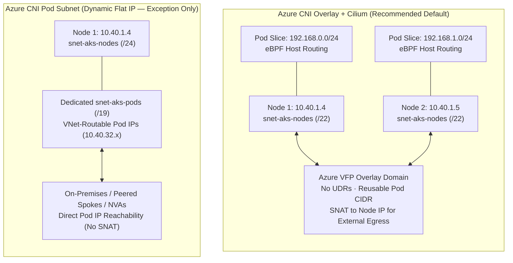
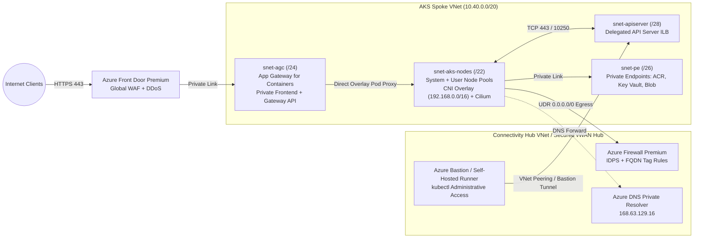

Enterprise Azure Kubernetes Service (AKS) deployments routinely fail network readiness reviews for three avoidable reasons: exhausting RFC 1918 address space with legacy flat pod IP allocation, coupling cluster ingress to retiring or control-plane-bound controllers, and leaving worker nodes with unrestricted default outbound internet access.

This chapter provides an opinionated production blueprint for **CNI and data-plane selection**, **Kubernetes Gateway API ingress with Application Gateway for Containers**, **zero-trust egress routing**, and **API Server VNet Integration**. Before sizing node and ingress subnets, review foundational CIDR planning in [VNet Sizing & IPv4/IPv6 Planning](/azure-networking/01-foundations/vnet-and-ip-addressing/) and route precedence in [Routing & Traffic Engineering](/azure-networking/01-foundations/routing-and-traffic-engineering/).

---

## 1. CNI & Data Plane Selection

AKS separates **IP Address Management (IPAM)**—how pods acquire IP addresses—from the **Linux/Windows packet data plane** that enforces service load balancing and Kubernetes `NetworkPolicy`.

### Why Azure CNI Overlay Powered by Cilium Is the Enterprise Default

**Azure CNI Overlay powered by Cilium** (`--network-plugin azure --network-plugin-mode overlay --network-dataplane cilium`) combines Azure's native overlay IPAM with an eBPF-based Linux kernel data plane—and is preconfigured by default on **AKS Automatic**.

1. **Massive VNet IP Conservation**: Worker nodes receive standard VNet subnet IPs, while pods draw from a logically isolated private CIDR (default `10.244.0.0/16`, customizable such as `192.168.0.0/16`). Each node is carved a `/24` pod slice from the overlay CIDR. Because pod CIDRs never appear on your enterprise WAN or hub route tables, **every AKS cluster across your estate can reuse the exact same pod CIDR** without IP overlap.
2. **Line-Rate Azure SDN Routing Without UDR Limits**: Unlike legacy Kubenet, Azure CNI Overlay programs pod-cidr-to-node mappings directly inside the Azure SDN Virtual Filtering Platform (VFP) fabric. No Azure Route Table UDRs are required for pod-to-pod traffic, removing the 400-route table ceiling and scaling up to **5,000 nodes** and **250 pods per node**.
3. **eBPF Data Plane & Security Enforcement**: Cilium replaces `kube-proxy` `iptables` rule chains—which degrade at $O(N)$ as services grow into the thousands—with constant-time eBPF hash-table lookups and **eBPF host routing**. It natively enforces Kubernetes `NetworkPolicy` plus `CiliumNetworkPolicy` (L3/L4, DNS/FQDN-aware egress filtering) and unlocks **Advanced Container Networking Services (ACNS)** for Hubble flow observability and FQDN policies.

### When Flat VNet Networking (Azure CNI Pod Subnet) Is Still Justified

With CNI Overlay, traffic leaving the cluster VNet (to peered spokes or on-premises networks) is SNATed to the worker node's VNet IP. Choose **Azure CNI Pod Subnet (Dynamic IP Allocation)**—where nodes live in a small node subnet and pods dynamically lease VNet-routable IPs from a dedicated pod subnet—only when you have a hard requirement for **non-SNATed, directly routable pod IPs**:

- On-premises or peered-spoke firewalls enforce security policies tied to distinct pod subnet CIDRs rather than node subnet CIDRs.
- External non-Kubernetes consumers (legacy RPC, VoIP/SIP, or peer-to-peer stateful clusters) initiate connections directly to individual pod IPs without traversing a Kubernetes `Service` or L7 gateway.
- You require Azure Firewall or a third-party NVA to forward inbound traffic directly to pod IPs without an intermediate load balancer (NVAs cannot route directly into an AKS CNI Overlay pod CIDR).

:::caution[Avoid Legacy Azure CNI Node Subnet]
Traditional **Azure CNI Node Subnet** pre-allocates `maxPods` secondary VNet IPs on every node NIC at boot time (a 10-node pool with `maxPods = 110` immediately locks **1,110 VNet IPs**—plus another full surge node's worth during upgrades). If flat pod routing is mandatory, always use **Azure CNI Pod Subnet (Dynamic IP)** so VNet IPs are allocated on demand as pods schedule.
:::

### Why Kubenet and Azure NPM Must Not Be Used

- **Kubenet retires on March 31, 2028**: Kubenet caps clusters at 400 nodes, requires platform-managed UDRs per node (breaking custom hub-spoke route tables unless carefully merged), adds extra encapsulation/hop latency, does not support Windows node pools, and is **unsupported by Application Gateway for Containers**. Migrate existing Kubenet clusters to Azure CNI Overlay well ahead of retirement.
- **Azure Network Policy Manager (NPM) is retiring**: Windows support ended on September 30, 2026, and Linux support ends on **September 30, 2028**. Standardize on **Cilium** for network policy enforcement across all new clusters.

### AKS CNI & Data Plane Decision Matrix

| Capability / Constraint | Azure CNI Overlay + Cilium | Azure CNI Pod Subnet + Cilium | Azure CNI Node Subnet (Legacy) | Kubenet (Retiring Mar 2028) |
| --- | --- | --- | --- | --- |
| **Pod IP Source** | Isolated Overlay CIDR (reusable across clusters) | Dedicated VNet Pod Subnet (dynamic) | Shared VNet Node Subnet (pre-allocated) | Isolated CIDR + Azure Route Table UDRs |
| **VNet IP Footprint (100 nodes, 100 pods/node)** | ~101 VNet IPs (+ upgrade surge) | ~101 Node IPs + active pod count in Pod Subnet | ~10,100 VNet IPs reserved up front | ~101 VNet IPs + 100 UDR routes |
| **Maximum Cluster Scale** | Up to 5,000 nodes / 250 pods per node | Scales to VNet pod subnet capacity | Severely constrained by subnet `/16`–`/20` size | Hard limit < 400 nodes (400 UDR limit) |
| **Direct External Pod IP Access** | No (use L4 ILB, AGC, or Private Link) | Yes (native VNet routing) | Yes (native VNet routing) | Requires manual UDR propagation |
| **Application Gateway for Containers** | Supported (ALB Controller >= 1.7.9) | Supported | Supported | **Not supported** |
| **Service Routing & Policy Engine** | eBPF kube-proxy replacement + Cilium L3–L7 | eBPF kube-proxy replacement + Cilium L3–L7 | Cilium or legacy `iptables`/Calico | Legacy `iptables`/Calico only |
| **Production Verdict** | **Default for 95% of enterprise clusters** | **Use only when external direct Pod IP is mandatory** | **Avoid for new deployments** | **Prohibited — migrate to CNI Overlay** |

:::tip[What I Recommend]
Deploy **Azure CNI Overlay powered by Cilium** on every new AKS Standard cluster (or adopt **AKS Automatic** where opinionated node management fits). Allocate a `/22` or `/23` VNet node subnet per cluster—providing ample room for 200–500 nodes plus `maxSurge` rolling upgrades—and standardize on a non-routable overlay CIDR such as `192.168.0.0/16` or `100.64.0.0/16` so your enterprise IPAM stays completely decoupled from pod density. Reserve **Azure CNI Pod Subnet** strictly for documented exceptions requiring direct NVA-to-pod or on-premises-to-pod L3 addressing.
:::

---

## 2. Ingress: Application Gateway for Containers & Gateway API

Kubernetes ingress architecture has undergone a generational shift away from annotation-heavy `Ingress` v1 objects and toward the role-oriented **Kubernetes Gateway API** (`GatewayClass`, `Gateway`, `HTTPRoute`, `GRPCRoute`, `TLSRoute`).

### Why Application Gateway for Containers Supersedes AGIC and Ingress-NGINX

1. **Legacy AGIC (Application Gateway v2) Bottlenecks**: AGIC translates Kubernetes endpoint changes into Azure Resource Manager (ARM) `PUT` operations against Application Gateway v2. During rapid pod autoscaling or rolling deployments, ARM control-plane throttling and 30–90 second configuration apply times can leave stale pod IPs in backend pools, causing transient `502 Bad Gateway` errors.
2. **Community Ingress-NGINX Retirement**: Upstream Kubernetes community `ingress-nginx` entered maintenance/retirement wind-down in favor of Gateway API implementations. Running self-managed reverse proxies inside worker nodes also consumes node compute, adds an extra in-cluster hop (`External LB -> NodePort -> NGINX Pod -> App Pod`), and shifts WAF patching onto application teams.
3. **Application Gateway for Containers (AGC) Data-Plane Speed**: AGC (`Microsoft.ServiceNetworking/trafficControllers`) is purpose-built for cloud-native workloads. Its in-cluster **ALB Controller** streams pod readiness and Gateway API route updates over a dedicated high-speed configuration channel—updating L7 backend targets in **near real-time (sub-second to low seconds)** without hitting ARM rate limits, while supporting mTLS, gRPC, header/traffic splitting, and Azure WAF (`SecurityPolicy` with DRS 2.1).

### Native CNI Overlay Integration & Subnet Constraints

When AGC is deployed in the same VNet as an AKS CNI Overlay cluster (with ALB Controller `>= 1.7.9`), Azure automatically extends the cluster's overlay routing domain into the AGC subnet. AGC proxies HTTP/HTTPS/gRPC requests **directly to overlay pod IPs** with zero NodePort translation.

Respect four hard architectural guardrails when designing AGC:

- **Dedicated `/24` Delegated Subnet**: Each AGC association requires its own `/24` subnet delegated to `Microsoft.ServiceNetworking/trafficControllers`. Larger (`/23`) or smaller (`/25`) prefixes are rejected for CNI Overlay upgrades.
- **Same-VNet Co-location**: AGC and AKS worker nodes **must reside in the same VNet**. Deploying AGC in a central Hub VNet and peering to an AKS Spoke VNet is **not supported**.
- **Bring-Your-Own (BYO) Provisioning Model**: Always provision the Traffic Controller, Frontend, Association, and WAF `SecurityPolicy` in Bicep/Terraform (**BYO deployment**) rather than letting in-cluster YAML (`ApplicationLoadBalancer` CRD) create Azure edge resources. Platform teams own the Azure perimeter; application teams bind `HTTPRoute` manifests in their namespaces.
- **Public vs. Private Frontend & Private Link**:
  - **Internet-facing apps**: Expose an AGC public frontend protected by Azure WAF Prevention mode and DDoS Protection (or place **Azure Front Door Premium** globally in front of a private origin via Private Link).
  - **Internal APIs & Cross-Cluster / Cross-Tenant Mesh**: Configure a **private frontend** on AGC—or front an AKS Internal Load Balancer with **Azure Private Link Service (PLS)**—so consumers in other spokes, regions, or Entra tenants connect over Private Endpoints without VNet peering or CIDR-overlap constraints (see [Private Link & DNS at Scale](/azure-networking/04-network-security/private-link-and-dns-at-scale/)).

### AKS Ingress Architecture Comparison

| Criterion | Application Gateway for Containers (AGC) | Istio Add-on / Envoy Gateway (Behind Azure ILB/PLB) | Legacy AGIC (AppGW v2) | Community Ingress-NGINX |
| --- | --- | --- | --- | --- |
| **Primary API Standard** | **Gateway API** (`Gateway`, `HTTPRoute`, `GRPCRoute`) + Ingress | Gateway API / Istio `VirtualService` | Legacy `Ingress` v1 + proprietary annotations | Legacy `Ingress` v1 + NGINX snippet annotations |
| **Backend Update Latency** | Near real-time data-plane streaming (no ARM bottleneck) | Sub-second in-cluster Envoy EDS updates | Slow (ARM control-plane `PUT`, 30–90s under churn) | Sub-second in-cluster reload (risk of reload drops) |
| **CNI Overlay Direct-to-Pod** | Native fabric extension to `/24` AGC subnet | Via Standard LB -> Node -> Envoy Pod -> App Pod | Supported (v1.9.1+, same VNet `/24` subnet) | Via Standard LB -> Node -> NGINX Pod -> App Pod |
| **Integrated Azure WAF** | Native (`SecurityPolicy` + WAF Policy DRS 2.1) | Requires Front Door WAF or upstream AppGW WAF | Native AppGW WAF v2 | ModSecurity deprecated / unsupported |
| **Private Link Exposure** | Native Private Frontend + Private Endpoints | Standard ILB + Private Link Service (`azure-pls-create`) | Complex (AppGW Private Link preview/constraints) | Standard ILB + Private Link Service |
| **Recommended Role** | **Default managed L7 North-South edge & WAF** | **East-West mTLS service mesh or multi-cloud L7** | **Legacy brownfield only** | **Decommission / migrate to Gateway API** |

:::tip[What I Recommend]
Standardize on **Application Gateway for Containers (BYO deployment model)** using the **Kubernetes Gateway API** (`Gateway` in a platform-owned infra namespace, `HTTPRoute` delegated to app namespaces). Carve a dedicated `/24` subnet delegated to `Microsoft.ServiceNetworking/trafficControllers` inside every AKS spoke VNet during initial VNet creation—even if initial workloads are L4-only—so adding managed L7 WAF ingress later requires zero VNet CIDR refactoring.
:::

---

## 3. Zero-Trust Egress & Control Plane Isolation

### Controlling Outbound Traffic (`outboundType`)

By default, AKS provisions a public Standard Load Balancer (`--outbound-type loadBalancer`) with a single outbound public IP, providing only a fraction of total SNAT ports per node and bypassing central firewall telemetry. Moreover, Azure subnets created under post-March 2026 API defaults enforce `defaultOutboundAccess: false` unless explicit egress is defined.

Choose between two production egress patterns:

1. **`userDefinedRouting` (UDR) via Hub Firewall or Secured Virtual WAN (Enterprise Standard)**:
   - Deploying with `--outbound-type userDefinedRouting` prevents AKS from creating any outbound public IP on the cluster Load Balancer.
   - Associate a route table (or Virtual WAN Routing Intent `InternetTraffic` policy; see [Virtual WAN & Routing Intent](/azure-networking/02-core-topologies/virtual-wan-and-routing-intent/)) steering `0.0.0.0/0` to **Azure Firewall** or a third-party NGFW (see [Firewall & NVA Patterns](/azure-networking/04-network-security/firewall-and-nva-patterns/)).
   - **Mandatory FQDN & Network Rules**: Permit the `AzureKubernetesService` FQDN tag on HTTPS `443`, `mcr.microsoft.com` and `*.data.mcr.microsoft.com` (unless fully air-gapped with ACR artifact cache + Private Link), NTP (`UDP 123`), and OS security repo FQDNs. When using Azure Firewall FQDN filtering in Network Rules, enable **DNS Proxy** or resolve via **Azure DNS Private Resolver** ([DNS & Private Resolver](/azure-networking/01-foundations/dns-and-private-resolver/)).
   - **Asymmetric Routing Trap**: Never place a `0.0.0.0/0 -> VirtualAppliance` UDR on a public ingress subnet (such as AGC with a public frontend or a public Standard Load Balancer without inbound DNAT at the firewall). Inbound client packets arriving directly on a spoke public IP will have their SYN-ACK replies hairpinned to the hub firewall and dropped due to missing session state. Either keep `0.0.0.0/0` off the dedicated `/24` AGC public subnet, or front ingress through Azure Front Door -> Private Link -> private AGC frontend!
2. **`managedNATGateway` / `userAssignedNATGateway`**:
   - Attach an Azure NAT Gateway (up to 16 public IPs = **1,024,000 ephemeral SNAT ports** shared dynamically across the subnet) when workloads generate massive outbound HTTPS connection rates to partner APIs and security policy permits direct breakout without L7 proxy inspection—or pair NAT Gateway on the Hub Firewall subnet itself to scale Azure Firewall SNAT capacity.

### API Server Isolation: VNet Integration vs. Legacy Private Cluster

Never expose the Kubernetes API server (`:443`) to `0.0.0.0/0` in production. AKS offers two private control-plane architectures:

| Feature | API Server VNet Integration (`--enable-apiserver-vnet-integration`) | Legacy Private Cluster (Private Endpoint Model) |
| --- | --- | --- |
| **Data-Plane Plumbing** | Injects `kube-apiserver` Internal Load Balancer directly into a `/28`+ subnet delegated to `Microsoft.ContainerService/managedClusters` | Exposes control plane via Private Link Service + Private Endpoint NIC dropped into first node pool subnet |
| **Private DNS Dependency** | **None required inside the VNet/peered spokes**; optional custom Private Link Service + DNS for cross-tenant/non-peered CI/CD | **Mandatory** `privatelink.<region>.azmk8s.io` Private DNS zone linked to hub & DNS resolvers before cluster boots |
| **Public/Private Toggle** | Can dynamically add/remove public API endpoint post-creation without rebuilding cluster | Immutable at cluster creation |
| **Required NSG Rules (if NSG attached)** | Allow Nodes -> APIServer `TCP 443, 4443`; APIServer -> Nodes `TCP 10250` (`kubelet`); `AzureLoadBalancer` -> APIServer `TCP 9988` | Standard Private Endpoint NSG behavior |

:::tip[What I Recommend]
1. **Control Plane**: Use **Private Cluster with API Server VNet Integration** (`--enable-private-cluster --enable-apiserver-vnet-integration`) in a dedicated `/28` delegated subnet. It eliminates fragile `privatelink.<region>.azmk8s.io` bootstrap race conditions between platform DNS teams and cluster Terraform/Bicep pipelines, and works seamlessly with **Azure Bastion native AKS tunneling** or a customer-owned Private Link Service for central GitOps runners.
2. **Egress & Registry**: Pair `--outbound-type userDefinedRouting` through Azure Firewall (or vWAN Secured Hub) with **Private Endpoints** for Azure Container Registry (`privatelink.azurecr.io`), Azure Key Vault (`privatelink.vaultcore.azure.net`), and Storage—keeping image pulls and secret mounts off the firewall data-processing meter entirely.
3. **Identity Race Prevention**: Always pre-create a **User-Assigned Managed Identity** and grant it `Network Contributor` scoped to the cluster VNet/subnets (`snet-aks-nodes`, `snet-apiserver`, `snet-ilb`) *before* `az aks create` so internal load balancer and route operations never fail on RBAC propagation delays.
:::

---

## 4. Hands-On Validation

Deploy and test Azure CNI Overlay, Azure CNI Powered by Cilium, Application Gateway for Containers (`Gateway` and `HTTPRoute`), and `userDefinedRouting` egress lockdown using the runnable scripts and manifests in **[`labs/aks`](https://github.com/jonathan-vella/azure-networking/tree/main/labs/aks)**. For execution walkthroughs and cost-cleanup discipline, see the [Labs & Operational Tools Guide](/azure-networking/06-operations-reviews/labs-and-tools-guide/).
