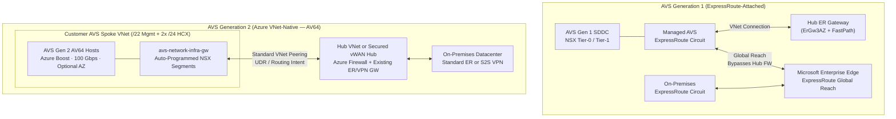
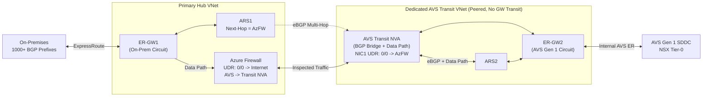
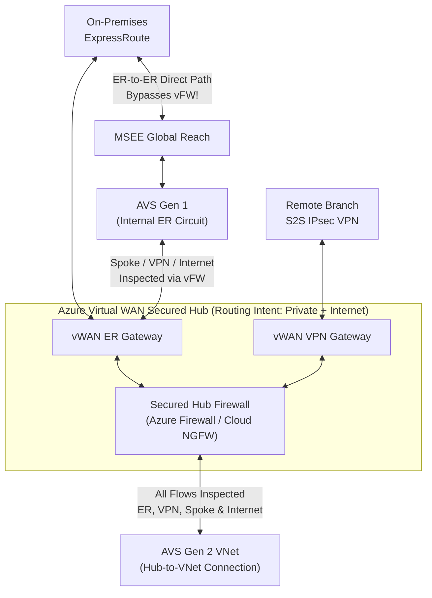

Azure VMware Solution (AVS) runs dedicated VMware vSphere, vSAN, vCenter, HCX, and NSX software-defined datacenters (SDDCs) on bare-metal Azure hosts. Historically, integrating AVS into enterprise Hub-and-Spoke or Virtual WAN topologies was one of the trickiest routing exercises in Azure because AVS operated outside Virtual Networks behind a dedicated internal ExpressRoute circuit.

Today, architects must evaluate two fundamentally different network attachment models—**AVS Generation 1 (ExpressRoute-attached)** and **AVS Generation 2 (Azure VNet-native)**—before designing hybrid transit, East-West firewall inspection, and internet breakout.

---

## 1. AVS Networking Evolution: Generation 1 vs. Generation 2

### AVS Generation 1: Dedicated Stamp + Internal ExpressRoute + Global Reach

In **AVS Generation 1** (`AV36`, `AV36P`, `AV48`, `AV52`, and `AV64` expansion clusters), the bare-metal cluster resides in a dedicated AVS stamp outside your Azure Virtual Networks:

- **AVS-to-VNet Path**: Microsoft provisions a managed **internal ExpressRoute circuit** bundled with the AVS private cloud at no extra circuit fee. You redeem an authorization key against an ExpressRoute Virtual Network Gateway in your Hub VNet or Virtual WAN Hub (supporting up to 4 AVS connections per gateway; production workloads should use `ErGw3AZ` / `UltraPerformance` with **ExpressRoute FastPath** enabled—see [ExpressRoute FastPath & Gateway SKUs](/azure-networking/03-hybrid-connectivity/expressroute-fastpath-and-skus/)).
- **AVS-to-On-Premises Path**: Because an Azure ExpressRoute Gateway **never** performs transitive routing between two attached ExpressRoute circuits, connecting an on-premises datacenter ExpressRoute circuit directly to AVS Gen 1 requires **ExpressRoute Global Reach**, which peers both circuits directly at the Microsoft Enterprise Edge (MSEE) routers (see [ExpressRoute Resiliency](/azure-networking/03-hybrid-connectivity/expressroute-resiliency/)).
- **The Inspection & Regional Challenge**: Global Reach traffic hairpins at MSEE and **bypasses** firewalls inside your Hub VNet or Virtual WAN Hub. Furthermore, in sovereign or commercial regions where Global Reach is unavailable—or when security mandates centralized firewall inspection between on-premises and AVS—you must engineer explicit BGP/UDR transit hairpins using **Azure Route Server (ARS)** and Network Virtual Appliances (NVAs).

### AVS Generation 2: Azure VNet-Native Architecture (`AV64`)

**AVS Generation 2** modernizes the platform by deploying dedicated **AV64** bare-metal hosts (powered by Azure Boost with vSAN Express Storage Architecture and 100 Gbps host networking) **directly inside a customer-owned Azure Virtual Network**:

- **Zero Internal ExpressRoute or Global Reach Overhead**: Gen 2 eliminates the dedicated backend AVS ExpressRoute circuit and removes the Global Reach requirement for on-premises reachability.
- **Automatic NSX-to-VNet Route Programming**: You allocate a non-overlapping `/22` RFC 1918 block (excluding `172.17.0.0/16`) for SDDC management subnets plus two `/24` subnets for VMware HCX management and uplink. When administrators create NSX Tier-0/Tier-1 workload segments (or HCX Mobility Optimized Networking `/32` host routes), the AVS control plane automatically adds those prefixes to the VNet address space and programs them onto the system-managed `avs-network-infra-gw` subnet.
- **Standard Azure Networking Semantics**: Because AVS Gen 2 lives natively inside a Spoke VNet, it reaches other spokes via standard VNet peering, connects to on-premises via your existing Hub ExpressRoute or Site-to-Site VPN Gateway, enforces subnet-level NSGs, and routes outbound or East-West traffic through **Azure Firewall** or **Virtual WAN Secured Hubs** using standard UDRs or Routing Intent—no Azure Route Server or BGP helper NVAs required.

### AVS Generation 1 vs. Generation 2 Comparison

| Architectural Dimension | AVS Generation 1 | AVS Generation 2 (VNet-Native) |
| --- | --- | --- |
| **Supported Host SKUs** | `AV36`, `AV36P`, `AV48`, `AV52` (plus `AV64` expansion on Gen 1 seed cluster) | Direct `AV64` deployment (3-host minimum; no legacy seed cluster needed) |
| **Storage & Host Fabric** | vSAN OSA; 25 Gbps–50 Gbps class networking | vSAN ESA; Azure Boost 100 Gbps host networking |
| **Azure VNet Connectivity** | Backend ExpressRoute circuit -> ExpressRoute VNet Gateway | Deployed natively inside customer VNet (`avs-network-infra-gw`) |
| **On-Premises Connectivity** | ExpressRoute Global Reach (or complex ARS + NVA transit VNet) | Existing Hub ExpressRoute Gateway or Site-to-Site VPN Gateway |
| **Availability Zone Alignment** | Stamp-assigned by platform | Optional explicit Availability Zone selection to co-locate with zonal gateways/ANF |
| **Internet Egress Options** | Hub FW/NVA (`0.0.0.0/0` via BGP), NSX Edge Public IP, or Managed SNAT | Standard VNet UDR to Hub Azure Firewall/NVA, or Virtual WAN Secured Hub |
| **Key Guardrails & Constraints** | 4 AVS circuits per ER Gateway (use AVS Interconnect above 4); Global Reach skips Hub FW | Supported regions only; 1 private cloud per VNet & RG (same RG required for VNet/PC/NSGs); no NSX Public IP; no Custom DNS on host VNet with Private DNS; FastPath & Global Peering require support ticket |

:::tip[What I Recommend]
**Default to AVS Generation 2 (`AV64`)** for all greenfield private cloud deployments in supported regions. Gen 2 eliminates ExpressRoute Global Reach blind spots, removes Azure Route Server + helper NVA complexity for firewall inspection, unlocks explicit Availability Zone alignment for ultra-low latency to Azure NetApp Files and spoke VMs, and lets your existing Hub-and-Spoke or Virtual WAN Secured Hub inspect all AVS traffic natively. Use **AVS Generation 1** only when extending an existing Gen 1 footprint, deploying in a region where Gen 2 is not yet available, or requiring features currently limited to Gen 1 (such as Public IPs terminated directly on the NSX-T Edge).
:::

---

## 2. AVS Internet Breakout Options

Every AVS design must choose how workload VMs access public internet endpoints (OS repositories, SaaS APIs, or inbound published services):

| Option | Supported Gen | How It Works | Strengths | Limitations & When to Avoid |
| --- | --- | --- | --- | --- |
| **1. Centralized Hub Firewall / NGFW** | **Gen 1 & Gen 2** | **Gen 2**: UDR (`0.0.0.0/0`) or vWAN Routing Intent. **Gen 1**: Hub ARS or vWAN Secured Hub advertises `0.0.0.0/0` over BGP into AVS. | Unified enterprise L7 FQDN filtering, IDPS, TLS inspection, and SIEM logging across VNets and AVS. | Gen 1 Hub-and-Spoke requires ARS + BGP speaker to inject `0.0.0.0/0`. |
| **2. Public IP to NSX-T Edge** | **Gen 1 Only** | Allocates up to 64 Azure Public IPs directly onto the AVS NSX Tier-0 gateway for SNAT/DNAT or 3rd-party NVAs inside vSphere. | High SNAT scale; supports inbound DNAT, L7 load balancers, and VMware-hosted NGFWs directly inside SDDC. | **Not supported on Gen 2**; creates a separate perimeter outside central Azure Firewall governance. |
| **3. AVS Managed SNAT** | **Gen 1 Only** | Turnkey Microsoft-managed NAT gateway in the AVS portal using two rotating public IPs (128K SNAT ports). | One-click enablement for basic outbound OS patching or HCX activation. | No inbound DNAT, no granular FQDN filtering, no deterministic static source IP allowlisting. |

---

## 3. AVS Gen 1 Hub-and-Spoke Transit Patterns (Azure Route Server)

When running **AVS Generation 1** alongside a customer-managed Hub-and-Spoke topology (see [Hub-Spoke & Azure Route Server](/azure-networking/02-core-topologies/hub-spoke-and-route-server/)), ExpressRoute Gateways do not originate a `0.0.0.0/0` default route and do not route between two ExpressRoute circuits. You solve this with **Azure Route Server (ARS)** using one of two architectural patterns.

### Pattern 1: Single Hub VNet with ARS

In a single Hub VNet hosting the ExpressRoute Gateway, ARS (`Branch-to-Branch` enabled), and a central Firewall:

- **With Global Reach Enabled (`Spoke <-> AVS` & `AVS -> Internet` Inspection)**:
  - **Firewall NVA (BGP-capable)**: The NVA peers with ARS over eBGP and advertises `0.0.0.0/0`, which ARS propagates across the AVS ExpressRoute connection. *Critical*: Disable **Gateway Route Propagation** on the NVA's untrusted/internet NIC so ARS does not overwrite the NVA's own internet breakout route and cause a blackhole loop.
  - **Azure Firewall + Control-Plane Routing NVA**: Because Azure Firewall does not speak BGP, deploy a lightweight redundant Linux routing NVA (such as BIRD—see [`samples/bgp-bird`](/azure-networking/06-operations-reviews/labs-and-tools-guide/)) that peers with ARS and uses the **ARS Next-Hop IP** capability to advertise `0.0.0.0/0` with `next-hop = <AzureFirewallPrivateIP>`. The routing NVA stays **100% out of the data path**!
  - **Mandatory Hub & Spoke UDRs**:
    1. Attach a route table to `AzureFirewallSubnet` with `0.0.0.0/0 -> Internet` so ARS does not program the Firewall's own `0.0.0.0/0` route back onto `AzureFirewallSubnet`.
    2. Disable **Gateway Route Propagation** on Spoke subnets and enforce `0.0.0.0/0 -> <FirewallPrivateIP>` via Spoke UDRs.
    3. Place exact Spoke CIDR UDRs on `GatewaySubnet` (`Never` < `/26` without room) pointing to `<FirewallPrivateIP>`—because VNet peering system routes take precedence over ARS BGP routes even when ARS advertises longer prefixes!
- **Without Global Reach (The "Supernet Hairpin" Variant & Its 400-UDR Ceiling)**:
  - If Global Reach is unavailable or security requires inspecting `On-Premises <-> AVS` traffic in the Single Hub VNet, the NVA must advertise **less-specific supernets** encompassing AVS and On-Premises CIDRs to ARS (avoiding BGP loops), while `GatewaySubnet` uses **exact-match UDRs** for every individual On-Premises, AVS, and Spoke prefix pointing to the Firewall.
  - **Hard Scale Limit**: Azure Route Tables support at most **400 UDRs**. Whenever `(On-Premises BGP prefixes + AVS NSX segments + Spoke prefixes) > 400`, the Single-Hub Supernet Hairpin breaks. Use **Pattern 2** instead.

### Pattern 2: Hub VNet + Dedicated AVS Transit VNet (Scalable Non-Global-Reach Inspection)

When Global Reach cannot be used (either due to regional regulation or mandatory firewall inspection of `On-Premises <-> AVS` flows) and on-premises advertises hundreds or thousands of prefixes, decouple the two ExpressRoute circuits into separate VNets:

1. **Hub VNet**: Terminates the **On-Premises ExpressRoute circuit** on `ER-GW1` with `ARS1` and hosts **Azure Firewall** (or your primary Firewall NVA).
2. **AVS Transit VNet**: Peered to the Hub VNet (*without* Gateway Transit) and terminates the **AVS Gen 1 ExpressRoute circuit** on `ER-GW2` with `ARS2` plus an **AVS Transit NVA** (`Active/Standby` or symmetric cluster).
3. **Control & Data Plane Flow (Azure Firewall Variant)**:
   - `ARS2` learns exact AVS NSX segment routes from `ER-GW2` and advertises them to the `AVS Transit NVA`.
   - The `AVS Transit NVA` advertises `0.0.0.0/0` + AVS prefixes to `ARS1` in the Hub VNet, rewriting **Next-Hop IP = `<AzureFirewallPrivateIP>`** so both On-Premises (`ER-GW1`) and Spokes steer AVS-bound and internet-bound traffic into Azure Firewall.
   - `ARS1` advertises full On-Premises + Hub/Spoke prefixes to the `AVS Transit NVA`, which re-advertises them unmodified to `ARS2` -> `ER-GW2` -> AVS (preserving 100% route granularity during HCX migration waves with zero 400-UDR limit on `GatewaySubnet`!).
   - Enforce UDRs on `AzureFirewallSubnet` (`0.0.0.0/0 -> Internet` and `AVS summary/segments -> AVS Transit NVA`), and place `0.0.0.0/0 -> AzureFirewallPrivateIP` with **Gateway Route Propagation disabled** on the `AVS Transit NVA` NIC facing `ARS1`.

---

## 4. Azure Virtual WAN Secured Hub Transit & Caveats

Integrating AVS with **Azure Virtual WAN Standard** ([Virtual WAN & Routing Intent](/azure-networking/02-core-topologies/virtual-wan-and-routing-intent/)) differs sharply between Gen 1 and Gen 2:

- **AVS Gen 2 Attached as a Spoke VNet**: Connect the AVS Gen 2 VNet via a standard Hub-to-VNet connection. Enabling **Routing Intent** (`PrivateTraffic` + `InternetTraffic`) on the Secured Virtual Hub automatically inspects **all** `AVS Gen 2 <-> On-Premises (ER or VPN)`, `AVS Gen 2 <-> Spoke VNet`, `Inter-Hub`, and `AVS Gen 2 -> Internet` flows through Azure Firewall or Cloud NGFW—with zero Global Reach or NVA workarounds.
- **AVS Gen 1 Attached to vWAN ExpressRoute Gateway**:
  - **Internet & Spoke Inspection Works Natively**: Secured Virtual Hub Routing Intent (`InternetTraffic` and `PrivateTraffic`) advertises `0.0.0.0/0` and RFC 1918 summaries to AVS Gen 1, inspecting `AVS <-> Spoke VNet` and `AVS <-> VPN/SD-WAN Branch` traffic through the hub firewall.
  - **The ER-to-ER Caveat**: A Virtual WAN ExpressRoute Gateway **still cannot transit natively between two ExpressRoute circuits** (On-Premises ER <-> AVS Gen 1 ER) without **ExpressRoute Global Reach**. Once Global Reach is enabled between the two circuits, `On-Premises <-> AVS Gen 1` traffic takes the MSEE Global Reach shortcut—**bypassing the vWAN Hub Firewall** even when Routing Intent is active! If `On-Premises ER <-> AVS Gen 1` traffic *must* be inspected by a firewall, enforce Layer 4–7 distributed/gateway firewalling on **VMware NSX inside AVS**, or terminate the AVS Gen 1 ER circuit in a dedicated Transit Spoke VNet with a BGP-peered NVA connected to the vWAN hub.

### AVS Transit Architecture Summary Matrix

| Topology Pattern | Max On-Prem Prefixes | Inspects `Spoke <-> AVS` | Inspects `On-Prem ER <-> AVS` | Operational Complexity |
| --- | --- | --- | --- | --- |
| **AVS Gen 2 + Hub Firewall or vWAN Routing Intent** | Standard ER GW limits (up to 1,000) | Yes (native) | **Yes (native)** | **Low (Recommended)** |
| **AVS Gen 1 + Single Hub ARS + Global Reach** | Standard ER limits | Yes | No (Global Reach bypasses Hub FW; use NSX DFW/GFW) | Medium |
| **AVS Gen 1 + Single Hub Supernet Hairpin (No GR)** | **Hard cap < 400 total UDRs** | Yes | Yes (hairpins ER-GW -> FW) | High (brittle UDR maintenance) |
| **AVS Gen 1 + Hub VNet + Dedicated AVS Transit VNet** | 1,000+ BGP prefixes | Yes | **Yes (scales without Global Reach)** | High (dual ER-GW + dual ARS + NVA) |
| **AVS Gen 1 + vWAN Secured Hub + Global Reach** | Standard vWAN ER limits | Yes (Routing Intent) | No (Global Reach bypasses vWAN FW; use NSX DFW/GFW) | Low–Medium |

:::tip[What I Recommend]
1. **New Deployments**: Choose **AVS Generation 2** in a dedicated Resource Group and Spoke VNet, peer it to your Hub VNet or **Virtual WAN Secured Hub**, and let standard UDRs or **Routing Intent** handle both internet breakout and `On-Premises <-> AVS` inspection cleanly.
2. **Existing AVS Gen 1 with Global Reach**: Keep **ExpressRoute Global Reach** enabled for low-latency vMotion/HCX replication between on-premises and AVS, enforce East-West and North-South microsegmentation using **VMware NSX Distributed Firewall (DFW) and Gateway Firewall**, and use **Virtual WAN Routing Intent** (or Single-Hub ARS + Routing NVA Next-Hop IP) solely for `AVS <-> Spoke` and `AVS -> Internet` inspection.
3. **AVS Gen 1 Where Global Reach Is Unavailable or Hub Inspection Is Mandatory**: Never rely on the `< 400` UDR Single-Hub Supernet Hairpin in enterprise networks—deploy the **Dedicated AVS Transit VNet (`ARS1` + `ARS2`)** pattern so on-premises BGP growth never triggers a `GatewaySubnet` outage.
:::
