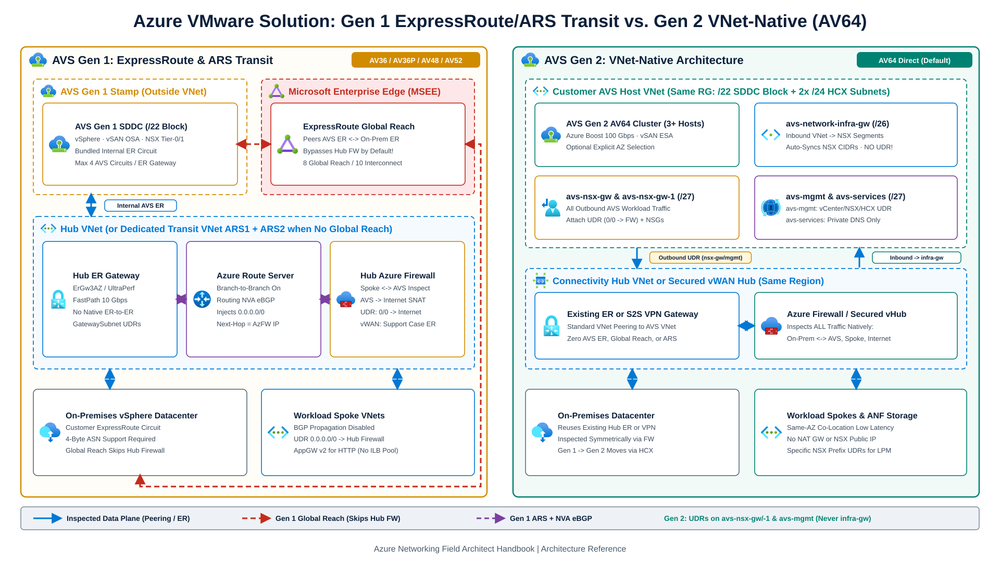
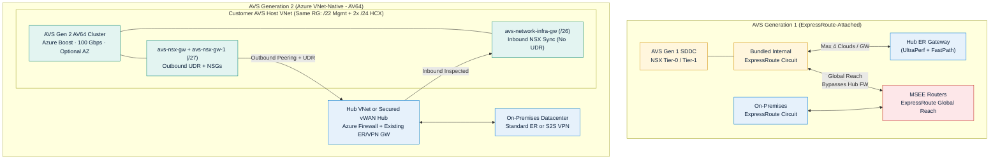
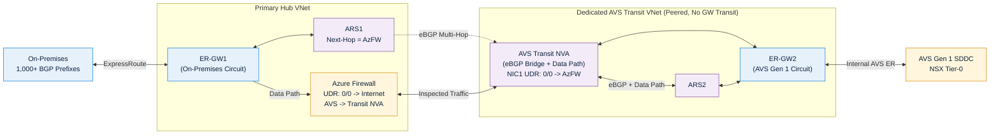
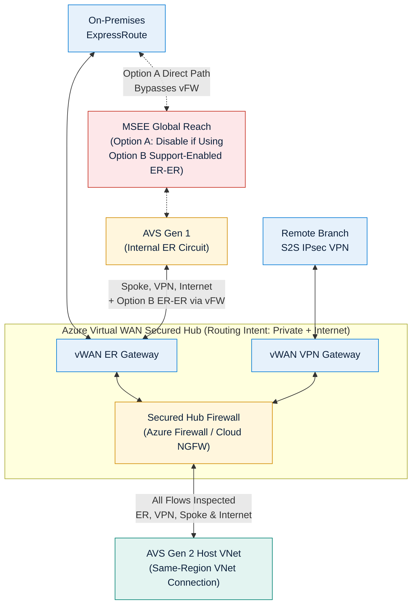

[Azure VMware Solution (AVS)](https://learn.microsoft.com/en-us/azure/azure-vmware/introduction) runs dedicated VMware vSphere, vSAN, vCenter Server, HCX, and NSX software-defined datacenters (SDDCs) on bare-metal Azure hosts. Historically, integrating AVS into enterprise Hub-and-Spoke or Virtual WAN topologies required specialized BGP engineering because AVS operated outside Virtual Networks behind a dedicated internal ExpressRoute circuit.

Architects now choose between two distinct network attachment models in the [Cloud Adoption Framework for AVS](https://learn.microsoft.com/en-us/azure/cloud-adoption-framework/azure-vmware-solution/architecture-landing-zone): **AVS Generation 1 (ExpressRoute-attached)** and **AVS Generation 2 (Azure VNet-native)**. Make this choice before deployment, because moving between Gen 1 and Gen 2 requires a **[VMware HCX workload migration](https://learn.microsoft.com/en-us/azure/azure-vmware/migrate-between-private-clouds)** rather than an in-place conversion.

---

## 1. AVS Networking Evolution: Generation 1 vs. Generation 2

### AVS Generation 1: Dedicated Stamp + Internal ExpressRoute + Global Reach

In **[AVS Generation 1](https://learn.microsoft.com/en-us/azure/azure-vmware/architecture-networking)** (`AV36`, `AV36P`, `AV48`, `AV52`, plus `AV64` expansion clusters added onto a 3-host Gen 1 seed cluster), the bare-metal cluster resides in a dedicated stamp outside your Azure Virtual Networks:

- **AVS-to-VNet Path**: Microsoft bundles a managed **internal ExpressRoute circuit** with each Gen 1 private cloud at no extra circuit port charge. You redeem an authorization key against an ExpressRoute Virtual Network Gateway in your Hub VNet or Virtual WAN Hub. A single VNet ExpressRoute Gateway accepts up to **4 AVS private cloud connections** from one location. Above 4 private clouds in the same region, aggregate connectivity with **[AVS Interconnect](https://learn.microsoft.com/en-us/azure/azure-vmware/connect-multiple-private-clouds-same-region)** (up to 10 non-transitive links per private cloud; verify non-overlapping NSX CIDRs manually). Production deployments should use `ErGw3AZ` or `UltraPerformance` with **ExpressRoute FastPath** enabled for 10 Gbps throughput; see [ExpressRoute FastPath & Gateway SKUs](/azure-networking/03-hybrid-connectivity/expressroute-fastpath-and-skus/).
- **AVS-to-On-Premises Path**: Because an Azure ExpressRoute Gateway never transits packets directly between two attached ExpressRoute circuits, connecting an on-premises ExpressRoute circuit to AVS Gen 1 uses **[ExpressRoute Global Reach](https://learn.microsoft.com/en-us/azure/azure-vmware/tutorial-expressroute-global-reach-private-cloud)**. Each private cloud supports up to **8 Global Reach connections**, and all provider/edge routers must support 4-byte BGP ASNs; see [ExpressRoute Resiliency](/azure-networking/03-hybrid-connectivity/expressroute-resiliency/). Also note that AVS discards a bare `0.0.0.0/0` route from on-premises for SDDC management reachability unless specific on-premises RFC 1918 prefixes are advertised alongside it.
- **Inspection & Load Balancing Constraints**: Global Reach peers both circuits directly at the Microsoft Enterprise Edge (MSEE) routers and **bypasses** firewalls inside your Hub VNet. In regions where Global Reach is unavailable due to local regulation, or where security policy mandates hub firewall inspection between on-premises and AVS, you must build explicit BGP transit using **Azure Route Server (ARS)** and Network Virtual Appliances (NVAs) or enable Virtual WAN Routing Intent ER-to-ER support via a Microsoft Support case. Finally, **Azure Internal Load Balancer cannot target AVS VMs** because IP-based ILB pools do not support non-Azure VM objects; use **[Application Gateway v2](https://learn.microsoft.com/en-us/azure/azure-vmware/protect-azure-vmware-solution-with-application-gateway)** when publishing AVS HTTP/HTTPS workloads through Azure native load balancing.

### AVS Generation 2: Azure VNet-Native Architecture (`AV64`)

**[AVS Generation 2](https://learn.microsoft.com/en-us/azure/azure-vmware/native-introduction)** deploys dedicated **`AV64`** bare-metal hosts (3-host minimum, Azure Boost 100 Gbps networking, vSAN Express Storage Architecture, and optional explicit Availability Zone selection) **directly inside a customer-owned Azure Virtual Network**:

- **Native VNet Peering & Hybrid Reuse**: Gen 2 eliminates the internal AVS ExpressRoute circuit and the Global Reach requirement. Your AVS private cloud reaches peered spokes via standard VNet peering and reaches on-premises datacenters through your existing Hub ExpressRoute Gateway or Site-to-Site VPN Gateway.
- **Address Space & Reserved CIDRs**: Per [AVS Gen 2 network design considerations](https://learn.microsoft.com/en-us/azure/azure-vmware/native-network-design-consideration), allocate a dedicated non-overlapping **`/22` RFC 1918 block** (excluding `172.17.0.0/16`) **plus two `/24` subnets** for VMware HCX management and uplink. Inside the `/22` block, Azure automatically provisions system-managed subnets including `avs-mgmt`, `avs-vnet-sync`, `avs-services`, `avs-nsx-gw`, `avs-nsx-gw-1`, `avs-network-infra-gw`, and ESXi `vmk1`/`vmk2`/`vmk3` networks. Never overlap NSX internal reserved ranges: `169.254.0.0/24`, `169.254.2.0/23`, `100.64.0.0/16`, and `100.73.x.x`.
- **Inbound vs. Outbound Gateway Subnets (Critical UDR Rule)**:
  - **`avs-network-infra-gw` (`/26`, Inbound Only)**: When you create NSX Tier-0/Tier-1 workload segments (or static routes), the AVS control plane automatically adds those prefixes to the VNet address space and assigns them as secondary IPs on `avs-network-infra-gw`. **Never attach an Azure Route Table (UDR) to `avs-network-infra-gw`!**
  - **`avs-nsx-gw` & `avs-nsx-gw-1` (`/27` each) + `avs-mgmt` (`/27`, Outbound UDRs)**: All outbound traffic from AVS workload VMs to the VNet, peered spokes, on-premises, and the internet exits through `avs-nsx-gw` and `avs-nsx-gw-1` (while vCenter, NSX Manager, and HCX Manager egress via `avs-mgmt`). Attach your `0.0.0.0/0 -> <FirewallPrivateIP>` UDR route tables and customer NSGs to **`avs-nsx-gw`, `avs-nsx-gw-1`, and `avs-mgmt`** ([AVS Gen 2 internet connectivity](https://learn.microsoft.com/en-us/azure/azure-vmware/native-internet-connectivity-design-considerations)).
  - **Specific Prefix UDRs for Peered Inspection**: Current AVS Gen 2 synchronizes both the broader VNet address space and **specific NSX segment subnet routes** across VNet peering. If you use hub/gateway UDRs to steer `On-Premises -> AVS` traffic through a firewall, include **specific NSX segment subnet routes** (rather than only a summary supernet) so Longest Prefix Match does not bypass the firewall.
- **Resource Group & Operational Guardrails**:
  - **Co-Located Resource Group Boundary**: Limit deployments to **1 private cloud per VNet and per Resource Group**, keeping the Private Cloud, host VNet, NSGs, and UDR Route Tables inside that single Resource Group. Cross-RG or cross-subscription links (such as central DDoS plans or UDRs) break NSX route synchronization unless `AzS VIS Prod App` holds the `AVS on Fleet VIS Role`. Temporarily exempt the AVS RG from strict naming-convention Azure Policies on NSGs and route tables during initial deployment.
  - **DNS, NAT & Support-Gated Features**: Do **not** configure Custom DNS on the AVS Gen 2 host VNet when using AVS Private DNS (doing so breaks scaling and upgrades). **Azure NAT Gateway** and **Public IP down to NSX Edge** are unsupported on Gen 2. Open an Azure Support Case if you require **ExpressRoute FastPath**, **Global VNet Peering**, cross-region Virtual WAN hub peering, or peered-VNet reachability to `/32` NSX routes (such as HCX Mobility Optimized Networking).

### AVS Generation 1 vs. Generation 2 Comparison

| Architectural Dimension | AVS Generation 1 | AVS Generation 2 (VNet-Native) |
| --- | --- | --- |
| **Supported Host SKUs** | `AV36`, `AV36P`, `AV48`, `AV52` (plus `AV64` expansion on 3-host Gen 1 seed) | Direct `AV64` deployment (3-host minimum; no legacy seed cluster) |
| **Storage & Host Networking** | vSAN OSA; four 25 Gbps NICs per host | vSAN ESA; Azure Boost 100 Gbps host networking |
| **Azure VNet Connectivity** | Bundled internal ExpressRoute circuit -> ExpressRoute VNet Gateway | Deployed directly inside customer VNet (`avs-network-infra-gw` / `avs-nsx-gw`) |
| **On-Premises Connectivity** | ExpressRoute Global Reach (or ARS + NVA transit / vWAN support case) | Existing Hub ExpressRoute Gateway or Site-to-Site VPN Gateway |
| **Availability Zone Alignment** | Platform-assigned stamp | Optional explicit Availability Zone selection to co-locate with zonal gateways/ANF |
| **Internet Egress Options** | Hub FW/NVA (`0.0.0.0/0` via BGP), NSX Edge Public IP (up to 2,000 IPs), or Managed SNAT | VNet UDR on `avs-nsx-gw`/`avs-nsx-gw-1`/`avs-mgmt` to Hub Firewall/NVA, or Secured vHub |
| **Key Guardrails & Constraints** | 4 AVS circuits per ER Gateway (AVS Interconnect above 4); Global Reach bypasses Hub FW | Specific regions; 1 cloud per VNet & RG (same RG for VNet/PC/UDR/NSG); no NAT GW or NSX Public IP; no Custom VNet DNS with Private DNS; support case for FastPath, Global Peering, `/32` peered MON |

:::tip[What I Recommend]
**Default to AVS Generation 2 (`AV64`)** for all greenfield private cloud deployments in supported regions. Place each AVS Gen 2 private cloud in a dedicated Workload Landing Zone subscription and dedicated Resource Group containing its host VNet, NSGs, and UDR tables, and select the exact Availability Zone matching your zonal ExpressRoute Gateway and Azure NetApp Files datastores. Choose **AVS Generation 1** only when extending an existing Gen 1 estate, deploying in a region not yet enabled for Gen 2, or requiring Gen 1-only features such as Zerto DR, stretched clusters, or Public IPs terminated directly on the NSX Edge.
:::

---

## 2. AVS Internet Breakout Options

Every AVS design must define how workload VMs access public internet endpoints or publish inbound services ([AVS internet connectivity design](https://learn.microsoft.com/en-us/azure/azure-vmware/architecture-design-public-internet-access)):

| Option | Supported Gen | How It Works | Strengths | Limitations & When to Avoid |
| --- | --- | --- | --- | --- |
| **1. Centralized Hub Firewall / NGFW** | **Gen 1 & Gen 2** | **Gen 2**: UDR (`0.0.0.0/0`) on `avs-nsx-gw`, `avs-nsx-gw-1`, and `avs-mgmt`, or vWAN Routing Intent. **Gen 1**: Hub ARS or vWAN Secured Hub advertises `0.0.0.0/0` over BGP into AVS. | Unified enterprise L7 FQDN filtering, IDPS, and SIEM logging across Azure VNets and AVS; inbound DNAT via Firewall or Application Gateway v2. | Gen 1 Customer-Managed Hub requires ARS + BGP speaker to originate `0.0.0.0/0`. |
| **2. Public IP to NSX Edge** | **Gen 1 Only** | Allocates up to **2,000 Azure Public IPv4 addresses** onto the AVS NSX Tier-0 gateway for SNAT, inbound DNAT, L7 load balancers, or 3rd-party NVAs inside vSphere. | High SNAT scale and self-contained inbound/outbound perimeter inside SDDC. | **Not supported on Gen 2**; creates a separate security perimeter outside central Azure Firewall governance. |
| **3. AVS Managed SNAT** | **Gen 1 Only** | Microsoft-managed NAT gateway toggled in the AVS portal using **2 rotating public IPs** (up to **128,000 concurrent connections**). | Single-click activation for basic outbound OS patching or HCX activation. | No connection logs, no SNAT rule filtering, no inbound DNAT, and non-deterministic source IP rotation. |

---

## 3. AVS Gen 1 Hub-and-Spoke Transit Patterns (Azure Route Server)

When running **AVS Generation 1** in a customer-managed [Hub-and-Spoke architecture](https://learn.microsoft.com/en-us/azure/azure-vmware/architecture-hub-and-spoke) (see [Hub-Spoke & Azure Route Server](/azure-networking/02-core-topologies/hub-spoke-and-route-server/)), ExpressRoute Gateways neither originate `0.0.0.0/0` nor route transitively between two ExpressRoute circuits. Furthermore, **a `0.0.0.0/0` UDR on `GatewaySubnet` is unsupported**. You solve default-route injection and non-Global-Reach transit with **Azure Route Server (ARS)** using one of two patterns.

### Pattern 1: Single Hub VNet with ARS

In a single Hub VNet hosting the ExpressRoute Gateway, ARS (`Branch-to-Branch` enabled), and a central Firewall:

- **With Global Reach Enabled (`Spoke <-> AVS` & `AVS -> Internet` Inspection)**:
  - **BGP-Capable Firewall NVA**: The NVA peers with ARS over eBGP and advertises `0.0.0.0/0`, which ARS propagates across the AVS ExpressRoute connection. Disable **Gateway Route Propagation** on the NVA's untrusted/internet NIC so ARS does not overwrite the NVA's own default internet breakout route.
  - **Azure Firewall + Control-Plane Routing NVA**: Because Azure Firewall does not speak BGP, deploy redundant lightweight Linux VMs running BIRD or FRRouting (see [`samples/bgp-bird`](https://github.com/jonathan-vella/azure-networking/tree/main/samples/bgp-bird) and the [Labs & Tools Guide](/azure-networking/06-operations-reviews/labs-and-tools-guide/)) that peer with ARS and advertise `0.0.0.0/0` with **`next-hop = <AzureFirewallPrivateIP>`**. The routing VMs stay completely out of the packet data path.
  - **Mandatory Hub & Spoke UDRs**:
    1. Attach a route table to `AzureFirewallSubnet` with `0.0.0.0/0 -> Internet` so ARS does not program the Firewall's own `0.0.0.0/0` route back onto `AzureFirewallSubnet`.
    2. Disable **Gateway Route Propagation** on Spoke subnets and set `0.0.0.0/0 -> <FirewallPrivateIP>` via Spoke UDRs.
    3. Place exact Spoke CIDR UDRs on `GatewaySubnet` (sized `/26` or larger; never `0.0.0.0/0`) pointing to `<FirewallPrivateIP>`, because VNet peering system routes override ARS BGP routes even when ARS advertises longer masks.
- **Without Global Reach (Single-Hub Supernet Hairpin & Its 400-UDR Limit)**:
  - If Global Reach is unavailable or policy requires inspecting `On-Premises <-> AVS` in a single Hub VNet, the NVA advertises less-specific summary supernets covering AVS and On-Premises CIDRs to ARS while `GatewaySubnet` carries exact-match UDRs for every On-Premises, AVS, and Spoke prefix pointing to the Firewall.
  - **Hard Scale Limit**: Azure Route Tables cap at **400 UDRs**. Whenever `(On-Premises BGP prefixes + AVS NSX segments + Spoke prefixes) > 400`, this pattern breaks. Use **Pattern 2** instead.

### Pattern 2: Hub VNet + Dedicated AVS Transit VNet (Scalable Non-Global-Reach Inspection)

When Global Reach cannot be used and on-premises advertises hundreds or thousands of BGP prefixes, isolate the two ExpressRoute circuits into separate VNets:

1. **Primary Hub VNet**: Terminates the **On-Premises ExpressRoute circuit** on `ER-GW1` with `ARS1` and hosts **Azure Firewall** (or your primary Firewall NVA).
2. **AVS Transit VNet**: Peered to the Hub VNet (*without* Gateway Transit) and terminates the **AVS Gen 1 ExpressRoute circuit** on `ER-GW2` with `ARS2` plus a symmetric **AVS Transit NVA** pair.
3. **Control & Data Plane Flow (Azure Firewall Variant)**:
   - `ARS2` learns exact AVS NSX segment routes from `ER-GW2` and advertises them to the `AVS Transit NVA`.
   - The `AVS Transit NVA` advertises `0.0.0.0/0` plus AVS prefixes over multi-hop eBGP to `ARS1` in the Hub VNet with **Next-Hop IP = `<AzureFirewallPrivateIP>`**. Both On-Premises (`ER-GW1`) and Spokes then route AVS-bound and internet-bound traffic through Azure Firewall.
   - `ARS1` advertises full On-Premises and Hub/Spoke prefixes to the `AVS Transit NVA`, which re-advertises them unmodified to `ARS2 -> ER-GW2 -> AVS`. Full prefix granularity stays intact during HCX migration waves without hitting the 400-UDR ceiling on `GatewaySubnet`.
   - Attach UDRs on `AzureFirewallSubnet` (`0.0.0.0/0 -> Internet` and `AVS prefixes -> AVS Transit NVA`), and set `0.0.0.0/0 -> <AzureFirewallPrivateIP>` with **Gateway Route Propagation disabled** on the `AVS Transit NVA` NIC facing `ARS1`.

---

## 4. Azure Virtual WAN Secured Hub Transit & Caveats

Integrating AVS with **Azure Virtual WAN Standard** ([Virtual WAN & Routing Intent](/azure-networking/02-core-topologies/virtual-wan-and-routing-intent/)) differs between Gen 2 and Gen 1:

- **AVS Gen 2 Attached as a Spoke VNet**: Connect the AVS Gen 2 host VNet to a Virtual WAN Hub **in the same Azure region** (cross-region hub peering requires a support ticket). Enabling **[Routing Intent](https://learn.microsoft.com/en-us/azure/virtual-wan/how-to-routing-policies)** (`PrivateTraffic` + `InternetTraffic`) on the Secured Virtual Hub inspects **all** `AVS Gen 2 <-> On-Premises (ER or VPN)`, `AVS Gen 2 <-> Spoke VNet`, `Inter-Hub`, and `AVS Gen 2 -> Internet` flows symmetrically through Azure Firewall or Cloud NGFW with zero ARS or NVA components.
- **AVS Gen 1 Attached to a vWAN ExpressRoute Gateway**:
  - **Internet, Spoke & VPN Inspection**: Secured Virtual Hub Routing Intent (`InternetTraffic` and `PrivateTraffic`) advertises `0.0.0.0/0` and private summaries to AVS Gen 1 and inspects `AVS <-> Spoke VNet` and `AVS <-> VPN/SD-WAN Branch` traffic natively through the hub firewall.
  - **Two Mutually Exclusive ER-to-ER Transit Options**: Per [Virtual WAN Routing Intent key routing scenarios](https://learn.microsoft.com/en-us/azure/virtual-wan/how-to-routing-policies), you must pick **one** of two incompatible configurations for `On-Premises ER <-> AVS Gen 1 ER`:
    1. **ExpressRoute Global Reach *(Low-Latency Default)***: Traffic between On-Premises ER and AVS Gen 1 ER routes directly across MSEE routers and **bypasses the Secured Virtual Hub Firewall**, even when Routing Intent is active. Enforce L4-L7 inspection inside **VMware NSX Distributed and Gateway Firewalls**.
    2. **Routing Intent `PrivateTraffic` ER-to-ER Transit *(Support-Enabled Firewall Path)***: Open a **Microsoft Support case** to enable ExpressRoute-to-ExpressRoute transit via the Secured Hub Firewall (supported within a single hub or across hubs when both hubs configure `PrivateTraffic` Routing Intent). **Global Reach must be disabled** between the circuits, and Virtual WAN will advertise RFC 1918 aggregates (`10.0.0.0/8`, `172.16.0.0/12`, `192.168.0.0/16`) to ExpressRoute-connected networks so `On-Premises ER <-> AVS Gen 1 ER` flows traverse the hub firewall.

### AVS Transit Architecture Summary Matrix

| Topology Pattern | Max On-Prem Prefixes | Inspects `Spoke <-> AVS` | Inspects `On-Prem ER <-> AVS` | Operational Complexity |
| --- | --- | --- | --- | --- |
| **AVS Gen 2 + Hub Firewall or vWAN Routing Intent** | Standard ER GW limits (up to 1,000) | Yes (native) | **Yes (native)** | **Low (Recommended)** |
| **AVS Gen 1 + vWAN Secured Hub + Routing Intent ER-to-ER (Support Case, No GR)** | Standard vWAN ER limits (advertises RFC 1918 summaries) | Yes (Routing Intent) | **Yes (via vWAN Hub FW)** | Low-Medium |
| **AVS Gen 1 + vWAN Secured Hub + Global Reach** | Standard vWAN ER limits | Yes (Routing Intent) | No (Global Reach skips vWAN FW; use NSX DFW/GFW) | Low-Medium |
| **AVS Gen 1 + Single Hub ARS + Global Reach** | Standard ER limits | Yes | No (Global Reach skips Hub FW; use NSX DFW/GFW) | Medium |
| **AVS Gen 1 + Single Hub Supernet Hairpin (No GR)** | **Hard cap < 400 total UDRs** | Yes | Yes (hairpins ER-GW -> FW) | High (brittle UDR maintenance) |
| **AVS Gen 1 + Hub VNet + Dedicated AVS Transit VNet** | 1,000+ BGP prefixes | Yes | **Yes (scales without Global Reach)** | High (dual ER-GW + dual ARS + NVA) |

:::tip[What I Recommend]
1. **New Deployments**: Deploy **AVS Generation 2 (`AV64`)** in a dedicated Workload Landing Zone Resource Group, attach UDRs solely to `avs-nsx-gw`, `avs-nsx-gw-1`, and `avs-mgmt` (never `avs-network-infra-gw`), and let standard Hub Firewall UDRs or **Virtual WAN Routing Intent** inspect both internet egress and `On-Premises <-> AVS` flows.
2. **Existing AVS Gen 1 on Virtual WAN**: Keep **ExpressRoute Global Reach** + **NSX Distributed/Gateway Firewalls** when sub-millisecond MSEE hairpins are required for live HCX vMotion, or disable Global Reach and enable **Routing Intent `PrivateTraffic` ER-to-ER transit via Microsoft Support** when compliance mandates central hub firewall inspection.
3. **Existing AVS Gen 1 on Customer-Managed Hub-and-Spoke Without Global Reach**: Avoid the `< 400` UDR Single-Hub Supernet Hairpin in enterprise environments; deploy the **Dedicated AVS Transit VNet (`ARS1` + `ARS2`)** pattern so on-premises BGP route growth never causes a `GatewaySubnet` outage.
:::

---

## 5. Microsoft Learn References

- [Azure VMware Solution adoption & Generation selection (Cloud Adoption Framework)](https://learn.microsoft.com/en-us/azure/cloud-adoption-framework/azure-vmware-solution/strategy)
- [Architecture: Azure VMware Solution in an Azure landing zone](https://learn.microsoft.com/en-us/azure/cloud-adoption-framework/azure-vmware-solution/architecture-landing-zone)
- [Introduction to Azure VMware Solution Generation 2 Private Clouds (`AV64`)](https://learn.microsoft.com/en-us/azure/azure-vmware/native-introduction)
- [Design considerations for AVS Generation 2 Private Clouds (`avs-nsx-gw` vs. `avs-network-infra-gw` & limitations)](https://learn.microsoft.com/en-us/azure/azure-vmware/native-network-design-consideration)
- [Internet connectivity options for AVS Generation 2 private clouds](https://learn.microsoft.com/en-us/azure/azure-vmware/native-internet-connectivity-design-considerations)
- [AVS networking, limits & ExpressRoute interconnectivity concepts](https://learn.microsoft.com/en-us/azure/azure-vmware/architecture-networking)
- [Connect multiple AVS private clouds in the same region (AVS Interconnect)](https://learn.microsoft.com/en-us/azure/azure-vmware/connect-multiple-private-clouds-same-region)
- [Migrate workloads between AVS private clouds with VMware HCX](https://learn.microsoft.com/en-us/azure/azure-vmware/migrate-between-private-clouds)
- [Configure Virtual WAN Hub routing intent (ExpressRoute-to-ExpressRoute transit)](https://learn.microsoft.com/en-us/azure/virtual-wan/how-to-routing-policies)

