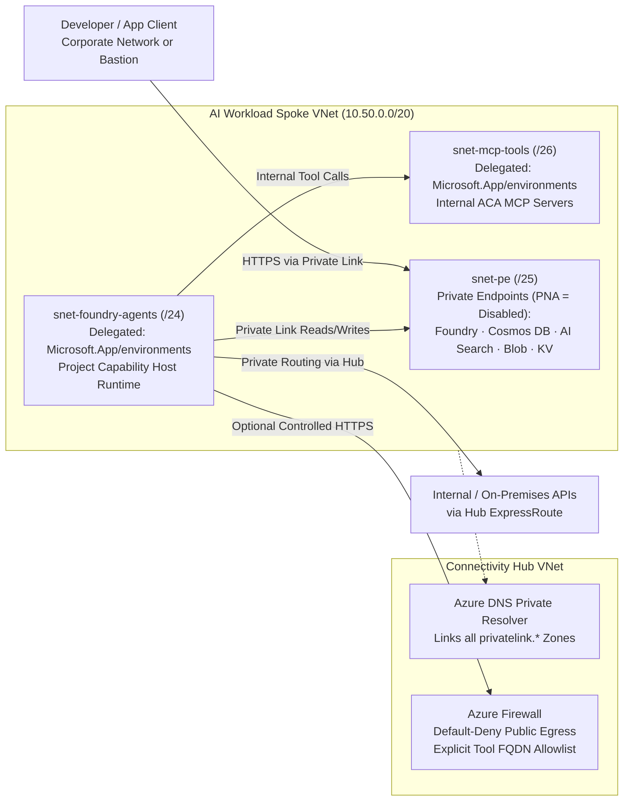
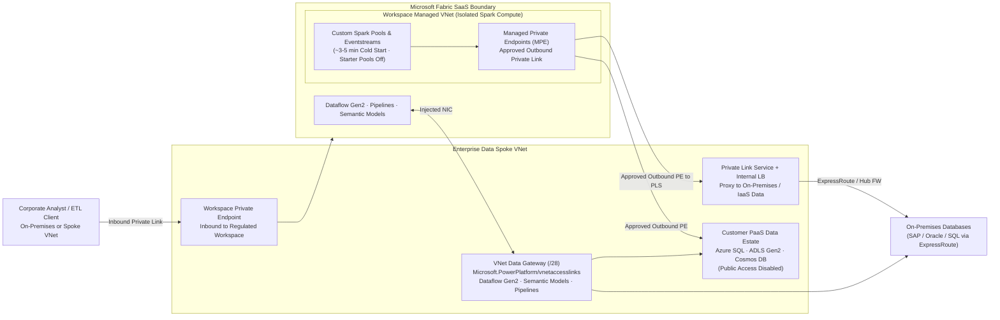

Modern AI and analytics platforms—**Microsoft Foundry** (formerly Azure AI Foundry / Azure AI Studio), **Azure Machine Learning**, and **Microsoft Fabric**—combine multi-tenant control planes with dynamic, serverless compute runtimes (agent sandboxes, Spark clusters, and Dataflow engines). Securing these services requires solving **two independent directions of traffic**:

1. **Inbound Isolation**: Blocking public internet access to APIs, studios, workspaces, and storage while exposing Private Endpoints inside your Virtual Network.
2. **Outbound & Compute Isolation**: Injecting or isolating the serverless compute runtime so agents, training jobs, and notebooks reach enterprise data stores privately without opening public data-exfiltration paths.

For enterprise DNS zone governance, Azure DNS Private Resolver forwarding (`168.63.129.16`), and Azure Policy automation referenced throughout this chapter, see [DNS & Private Resolver](/azure-networking/01-foundations/dns-and-private-resolver/) and [Private Link & DNS at Scale](/azure-networking/04-network-security/private-link-and-dns-at-scale/).

---

## 1. Microsoft Foundry & Agent Service Enterprise Networking

### Comparing Foundry Agent Setup Modes

Microsoft Foundry offers three deployment tiers for **Foundry Agent Service**. Only **Standard Setup with Private Networking (BYO-VNet)** satisfies strict enterprise data-residency and network-perimeter mandates:

| Capability | Basic Setup | Standard Setup (Public Networking) | Standard Setup with Private Networking (BYO-VNet) |
| --- | --- | --- | --- |
| **Agent State, Files & Vector Storage** | Microsoft-managed multi-tenant storage | Customer-owned BYO Storage, Cosmos DB, AI Search | Customer-owned BYO Storage, Cosmos DB, AI Search |
| **Customer-Managed Keys (CMK)** | Not supported | Supported | Supported |
| **Inbound Private Endpoint to Foundry** | Supported | Supported | **Mandatory (`publicNetworkAccess: Disabled`)** |
| **Agent Compute VNet Injection** | Not supported (shared platform network) | Not supported (public outbound) | **Yes — Delegated BYO Subnet (`Microsoft.App/environments`)** |
| **Zero-Public-Egress Execution** | No | No | **Yes — Native private access without trusted-service bypass** |
| **Target Environment** | Sandbox / rapid PoC only | Non-regulated dev/test | **Enterprise production standard** |

### Standard Agent BYO-VNet Architecture Deep Dive

In **Standard Agent Setup with Private Networking**, Foundry injects serverless agent execution containers into a subnet you own and control:

1. **Dedicated Delegated Agent Subnet**:
   - Allocate a dedicated subnet (`snet-foundry-agents`, **minimum `/27`**, **`/24` strongly recommended** for production concurrency) delegated exclusively to `Microsoft.App/environments`.
   - **One Foundry account per delegated subnet**: Never share `snet-foundry-agents` across multiple Foundry accounts or general Azure Container Apps environments.
   - **Supported IP Address Space**: Must use RFC 1918 (`10.0.0.0/8`, `172.16.0.0/12`, `192.168.0.0/16`) or supported RFC 6598 CGNAT (`100.64.0.0/10` **excluding** reserved ranges `100.100.0.0/17`, `100.100.192.0/19`, and `100.100.224.0/19`). Register resource providers `Microsoft.CognitiveServices`, `Microsoft.App`, and `Microsoft.ContainerService` prior to deployment.
2. **Mandatory BYO State Resources & Project Capability Hosts**:
   - Standard Agent setup requires **three customer-owned Azure resources** with `publicNetworkAccess: Disabled` and Private Endpoints in your VNet (`snet-pe`):
     - **Azure Cosmos DB for NoSQL** (`threadStorageConnections` — conversation history and agent state)
     - **Azure Storage Account** (`storageConnections` — uploaded files and artifacts)
     - **Azure AI Search** (`vectorStoreConnections` — RAG indexes and vector stores)
   - **Critical Provisioning Rule**: Private Endpoints to Storage, Cosmos DB, and AI Search are **not** auto-created by Foundry—provision them explicitly in IaC. Furthermore, you must configure **both** account-level and **project-level capability hosts** (`capabilityHosts`). Without a valid project-level capability host, outbound VNet tool calls fail with `name or host unknown`. Capability host connections are immutable once created, and deleting a VNet requires removing the capability host first (or purging soft-deleted Foundry resources) to release the `legionservicelink` service association link on `Microsoft.App/environments`.
3. **Private Tooling & Model Context Protocol (MCP) Servers**:
   - Agents running in `snet-foundry-agents` can invoke internal REST APIs, databases, and **private MCP servers** over your VNet and peered spokes. Host private MCP servers on Azure Container Apps with internal-only ingress in a **separate** `/27`–`/24` subnet (`snet-mcp-tools`, also delegated to `Microsoft.App/environments`).
   - Core agent orchestration requires **zero public internet egress**. If agents invoke external partner APIs or public SaaS endpoints, steer `0.0.0.0/0` via UDR or Virtual WAN Routing Intent through **Azure Firewall** with explicit FQDN allowlists.

### Required Private Endpoints & Private DNS Zones (Foundry & Azure ML)

Missing or unlinked Private DNS zones are the #1 root cause of deployment hangs (for example, a missing `privatelink.documents.azure.com` record triggers a `Timeout of 60000ms exceeded` error when opening the Foundry Agents blade). Link all zones below to your Hub DNS VNet so `168.63.129.16` resolves every endpoint privately:

| Target Resource | Subresource (`groupId`) | Canonical Private DNS Zone(s) | Required By |
| --- | --- | --- | --- |
| **Microsoft Foundry / AI Services** | `account` | `privatelink.services.ai.azure.com` `privatelink.openai.azure.com` `privatelink.cognitiveservices.azure.com` | Foundry & Azure OpenAI |
| **Azure Cosmos DB (NoSQL)** | `Sql` | `privatelink.documents.azure.com` | Foundry Standard Agent threads |
| **Azure AI Search** | `searchService` | `privatelink.search.windows.net` | Foundry Standard Agent vectors |
| **Azure Storage Account** | `blob` (+ `file` for Azure ML) | `privatelink.blob.core.windows.net` `privatelink.file.core.windows.net` | Foundry & Azure ML workspaces |
| **Azure Key Vault** | `vault` | `privatelink.vaultcore.azure.net` | Secrets & CMK integration |
| **Azure Container Registry** | `registry` | `privatelink.azurecr.io` | Custom ML images & MCP containers |
| **Azure Machine Learning Workspace** | `amlworkspace` | `privatelink.api.azureml.ms` `privatelink.notebooks.azure.net` | Azure ML hub/workspace compute |

:::note[Azure Machine Learning Managed VNet vs. Foundry BYO-VNet]
For classic **Azure Machine Learning** training clusters and managed online endpoints (`samples/azure-ai` / `labs/foundry-networking`), Azure ML offers a **Workspace Managed VNet** mode (`Allow Only Approved Outbound` with Microsoft-managed Private Endpoints + FQDN rules) alongside traditional BYO VNet compute injection. Choose **Foundry Standard Agent BYO-VNet** whenever agents need direct routing over ExpressRoute/VPN to on-premises APIs, custom Hub Firewall inspection, or shared VNet Private Endpoints without duplicating managed endpoints per workspace.
:::

Deploy and validate this topology hands-on using **[`labs/foundry-networking`](https://github.com/jonathan-vella/azure-networking/tree/main/labs/foundry-networking)** (walkthrough in the [Labs & Operational Tools Guide](/azure-networking/06-operations-reviews/labs-and-tools-guide/)).

:::tip[What I Recommend]
1. **Never deploy Basic Agent Setup beyond disposable sandboxes.** Enforce **Standard Agent Setup with Private Networking (BYO-VNet)** via Bicep/Terraform, sizing `snet-foundry-agents` at `/24` to avoid IP starvation as concurrent agent runs scale.
2. **Automate Private DNS via Policy**: Let Azure Policy (`DeployIfNotExists`) register Private Endpoint DNS zone groups centrally in your Platform Connectivity subscription so application teams never manually edit `privatelink.services.ai.azure.com` or `privatelink.documents.azure.com`.
3. **Provision Project-Level Capability Hosts in IaC** alongside explicit teardown scripts that delete capability hosts *before* deleting subnets—eliminating orphaned `legionservicelink` deployment blocks.
:::

---

## 2. Microsoft Fabric Private Networking

Unlike AKS or Foundry BYO-VNet, **Microsoft Fabric** is a pure SaaS analytics platform—you never inject Fabric Spark clusters directly into a customer-owned VNet. Instead, Fabric secures enterprise traffic through three complementary mechanisms covering **inbound client access**, **isolated Spark outbound Private Link**, and **gateway-mediated hybrid connectors**.

### Plane 1: Inbound Protection — Workspace-Level vs. Tenant-Level Private Links

- **Workspace-Level Private Links (Recommended Granular Pattern)**:
  - Secures individual regulated or production Fabric workspaces behind dedicated Azure Private Endpoints (`privatelink.<workspaceId>.z<xy>.w.api.fabric.microsoft.com`) and blocks public internet access **for those workspaces only**—without breaking self-service Power BI or trial workspaces elsewhere in the tenant.
- **Tenant-Level Private Link**:
  - Enforces Private Link across the **entire Fabric tenant** (`privatelink.analysis.windows.net`, `privatelink.pbidedicated.windows.net`, and OneLake `privatelink.dfs.fabric.microsoft.com` / `privatelink.blob.fabric.microsoft.com`). Turning on "Block Public Internet Access" at the tenant scope immediately impacts every user, mobile client, and workspace globally; reserve it only for dedicated single-posture regulated tenants.

### Plane 2: Spark Compute & Outbound Isolation — Managed VNets & Managed Private Endpoints (MPEs)

When you enable Private Link or create a Managed Private Endpoint in a workspace, Fabric automatically allocates a dedicated **Fabric Managed Virtual Network** for that workspace:

- **Spark Starter Pool Trade-off**: Pre-warmed Spark "starter pools" run in a shared multi-tenant network and are **automatically disabled** once a workspace Managed VNet is provisioned. Spark notebooks and jobs run on custom pools spun up inside the workspace Managed VNet (expect **~3–5 minutes** session startup latency; factor this into orchestration SLAs). Also note that workspaces with an allocated Managed VNet cannot be migrated across capacities in different regions.
- **Managed Private Endpoints (MPEs)**: Created in Workspace Settings (or via `POST /v1/workspaces/{workspaceId}/managedPrivateEndpoints`) and approved by the target Azure resource owner. MPEs allow **Fabric Spark notebooks, Lakehouse jobs, and Eventstreams** to connect outbound over Private Link to:
  - Native Azure PaaS data stores (**Azure SQL Database, ADLS Gen2, Cosmos DB, Key Vault, Azure AI Search, Snowflake on Azure**) with `publicNetworkAccess: Disabled`.
  - **On-Premises, AVS, or IaaS Databases via Private Link Service (PLS)**: Front on-premises SQL/Oracle/SAP/Kafka (reachable over ExpressRoute) with a Standard Internal Load Balancer + **Azure Private Link Service** in your Hub/Spoke VNet, then bind a Fabric MPE to that PLS `targetPrivateLinkResourceId` and `targetFQDNs`!
- **Trusted Workspace Access**: For ADLS Gen2 storage accounts where Selected Networks firewall rules are acceptable, Fabric **Workspace Identity** + Trusted Workspace Access provides lightweight secure access without per-storage MPE approval workflows.

### Plane 3: Hybrid & Non-Spark Connectors — VNet Data Gateway vs. On-Premises Data Gateway

Managed Private Endpoints apply to **Spark, Eventstream, and supported Data Engineering runtimes**—they do **not** route Power BI Semantic Model refreshes, Dataflow Gen2 queries, or all Data Factory Pipeline connectors. To reach private Azure PaaS endpoints or on-premises databases from those engines:

- **Virtual Network (VNet) Data Gateway**: Microsoft injects managed gateway compute into a subnet in your Spoke VNet (`snet-fabric-vnetgw`, minimum `/28`, delegated to `Microsoft.PowerPlatform/vnetaccesslinks`). No IaaS VMs to patch!
  - *Critical Co-location Rule*: When **Workspace-Level Private Links** are enabled with public access denied, Dataflow Gen2 requires a VNet Data Gateway deployed **in the exact same VNet** as the Workspace Private Endpoint.
- **On-Premises Data Gateway**: Installed on redundant Windows Server VMs on-premises or in an IaaS spoke when connectors require local custom ODBC/JDBC drivers not supported by the managed VNet Data Gateway.

### Microsoft Fabric Workload-to-Network Control Matrix

| Fabric Workload / Item | Inbound Access Lock | Recommended Private Outbound Path | Key Operational Caveat |
| --- | --- | --- | --- |
| **Spark Notebooks & Spark Jobs** | Workspace or Tenant Private Link | **Managed Private Endpoints (MPE)** from Workspace Managed VNet | Disables Spark starter pools (~3–5 min spin-up); blocks cross-region capacity move |
| **OneLake & Lakehouse Storage** | Workspace or Tenant Private Link | Trusted Workspace Access or MPE | Check regional Managed VNet availability before enabling Tenant Private Link |
| **Dataflow Gen2** | Workspace or Tenant Private Link | **VNet Data Gateway** (`Microsoft.PowerPlatform/vnetaccesslinks`) | Gateway must reside in same VNet as Workspace PE; Copilot in Dataflow Gen2 unsupported under Workspace PL |
| **Fabric Data Pipelines** | Workspace or Tenant Private Link | **VNet Data Gateway** or On-Premises Data Gateway | Verify connector support matrix under Private Link (e.g., Warehouse copy constraints) |
| **Power BI Semantic Models** | Tenant Private Link (or Workspace PL where supported) | **VNet Data Gateway** or On-Premises Data Gateway | Size VNet Data Gateway cluster member count for parallel dataset refresh windows |

:::tip[What I Recommend]
1. **Prefer Workspace-Level Private Links over Tenant-Wide Lockdown**: Isolate regulated bronze/silver/gold engineering workspaces with **Workspace-Level Private Links**, leaving general business-intelligence consumption workspaces accessible via Entra Conditional Access without breaking mobile/web workflows across the enterprise.
2. **Pair Both Outbound Mechanisms Deliberately**: Provision **Managed Private Endpoints (MPEs)** for Spark notebooks/Lakehouse engineering (including **PLS + Internal LB** for on-premises sources) *and* a `/27` delegated **VNet Data Gateway** subnet in the same data spoke VNet for Dataflow Gen2, Pipelines, and Semantic Models.
:::
