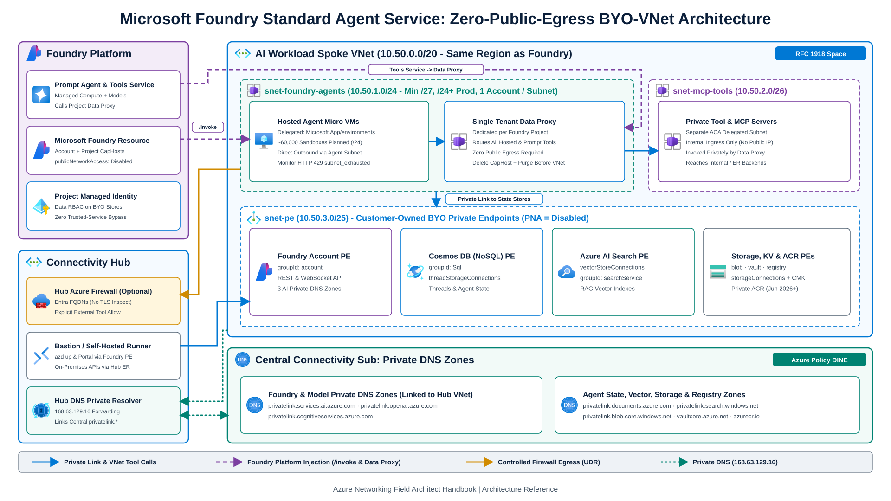
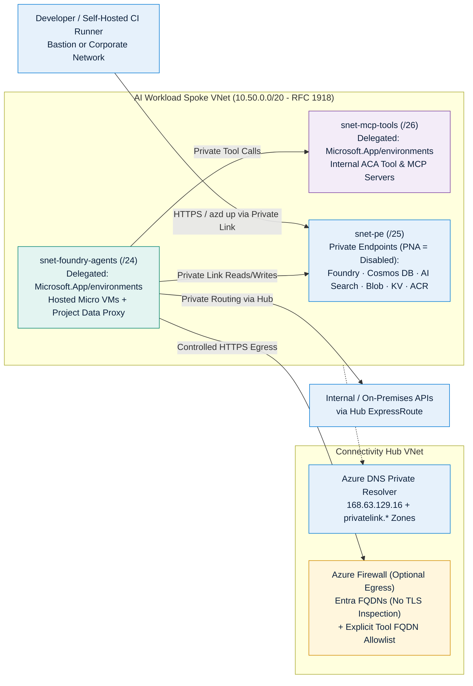
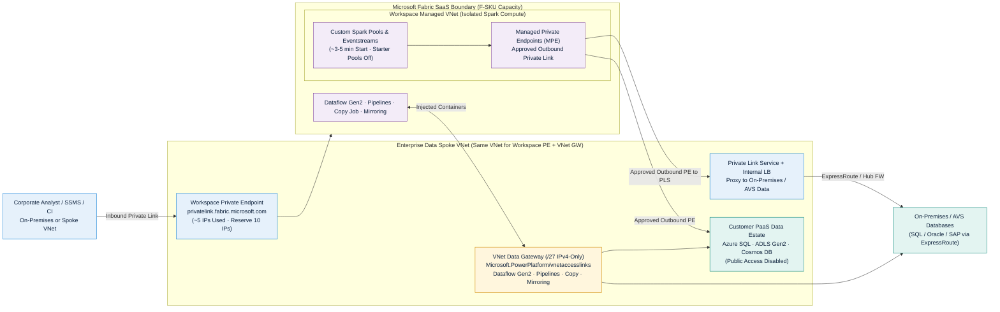

Enterprise AI and analytics platforms (**Microsoft Foundry**, **Azure Machine Learning**, and **Microsoft Fabric**) combine multi-tenant SaaS control planes with serverless compute runtimes (agent Micro VMs, data proxies, Spark pools, and Dataflow engines). Securing these services requires isolating **two distinct traffic directions**:

1. **Inbound Isolation**: Blocking public internet access to APIs, portals, workspaces, and state stores while exposing approved Private Endpoints inside your Virtual Network.
2. **Outbound & Compute Isolation**: Attaching or isolating serverless compute so agents, training jobs, and notebooks reach enterprise data stores privately without opening public exfiltration paths.

For central Private DNS Zone governance, Azure DNS Private Resolver forwarding (`168.63.129.16`), and Azure Policy `DeployIfNotExists` automation referenced throughout this chapter, see [DNS & Private Resolver](/azure-networking/01-foundations/dns-and-private-resolver/) and [Private Link & DNS at Scale](/azure-networking/04-network-security/private-link-and-dns-at-scale/).

---

## 1. Microsoft Foundry & Agent Service Enterprise Networking

### Comparing Foundry Agent Setup Modes

[Microsoft Foundry Agent Service](https://learn.microsoft.com/en-us/azure/foundry/agents/environment-setup) offers three environment tiers. Only **[Standard Setup with Private Networking (BYO-VNet)](https://learn.microsoft.com/en-us/azure/foundry/agents/how-to/virtual-networks)** satisfies strict enterprise data-sovereignty and network-isolation requirements:

| Capability | Basic Setup | Standard Setup (Public Networking) | Standard Setup with Private Networking (BYO-VNet) |
| --- | --- | --- | --- |
| **Agent State, Files & Vector Storage** | Microsoft-managed multi-tenant storage | Customer-owned BYO Storage, Cosmos DB, AI Search | Customer-owned BYO Storage, Cosmos DB, AI Search |
| **Customer-Managed Keys (CMK)** | Not supported | Supported | Supported |
| **Inbound Private Endpoint to Foundry** | Supported | Supported | **Mandatory (`publicNetworkAccess: Disabled`)** |
| **Agent Compute VNet Injection** | Not supported (shared platform network) | Not supported (public outbound) | **Yes: Delegated BYO Subnet (`Microsoft.App/environments`)** |
| **Zero-Public-Egress Execution** | No | No | **Yes: Native private access without trusted-service bypass** |
| **Target Environment** | Disposable sandbox / PoC only | Non-regulated dev/test | **Enterprise production standard** |

### Standard Agent BYO-VNet Architecture Deep Dive

Per [Deep dive into Foundry Agent Service networking](https://learn.microsoft.com/en-us/azure/foundry/agents/concepts/agents-networking-deep-dive) and [Foundry private networking setup](https://learn.microsoft.com/en-us/azure/foundry/agents/how-to/virtual-networks), Foundry projects two runtime components into your delegated subnet while keeping model inference on the Microsoft platform network:

1. **Hosted Agents vs. Prompt Agents & Single-Tenant Data Proxy**:
   - **Hosted Agents**: Custom container images pulled from Azure Container Registry run inside VM-isolated **Micro VMs** attached directly to your delegated subnet (`snet-foundry-agents`). Direct agent outbound calls exit via the delegated subnet, while registered tool calls traverse the project's **Single-Tenant Data Proxy**. Hosted agent VNet injection must be configured when you first create the Foundry account (it cannot be added later), and pulling from a **private ACR** (`publicNetworkAccess: Disabled`) requires Foundry projects created after **June 25, 2026**.
   - **Prompt Agents**: Compute and scaling remain Microsoft-managed, and prompt agent versions consume zero per-version subnet IPs. All outbound tool invocations route through the isolated **Single-Tenant Data Proxy** provisioned per Foundry project inside `snet-foundry-agents`.
2. **Delegated Agent Subnet Sizing & IP Rules**:
   - **Subnet Size & Capacity**: Delegate `snet-foundry-agents` exclusively to `Microsoft.App/environments` in the same Azure region as the Foundry resource, keeping the subnet name at `63` UTF-8 bytes or fewer. Dedicate **1 Foundry account per delegated subnet**, though multiple Foundry accounts can occupy separate subnets in the same VNet. Minimum subnet size is **`/27`** (~7,500 planned hosted-agent sandbox sessions), and **`/24` or larger** (~60,000 planned sessions) is recommended for all production workloads to absorb multi-project data proxies (roughly 25 to 250 projects per instance depending on traffic) and parallel platform upgrades. Because Azure Portal does not expose IP utilization on delegated subnets, monitor **data-proxy HTTP `5xx`** responses and **`HTTP 429 subnet_exhausted`** errors as leading exhaustion signals.
   - **Address Space Discipline**: Use **RFC 1918 private IPv4 space (`10.0.0.0/8`, `172.16.0.0/12`, `192.168.0.0/16`)** across the VNet and all peered VNets. While legacy Container Apps-only templates accept non-reserved RFC 6598 slices, the Hosted Agent and Data Proxy architecture rejects CGNAT (`100.64.0.0/10`) and public ranges. Never overlap reserved platform ranges (`169.254.0.0/16`, `172.30.0.0/16`, `172.31.0.0/16`, `192.0.2.0/24`, `100.100.0.0/17`, `100.100.192.0/19`, `100.100.224.0/19`). Register `Microsoft.CognitiveServices`, `Microsoft.KeyVault`, `Microsoft.Storage`, `Microsoft.MachineLearningServices`, `Microsoft.Search`, `Microsoft.Network`, `Microsoft.App`, and `Microsoft.ContainerService` before deployment.
3. **Mandatory BYO State Resources & Capability Hosts**:
   - Standard Agent setup requires **three customer-owned resources** with `publicNetworkAccess: Disabled` and explicit Private Endpoints in `snet-pe` (Foundry **does not** auto-create Private Endpoints for dependent stores):
     - **Azure Cosmos DB for NoSQL** (`threadStorageConnections`: conversation history and agent definitions)
     - **Azure Storage Account** (`storageConnections`: uploaded files and blob artifacts)
     - **Azure AI Search** (`vectorStoreConnections`: vector indexes for retrieval)
   - **[Capability Hosts](https://learn.microsoft.com/en-us/azure/foundry/agents/concepts/capability-hosts) & RBAC Split**: Configure both account-level (`capabilityHostKind: "Agents"`) and **project-level capability hosts** (each connection must populate `metadata.ResourceId`, `authType`, `category`, and `target`). Bicep/ARM capability-settings deployments require the deploying caller to hold `Storage Blob Data Contributor` and `Cosmos DB Operator`, whereas running agents authenticate using the **Project Managed Identity**, which requires data-plane RBAC roles on Cosmos DB, AI Search, and Storage. Capability hosts are **immutable** (delete and recreate to change connections). Before deleting a VNet, delete the capability hosts and **purge** the soft-deleted Foundry resource so the `legionservicelink` service association link releases `snet-foundry-agents`.
4. **Private MCP Servers & Optional Hub Firewall Egress**:
   - Host internal REST tools and **Model Context Protocol (MCP) servers** on Azure Container Apps with internal-only ingress in a **separate** `/27`-`/24` subnet (`snet-mcp-tools`, delegated to `Microsoft.App/environments`).
   - If you attach a `0.0.0.0/0 -> Azure Firewall` UDR to `snet-foundry-agents`, allow `control-{region}.identity.azure.net`, `{region}.login.microsoft.com`, and `login.microsoftonline.com` (or the `AzureActiveDirectory` service tag in NSGs/Firewall) **with TLS inspection disabled** so Managed Identity token acquisition never fails on re-signed certificates.

### Required Private Endpoints & Private DNS Zones (Foundry & Azure ML)

Unlinked or missing Private DNS records are the primary cause of deployment timeouts (for example, broken Cosmos DB resolution triggers `Timeout of 60000ms exceeded` in the Foundry Agents portal). Link all zones below to your Hub DNS VNet so `168.63.129.16` resolves every endpoint privately:

| Target Resource | Subresource (`groupId`) | Canonical Private DNS Zone(s) | Required By |
| --- | --- | --- | --- |
| **Microsoft Foundry / AI Services** | `account` | `privatelink.services.ai.azure.com` `privatelink.openai.azure.com` `privatelink.cognitiveservices.azure.com` | Foundry REST/WebSocket & Azure OpenAI |
| **Azure Cosmos DB (NoSQL)** | `Sql` | `privatelink.documents.azure.com` | Foundry Standard Agent threads |
| **Azure AI Search** | `searchService` | `privatelink.search.windows.net` | Foundry Standard Agent vector stores |
| **Azure Storage Account** | `blob` (+ `file` for Azure ML) | `privatelink.blob.core.windows.net` `privatelink.file.core.windows.net` | Foundry files & Azure ML workspaces |
| **Azure Key Vault** | `vault` | `privatelink.vaultcore.azure.net` | Secrets & CMK encryption |
| **Azure Container Registry** | `registry` | `privatelink.azurecr.io` | Hosted agent images & MCP containers |
| **Azure Machine Learning Workspace** | `amlworkspace` | `privatelink.api.azureml.ms` `privatelink.notebooks.azure.net` | Azure ML workspace & compute |

:::note[Azure Machine Learning Managed VNet vs. Foundry BYO-VNet]
For classic **[Azure Machine Learning](https://learn.microsoft.com/en-us/azure/machine-learning/how-to-managed-network)** training clusters and managed online endpoints, Azure ML offers a **Workspace Managed VNet** mode (`Allow Only Approved Outbound` with Microsoft-managed Private Endpoints and FQDN rules) alongside BYO VNet compute injection. Choose **Foundry Managed Virtual Network** or **Azure ML Managed VNet** when spoke VNets suffer from severe RFC 1918 IP overlap; choose **Foundry Standard Agent BYO-VNet** when agents require direct routing over ExpressRoute/VPN to on-premises APIs, central Hub Firewall governance, or shared VNet Private Endpoints.
:::

Deploy and validate this topology using **[`labs/foundry-networking`](https://github.com/jonathan-vella/azure-networking/tree/main/labs/foundry-networking)** (walkthrough in the [Labs & Operational Tools Guide](/azure-networking/06-operations-reviews/labs-and-tools-guide/)).

:::tip[What I Recommend]
1. **Standardize on Standard Agent BYO-VNet with `/24` RFC 1918 Subnets**: Restrict Basic Agent Setup to throwaway PoCs. Allocate a dedicated `/24` RFC 1918 subnet per Foundry account at creation time and run `azd up` / IaC deployments from self-hosted runners inside a peered VNet.
2. **Automate All 3 Foundry DNS Zones via Policy**: Ensure Azure Policy (`DeployIfNotExists`) registers Private Endpoint `PrivateDnsZoneGroup` attachments for **all three** Foundry zones (`privatelink.services.ai.azure.com`, `privatelink.openai.azure.com`, `privatelink.cognitiveservices.azure.com`) plus Cosmos DB, AI Search, and Blob Storage.
3. **Script Clean Teardown Order**: Always delete project and account `capabilityHosts` and purge soft-deleted Foundry resources *before* deleting `snet-foundry-agents` so `legionservicelink` never blocks VNet teardown.
:::

---

## 2. Microsoft Fabric Private Networking

Unlike AKS or Foundry BYO-VNet, **Microsoft Fabric** is a SaaS analytics platform: you never inject Fabric Spark clusters directly into a customer-owned VNet. Instead, [Fabric network security](https://learn.microsoft.com/en-us/fabric/security/security-overview) combines three controls covering **inbound workspace access**, **isolated Spark outbound Private Link**, and **gateway-mediated connectors**.

### Plane 1: Inbound Protection (Workspace-Level vs. Tenant-Level Private Links)

- **[Workspace-Level Private Links](https://learn.microsoft.com/en-us/fabric/security/security-workspace-level-private-links-overview) *(Recommended Granular Pattern)***:
  - Maps a single Fabric workspace (`Microsoft.Fabric/privateLinkServicesForFabric`, `subresource: workspace`) on a paid **F-SKU capacity** (P-SKU and Trial capacities are unsupported) to an Azure Private Endpoint in your VNet. Each workspace PLS supports up to 100 Private Endpoints (500 workspace PLSs per tenant), and each endpoint currently consumes 5 subnet IPs; reserve at least **10 IPs** per workspace PE for future expansion.
  - **DNS Zone & Workspace FQDNs**: Integrate the Private Endpoint with the **`privatelink.fabric.microsoft.com`** Private DNS Zone ([setup guide](https://learn.microsoft.com/en-us/fabric/security/security-workspace-level-private-links-set-up)). Clients access the workspace at `{workspaceIdWithoutDashes}.z{xy}.w.api.fabric.microsoft.com`, where `{xy}` equals the first two characters of the workspace ID. For Warehouse and SQL analytics TDS tools (such as SSMS), connect to `{tenantGuid}-{workspaceGuid}.z{xy}.datawarehouse.fabric.microsoft.com` (keeping hyphens in both GUIDs); note that **this Warehouse FQDN is not auto-registered** by the Private Endpoint's `PrivateDnsZoneGroup` integration and must be added manually to `privatelink.fabric.microsoft.com`.
  - **Unsupported Item Constraint**: Per [Workspace-level Private Link limitations](https://learn.microsoft.com/en-us/fabric/security/security-workspace-level-private-links-support), **Power BI semantic models and deployment pipelines are not supported** in workspaces with workspace-level private links enabled (enabling inbound restriction fails with `InboundRestrictionNotEligible` if semantic models exist in the workspace). Keep Lakehouse/Warehouse engineering items in workspace-PL-protected workspaces, and host Power BI semantic models in separate BI consumption workspaces. Also configure combined inbound + outbound workspace access protection via the [Set Network Communication Policy REST API](https://learn.microsoft.com/en-us/rest/api/fabric/core/workspaces/set-network-communication-policy) rather than the portal UI.
- **[Tenant-Level Private Link](https://learn.microsoft.com/en-us/fabric/security/security-private-links-overview)**:
  - Enforces Private Link across the **entire Fabric tenant**. Turning on **Block Public Internet Access** at the tenant scope immediately restricts every workspace, user, mobile app, and OneLake File Explorer client globally; reserve it only for single-posture regulated tenants.

### Plane 2: Spark Compute & Outbound Isolation (Managed VNets & MPEs)

Enabling Private Link (and running a Spark/Lakehouse job) or creating a Managed Private Endpoint provisions a dedicated **[Fabric Managed Virtual Network](https://learn.microsoft.com/en-us/fabric/security/security-managed-vnets-fabric-overview)** for that workspace:

- **Starter Pool & Region Trade-offs**: Pre-warmed Spark starter pools run in a shared network and are **disabled** once a workspace Managed VNet is provisioned. Jobs run on custom Spark pools spun up on demand inside the Managed VNet (**~3 to 5 minutes** session startup time). Workspaces with an allocated Managed VNet **cannot migrate across capacities in different regions**, and Managed VNets / MPEs are currently **not supported in `Switzerland West` or `West Central US`**.
- **[Managed Private Endpoints (MPEs)](https://learn.microsoft.com/en-us/fabric/security/security-managed-private-endpoints-overview)**: Created in Workspace Settings or via `POST https://api.fabric.microsoft.com/v1/workspaces/{workspaceId}/managedPrivateEndpoints` and approved on the target resource. MPEs let **Fabric Data Engineering items (Spark/Python notebooks, Lakehouses, Spark jobs) and Eventstreams** connect outbound over Private Link to:
  - Azure PaaS data stores (Azure SQL Database, ADLS Gen2, Cosmos DB, Key Vault, Azure AI Search, and Snowflake on Azure) with `publicNetworkAccess: Disabled`, or other restricted Fabric workspaces (using workspace and lakehouse GUID paths rather than display names).
  - **[On-Premises, AVS, or IaaS Databases via Private Link Service (PLS)](https://learn.microsoft.com/en-us/fabric/security/connect-to-on-premise-sources-using-managed-private-endpoints)**: Front on-premises SQL, Oracle, SAP, or Kafka (reachable over ExpressRoute) with a Standard Internal Load Balancer + **Azure Private Link Service** in your VNet, then bind a Fabric MPE to `targetPrivateLinkResourceId` and `targetFQDNs`.
- **[Trusted Workspace Access](https://learn.microsoft.com/en-us/fabric/security/security-trusted-workspace-access)**: For ADLS Gen2 accounts using Selected Networks firewall rules on F-SKU capacities, Workspace Identity + Trusted Workspace Access enables secure OneLake shortcuts and reads without per-storage MPE approval.

### Plane 3: Non-Spark & Hybrid Connectors (VNet vs. On-Premises Data Gateway)

Managed Private Endpoints apply only to Spark Data Engineering and Eventstream workloads; they do **not** route Dataflow Gen2, Data Pipelines, Copy Job, Mirroring, Power BI Semantic Models, or Paginated Reports. To connect those engines to private Azure endpoints or hybrid databases:

- **[Virtual Network (VNet) Data Gateway](https://learn.microsoft.com/en-us/data-integration/vnet/overview)**: Microsoft injects managed gateway containers into a dedicated **IPv4-only** subnet (`snet-fabric-vnetgw`) delegated to `Microsoft.PowerPlatform/vnetaccesslinks`. Per [gateway subnet rules](https://learn.microsoft.com/en-us/data-integration/vnet/create-data-gateways), Azure reserves **5 base IPs + 1 IP per gateway cluster member**, so allocate `/28` minimum or `/27` for multi-cluster scale. Never add IPv6 address space to the subnet or use reserved names (`GatewaySubnet`, `AzureBastionSubnet`). Each user is capped at 1,000 data sources per gateway, and OAuth2 dataflow tokens do not auto-refresh mid-run past ~1 hour.
  - **Same-VNet Co-Location Rule**: When a workspace restricts inbound public access via Workspace-Level Private Link, Dataflow Gen2 (CI/CD) requires a VNet Data Gateway deployed **in the exact same Virtual Network** as the Workspace Private Endpoint (and Copilot in Dataflow Gen2 is unsupported).
- **On-Premises Data Gateway**: Installed on redundant Windows Server VMs when connectors require custom third-party ODBC/JDBC drivers unavailable on the managed VNet Data Gateway.

### Microsoft Fabric Workload-to-Network Control Matrix

| Fabric Workload / Item | Inbound Access Lock | Private Outbound Path | Key Operational Caveat |
| --- | --- | --- | --- |
| **Spark Notebooks, Jobs & Lakehouse** | Workspace PL (F-SKU) or Tenant PL | **Managed Private Endpoints (MPE)** from Workspace Managed VNet | Disables Spark starter pools (~3-5 min start); blocks cross-region capacity move; unsupported in `Switzerland West` & `West Central US` |
| **OneLake & Shortcuts** | Workspace PL or Tenant PL | **Trusted Workspace Access** (ADLS Gen2) or Cross-Workspace MPE | Cross-workspace Spark reads require GUID paths; cross-region MPE shortcuts unsupported |
| **Dataflow Gen2 (CI/CD)** | Workspace PL or Tenant PL | **VNet Data Gateway** (`Microsoft.PowerPlatform/vnetaccesslinks`) | Gateway **must** reside in same VNet as Workspace PE; Copilot & dataflow-to-dataflow connector unsupported under Workspace PL |
| **Pipelines, Copy Job & Mirroring** | Workspace PL or Tenant PL | **VNet Data Gateway** or On-Premises Data Gateway | Workspace staging unsupported for Warehouse/Snowflake/Teradata Copy; use external staging |
| **Power BI Semantic Models** | **Tenant PL only** (**Unsupported** in Workspace-PL workspaces) | **VNet Data Gateway** or On-Premises Data Gateway | Host Semantic Models in separate consumption workspaces so engineering workspaces can enforce Workspace PL |

:::tip[What I Recommend]
1. **Workspace Topology Boundary**: Lock down Lakehouse, Warehouse, and Spark workspaces on **F-SKU capacities** with **Workspace-Level Private Links** (`privatelink.fabric.microsoft.com`), while keeping Power BI Semantic Models and Deployment Pipelines in separate consumption workspaces governed by Entra Conditional Access so `InboundRestrictionNotEligible` never blocks inbound restriction.
2. **Deploy Both Outbound Paths in the Same Data Spoke VNet**: Pair **Managed Private Endpoints** (including **PLS + Internal LB** for on-premises databases) for Spark/Eventstream workloads with an IPv4-only **`/27` VNet Data Gateway subnet** in the exact same VNet as your Workspace Private Endpoints for Dataflow Gen2, Pipelines, Copy Jobs, Mirroring, and Semantic Model refreshes.
:::

---

## 3. Microsoft Learn References

- [Set up private networking for Microsoft Foundry Agent Service (BYO-VNet & Private DNS zones)](https://learn.microsoft.com/en-us/azure/foundry/agents/how-to/virtual-networks)
- [Deep dive into Foundry Agent Service networking (Hosted vs. Prompt Agents, Data Proxy & Subnet Sizing)](https://learn.microsoft.com/en-us/azure/foundry/agents/concepts/agents-networking-deep-dive)
- [Capability hosts in Microsoft Foundry Agent Service](https://learn.microsoft.com/en-us/azure/foundry/agents/concepts/capability-hosts)
- [Configure a managed virtual network for Azure Machine Learning](https://learn.microsoft.com/en-us/azure/machine-learning/how-to-managed-network)
- [Workspace-level private links in Microsoft Fabric (`privatelink.fabric.microsoft.com`)](https://learn.microsoft.com/en-us/fabric/security/security-workspace-level-private-links-overview)
- [Supported scenarios and limitations for Fabric workspace-level private links](https://learn.microsoft.com/en-us/fabric/security/security-workspace-level-private-links-support)
- [Managed virtual networks & Managed Private Endpoints in Microsoft Fabric](https://learn.microsoft.com/en-us/fabric/security/security-managed-vnets-fabric-overview)
- [Connect to on-premises data sources from Fabric using Managed Private Endpoints & PLS](https://learn.microsoft.com/en-us/fabric/security/connect-to-on-premise-sources-using-managed-private-endpoints)
- [What is a Virtual Network (VNet) Data Gateway? (`Microsoft.PowerPlatform/vnetaccesslinks`)](https://learn.microsoft.com/en-us/data-integration/vnet/overview)

