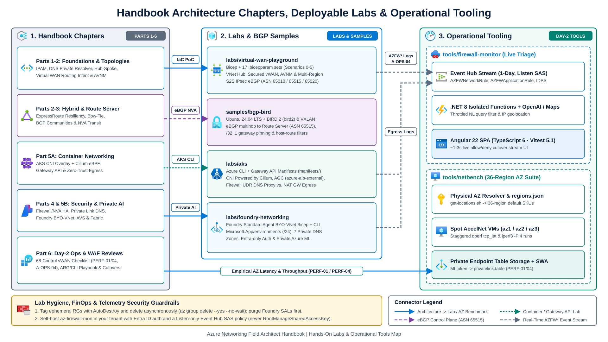
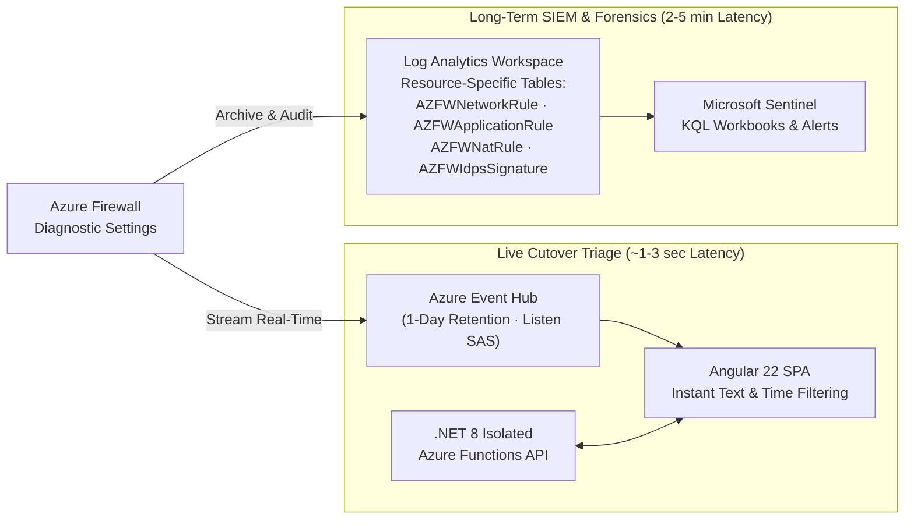

Every architecture chapter in this handbook pairs with runnable Infrastructure as Code, routing troubleshooting labs, or live operational tooling inside this repository. Use this guide to pick the right suite for proof-of-concept deployments, engineer onboarding, live firewall cutover triage, or physical Availability Zone latency benchmarking.



---

## Quick selector and FinOps cleanup discipline

| Repository Path | Primary Stack | What It Validates or Operates | Typical Deploy Time |
| --- | --- | --- | --- |
| **[`labs/virtual-wan-playground`](https://github.com/jonathan-vella/azure-networking/tree/main/labs/virtual-wan-playground)** | Bicep + `.bicepparam` | Single-region and multi-region Hub-and-Spoke, Virtual WAN Secured Hub, Routing Intent, Private Subnets, and AVNM (Scenarios 0-5) | 5 min (Scen 0) to 40 min (Scen 5) |
| **[`labs/aks`](https://github.com/jonathan-vella/azure-networking/tree/main/labs/aks)** | Azure CLI + K8s YAML | Azure CNI Overlay, Azure CNI Powered by Cilium, Application Gateway for Containers (Gateway API), and UDR or NAT Gateway egress | 10-20 min |
| **[`labs/foundry-networking`](https://github.com/jonathan-vella/azure-networking/tree/main/labs/foundry-networking)** | Bicep + Azure CLI | Microsoft Foundry Standard Agent BYO-VNet (`Microsoft.App/environments`) and private Azure Machine Learning workspace topologies | 15-25 min |
| **[`samples/bgp-bird`](https://github.com/jonathan-vella/azure-networking/tree/main/samples/bgp-bird)** | Ubuntu 24.04 + BIRD 2 + VXLAN | Lightweight eBGP `multihop` routing NVAs (`ASN 65515`), `/32` Route Server peer pinning, IP masquerading, and VXLAN overlays | 5-10 min |
| **[`tools/firewall-monitor`](https://github.com/jonathan-vella/azure-networking/tree/main/tools/firewall-monitor)** | Angular 22 + .NET 8 + Event Hubs | Real-time Process Monitor-style live stream viewer for Azure Firewall allow, deny, and IDPS structured events | 10 min |
| **[`tools/netbench`](https://github.com/jonathan-vella/azure-networking/tree/main/tools/netbench)** | Terraform + Functions + SWA | Automated intra-zone and inter-zone latency (`qperf`) and parallel TCP throughput (`iperf3`) across 36 regions mapped to physical AZs | 8-15 min per region |

:::caution[Lab Cost & Teardown Discipline]
Network gateways (`VpnGw1AZ`, Virtual WAN VPN and ExpressRoute gateways), Secured Virtual Hubs, Azure Firewall, and Azure Bastion bill continuously by the hour regardless of traffic volume. Never leave lab topologies running overnight in shared subscriptions:
- Tag every lab Resource Group with an `AutoDestroy` or owner expiration tag.
- Delete entire lab Resource Groups asynchronously right after validation (`az group delete -n <rg-name> --yes --no-wait`).
- Delete Virtual WAN Routing Intent policies or third-party SaaS attachments before hub deletion when tearing down individual resources, and purge Microsoft Foundry accounts before deleting BYO-VNet subnets so the `legionservicelink` Service Association Link releases cleanly.
:::

---

## 1. Virtual WAN and Hub-Spoke Bicep playground (`labs/virtual-wan-playground`)

**Source**: **[`labs/virtual-wan-playground`](https://github.com/jonathan-vella/azure-networking/tree/main/labs/virtual-wan-playground)** · **Related chapters**: [Hub-Spoke vs. Virtual WAN](/azure-networking/02-core-topologies/hub-spoke-vs-vwan/), [Virtual WAN & Routing Intent](/azure-networking/02-core-topologies/virtual-wan-and-routing-intent/), [Hub-Spoke & Azure Route Server](/azure-networking/02-core-topologies/hub-spoke-and-route-server/).

This modular Bicep lab builder deploys customer-managed Hub-and-Spoke (`hubType = 'VNET'`), Azure Virtual WAN (`hubType = 'VWAN'`), and Azure Virtual Network Manager (`deployVnetPeeringAVNM = true`) topologies from a single parameterized entry point (`main.bicep`). Each regional `/16` block slices deterministically into `/24` virtual networks (`x.x.0.0/24` Hub, `x.x.1..N.0/24` Spokes, and `x.x.255.0/24` simulated On-Premises).

### Pre-built parameter progression (`bicepparams/scenario0..5`)

Start with the lowest scenario number that tests your hypothesis so you do not wait 30 minutes for VPN Gateways when validating basic peering or firewall rules:

| Parameter Set | Topology Variants | Deployed Components | Best Used For |
| --- | --- | --- | --- |
| **`scenario0`** | `.vnet` · `.vwan` · `.avnm` | Hub + 2 Spokes + OnPrem VNet + Peerings/vWAN Connections (no VMs, Bastion, Firewall, or Gateways) | Fast (<5 min), near-zero-cost validation of Bicep CIDR math, AVNM network groups, and route tables |
| **`scenario1`** | `.vnet` · `.vwan` · `.avnm` | Scenario 0 + Spoke & OnPrem VMs (`Standard_B2ls_v2`) with Azure Monitor Agent & DCR | Testing baseline VM-to-VM east-west connectivity and VM Insights Dependency Map |
| **`scenario2`** | `.vnet` · `.vwan` · `.avnm` | Scenario 1 + Azure Bastion | Browser-based SSH/RDP validation into private spoke and on-premises VMs without public VM IPs |
| **`scenario3`** | `.vnet` · `.vwan` · `.avnm` | Scenario 2 + Azure Firewall (`Standard` or `Premium`) + Rule Collection Group + Spoke UDRs / Hub routing | Validating Secured Hub Routing Intent (`internetTrafficRoutingPolicy`, `privateTrafficRoutingPolicy`) and `defaultOutboundAccess: false` private subnets |
| **`scenario4`** | `.vnet` · `.vwan` · `.avnm` | Scenario 3 + AZ VPN Gateways (`VpnGw1AZ` Gen2 / vWAN VPN GW) with BGP (`ASN 65010`/`65515` & `65020`) | Pre-staging hybrid BGP gateways and inspecting gateway effective routes before tunnel bring-up |
| **`scenario5`** | `.vnet` · `.vwan` | Scenario 4 + Active Site-to-Site IPsec VPN Tunnel + eBGP between OnPrem and Hub | End-to-end hybrid branch to Secured Hub Firewall to Spoke VNet routing, SNAT/DNAT, and BGP failover testing |

### Deploying single-region and multi-region topologies

Pass the target `.bicepparam` file at subscription scope. Supply the VM password from a shell variable (`read -rsp`) rather than committing secrets into `.bicepparam` files, and set `defaultOutboundAccess=false` when testing private spoke subnets behind the hub firewall:

```bash
# Deploy Scenario 3 (Secured Virtual WAN Hub + Azure Firewall + 2 Private Spokes)
read -rsp "VM Admin Password: " VM_ADMIN_PASSWORD && echo
az deployment sub create \
  --name lab-vwan-scen3 \
  --location swedencentral \
  --template-file labs/virtual-wan-playground/main.bicep \
  --parameters labs/virtual-wan-playground/bicepparams/scenario3.vwan.bicepparam \
  --parameters \
    adminUsername=azureadmin \
    adminPassword="$VM_ADMIN_PASSWORD" \
    internetTrafficRoutingPolicy=true \
    privateTrafficRoutingPolicy=true \
    defaultOutboundAccess=false
```

To test multi-region Global VNet Peering, inter-hub Virtual WAN transit, and cross-region S2S VPN failover, pass a two-element `locations` array (for example, `swedencentral` `172.16.0.0/16` and `germanywestcentral` `172.31.0.0/16`). Deploying the AVNM variant (`*.avnm.bicepparam`) requires `Owner` or `User Access Administrator` on the Hub Resource Group so the deployment script's User-Assigned Managed Identity can assign `Network Contributor`.

:::tip[What I Recommend]
Validate CIDR slicing, AVNM Connected Groups, and custom route tables with `scenario0` first, then layer VMs and Azure Firewall in `scenario3` via incremental subscription deployments. Only step up to `scenario5` when you specifically need IPsec tunnel state or eBGP AS-path failover evidence.
:::

---

## 2. AKS and container networking labs (`labs/aks`)

**Source**: **[`labs/aks`](https://github.com/jonathan-vella/azure-networking/tree/main/labs/aks)** · **Related chapter**: [AKS Enterprise Networking Architecture](/azure-networking/05-workload-networking/aks-networking/).

Use the Azure CLI runbooks and deduplicated Kubernetes YAML manifests (`labs/aks/manifests/`) to compare AKS container networking data planes and reproduce common RBAC and egress errors safely:

- **CNI and Cilium data-plane labs (`labs/aks/CNI/`)**:
  - `build-azure-cni-powered-by-cilium.sh`: Provisions an AKS cluster running Azure CNI Overlay with the Cilium eBPF data plane (`--network-plugin azure --network-plugin-mode overlay --pod-cidr 192.168.0.0/16 --network-dataplane cilium`), applies test workloads from `manifests/`, and pre-grants `Network Contributor` to a User-Assigned Managed Identity to prevent `SyncLoadBalancerFailed (403 AuthorizationFailed)` race conditions on custom subnets.
  - `build-azure-cni-overlay.sh` and `build-azure-cni.sh`: Contrasts overlay pod IP conservation against flat VNet pod IP consumption in the Azure Portal and `kubectl get pods -o wide`.
- **Application Gateway for Containers and Gateway API (`labs/aks/Ingress/build-aks-agc-gateway-api.sh`)**: Provisions a `/24` subnet delegated to `Microsoft.ServiceNetworking/trafficControllers`, federates Workload Identity (`azure-alb-identity`) with `AppGw for Containers Configuration Manager` and `Network Contributor`, installs the ALB Controller via Helm, and applies `manifests/gateway-api-routes.yaml` (`GatewayClass: azure-alb-external`, `Gateway`, and `HTTPRoute`) for direct-to-overlay-pod L7 routing without NodePort hops.
- **Zero-trust egress lockdown (`labs/aks/Egress/build-aks-egress.azcli`)**: Supports `OUTBOUND_MODE=udr` (default) and `OUTBOUND_MODE=natgw`. The `udr` track deploys Azure Firewall with DNS Proxy enabled, configures required `AzureKubernetesService` FQDN tags and container registry rules (`mcr.microsoft.com`, `ghcr.io`, `docker.io`), attaches a `0.0.0.0/0 -> VirtualAppliance` UDR to the AKS node subnet with `--outbound-type userDefinedRouting`, and demonstrates symmetric inbound Firewall DNAT to an internal LoadBalancer.
- **Container networking fundamentals (`labs/aks/docker-networking/`)**: Deploys two NSG-locked Ubuntu 24.04 hosts (`build-docker-hosts.sh`) and walks through Linux `veth` pairs, custom bridges, dual-homed containers, and `ipvlan` L3 routing (`docker-networking-basics.sh`).

---

## 3. Microsoft Foundry labs (`labs/foundry-networking`) and BGP BIRD samples (`samples/bgp-bird`)

### Microsoft Foundry and private AI workspace labs (`labs/foundry-networking`)

**Source**: **[`labs/foundry-networking`](https://github.com/jonathan-vella/azure-networking/tree/main/labs/foundry-networking)** · **Related chapters**: [Microsoft Foundry, Azure ML & Fabric Private Networking](/azure-networking/05-workload-networking/foundry-and-fabric-networking/), [Private Link & DNS at Enterprise Scale](/azure-networking/04-network-security/private-link-and-dns-at-scale/).

Provides Bicep (`build-foundry-standard-agent-vnet.bicep`) and automated CLI orchestration (`deploy-foundry-standard-agent.sh`) for network-isolated AI landing zones:

- **Foundry Standard Agent BYO-VNet**: Delegates a dedicated `/24` agent subnet (`snet-foundry-agent`, `defaultOutboundAccess: false`) to `Microsoft.App/environments`, disables `publicNetworkAccess` and local keys (`disableLocalAuth: true`) across Microsoft Foundry, Azure Cosmos DB, Azure AI Search, Azure Storage, and Azure Key Vault, links all seven required `privatelink.*` Private DNS zones, and provisions account and project capability hosts. Before deleting the VNet, run `az cognitiveservices account delete` followed by `az cognitiveservices account purge` so the `legionservicelink` Service Association Link detaches cleanly.
- **Private Azure Machine Learning workspace (`ml-private-workspace/`)**: Provisions a customer VNet jumpbox (`build-cust-vnet.sh`) and private workspace (`build-workspace.sh`) supporting `managed_approved`, `managed_internet`, and `byo_vnet` isolation modes with `privatelink.api.azureml.ms` and `privatelink.notebooks.azure.net` DNS zones.

### Linux BIRD 2 BGP and VXLAN NVA samples (`samples/bgp-bird`)

**Source**: **[`samples/bgp-bird`](https://github.com/jonathan-vella/azure-networking/tree/main/samples/bgp-bird)** · **Related chapters**: [Hub-Spoke & Azure Route Server](/azure-networking/02-core-topologies/hub-spoke-and-route-server/), [AVS Networking & Transit](/azure-networking/05-workload-networking/avs-networking/).

Contains lightweight Linux Network Virtual Appliance configurations for testing dynamic BGP route exchange without commercial NVA licensing overhead:

- **BIRD 2 (`bird2`) on Ubuntu 24.04 LTS (`bird-east.conf` and `bird-notes.md`)**: Reference eBGP `multihop` peering configuration (`ASN 65001` peering with both Azure Route Server instance IPs in `ASN 65515`). On Ubuntu 24.04 LTS, install the **`bird2`** package (`sudo apt-get install -y bird2`), place the configuration at `/etc/bird/bird.conf` using BIRD 2 `ipv4 { ... };` channel blocks inside `protocol kernel`, `protocol static`, and `protocol bgp`, validate syntax (`sudo bird -p -c /etc/bird/bird.conf`), and inspect session state via `birdc`.
- **Control-plane recursion and prefix-length guards**: Demonstrates two mandatory Azure SDN protections when originating `0.0.0.0/0` (or split `0.0.0.0/1` and `128.0.0.0/1`) into the Linux kernel:
  1. Pin explicit `/32` static routes for both Route Server peer IPs (`172.16.201.4/32`, `172.16.201.5/32`) and remote VXLAN underlay peers via the local subnet `.1` virtual gateway so BGP control-plane packets never recurse into the overlay tunnel.
  2. Enable the `to_routeserver` export filter on both Route Server sessions to drop `/30`-`/32` host prefixes so internal helper routes are never advertised toward Azure Route Server's 1,000-route limit.
- **SNAT masquerading and VXLAN overlays (`masq.sh` and `vxlan-notes.md`)**: Enables `net.ipv4.ip_forward = 1`, preserves client source IPs across RFC 1918 ranges while masquerading `0.0.0.0/0` internet egress, and builds point-to-point `UDP 4789` VXLAN tunnels (VNI `5001`) to test chained multi-NVA BGP topologies across Azure VNet fabrics.

---

## 4. Real-time Azure Firewall Monitor (`tools/firewall-monitor`)

**Source**: **[`tools/firewall-monitor`](https://github.com/jonathan-vella/azure-networking/tree/main/tools/firewall-monitor)** · **Related chapters**: [Firewall & NVA Patterns](/azure-networking/04-network-security/firewall-and-nva-patterns/), [Virtual WAN Verification Playbook (`A-OPS-04`)](/azure-networking/06-operations-reviews/vwan-review-addendum/#a-ops-04).

Waiting 2 to 5 minutes for Log Analytics ingestion latency after every test `curl` slows down live application cutovers. **`tools/firewall-monitor`** (`az-firewall-mon`) streams Azure Firewall events in near real time through an **Angular 22** single-page application (`TypeScript 6.0`, tested with `Vitest 5.1`), **.NET 8 isolated Azure Functions** (throttled Azure OpenAI natural-language filter and Azure Maps IP geolocation), and **Azure Event Hubs**.



### Event Hub live streaming vs. Log Analytics structured logs

| Operational Need | `tools/firewall-monitor` (Event Hub Stream) | Log Analytics Structured Logs (`AZFW*` Tables) |
| --- | --- | --- |
| **End-to-End Visibility Lag** | **~1-3 seconds** over AMQP-over-WebSockets | **2-5 minutes** ingestion pipeline delay |
| **Query Experience** | Instant client-side substring, protocol, action (`Deny`), time-window, and optional OpenAI filter (zero KQL required) | Full KQL joins, aggregations, policy analytics, and Sentinel hunting queries |
| **Retention Window** | Ephemeral (**24 hours** on Event Hub; up to 100k rows in browser ring buffer) | **30 days to 12 years** (Analytics, Basic, and Archive tiers) |
| **Primary Use Case** | Live production cutover bridges, AKS/Foundry egress rule discovery, interactive troubleshooting | Production compliance auditing, SOC incident response, historical top-talker FinOps analysis |

:::tip[What I Recommend]
Enable **Resource-specific** structured log categories (`AZFWNetworkRule`, `AZFWApplicationRule`, `AZFWNatRule`, `AZFWDnsQuery`, `AZFWIdpsSignature`, `AZFWThreatIntel`) rather than legacy `AzureDiagnostics`. Keep Log Analytics enabled permanently for SIEM compliance, and attach the Event Hub diagnostic setting only during cutover windows or active egress troubleshooting so you do not pay ongoing Event Hub streaming charges when nobody is watching the live console.
:::

:::danger[Security Guardrails for `tools/firewall-monitor`]
1. **Self-Host Inside Your Own Azure Tenant**: Deploy the Static Web App, .NET 8 Function App, and Event Hub inside your own controlled subscription (`tools/firewall-monitor/INSTALL.md` and `bicep/setup.bicep`). Never paste production Event Hub connection strings or stream production firewall telemetry (which contains internal IPs, FQDNs, and URL paths) into a public or third-party demo URL.
2. **Least-Privilege Stream Access**: Create an Event Hub-scoped Shared Access Policy restricted strictly to the **`Listen`** claim (`bicep/firewall-mon-azure-stuff.bicep`), never `RootManageSharedAccessKey` or `Manage`/`Send`. Protect the Static Web App with Microsoft Entra ID authentication and Static Web App Private Endpoints before connecting production firewall streams.
:::

---

## 5. Azure Netbench: Availability Zone latency and throughput suite (`tools/netbench`)

**Source**: **[`tools/netbench`](https://github.com/jonathan-vella/azure-networking/tree/main/tools/netbench)** · **Related chapters**: [ExpressRoute Resiliency](/azure-networking/03-hybrid-connectivity/expressroute-resiliency/), [Virtual WAN Checklist (`PERF-01`)](/azure-networking/06-operations-reviews/vwan-review-checklist/#perf-01), [Virtual WAN Checklist (`PERF-04`)](/azure-networking/06-operations-reviews/vwan-review-checklist/#perf-04).

When placing latency-sensitive synchronous database replicas, SAP HANA System Replication, stretched storage clusters, or low-latency financial workloads, regional SLA averages do not reveal per-zone fiber variance. Measure actual round-trip and one-way latency between physical Availability Zones before locking zone assignments.

### Why logical zone numbers differ across subscriptions

Azure assigns the mapping between **logical Availability Zones** (`1`, `2`, `3` inside a subscription) and **physical Availability Zones** (such as `francecentral-az1`, `francecentral-az2`, `francecentral-az3`) independently when each subscription is created. Logical Zone 1 in Subscription A often points to a different physical datacenter campus than Logical Zone 1 in Subscription B.

`tools/netbench` resolves your subscription's exact mapping via `./get-locations.sh <subscription-id>` (calling the ARM Subscriptions Locations API) and stores the result in `availabilityZoneMappings.json`, tagging every test VM with both `physical-zone` and `logical-zone`.

### Architecture and execution workflow

1. **Consolidated 36-region Terraform suite (`regions.json` + `modules/netperf/`)**: Maps 36 global Azure regions directly to regional default Accelerated Networking VM SKUs in `regions.json` (with optional `-var="vm_sku=..."` overrides), deploying three Spot Linux server VMs and three Spot Linux client VMs across `az1`, `az2`, and `az3` staggered by 60 seconds (`time_sleep`) to prevent NIC contention.
2. **Private Link telemetry sink and dashboard**: Client VMs acquire a Managed Identity token via IMDS and post structured JSON rows (`LatencyUs`, `ThroughputMbps`, `ThroughputGbps`) over an Azure Private Endpoint (`privatelink.table.core.windows.net`) into Azure Table Storage with public network access disabled. An optional Static Web App and Azure Functions dashboard (`tools/netbench/dashboard`, deployable via `azd up`) charts regional latency and throughput trends and exports filtered CSVs.
3. **Interpreting `qperf` latency and `iperf3` throughput**:
   - **Intra-zone latency (`qperf <target> tcp_lat`)**: Same physical AZ. Healthy baseline is **`< 500 µs`** (typically `80-350 µs` with Accelerated Networking).
   - **Inter-zone latency (`qperf <target> tcp_lat`)**: Cross-physical AZ within the same region. Healthy baseline is **`< 1,000-2,000 µs` (`< 1-2 ms`)**; investigate pairs exceeding `2 ms` before placing synchronous quorum replicas across them.
   - **Parallel TCP and UDP throughput (`iperf3`)**: Automated client runs execute 4-stream TCP sweeps (`iperf3 -c <target> -P 4 -t 10 -J`). For manual gateway, VNet peering, or Virtual WAN hub router ceiling checks ([PERF-04](/azure-networking/06-operations-reviews/vwan-review-checklist/#perf-04)), run 8+ parallel TCP streams (`iperf3 -c <server-ip> -P 8 -t 30`) or fixed-payload UDP (`iperf3 -u -b <target> -l 1400`).

```bash
# Refresh physical-to-logical AZ mappings once per subscription, run a benchmark, and tear down
cd tools/netbench
./get-locations.sh "<YOUR_SUBSCRIPTION_ID>"

terraform init -backend=false
terraform apply \
  -var="location=francecentral" \
  -var="subscription_id=<YOUR_SUBSCRIPTION_ID>" \
  -var="storage_account_name=<YOUR_STORAGE_ACCOUNT>" \
  -var="storage_account_resource_group=<YOUR_STORAGE_RG>"

# Wait ~5-8 minutes for staggered cloud-init qperf and iperf3 sweeps to upload, then destroy:
terraform destroy \
  -var="location=francecentral" \
  -var="subscription_id=<YOUR_SUBSCRIPTION_ID>" \
  -var="storage_account_name=<YOUR_STORAGE_ACCOUNT>" \
  -var="storage_account_resource_group=<YOUR_STORAGE_RG>"
```

---

## 6. Microsoft Learn references

- [Configure Virtual WAN Hub Routing Intent and routing policies](https://learn.microsoft.com/en-us/azure/virtual-wan/how-to-routing-policies)
- [What is Azure Virtual Network Manager?](https://learn.microsoft.com/en-us/azure/virtual-network-manager/overview)
- [Configure Azure CNI Powered by Cilium in Azure Kubernetes Service (AKS)](https://learn.microsoft.com/en-us/azure/aks/azure-cni-powered-by-cilium)
- [What is Application Gateway for Containers?](https://learn.microsoft.com/en-us/azure/application-gateway/for-containers/overview)
- [Use your own virtual network with Microsoft Foundry Agent Service](https://learn.microsoft.com/en-us/azure/foundry/agents/how-to/virtual-networks)
- [What is Azure Route Server?](https://learn.microsoft.com/en-us/azure/route-server/overview)
- [Monitor Azure Firewall: Resource-specific structured logs (`AZFW*` tables)](https://learn.microsoft.com/en-us/azure/firewall/monitor-firewall#structured-azure-firewall-logs)
- [Azure Availability Zones: Physical and logical zone mappings (`availabilityZoneMappings`)](https://learn.microsoft.com/en-us/azure/reliability/availability-zones-overview#physical-and-logical-availability-zones)

