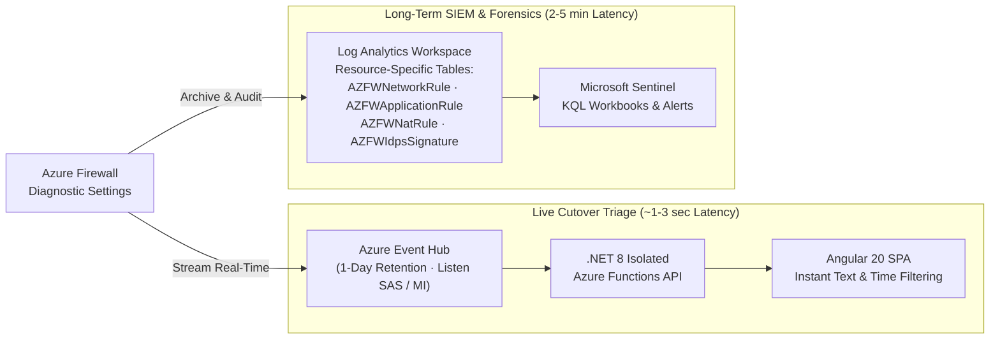

Every architectural pattern in this handbook is backed by runnable Infrastructure as Code, troubleshooting topologies, or live operational tooling inside this repository. Use this guide to pick the right lab or tool for **proof-of-concept validation**, **engineer onboarding**, **live firewall cutover debugging**, or **inter-Availability-Zone latency benchmarking**.

---

## Quick Selector & FinOps Cleanup Discipline

| Repository Path | Primary Stack | What It Validates or Operates | Typical Deploy Time |
| --- | --- | --- | --- |
| **[`labs/virtual-wan-playground`](https://github.com/jonathan-vella/azure-networking/tree/main/labs/virtual-wan-playground)** | Bicep + `.bicepparam` | Multi-region Hub-and-Spoke, Virtual WAN Secured Hub, Routing Intent, Private Subnets, and AVNM (Scenarios 0–5) | 5 min (Scen 0) to 40 min (Scen 5) |
| **[`labs/aks`](https://github.com/jonathan-vella/azure-networking/tree/main/labs/aks)** | Azure CLI + K8s YAML | Azure CNI Overlay, Azure CNI Powered by Cilium, Application Gateway for Containers (Gateway API), and UDR/NAT GW Egress | 10–20 min |
| **[`labs/foundry-networking`](https://github.com/jonathan-vella/azure-networking/tree/main/labs/foundry-networking)** | Bicep / CLI | Microsoft Foundry Standard Agent BYO-VNet (`Microsoft.App/environments`) and private Azure ML workspace topologies | 15–25 min |
| **[`samples/bgp-bird`](https://github.com/jonathan-vella/azure-networking/tree/main/samples/bgp-bird)** | Linux BIRD + VXLAN | Lightweight eBGP routing NVAs, IP masquerading, VXLAN overlays, and Azure Route Server Next-Hop IP experiments | 5–10 min |
| **[`tools/firewall-monitor`](https://github.com/jonathan-vella/azure-networking/tree/main/tools/firewall-monitor)** | Angular 20 + .NET 8 + Event Hubs | Real-time "Process Monitor"-style live stream viewer for Azure Firewall allow/deny events | 10 min |
| **[`tools/netbench`](https://github.com/jonathan-vella/azure-networking/tree/main/tools/netbench)** | Terraform + Functions + SWA | Automated intra-zone, inter-zone (`qperf`), and throughput (`iperf3`) benchmarking mapped to physical Azure AZs | 8–15 min per region |

:::caution[Lab Cost & Teardown Discipline]
Network gateways (`VpnGw1AZ`, vWAN VPN/ER Gateways), Secured Virtual Hubs, Azure Firewall, and Azure Bastion **bill continuously by the hour regardless of traffic volume**. Never leave lab topologies running overnight in shared subscriptions:
- Tag every lab Resource Group with an `AutoDestroy` or owner expiration tag.
- Delete entire lab Resource Groups asynchronously immediately after validation (`az group delete -n <rg-name> --yes --no-wait`).
- Remember that Virtual WAN hubs with Routing Intent or third-party SaaS attachments must delete child policies/SaaS resources in reverse dependency order if not deleting the entire Resource Group at once.
:::

---

## 1. Virtual WAN & Hub-Spoke Bicep Playground (`labs/virtual-wan-playground`)

**Source**: **[`labs/virtual-wan-playground`](https://github.com/jonathan-vella/azure-networking/tree/main/labs/virtual-wan-playground)** · **Related Chapters**: [Hub-Spoke vs. Virtual WAN](/azure-networking/02-core-topologies/hub-spoke-vs-vwan/), [Virtual WAN & Routing Intent](/azure-networking/02-core-topologies/virtual-wan-and-routing-intent/).

This modular Bicep lab builder deploys side-by-side **customer-managed Hub-and-Spoke (`hubType = 'VNET'`)**, **Azure Virtual WAN (`hubType = 'VWAN'`)**, and **Azure Virtual Network Manager (`deployVnetPeeringAVNM = true`)** topologies from a single parameterized entry point (`main.bicep`), slicing a `/16` address block cleanly into `/24` VNets (`x.x.0.0/24` Hub, `x.x.1..N.0/24` Spokes, `x.x.255.0/24` simulated On-Premises).

### Pre-Built Parameter Progression (`bicepparams/scenario0..5`)

Start with the lowest scenario number that tests your hypothesis so you do not wait 30+ minutes for VPN Gateways when validating basic peering or firewall rules:

| Parameter Set | Topology Variants | Deployed Components | Best Used For |
| --- | --- | --- | --- |
| **`scenario0`** | `.vnet` · `.vwan` · `.avnm` | Hub + 2 Spokes + OnPrem VNet + Peerings/vWAN Connections (**no VMs, Bastion, Firewall, or Gateways**) | Fast (<5 min), near-zero-cost validation of Bicep CIDR math, AVNM network groups, and route tables |
| **`scenario1`** | `.vnet` · `.vwan` · `.avnm` | Scenario 0 + Spoke & OnPrem VMs (`Standard_B2ls_v2`) with Azure Monitor Agent & DCR | Testing baseline VM-to-VM East-West connectivity and VM Insights Dependency Map |
| **`scenario2`** | `.vnet` · `.vwan` · `.avnm` | Scenario 1 + **Azure Bastion** | Browser-based SSH/RDP validation into private spoke/on-prem VMs without public VM IPs |
| **`scenario3`** | `.vnet` · `.vwan` · `.avnm` | Scenario 2 + **Azure Firewall (`Standard`/`Premium`)** + Rule Collection Group + Spoke UDRs / Hub routing | Validating Secured Hub Routing Intent (`internetTrafficRoutingPolicy`, `privateTrafficRoutingPolicy`) and **`defaultOutboundAccess: false`** private subnets |
| **`scenario4`** | `.vnet` · `.vwan` · `.avnm` | Scenario 3 + **AZ VPN Gateways** (`VpnGw1AZ` Gen2 / vWAN VPN GW) with BGP (`ASN 65010`/`65515` & `65020`) | Pre-staging hybrid BGP gateways and inspecting gateway effective routes prior to tunnel bring-up |
| **`scenario5`** | `.vnet` · `.vwan` | Scenario 4 + **Active Site-to-Site IPsec VPN Tunnel + eBGP** between OnPrem and Hub | Full end-to-end hybrid branch -> Secured Hub Firewall -> Spoke VNet routing, SNAT/DNAT, and BGP failover testing |

### Deploying Single-Region & Multi-Region Topologies

Pass the desired `.bicepparam` file at subscription scope (supplying credentials interactively or via environment overrides—never commit secrets into `.bicepparam` files):

```bash
# Deploy Scenario 3 (Secured Virtual WAN Hub + Azure Firewall + 2 Spokes)
az deployment sub create \
  --name lab-vwan-scen3 \
  --location swedencentral \
  --template-file labs/virtual-wan-playground/main.bicep \
  --parameters labs/virtual-wan-playground/bicepparams/scenario3.vwan.bicepparam \
  --parameters adminUsername=azureadmin internetTrafficRoutingPolicy=true privateTrafficRoutingPolicy=true defaultOutboundAccess=true
```

To test **multi-region Global VNet Peering, inter-hub Virtual WAN transit, and cross-region S2S VPN failover**, pass a two-element `locations` array (e.g., `swedencentral` `172.16.0.0/16` + `germanywestcentral` `172.31.0.0/16`). Note that deploying the **AVNM** variant (`*.avnm.bicepparam`) requires `Owner` or `User Access Administrator` on the Hub Resource Group so the deployment script's User-Assigned Managed Identity can bind `Network Contributor`.

---

## 2. AKS & Container Networking Labs (`labs/aks`)

**Source**: **[`labs/aks`](https://github.com/jonathan-vella/azure-networking/tree/main/labs/aks)** · **Related Chapter**: [AKS Enterprise Networking Architecture](/azure-networking/05-workload-networking/aks-networking/).

Use the modular scripts and Kubernetes manifests in `labs/aks` to compare container networking data planes side by side and reproduce common enterprise RBAC and egress errors safely:

- **CNI & Cilium Data-Plane Labs (`labs/aks/CNI/`)**:
  - `build-azure-cni-powered-by-cilium.sh`: Provisions an AKS cluster running **Azure CNI Overlay + Cilium eBPF** (`--network-plugin azure --network-plugin-mode overlay --pod-cidr 192.168.0.0/16 --network-dataplane cilium`), deploys test pods and internal/external `LoadBalancer` services (`yaml/`), and demonstrates how pre-creating a User-Assigned Managed Identity with `Network Contributor` prevents `SyncLoadBalancerFailed (403 AuthorizationFailed)` race conditions on custom subnets.
  - `build-azure-cni-overlay.sh` & `build-azure-cni.sh`: Contrasts overlay pod IP conservation against flat VNet pod IP consumption in Azure Portal / `kubectl get pods -o wide`.
- **Application Gateway for Containers & Gateway API**: Pair your Cilium Overlay cluster with a `/24` subnet delegated to `Microsoft.ServiceNetworking/trafficControllers` and test `Gateway` + `HTTPRoute` direct-to-overlay-pod routing without NodePort hops.
- **Zero-Trust Egress Lockdown (`labs/aks/Egress/build-aks-egress.azcli`)**:
  - Walks step-by-step through deploying **Azure Firewall** (`--enable-dns-proxy true`), configuring mandatory `AzureKubernetesService` FQDN tags and container registry rules (`mcr.microsoft.com`, `ghcr.io`, `docker.io`), attaching a `0.0.0.0/0 -> VirtualAppliance` UDR to `aks-subnet`, and deploying AKS with `--outbound-type userDefinedRouting` (plus an alternative `--outbound-type userAssignedNATGateway` comparison and inbound Firewall DNAT test).
- **Container Networking Fundamentals (`labs/aks/docker-networking/`)**: Hands-on Linux network namespace, `veth` pair, and bridge exercises for engineers learning how CNI plugins wire pod interfaces under the hood.

---

## 3. Microsoft Foundry Labs (`labs/foundry-networking`) & BGP BIRD Samples (`samples/bgp-bird`)

### Microsoft Foundry & Private AI Workspace Labs (`labs/foundry-networking`)

**Source**: **[`labs/foundry-networking`](https://github.com/jonathan-vella/azure-networking/tree/main/labs/foundry-networking)** · **Related Chapter**: [Microsoft Foundry, Azure ML & Fabric Private Networking](/azure-networking/05-workload-networking/foundry-and-fabric-networking/).

Provides reference scripts and templates for building **network-isolated AI landing zones**:

- **Foundry Standard Agent BYO-VNet**: Validates subnet delegation to `Microsoft.App/environments` (`/24` agent subnet), disabling `publicNetworkAccess` across Microsoft Foundry, Azure Cosmos DB, Azure AI Search, Azure Storage, Azure Key Vault, and Azure Container Registry, linking all `privatelink.*` Private DNS zones, and verifying `nslookup` private IP resolution from inside the VNet before provisioning project capability hosts.
- **Private Azure Machine Learning Workspace**: Demonstrates bastion/jump-host validation, private storage (`blob` + `file`) and ACR Private Endpoints, and workspace Managed VNet outbound rules.

### Linux BIRD BGP & VXLAN NVA Samples (`samples/bgp-bird`)

**Source**: **[`samples/bgp-bird`](https://github.com/jonathan-vella/azure-networking/tree/main/samples/bgp-bird)** · **Related Chapters**: [Hub-Spoke & Azure Route Server](/azure-networking/02-core-topologies/hub-spoke-and-route-server/), [AVS Networking & Transit](/azure-networking/05-workload-networking/avs-networking/).

Contains lightweight Linux Network Virtual Appliance configurations using the **BIRD Internet Routing Daemon**:

- **`bird-east.conf` & `bird-notes`**: Ready-to-adapt eBGP multi-hop peering configuration (`ASN 65515`) for **Azure Route Server**—ideal for testing **ARS Next-Hop IP** (`0.0.0.0/0` next-hop rewrite to Azure Firewall for AVS Gen 1 internet breakout!), AS-path prepending, and route filtering without paying for heavy commercial NVA licenses in a lab.
- **`masq.sh` & `vxlan-notes`**: Linux kernel IP forwarding + `iptables` SNAT masquerading scripts and VXLAN tunnel encapsulation recipes for testing chained multi-NVA BGP sessions over Azure VNet fabrics (where native Layer 2 multicast/broadcast is blocked and direct NIC-to-NIC BGP next-hop rewrites would otherwise collide with Azure SDN).

---

## 4. Real-Time Azure Firewall Monitor (`tools/firewall-monitor`)

**Source**: **[`tools/firewall-monitor`](https://github.com/jonathan-vella/azure-networking/tree/main/tools/firewall-monitor)** · **Related Chapters**: [Firewall & NVA Patterns](/azure-networking/04-network-security/firewall-and-nva-patterns/), [Virtual WAN Verification Playbook (`A-OPS-04`)](/azure-networking/06-operations-reviews/vwan-review-addendum/#a-ops-04).

Anyone who has debugged a live application cutover through Azure Firewall knows the frustration of waiting **2 to 5 minutes** for Log Analytics ingestion latency after every test `curl`. **`tools/firewall-monitor`** (`az-firewall-mon`) solves the *"what is being blocked right this second?"* problem with a Sysinternals Process Monitor / Check Point SmartView-style live stream UI built on **Angular 20**, **.NET 8 isolated Azure Functions**, and **Azure Event Hubs**.



### When to Use Event Hub Live Streaming vs. Log Analytics Structured Logs

| Operational Need | `tools/firewall-monitor` (Event Hub Stream) | Log Analytics Structured Logs (`AZFW*` Tables) |
| --- | --- | --- |
| **End-to-End Visibility Lag** | **Near real-time (~1–3 seconds)** | **2–5 minutes** ingestion pipeline delay |
| **Query Experience** | Instant client-side substring, protocol, action (`Deny`), and time-window filtering (zero KQL required) | Full KQL joins, aggregations, percentile charts, and Sentinel hunting queries |
| **Retention Window** | Ephemeral (**24 hours** on Event Hub) | **30 days to 12 years** (Interactive + Archive tiers) |
| **Primary Use Case** | Live production cutover bridges, AKS/Foundry egress rule discovery, interactive troubleshooting | Production compliance auditing, SOC incident response, historical top-talker FinOps analysis |

:::danger[Security Guardrails for `tools/firewall-monitor`]
1. **Self-Host Inside Your Own Azure Tenant**: Always deploy the Static Web App, .NET 8 Function App, and Event Hub inside **your own controlled subscription** (`tools/firewall-monitor/INSTALL.md` + `bicep/`). **Never** paste production Event Hub connection strings or stream production firewall telemetry (which contains internal IPs, FQDNs, and URL paths) into any public or third-party demo URL.
2. **Least-Privilege Stream Access**: Create a dedicated Event Hub Shared Access Policy restricted strictly to the **`Listen`** claim (never `Manage` or `Send`), protect the Static Web App with **Microsoft Entra ID built-in authentication**, and disable or tear down the diagnostic Event Hub stream when active troubleshooting concludes if continuous streaming is not needed.
:::

---

## 5. Azure Netbench: Latency & Throughput Suite (`tools/netbench`)

**Source**: **[`tools/netbench`](https://github.com/jonathan-vella/azure-networking/tree/main/tools/netbench)** · **Related Chapters**: [ExpressRoute Resiliency](/azure-networking/03-hybrid-connectivity/expressroute-resiliency/), [Virtual WAN Checklist (`PERF-01`)](/azure-networking/06-operations-reviews/vwan-review-checklist/#perf-01).

When designing latency-sensitive synchronous database replication, SAP HANA HSR, AVS stretched/multi-tier workloads, or high-frequency financial systems, marketing SLA numbers are no substitute for empirical measurements between actual **physical Azure Availability Zones**.

### Why Logical Zone != Physical Datacenter

Azure randomizes the mapping between **Logical Availability Zones** (`1`, `2`, `3` inside your subscription) and **Physical Availability Zones** (e.g., `eastus-az1`, `eastus-az2`, `eastus-az3`) independently per subscription. Logical Zone 1 in Subscription A frequently maps to Physical Zone B in Subscription B!

`tools/netbench` resolves this via `get-locations.sh` (`az rest` against the subscriptions `/locations` API) and `availabilityZoneMappings.json` so benchmarks always measure **true physical-zone-to-physical-zone** paths.

### Architecture & Execution Workflow

1. **Terraform Test Harness (`modules/netperf/`)**: Provisions Linux server and client VMs across all three Availability Zones with **Accelerated Networking** enabled, staggered by 60 seconds via `cloud-init` so zone-pair tests never contend on the same receiver NIC simultaneously.
2. **Secure Telemetry Sink**: Client VMs authenticate via **Managed Identity** and write structured JSON metrics over an **Azure Private Endpoint** to Azure Table Storage (`publicNetworkAccess` closed), surfaced by an Azure Functions API + Static Web App dashboard (`dashboard/`).
3. **Interpreting `qperf` Latency & `iperf3` Throughput**:
   - **Intra-Zone Latency (`qperf tcp_lat`)**: Same physical AZ — healthy baseline is **`< 500 µs`** (often `120–350 µs` with Accelerated Networking).
   - **Inter-Zone Latency (`qperf tcp_lat`)**: Cross-physical AZ within the same region — healthy baseline is **`< 2,000 µs` (`< 2 ms`)**; flag pairs exceeding `2 ms` before placing synchronous quorum replicas across them.
   - **TCP / UDP Throughput (`qperf tcp_bw` & `iperf3`)**: Both `qperf` and `iperf3` are installed on the benchmark images. Use `qperf` for automated 10-second zone-matrix sweeps, and invoke multi-stream `iperf3 -c <server-ip> -P 8 -t 30` (TCP) or `iperf3 -u -b <target> -l 1400` (UDP packet-per-second / ExpressRoute & Firewall shaper testing) when validating VM SKU bandwidth ceilings, VNet peering, or Virtual WAN hub router throughput ([PERF-04](/azure-networking/06-operations-reviews/vwan-review-checklist/#perf-04)):

```bash
# Run a localized one-shot regional benchmark and destroy immediately after results upload
cd tools/netbench
terraform init
terraform apply -var-file="tfvars/francecentral.tfvars" -auto-approve
# Wait ~5-8 minutes for staggered cloud-init qperf sweeps to complete, then clean up:
terraform destroy -var-file="tfvars/francecentral.tfvars" -auto-approve
```
