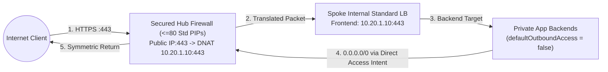
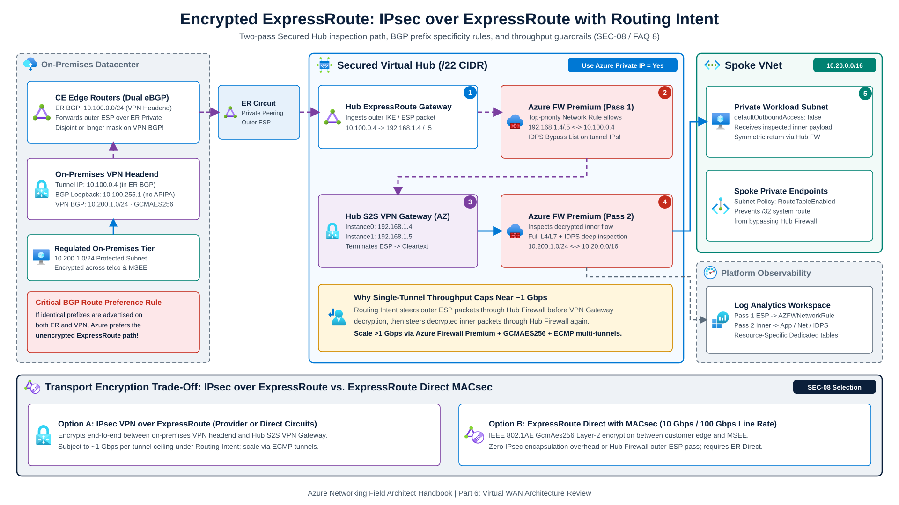

Enterprise Azure Virtual WAN architecture reviews consistently raise the same eight routing, security, and hybrid edge-case questions, particularly from teams migrating from AWS Transit Gateway or customer-managed Azure hub-and-spoke networks.

This FAQ covers Virtual WAN control-plane and data-plane edge cases, linking to foundational chapters for baseline concepts and to matching controls in the [Virtual WAN Review Checklist](/azure-networking/06-operations-reviews/vwan-review-checklist/) and [Verification Playbook](/azure-networking/06-operations-reviews/vwan-review-addendum/). For baseline topology trade-offs and Routing Intent fundamentals, read [Hub-Spoke vs. Virtual WAN](/azure-networking/02-core-topologies/hub-spoke-vs-vwan/) and [Virtual WAN & Routing Intent](/azure-networking/02-core-topologies/virtual-wan-and-routing-intent/) first.

---

## Executive decision summary

| # | Field Architect Question | Short Answer | Checklist Control |
| --- | --- | --- | --- |
| **1** | [Default route propagation](#1-default-route-propagation-mechanics) | Every connection associates to `defaultRouteTable` and propagates to the `Default` label (`ASN 65515`), **except `0.0.0.0/0`, which stays hub-local and never crosses hubs**. | [RT-01](/azure-networking/06-operations-reviews/vwan-review-checklist/#rt-01), [RT-03](/azure-networking/06-operations-reviews/vwan-review-checklist/#rt-03) |
| **2** | [Routing Intent vs. custom route tables](#2-routing-intent-vs-custom-route-tables) | Use `defaultRouteTable` with **Routing Intent** as the production standard. Reserve custom route tables for strict multi-tenant VRF isolation; the two cannot coexist in one hub. | [RT-06](/azure-networking/06-operations-reviews/vwan-review-checklist/#rt-06), [RT-10](/azure-networking/06-operations-reviews/vwan-review-checklist/#rt-10) |
| **3** | [VNet connection routing controls](#3-vnet-connection-routing-static-routes-and-bypass-next-hop-ip) | Keep default association and propagation; configure connection static routes with `Bypass next-hop IP = Yes` only for spoke NVAs, noting how Routing Intent overrides that flag. | [RT-04](/azure-networking/06-operations-reviews/vwan-review-checklist/#rt-04), [RT-06](/azure-networking/06-operations-reviews/vwan-review-checklist/#rt-06) |
| **4** | [Private Endpoint symmetry & UDRs](#4-private-endpoint-symmetry-and-spoke-udr-exceptions) | Do not put blanket `0.0.0.0/0` UDRs on spokes; instead enable **`RouteTableEnabled` network policy** on Private Endpoint subnets so on-premises-to-PE flows traverse the hub firewall symmetrically. | [SEC-05](/azure-networking/06-operations-reviews/vwan-review-checklist/#sec-05) |
| **5** | [Default outbound access post-March 2026](#5-default-outbound-access-post-march-2026-and-spoke-subnet-layout) | API versions released after March 31, 2026 create **private subnets (`defaultOutboundAccess: false`)** on new VNets and require explicit egress via Routing Intent or NAT Gateway. | [SEC-04](/azure-networking/06-operations-reviews/vwan-review-checklist/#sec-04) |
| **6** | [IPsec termination options](#6-ipsec-termination-options-when-hub-firewalls-cannot-terminate-tunnels) | **Neither Azure Firewall nor Palo Alto Cloud NGFW terminates IPsec.** Terminate tunnels on the vWAN S2S VPN Gateway, a certified dual-role hub NVA, or a spoke NVA. | [RES-04](/azure-networking/06-operations-reviews/vwan-review-checklist/#res-04), [SEC-07](/azure-networking/06-operations-reviews/vwan-review-checklist/#sec-07) |
| **7** | [DNAT return symmetry](#7-inbound-dnat-return-symmetry-to-private-spoke-load-balancers) | Secured Hub Azure Firewall (`<= 80` standard PIPs) and Cloud NGFW support DNAT to internal spoke Load Balancers with symmetric return **only for hub-local targets in Direct Access mode**. | [SEC-16](/azure-networking/06-operations-reviews/vwan-review-checklist/#sec-16) |
| **8** | [NVA BGP & Encrypted ExpressRoute](#8-centralized-hub-security-spoke-nva-bgp-and-encrypted-expressroute) | Prefer in-hub security over spoke NVAs. For IPsec VPN-over-ExpressRoute with Routing Intent, advertise more-specific VPN prefixes, exempt tunnel IPs from IDPS, and budget **~1 Gbps per tunnel**. | [SEC-08](/azure-networking/06-operations-reviews/vwan-review-checklist/#sec-08), [TOP-08](/azure-networking/06-operations-reviews/vwan-review-checklist/#top-08) |

---

## 1. Default route propagation mechanics

Every Standard Virtual WAN hub deploys a managed BGP router (`ASN 65515`) and two built-in tables: `defaultRouteTable` and `noneRouteTable` ([About virtual hub routing](https://learn.microsoft.com/en-us/azure/virtual-wan/about-virtual-hub-routing)). By default, every new VNet, S2S VPN, ExpressRoute, or P2S connection associates to `defaultRouteTable` and propagates to the `Default` label across every hub in the Virtual WAN (prepending `65520-65520` on inter-hub BGP advertisements).

Three platform constraints govern `defaultRouteTable`:

- **`0.0.0.0/0` stays hub-local**: Virtual WAN never propagates `0.0.0.0/0` across inter-hub links. Every regional hub that breaks out to the internet needs its own local security appliance and `InternetTraffic` Routing Intent policy ([RT-03](/azure-networking/06-operations-reviews/vwan-review-checklist/#rt-03)).
- **Hub BGP cannot override intra-VNet prefixes**: Virtual WAN rejects routes equal to or more specific than a connected VNet's own address space. Subnet-to-subnet inspection inside a single spoke requires NSGs or spoke UDRs (see [Routing & Traffic Engineering](/azure-networking/01-foundations/routing-and-traffic-engineering/)).
- **All branches share one association table**: Within a hub, S2S VPN, ExpressRoute, and P2S connections must associate to `defaultRouteTable` and propagate to the same set of route tables.

---

## 2. Routing Intent vs. custom route tables

Default to `defaultRouteTable` paired with [Routing Intent](https://learn.microsoft.com/en-us/azure/virtual-wan/how-to-routing-policies) (`PrivateTraffic` and `InternetTraffic` policies).

- **Why `defaultRouteTable` + Routing Intent is the standard**: Routing Intent programs `_policy_PrivateTraffic` (`10.0.0.0/8`, `172.16.0.0/12`, `192.168.0.0/16`, plus explicit additional prefixes under [RT-09](/azure-networking/06-operations-reviews/vwan-review-checklist/#rt-09)) and `_policy_PublicTraffic` (`0.0.0.0/0`) directly onto the Azure SDN platform toward your hub security appliance. That SDN programming bypasses the Virtual Hub router data plane (avoiding hub router `$/GB` data-processing charges) and is the **only** supported way to inspect inter-hub east-west traffic across regional firewalls ([RT-05](/azure-networking/06-operations-reviews/vwan-review-checklist/#rt-05)).
- **When custom route tables fit**: Use [custom route tables](https://learn.microsoft.com/en-us/azure/virtual-wan/how-to-virtual-hub-routing) and [Route Maps](https://learn.microsoft.com/en-us/azure/virtual-wan/route-maps-about) ([RT-10](/azure-networking/06-operations-reviews/vwan-review-checklist/#rt-10)) only when regulatory or multi-tenant boundaries forbid prefixes from sharing a route table even behind a stateful firewall. Routing Intent and custom route tables cannot coexist in the same hub.
- **Exact rollback and scale rules**: Enabling Routing Intent requires zero custom route tables and zero `defaultRouteTable` static routes pointing to VNet connections. You can remove Routing Intent later (`az network vhub routing-intent delete`), which resets all hub connections to propagate to the `default` label, **but Virtual WAN does not automatically restore prior `defaultRouteTable` static routes or custom propagations**. Export JSON snapshots beforehand ([A-RT-06](/azure-networking/06-operations-reviews/vwan-review-addendum/#a-rt-06)) and track the non-adjustable **600 locally connected VNet address-space limit** per hub, adding a second hub once a hub reaches `540` prefixes (`90%`).

---

## 3. VNet connection routing, static routes, and Bypass Next-Hop IP

Each Hub-to-VNet connection exposes six routing controls ([How to connect a VNet to a Virtual WAN hub](https://learn.microsoft.com/en-us/azure/virtual-wan/howto-connect-vnet-hub)):

| Connection Property | Recommended Setting | Architectural Behavior & Pitfalls |
| --- | --- | --- |
| **Associate Route Table** | `defaultRouteTable` | Leave empty/default when adding connections to a Routing Intent hub. |
| **Propagate to None** | `No` | Set `Yes` only on isolated sandbox VNets that peers must not reach (Routing Intent manages propagations automatically when active). |
| **Propagate to Labels** | `Default` | Shares spoke prefixes across hubs when Private Routing Intent is not overriding propagation to `noneRouteTable`. |
| **Static Routes** | **Empty** (unless spoke hosts an NVA) | Defines prefixes reachable behind a spoke appliance IP (supports a single next-hop IP per connection for `0.0.0.0/0` or public prefixes). |
| **Propagate Static Route** | `Yes` only if remote hubs need that spoke NVA | Static `0.0.0.0/0` never propagates cross-hub even when enabled. |
| **Bypass Next-Hop IP for Workloads Within This VNet** | `Yes` when NVA and workloads share a spoke | Prevents hub hairpins into a spoke's own NVA; set at connection creation only (delete and recreate the connection to change) and ignored for BGP-learned spoke NVA routes. |

:::caution[Routing Intent + Connection Static Route Override]
When `PrivateTraffic` Routing Intent is active **and** `Propagate static route = Yes` is enabled on a VNet connection (or a `0.0.0.0/0` static route is set on the connection), Virtual WAN ignores the connection's `Bypass next-hop IP` flag and treats it as `bypass/equals`. If the spoke VNet's own CIDR falls inside that static route summary, the hub security appliance inspects the packet and routes it **directly to the destination spoke VM, bypassing the static-route NVA IP**.
:::

---

## 4. Private Endpoint symmetry and spoke UDR exceptions

Do not attach blanket `0.0.0.0/0` User-Defined Route (UDR) tables to spoke subnets in a Routing Intent Virtual WAN; the hub injects `0.0.0.0/0` and RFC 1918 routes automatically. Attach spoke UDR tables (always keeping **`Propagate gateway routes = Yes`**) only for three specific cases:

1. **Private Endpoint return-path symmetry**: By default, Private Endpoints ignore route tables and program `/32` system routes. Under `PrivateTraffic` Routing Intent, traffic from on-premises to a spoke Private Endpoint bypasses the hub firewall on the forward path while return packets hit the firewall, and the firewall drops stateful TCP sessions. Adding `/32` prefixes to Routing Intent's Private Traffic list **does not fix this** ([Routing intent data-path troubleshooting](https://learn.microsoft.com/en-us/azure/virtual-wan/how-to-routing-policies#troubleshooting-data-path)). Enable **`privateEndpointNetworkPolicies: RouteTableEnabled`** (or `Enabled`) on the Private Endpoint subnet ([SEC-05](/azure-networking/06-operations-reviews/vwan-review-checklist/#sec-05); see [Private Link & DNS at Scale](/azure-networking/04-network-security/private-link-and-dns-at-scale/)). Also enforce the non-adjustable **4,000 Private Endpoint limit per hub** and tune client TCP timeouts to `15-30 seconds` so sessions recover quickly during hub or gateway maintenance ([Use Private Link in Virtual WAN](https://learn.microsoft.com/en-us/azure/virtual-wan/howto-private-link)).
2. **Service-tag control-plane exceptions**: Used only where service documentation mandates direct `Internet` next-hop UDRs for specific management tags. On private subnets (`defaultOutboundAccess: false`), `nextHopType: Internet` UDRs fail unless the subnet also has an explicit outbound method such as NAT Gateway.
3. **Intra-spoke subnet microsegmentation**: Used when two subnets inside the same spoke VNet must steer traffic through an appliance because Virtual WAN cannot inject routes equal to or more specific than the VNet CIDR.

---

## 5. Default outbound access post-March 2026 and spoke subnet layout

For ARM, Bicep, CLI, and Terraform deployments targeting API versions released **after March 31, 2026**, subnets in **new** Virtual Networks default to `defaultOutboundAccess: false` ([Default outbound access in Azure](https://learn.microsoft.com/en-us/azure/virtual-network/ip-services/default-outbound-access)). Existing VNets and templates pinned to earlier API versions retain `defaultOutboundAccess: null` (implicit outbound enabled) until updated. For baseline Bicep syntax and subnet sizing, see [VNet Sizing & IPv4/IPv6 Planning](/azure-networking/01-foundations/vnet-and-ip-addressing/).

Verify three Virtual WAN operational details when enforcing `defaultOutboundAccess: false` ([SEC-04](/azure-networking/06-operations-reviews/vwan-review-checklist/#sec-04)):

- **Choose an explicit egress path before flipping existing subnets**: Either advertise `0.0.0.0/0` from the Secured Virtual Hub via `InternetTraffic` Routing Intent (`enableInternetSecurity: true` on the hub VNet connection) or attach an **Azure NAT Gateway** to high-concurrency spoke subnets excused from central L7 inspection.
- **Stop and deallocate existing VMs**: Changing an existing subnet between non-private and `defaultOutboundAccess: false` takes effect on running VM NICs (`defaultOutboundConnectivityEnabled`) only after VMs are stopped and deallocated.
- **Watch IP-based Load Balancer pools and same-region Storage**: Load Balancer backend pools configured by IP address have a known default-outbound dependency (attach a NAT Gateway to secure them), and VMs in a private subnet can still reach same-region Azure Storage public IPs unless restricted by NSGs and Private Endpoints.

---

## 6. IPsec termination options when hub firewalls cannot terminate tunnels

Neither **Azure Firewall** nor **Palo Alto Cloud NGFW SaaS** includes an IKE/IPsec daemon for partner extranet or B2B Site-to-Site tunnels. Select one of three supported termination patterns (for NVA HA patterns outside vWAN, see [Firewall & NVA Patterns](/azure-networking/04-network-security/firewall-and-nva-patterns/)):

| Termination Option | Managed Model | Routing Intent Integration | When to Select |
| --- | --- | --- | --- |
| **A. Virtual WAN S2S VPN Gateway** | First-party Microsoft PaaS in hub ([IPsec policies](https://learn.microsoft.com/en-us/azure/virtual-wan/virtual-wan-ipsec)) | **Native**: decrypted traffic steers directly into the `PrivateTraffic` hub security appliance | **Default choice** whenever partner CPEs support route-based IKEv2 IPsec (`GCMAES256`, up to `1,000` connections / `2,000` tunnels per hub). |
| **B. Certified dual-role NVA in Virtual Hub** (`cisco-tdv-vwan-nva`, `fortinet-ngfw-and-sdwan`, `checkpoint`) | Marketplace Managed App in hub ([About NVAs in hub](https://learn.microsoft.com/en-us/azure/virtual-wan/about-nva-hub)) | **Native** for eligible NGFW/SD-WAN SKUs (avoid active-active BGP ECMP on dual-role NVAs unless vendor session sync is supported) | Partner requires vendor-specific crypto, SD-WAN overlays, or policy-based selectors unsupported by vWAN S2S VPN Gateway. |
| **C. Self-managed NVA in spoke VNet** | Customer IaaS VM/VMSS in spoke | **Partial**: uses [Virtual Hub BGP peering](https://learn.microsoft.com/en-us/azure/virtual-wan/scenario-bgp-peering-hub) or connection static routes (`Propagate static route = Yes`) | Brownfield migration preserving custom router images that have no certified Hub Managed Application offer. |

---

## 7. Inbound DNAT return symmetry to private spoke load balancers

Both **Azure Firewall** and **Palo Alto Cloud NGFW SaaS** publish private spoke workloads via **Destination NAT (DNAT)** to an Internal Standard Load Balancer or Application Gateway for Containers private frontend without placing public IPs in spoke VNets. Note the platform public IP ceiling: Azure Firewall supports up to **250 public IPs** in a customer-managed VNet hub, **but up to 80 public IPs in a standard GA Secured Virtual Hub** (up to 250 only with customer-provided public IPs in preview; see [Secured Virtual Hub public IP limits](https://learn.microsoft.com/en-us/azure/firewall-manager/secured-virtual-hub)).

Enforce three guardrails on every Secured Hub DNAT rule ([SEC-16](/azure-networking/06-operations-reviews/vwan-review-checklist/#sec-16), [Securing internet access known limitations](https://learn.microsoft.com/en-us/azure/virtual-wan/about-internet-routing#known-limitations)):

1. **Return-path symmetry**: With `InternetTraffic` Routing Intent enabled (`enableInternetSecurity: true` on the spoke connection), spoke backends return `0.0.0.0/0` replies through the hub firewall while preserving client source IPs. Without `enableInternetSecurity: true`, the firewall must SNAT inbound flows or return packets drop asymmetrically.
2. **Hub-local targets only**: Because `0.0.0.0/0` never crosses hubs, a hub firewall in Region A cannot DNAT to a spoke attached to Region B's hub without source NAT. Publish regional ingress on each regional hub behind Azure Front Door or Traffic Manager.
3. **Never combine with Hub Forced Tunnel mode**: Inbound DNAT is unsupported on Virtual Hubs configured in **Forced Tunnel** internet mode (`0.0.0.0/0` learned from on-premises or an NVA via Private Routing Intent) because return packets follow the forced tunnel instead of exiting the hub public IP.

---

## 8. Centralized hub security, spoke NVA BGP, and Encrypted ExpressRoute

### Why in-hub security beats spoke NVAs in Virtual WAN

Peering a legacy security-spoke NVA to a Virtual WAN hub via [Virtual Hub BGP peering](https://learn.microsoft.com/en-us/azure/virtual-wan/scenario-bgp-peering-hub) forfeits Routing Intent: spoke NVAs cannot act as a Routing Intent next hop, which brings back manual route engineering, custom load-balancer health probes, and cross-hub asymmetry risks. Standardize on in-hub security (**Azure Firewall**, **Palo Alto Cloud NGFW SaaS**, or **certified in-hub NGFW NVAs** `checkpoint`, `fortinet-ngfw`, `fortinet-ngfw-and-sdwan`, `cisco-tdv-vwan-nva`) and require an Architecture Decision Record for any spoke-NVA exception.

### Encrypted ExpressRoute (IPsec over ExpressRoute) with Routing Intent

Regulated workloads requiring encryption over ExpressRoute private peering ([SEC-08](/azure-networking/06-operations-reviews/vwan-review-checklist/#sec-08), [IPsec over ExpressRoute for Virtual WAN](https://learn.microsoft.com/en-us/azure/virtual-wan/vpn-over-expressroute)) can terminate Site-to-Site IPsec tunnels on the hub VPN Gateway (`Use Azure Private IP Address = Yes`) over the ExpressRoute circuit while running `PrivateTraffic` Routing Intent with Azure Firewall ([Encrypted ExpressRoute with routing intent](https://learn.microsoft.com/en-us/azure/virtual-wan/how-to-routing-policies#encryptedER)):

Apply five engineering rules when combining Encrypted ExpressRoute with `PrivateTraffic` Routing Intent:

1. **Advertise more-specific or disjoint prefixes on VPN BGP**: Azure advertises hub and spoke routes on both ExpressRoute BGP and VPN BGP, and prefers ExpressRoute when identical prefixes arrive on both links. Advertise a summary route (for example, `10.100.0.0/24` covering the on-premises VPN headend IP) on ExpressRoute private peering, and advertise more-specific or disjoint workload prefixes (`10.200.1.0/24`) over the IPsec VPN BGP session using a non-APIPA loopback BGP peer IP (`169.254.x.x` is unsupported).
2. **Place a top-priority Firewall Network Rule for tunnel endpoints**: Download the hub VPN configuration to read `vpnSiteConnections -> gatewayConfiguration -> IpAddresses` (`Instance0` and `Instance1` private hub IPs) and place the highest-priority Network Rule in Azure Firewall Policy allowing traffic between those VPN Gateway private IPs and your on-premises VPN device private link IPs.
3. **Exclude tunnel private IPs from IDPS**: Deploy **Azure Firewall Premium** and add the VPN tunnel endpoint private IPs to the [IDPS bypass list](https://learn.microsoft.com/en-us/azure/firewall/premium-features#idps). Deep-inspecting outer ESP ciphertext wastes firewall CPU; IDPS still inspects the decrypted inner payload on Pass 2 after VPN Gateway termination.
4. **Budget ~1 Gbps per tunnel and scale via ECMP**: Because outer ESP packets traverse the hub firewall before decryption and inner cleartext traverses the firewall again afterward, single-tunnel throughput caps near **~1 Gbps** (and lower PPS on small packets). Configure `GCMAES256` encryption and integrity ([PERF-05](/azure-networking/06-operations-reviews/vwan-review-checklist/#perf-05)) and run multiple active-active ECMP tunnels from your CPE cluster to scale aggregate bandwidth.
5. **Evaluate ExpressRoute Direct MACsec at 10 Gbps and 100 Gbps**: When line-rate 10 Gbps or 100 Gbps encrypted throughput is required without IPsec encapsulation or double firewall traversal, use `GcmAes256` **MACsec** on **ExpressRoute Direct** ports (see [ExpressRoute Resiliency](/azure-networking/03-hybrid-connectivity/expressroute-resiliency/)).

