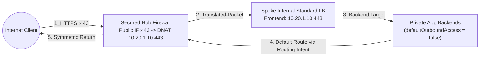

During enterprise Azure Virtual WAN design reviews, the same eight edge-case routing, security, and hybrid integration questions surface repeatedly—especially from architects transitioning from AWS Transit Gateway or customer-managed Azure Hub-and-Spoke networks.

This FAQ focuses strictly on **non-obvious Virtual WAN control-plane and data-plane mechanics**, cross-linking to foundational chapters and matching controls in the [Virtual WAN Review Checklist](/azure-networking/06-operations-reviews/vwan-review-checklist/) and [Verification Playbook](/azure-networking/06-operations-reviews/vwan-review-addendum/). For baseline topology comparisons and Routing Intent architecture, read [Hub-Spoke vs. Virtual WAN](/azure-networking/02-core-topologies/hub-spoke-vs-vwan/) and [Virtual WAN & Routing Intent](/azure-networking/02-core-topologies/virtual-wan-and-routing-intent/) first.

---

## Executive Decision Summary

| # | Field Architect Question | Short Answer | Checklist Control |
| --- | --- | --- | --- |
| **1** | [Default Route Propagation](#1-default-route-propagation-mechanics) | Every connection associates to `defaultRouteTable` and propagates to the global `Default` label (`ASN 65515`), **except `0.0.0.0/0`, which is strictly hub-local and never crosses hubs**. | [RT-01](/azure-networking/06-operations-reviews/vwan-review-checklist/#rt-01), [RT-03](/azure-networking/06-operations-reviews/vwan-review-checklist/#rt-03) |
| **2** | [Routing Intent vs. Custom Route Tables](#2-routing-intent-vs-custom-route-tables) | Use `defaultRouteTable` + **Routing Intent** as the production standard. Reserve custom route tables only for hard VRF-like multi-tenant isolation—the two are **mutually exclusive** per hub. | [RT-06](/azure-networking/06-operations-reviews/vwan-review-checklist/#rt-06), [RT-10](/azure-networking/06-operations-reviews/vwan-review-checklist/#rt-10) |
| **3** | [VNet Connection Routing Controls](#3-vnet-connection-routing-static-routes-and-bypass-next-hop-ip) | Keep default association/propagation; add connection static routes + `Bypass next-hop IP = Yes` **only** for spoke-resident NVAs, noting how Routing Intent overrides `Bypass next-hop IP`. | [RT-04](/azure-networking/06-operations-reviews/vwan-review-checklist/#rt-04), [RT-06](/azure-networking/06-operations-reviews/vwan-review-checklist/#rt-06) |
| **4** | [Private Endpoint Symmetry & UDRs](#4-private-endpoint-symmetry-and-spoke-udr-exceptions) | Let vWAN program spoke routes automatically, **except** enable **`RouteTableEnabled` network policy** on Private Endpoint subnets so on-premises -> PE flows do not bypass the hub firewall. | [SEC-05](/azure-networking/06-operations-reviews/vwan-review-checklist/#sec-05) |
| **5** | [Default Outbound Access Post-March 2026](#5-default-outbound-access-post-march-2026-and-spoke-subnet-layout) | Azure has no AWS-style "public subnet." New API versions post-March 31, 2026 create **private subnets (`defaultOutboundAccess: false`)** requiring explicit egress via Routing Intent or NAT Gateway. | [SEC-04](/azure-networking/06-operations-reviews/vwan-review-checklist/#sec-04) |
| **6** | [IPsec Termination Options](#6-ipsec-termination-options-when-hub-firewalls-cannot-terminate-tunnels) | **Neither Azure Firewall nor Palo Alto Cloud NGFW terminates IPsec.** Terminate tunnels on the vWAN S2S VPN Gateway, a certified hub NVA (`cisco-tdv-vwan-nva`), or a spoke NVA. | [RES-04](/azure-networking/06-operations-reviews/vwan-review-checklist/#res-04), [SEC-07](/azure-networking/06-operations-reviews/vwan-review-checklist/#sec-07) |
| **7** | [DNAT Return Symmetry](#7-inbound-dnat-return-symmetry-to-private-spoke-load-balancers) | Azure Firewall (up to 250 PIPs) and Cloud NGFW both support DNAT to internal spoke Load Balancers. Routing Intent guarantees return symmetry, **provided DNAT stays hub-local and Direct Access mode is used**. | [SEC-16](/azure-networking/06-operations-reviews/vwan-review-checklist/#sec-16) |
| **8** | [NVA BGP & Encrypted ExpressRoute](#8-centralized-hub-security-spoke-nva-bgp-and-encrypted-expressroute) | Prefer Secured Hub (Azure FW, Cloud NGFW, or certified NVA) over spoke NVAs. For IPsec VPN-over-ExpressRoute with Routing Intent, budget **~1 Gbps per tunnel** and exempt ESP endpoints from IDPS. | [SEC-08](/azure-networking/06-operations-reviews/vwan-review-checklist/#sec-08), [TOP-08](/azure-networking/06-operations-reviews/vwan-review-checklist/#top-08) |

---

## 1. Default Route Propagation Mechanics

Every Virtual WAN Standard hub provisions a managed BGP router (`ASN 65515`) alongside two built-in tables: **`defaultRouteTable`** and **`noneRouteTable`**. Unless modified, every new Hub-to-VNet, VPN, ExpressRoute, or P2S connection:

1. **Associates** to `defaultRouteTable` (egress packets from that connection consult this table).
2. **Propagates** to the built-in `Default` label, which spans `defaultRouteTable` across **every hub** in the Virtual WAN—advertising spoke CIDRs and branch BGP prefixes globally.

Three hard platform rules govern how `defaultRouteTable` behaves:

- **`0.0.0.0/0` Is Strictly Hub-Local**: Virtual WAN **never** propagates `0.0.0.0/0` across inter-hub links. In multi-region topologies, each regional hub that breaks out to the internet must run its own local firewall and `InternetTraffic` Routing Intent policy ([RT-03](/azure-networking/06-operations-reviews/vwan-review-checklist/#rt-03)).
- **Intra-VNet Prefixes Cannot Be Overridden by Hub BGP**: Virtual WAN refuses to inject routes equal to or more specific than a connected VNet's own CIDR; intra-VNet microsegmentation between subnets inside the same spoke requires NSGs or explicit spoke UDRs (see [Routing & Traffic Engineering](/azure-networking/01-foundations/routing-and-traffic-engineering/)).
- **All Branch Connections Share One Association Table**: Within a single hub, S2S VPN, ExpressRoute, and P2S connections must all associate to the same route table (`defaultRouteTable`).

---

## 2. Routing Intent vs. Custom Route Tables

**Always default to `defaultRouteTable` layered with Routing Intent** (`PrivateTraffic` + `InternetTraffic`).

- **Why `defaultRouteTable` + Routing Intent Wins**: Routing Intent automatically programs `_policy_PrivateTraffic` (`10.0.0.0/8`, `172.16.0.0/12`, `192.168.0.0/16`, plus any explicit non-RFC 1918 blocks you add under [RT-09](/azure-networking/06-operations-reviews/vwan-review-checklist/#rt-09)) and `_policy_PublicTraffic` (`0.0.0.0/0`) toward your hub security appliance. Crucially, **inter-hub East-West firewall inspection ([RT-05](/azure-networking/06-operations-reviews/vwan-review-checklist/#rt-05)) is supported only when Routing Intent is enabled on every hub**.
- **When Custom Route Tables Are Justified**: Use custom route tables, propagation labels, and Route Maps ([RT-10](/azure-networking/06-operations-reviews/vwan-review-checklist/#rt-10)) only when hard multi-tenant or M&A regulatory boundaries forbid prefixes from coexisting in a shared routing table even behind a stateful firewall.
- **The One-Way Operational Door**: Routing Intent requires zero custom route tables and zero `defaultRouteTable` VNet static routes. Enabling it irreversibly mutates `defaultRouteTable`—always capture JSON backups beforehand ([A-RT-06](/azure-networking/06-operations-reviews/vwan-review-addendum/#a-rt-06)), and monitor the **600 locally connected VNet address-space limit** per hub (plan a second hub at 540 prefixes / 90%).

---

## 3. VNet Connection Routing, Static Routes, and Bypass Next-Hop IP

Each Hub-to-VNet connection exposes six routing controls. Use the settings below to prevent routing loops:

| Connection Property | Recommended Setting | Architectural Behavior & Pitfalls |
| --- | --- | --- |
| **Associate Route Table** | `defaultRouteTable` | Required for Routing Intent; change only in custom-RT isolation hubs. |
| **Propagate to None** | `No` | Set `Yes` only on isolated "stub" sandbox VNets that must not be reachable from peers. |
| **Propagate to Labels** | `Default` | Shares spoke prefixes across hubs. |
| **Static Routes** | **Empty** (unless spoke hosts an NVA) | Defines prefixes reachable behind a spoke-resident appliance IP. |
| **Propagate Static Route** | `Yes` only if remote hubs need that spoke NVA | Static `0.0.0.0/0` never propagates cross-hub even when enabled. |
| **Bypass Next-Hop IP for Workloads Within This VNet** | `Yes` when NVA & workloads share a spoke | Prevents hub-hairpin loops into a spoke's own NVA; immutable after connection creation (recreate link to change). |

:::caution[Routing Intent + Connection Static Route Override]
When `PrivateTraffic` Routing Intent is active **and** `Propagate static route = Yes` is set on a VNet connection, Virtual WAN ignores the connection's `Bypass next-hop IP` flag and treats it as `bypass/equals`. If the spoke VNet's own CIDR falls inside that static route summary, the hub firewall inspects the packet and delivers it **directly to the destination spoke VM—bypassing the static-route NVA IP**. Validate spoke-NVA assumptions carefully!
:::

---

## 4. Private Endpoint Symmetry and Spoke UDR Exceptions

Architects accustomed to AWS Transit Gateway often assume every Azure spoke subnet needs a manually maintained UDR table (`0.0.0.0/0 -> Hub`). **In a Routing-Intent-enabled Virtual WAN, do not attach blanket UDRs to spoke subnets**—the Virtual Hub automatically injects `0.0.0.0/0` and RFC 1918 routes into connected spokes.

Attach spoke User-Defined Route tables **only** for three documented exceptions (and always leave **`Propagate gateway routes = Enabled`** on those tables so hub routes are not suppressed):

1. **Private Endpoint Return-Path Symmetry (Critical)**: By default, Azure Private Endpoints ignore route tables and inject `/32` system routes across VNet/hub links. When an on-premises host connects to a spoke Private Endpoint in a Routing-Intent hub, the forward packet may bypass the hub firewall while return traffic hits it—causing asymmetric state drops. Adding `/32` prefixes to Routing Intent's Private Traffic list **does not fix this**. Instead, set **`privateEndpointNetworkPolicies: RouteTableEnabled`** (or `Enabled`) on the Private Endpoint subnet ([SEC-05](/azure-networking/06-operations-reviews/vwan-review-checklist/#sec-05); see [Private Link & DNS at Scale](/azure-networking/04-network-security/private-link-and-dns-at-scale/)).
2. **Approved Control-Plane Service-Tag Bypass**: Only where Microsoft service documentation explicitly requires a specific Azure management service tag (such as `AzureCloud.<region>` control plane on legacy appliances) to exit directly via `Internet`—noting this requires an explicit public IP/NAT when `defaultOutboundAccess` is disabled.
3. **Intra-Spoke `/32` NVA Microsegmentation**: Rare cases where two subnets inside the **same** spoke VNet must inspect traffic via an appliance.

---

## 5. Default Outbound Access Post-March 2026 and Spoke Subnet Layout

Azure has no AWS-style "public subnet" vs. "private subnet" construct driven by an Internet Gateway attachment. Historically, VMs without an explicit outbound method received an implicit, unlogged Microsoft-owned SNAT IP ("default outbound access").

For Virtual Networks created on API versions released **after March 31, 2026**, Azure enforces **Private Subnets by default (`defaultOutboundAccess: false`)**. Codify this explicitly in every Bicep/Terraform module ([SEC-04](/azure-networking/06-operations-reviews/vwan-review-checklist/#sec-04), [VNet Sizing & IPv4/IPv6 Planning](/azure-networking/01-foundations/vnet-and-ip-addressing/)):

```bicep
resource appSubnet 'Microsoft.Network/virtualNetworks/subnets@2024-05-01' = {
  parent: spokeVnet
  name: 'snet-app-tier'
  properties: {
    addressPrefix: '10.20.1.0/24'
    defaultOutboundAccess: false
    networkSecurityGroup: {
      id: appNsg.id
    }
  }
}
```

With `defaultOutboundAccess: false`, workloads have **zero** implicit internet access unless you provide an explicit egress path:

- **Centralized Inspection (Default)**: Enable `InternetTraffic` Routing Intent on the Secured Virtual Hub (`enableInternetSecurity: true` on the VNet connection) so outbound flows SNAT and log centrally at the hub firewall.
- **High-Concurrency Direct SNAT**: Attach an **Azure NAT Gateway** to specific high-RPS subnets excused from L7 hub firewall inspection.

---

## 6. IPsec Termination Options (When Hub Firewalls Cannot Terminate Tunnels)

A frequent pitfall in financial services (e.g., B2B FIX trading partners) and extranet migrations is assuming **Azure Firewall** or **Palo Alto Cloud NGFW SaaS** can terminate partner Site-to-Site IPsec tunnels. **Neither service includes an IKE/IPsec VPN daemon.**

Choose one of three supported IPsec termination architectures in Virtual WAN (see [Firewall & NVA Patterns](/azure-networking/04-network-security/firewall-and-nva-patterns/)):

| Termination Option | Managed Model | Routing Intent Integration | When to Select |
| --- | --- | --- | --- |
| **A. Virtual WAN S2S VPN Gateway** | First-party Microsoft PaaS in hub | **Native** — decrypted partner traffic flows directly into `PrivateTraffic` hub firewall | **Preferred default** whenever partner CPEs support standard IKEv2 route-based IPsec (`GCMAES256`). |
| **B. Certified NVA in Virtual Hub** (e.g., **Cisco Catalyst 8000V** `cisco-tdv-vwan-nva`, Fortinet, Check Point) | Marketplace Managed App in hub | **Native** (for eligible dual-role NGFW/SD-WAN SKUs) | Partner requires vendor-specific crypto, policy-based selectors, or SD-WAN fabric features not offered by native vWAN S2S GW. |
| **C. Self-Managed NVA in Spoke VNet** | Customer IaaS VM/VMSS in spoke | **Partial** — requires BGP peering to hub or connection static routes (`Propagate static route = Yes`) | Brownfield migration preserving bespoke router images that cannot run as a certified Hub Managed Application. |

---

## 7. Inbound DNAT Return Symmetry to Private Spoke Load Balancers

Both **Azure Firewall** (up to **250 public IPs** in a Secured Virtual Hub) and **Palo Alto Cloud NGFW SaaS** support publishing private spoke workloads via **Destination NAT (DNAT)** to an Internal Standard Load Balancer or Application Gateway for Containers private frontend—eliminating public IPs from spoke VNets.



Verify three mandatory guardrails on every Secured Hub DNAT rule ([SEC-16](/azure-networking/06-operations-reviews/vwan-review-checklist/#sec-16)):

1. **Return-Path Symmetry**: With `InternetTraffic` Routing Intent enabled (`enableInternetSecurity: true` on the spoke connection), spoke backends automatically return `0.0.0.0/0` replies to the hub firewall without source-IP masking. If Routing Intent is *not* enabled on that spoke, the firewall must perform **SNAT** on the inbound flow or return packets will drop asymmetrically.
2. **Hub-Local Scope Only**: Because `0.0.0.0/0` does not cross hubs, a hub firewall in Region A **cannot** DNAT inbound internet traffic to a spoke attached to Region B's hub (Region B's spoke will return traffic to Region B's local egress, breaking TCP state). Publish regional ingress on each regional hub (fronted globally by Azure Front Door or Traffic Manager).
3. **Incompatible with Forced Tunnel Internet Mode**: Never configure inbound hub DNAT on a Virtual Hub whose Internet policy uses **Forced Tunnel** mode to an on-premises firewall—return packets will follow the forced tunnel on-premises rather than returning out the Azure hub public IP.

---

## 8. Centralized Hub Security, Spoke NVA BGP, and Encrypted ExpressRoute

### Why In-Hub Security Beats Spoke NVAs in Virtual WAN

While you *can* connect a legacy "security spoke" NVA to a Virtual WAN hub via **Virtual Hub BGP Peering**, doing so forfeits Virtual WAN's core operational advantage: you cannot designate a spoke NVA as a native **Routing Intent** next hop, forcing you back into manual UDR management, custom HA load-balancer probes, and complex inter-hub hairpins. Always prefer **Secured Virtual Hub** insertion (**Azure Firewall**, **Palo Alto Cloud NGFW SaaS**, or **certified in-hub NGFW NVAs**—`checkpoint`, `fortinet-ngfw`, `fortinet-ngfw-and-sdwan`, `cisco-tdv-vwan-nva`) and document any spoke-NVA exception in an Architecture Decision Record.

### Encrypted ExpressRoute (IPsec over ExpressRoute) with Routing Intent

Regulated workloads requiring encryption over ExpressRoute Private/Microsoft peering ([SEC-08](/azure-networking/06-operations-reviews/vwan-review-checklist/#sec-08), [ExpressRoute Resiliency](/azure-networking/03-hybrid-connectivity/expressroute-resiliency/)) can terminate **Site-to-Site IPsec VPN tunnels on the vWAN VPN Gateway riding inside the ExpressRoute circuit** even when **Azure Firewall** is configured as the `PrivateTraffic` Routing Intent next hop—subject to five critical engineering rules:

1. **Explicit Tunnel-Endpoint Allow Rule**: Create a top-priority Network Rule in Azure Firewall permitting UDP `500`, UDP `4500`, and IPsec ESP between the vWAN S2S VPN Gateway private tunnel IPs and your on-premises VPN headend private IPs.
2. **~1 Gbps Per-Tunnel Ceiling**: Because outer IPsec packets traverse the hub firewall prior to gateway decryption (and decrypted inner packets traverse the firewall again for East-West policy), single-tunnel throughput caps near **~1 Gbps**.
3. **Exempt Tunnel Endpoints from IDPS**: Exclude the outer VPN tunnel endpoint IPs from Azure Firewall Premium IDPS deep-packet inspection—inspecting encrypted ESP payloads burns firewall CPU for zero security gain; IDPS still inspects the **decrypted inner payload** after tunnel termination!
4. **Use `GCMAES256` & ECMP Multi-Tunnel Scaling**: Configure `GCMAES256` encryption/integrity ([PERF-05](/azure-networking/06-operations-reviews/vwan-review-checklist/#perf-05)) and deploy multiple Active-Active eBGP tunnels between your CPE cluster and the vWAN VPN Gateway when aggregate encrypted throughput above 1 Gbps is required.
5. **Consider ExpressRoute Direct MACsec Above 10 Gbps**: When line-rate 10 Gbps or 100 Gbps encrypted throughput is required without IPsec encapsulation overhead, evaluate **MACsec** on **ExpressRoute Direct** ports instead.
