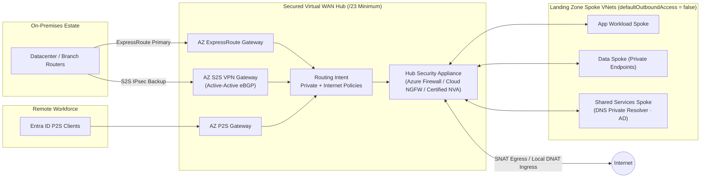

Use this field review checklist during Architecture Design Sessions, Production Readiness Reviews, and Well-Architected assessments of **Azure Virtual WAN** and **Azure Landing Zone (ALZ) connectivity platforms**.

Every control row maps directly to a runnable verification procedure (**Azure Resource Graph KQL**, **`az network vhub` CLI**, or **Portal inspection**) in the companion [Virtual WAN Review Verification Playbook](/azure-networking/06-operations-reviews/vwan-review-addendum/). For underlying topology trade-offs and routing internals, see [Hub-Spoke vs. Virtual WAN](/azure-networking/02-core-topologies/hub-spoke-vs-vwan/), [Virtual WAN & Routing Intent](/azure-networking/02-core-topologies/virtual-wan-and-routing-intent/), and the [Virtual WAN Architecture FAQ](/azure-networking/06-operations-reviews/vwan-architecture-faq/).

---

## Executive WAF & CAF Pillar Summary

Before walking individual rows, validate these non-negotiable architectural invariants across the seven review domains:

- **Topology & CAF Alignment (`TOP`)**: Isolate all Virtual WAN resources inside the dedicated **Platform Connectivity subscription** ([TOP-01](#top-01)) and a unified lifecycle Resource Group ([TOP-02](#top-02)), carve at least a `/23` non-overlapping hub prefix ([TOP-03](#top-03)), keep DNS/AD shared services in a dedicated spoke ([TOP-04](#top-04)), and default to one hub per region until scale limits dictate horizontal sharding ([TOP-05](#top-05)).
- **Resiliency (`RES`)**: Enforce **Virtual WAN Standard SKU** ([RES-01](#res-01)), deploy hubs across **>= 2 regions** ([RES-02](#res-02)) with **Availability Zone-redundant gateways** ([RES-03](#res-03)), run Active-Active eBGP S2S tunnels ([RES-04](#res-04)) plus VPN backup behind ExpressRoute ([RES-05](#res-05)), and pre-provision Routing Infrastructure Units above baseline because **hub router scale-out takes up to 25 minutes** ([RES-06](#res-06)).
- **Routing (`RT`)**: Keep connections on `defaultRouteTable` paired with **Routing Intent** for Private and Internet inspection ([RT-02](#rt-02), [RT-04](#rt-04)), treat Routing Intent enablement as a **one-way door** requiring pre-change snapshots ([RT-06](#rt-06)), and explicitly declare any non-RFC 1918 / CGNAT `100.64.0.0/10` prefixes in Private Traffic policies ([RT-09](#rt-09)).
- **Security (`SEC`)**: Inspect North-South and East-West flows in a **Secured Virtual Hub** ([SEC-02](#sec-02)), enforce Entra ID + Conditional Access MFA on P2S VPN ([SEC-03](#sec-03)), lock spoke subnets to `defaultOutboundAccess: false` with default-deny NSGs ([SEC-04](#sec-04)), use Private Endpoints with route-table network policies enabled ([SEC-05](#sec-05)), mandate `GCMAES256` IPsec ([SEC-07](#sec-07)), and govern Cloud NGFW / 3rd-party SaaS through a single policy management plane ([SEC-15](#sec-15)).
- **Performance (`PERF`)**: Anchor hubs near traffic gravity ([PERF-01](#perf-01)), size VPN (`500 Mbps/unit`) and ExpressRoute (`2 Gbps/unit` + FastPath) gateways for p95 peak + failover ([PERF-02](#perf-02), [PERF-03](#perf-03)), respect the **~50 Gbps aggregate hub router ceiling** ([PERF-04](#perf-04)), and align `hubRoutingPreference` with your primary WAN transport ([PERF-06](#perf-06)).
- **Operational Excellence (`OPS`)**: Deploy 100% via modular Bicep/Terraform ([OPS-01](#ops-01)) with gated CI/CD ([OPS-02](#ops-02)), stream structured resource-specific diagnostics to Log Analytics ([OPS-04](#ops-04)), enable VNet Flow Logs + Traffic Analytics ([OPS-06](#ops-06)), stagger gateway maintenance windows ([OPS-08](#ops-08)), and enforce Azure Policy guardrails ([OPS-09](#ops-09)).
- **Governance & FinOps (`GOV`)**: Model fixed scale-unit + variable per-GB hub/firewall data-processing fees up front ([GOV-01](#gov-01)), enforce cost tags ([GOV-02](#gov-02)), rightsize underutilized scale units quarterly ([GOV-03](#gov-03)), use direct VNet peering for approved high-throughput intra-region data replication ([GOV-04](#gov-04)), and track Marketplace SaaS NGFW PAYG separately from NVA Infrastructure Units ([GOV-08](#gov-08)).

---

## Reference Logical Architecture (Secured Virtual Hub)

The logical view below illustrates traffic intent across a Secured Virtual Hub using **Routing Intent** (with Azure Firewall, Palo Alto Cloud NGFW SaaS, or a certified hub NGFW NVA):

---

## Scoring Rubrics & Executive Rollup Template

- **Status**: `Pass` (implemented with captured CLI/ARG evidence) · `Partial` (in remediation or scoped exception) · `Gap` (unmitigated finding) · `N/A` (documented non-applicability).
- **Priority**: `Required` (blocks production sign-off) · `Recommended` (WAF/CAF best practice; requires risk sign-off to waive) · `Optional` (scenario-dependent).
- **Risk if Gap**: `H` (data exposure, single-region/AZ outage blast radius, or irreversible routing lock-in) · `M` (degraded failover, visibility blind spot, or predictable cost overrun) · `L` (hygiene, tagging, or documentation debt).

| Review Domain | Controls | Pass | Partial | Gap | N/A | Top Architectural Callouts |
| --- | --- | --- | --- | --- | --- | --- |
| **Topology & CAF (`TOP`)** | 8 | | | | | |
| **Resiliency (`RES`)** | 10 | | | | | |
| **Routing (`RT`)** | 10 | | | | | |
| **Security & NGFW (`SEC`)** | 16 | | | | | |
| **Performance (`PERF`)** | 7 | | | | | |
| **Operations (`OPS`)** | 9 | | | | | |
| **Governance & Cost (`GOV`)** | 8 | | | | | |

---

## 1. Topology & CAF Landing Zone Alignment (`TOP`)

| ID | Control | Why It Matters | Priority | Risk | Verification |
| --- | --- | --- | --- | --- | --- |
| **TOP-01** | Place Virtual WAN, Virtual Hubs, Gateways, and Secured Hub Firewalls in the dedicated **Platform Connectivity subscription** | Enforces Azure Landing Zone RBAC, subscription quota isolation, and central netops ownership | Required | L | [→ A-TOP-01](/azure-networking/06-operations-reviews/vwan-review-addendum/#a-top-01) |
| **TOP-02** | Co-locate Virtual WAN core resources in a single canonical **Resource Group** per lifecycle boundary | Prevents Azure Portal visibility quirks and aligns IaC deployment stacks | Required | L | [→ A-TOP-02](/azure-networking/06-operations-reviews/vwan-review-addendum/#a-top-02) |
| **TOP-03** | Size every Virtual Hub address prefix to **`/23` minimum** with zero CIDR overlap across spokes or on-premises IPAM | `/24` leaves minimal headroom for future gateway/NVA injections; overlaps cause silent BGP blackholes | Required | H | [→ A-TOP-03](/azure-networking/06-operations-reviews/vwan-review-addendum/#a-top-03) |
| **TOP-04** | Deploy shared platform services (**Azure DNS Private Resolver**, AD DS) in a **dedicated spoke VNet**—never inside the Virtual Hub | Virtual Hubs are managed transit appliances and cannot host customer VMs, resolvers, or Private Endpoints | Required | M | [→ A-TOP-04](/azure-networking/06-operations-reviews/vwan-review-addendum/#a-top-04) |
| **TOP-05** | Default to **one Virtual Hub per region**; add a second in-region hub only when approaching hard connection/prefix/throughput ceilings | Avoids unnecessary inter-hub routing hops and duplicate gateway fixed costs | Required | M | [→ A-TOP-05](/azure-networking/06-operations-reviews/vwan-review-addendum/#a-top-05) |
| **TOP-06** | Evaluate **ExpressRoute Global Reach** vs. vWAN inter-hub transit for branch-to-branch and AVS Gen 1 paths | Balances MSEE low-latency bypass against Secured Hub inspection requirements | Recommended | M | [→ A-TOP-06](/azure-networking/06-operations-reviews/vwan-review-addendum/#a-top-06) |
| **TOP-07** | Document a staged **brownfield Hub-and-Spoke to Virtual WAN migration runbook** | Prevents asymmetric routing and overlapping UDR/BGP advertisements during coexist cutovers | Optional | M | [→ A-TOP-07](/azure-networking/06-operations-reviews/vwan-review-addendum/#a-top-07) |
| **TOP-08** | Validate **certified SD-WAN / NVA Managed Application** hub coexistence rules before deployment | Separate SD-WAN NVA + Firewall NVA/SaaS cannot share the same Routing-Intent hub simultaneously | Optional | M | [→ A-TOP-08](/azure-networking/06-operations-reviews/vwan-review-addendum/#a-top-08) |

---

## 2. Resiliency & Availability (`RES`)

| ID | Control | Why It Matters | Priority | Risk | Verification |
| --- | --- | --- | --- | --- | --- |
| **RES-01** | Deploy **Virtual WAN Standard SKU** (never Basic) for all production environments | Basic SKU lacks AZ gateways, hub-to-hub transit, ExpressRoute, P2S, and Routing Intent; no seamless in-place hub downgrade/upgrade without disruption | Required | H | [→ A-RES-01](/azure-networking/06-operations-reviews/vwan-review-addendum/#a-res-01) |
| **RES-02** | Deploy Virtual Hubs in **>= 2 Azure regions** with independent hybrid circuits/tunnels | Eliminates single-region blast radius for global transit and remote access | Required | H | [→ A-RES-02](/azure-networking/06-operations-reviews/vwan-review-addendum/#a-res-02) |
| **RES-03** | Provision **Availability Zone-redundant SKUs** across VPN, ExpressRoute, and P2S Gateways | Survives physical Azure datacenter zone failures without dropping hybrid connectivity | Required | H | [→ A-RES-03](/azure-networking/06-operations-reviews/vwan-review-addendum/#a-res-03) |
| **RES-04** | Configure Site-to-Site VPN connections **Active-Active** with dual-tunnel eBGP to both hub gateway instances | Eliminates tunnel-failover convergence blackholes during gateway maintenance or instance healing | Recommended | M | [→ A-RES-04](/azure-networking/06-operations-reviews/vwan-review-addendum/#a-res-04) |
| **RES-05** | Deploy **S2S IPsec VPN as automatic failover** behind ExpressRoute with deterministic BGP route preference | Preserves hybrid L3 reachability during fiber cuts or peering-location incidents (see [Bow-Tie Failures](/azure-networking/03-hybrid-connectivity/expressroute-bowtie-failures/)) | Recommended | M | [→ A-RES-05](/azure-networking/06-operations-reviews/vwan-review-addendum/#a-res-05) |
| **RES-06** | Pre-size **Virtual Hub Routing Infrastructure Units** above baseline (`minCapacity` tuned for burst) | Hub router autoscale takes **up to 25 minutes**—traffic spikes will throttle if sized strictly at idle baseline | Required | M | [→ A-RES-06](/azure-networking/06-operations-reviews/vwan-review-addendum/#a-res-06) |
| **RES-07** | Use the **Global P2S VPN Profile** and size client address pools at **>= 2x peak concurrent users** | Enables automatic nearest/healthy hub selection and prevents pool exhaustion during regional evacuation | Recommended | M | [→ A-RES-07](/azure-networking/06-operations-reviews/vwan-review-addendum/#a-res-07) |
| **RES-08** | Maintain a **Failure Mode Analysis (FMA)** covering region loss, ER circuit/MSEE loss, BGP route leaks, and router scale events | Proves failover symmetry on paper before incidents occur in production | Required | M | [→ A-RES-08](/azure-networking/06-operations-reviews/vwan-review-addendum/#a-res-08) |
| **RES-09** | Calculate **end-to-end Composite SLA** across Hub Router, Gateways, Firewall/SaaS, and Telco circuits | A 99.95% hub SLA multiplied by unredundant CPE or single-circuit ER yields a much lower real availability | Recommended | L | [→ A-RES-09](/azure-networking/06-operations-reviews/vwan-review-addendum/#a-res-09) |
| **RES-10** | Execute **annual live DR and BGP failover drills** across ExpressRoute, VPN, and secondary regional hubs | Untested BGP failover routinely exposes asymmetric firewall drops or stale static routes | Recommended | M | [→ A-RES-10](/azure-networking/06-operations-reviews/vwan-review-addendum/#a-res-10) |

---

## 3. Routing Decision Matrix (`RT`)

:::danger[Routing Intent Is a One-Way Operational Door]
Enabling **Routing Intent** in a Virtual Hub rewrites `defaultRouteTable` (`_policy_PrivateTraffic` and `_policy_PublicTraffic`) and blocks custom route tables in that hub. Even if you later delete the Routing Intent resource, Virtual WAN **does not automatically restore** prior custom route propagations or static routes. Always export a JSON snapshot of hub route tables and connections before enabling Routing Intent.
:::

| ID | Scenario | Recommended Construct | Configuration Summary | Key Trade-offs | When NOT to Use | Verification |
| --- | --- | --- | --- | --- | --- | --- |
| **RT-01** | **Any-to-any default transit** | `defaultRouteTable` + `Default` label | Built-in default on Standard hub creation | Zero East-West segmentation; no central firewall inspection | Any regulated or production multi-workload environment | [→ A-RT-01](/azure-networking/06-operations-reviews/vwan-review-addendum/#a-rt-01) |
| **RT-02** | **Internet egress via Azure Firewall** | Routing Intent (`InternetTraffic -> Azure Firewall`) | Hub -> Routing Intent -> Internet Traffic -> Azure Firewall | Per-GB firewall + hub data-processing charges; use Premium for TLS/IDPS | When Cloud NGFW or certified 3rd-party NGFW is standard | [→ A-RT-02](/azure-networking/06-operations-reviews/vwan-review-addendum/#a-rt-02) |
| **RT-03** | **Internet egress via Cloud NGFW / 3rd-party NVA** | Routing Intent (`InternetTraffic -> SaaS / NVA`) | Hub -> Routing Intent -> Internet Traffic -> Cloud NGFW SaaS or eligible NGFW NVA | `0.0.0.0/0` is hub-local and never crosses hubs—every hub needs its own egress firewall | When first-party Azure Firewall meets policy with simpler ops | [→ A-RT-03](/azure-networking/06-operations-reviews/vwan-review-addendum/#a-rt-03) |
| **RT-04** | **Intra-region private inspection (E-W & N-S)** | Routing Intent (`PrivateTraffic -> Security Solution`) | Hub -> Routing Intent -> Private Traffic -> Azure FW / Cloud NGFW / eligible NVA | All VNet-to-VNet and VNet-to-branch flows traverse hub firewall | Ultra-low-latency storage/HPC flows excused from L4/L7 inspection | [→ A-RT-04](/azure-networking/06-operations-reviews/vwan-review-addendum/#a-rt-04) |
| **RT-05** | **Inter-hub cross-region private inspection** | Routing Intent (`PrivateTraffic`) on **both** source and destination hubs | Enable matching Private Routing Intent across all regional hubs | Dual-firewall traversal latency; ~50 Gbps inter-hub ceiling; cross-region egress fees | Branch-to-branch ER flows intended to stay on Global Reach | [→ A-RT-05](/azure-networking/06-operations-reviews/vwan-review-addendum/#a-rt-05) |
| **RT-06** | **Routing Intent change & rollback governance** | Pre-enablement JSON backup + <= 600 local VNet prefixes per hub | Snapshot `vhub route-table` & connections prior to enabling Routing Intent; monitor 540-prefix (90%) threshold | Irreversible `defaultRouteTable` mutation; incompatible with custom route tables | Hubs requiring per-tenant isolated VRF-like custom route tables | [→ A-RT-06](/azure-networking/06-operations-reviews/vwan-review-addendum/#a-rt-06) |
| **RT-07** | **ExpressRoute transit (VNet & ER-to-ER)** | Hub ER Gateway (+ FastPath where supported) + Global Reach for ER-to-ER | Attach Standard/Premium ER circuits to hub ER Gateway; link circuits with Global Reach for ER-to-ER | ER-to-ER via vWAN requires Global Reach (bypasses hub FW); **ExpressRoute Local SKU cannot use vWAN transit** | ExpressRoute Local circuits expecting inter-hub or branch transit | [→ A-RT-07](/azure-networking/06-operations-reviews/vwan-review-addendum/#a-rt-07) |
| **RT-08** | **Branch-to-branch (`VPN <-> VPN`, `VPN <-> ER`)** | `allowBranchToBranchTraffic: true` + Private Routing Intent | Enable on Virtual WAN resource; combine with Private Routing Intent for branch inspection | Consumes hub router & gateway scale units; charges Azure egress | SD-WAN fabrics handling direct branch-to-branch overlays externally | [→ A-RT-08](/azure-networking/06-operations-reviews/vwan-review-addendum/#a-rt-08) |
| **RT-09** | **Non-RFC 1918 & CGNAT (`100.64.0.0/10`) prefixes** | Explicit **Private Traffic Prefixes** list in Routing Intent | Add CGNAT `100.64.0.0/10` or public-owned internal blocks to Private Traffic additional prefixes | Forgetting a prefix causes vWAN to treat it as `0.0.0.0/0` Internet traffic and SNAT/drop it! | Pure RFC 1918 (`10/8`, `172.16/12`, `192.168/16`) estates | [→ A-RT-09](/azure-networking/06-operations-reviews/vwan-review-addendum/#a-rt-09) |
| **RT-10** | **Multi-tenant VRF isolation (Custom Route Tables)** | Custom Hub Route Tables + Propagation Labels + Route Maps | Associate isolated spokes to custom RTs; control advertisement with labels and Route Maps | **Mutually exclusive with Routing Intent** in the same hub; higher manual complexity | Standard enterprise landing zones well-served by Secured Hub firewall rules | [→ A-RT-10](/azure-networking/06-operations-reviews/vwan-review-addendum/#a-rt-10) |

---

## 4. Network Security & Secured Hub Controls (`SEC`)

### Hub Security Insertion Matrix: Azure Firewall vs. Cloud NGFW SaaS vs. Certified 3rd-Party NVA

| Architectural Dimension | Azure Firewall (Standard / Premium) | Palo Alto Networks Cloud NGFW (SaaS in Hub) | Certified 3rd-Party Hub NGFW NVA (Fortinet / Check Point / Cisco TDV) |
| --- | --- | --- | --- |
| **Operational Model** | First-party Microsoft PaaS inside Secured Virtual Hub | Fully managed Palo Alto SaaS integrated natively into Virtual Hub | Marketplace Managed Application VMSS inside Virtual Hub |
| **Deep Threat Inspection** | Premium SKU: TLS inspection, IDPS, URL categories, FQDN tags | Full PAN-OS App-ID, Advanced Threat Prevention, URL Filtering, WildFire, DNS Security | Vendor-native IPS/UTM/SD-WAN dual-role capabilities |
| **Policy Control Plane** | Azure Firewall Policy / Azure Firewall Manager (Bicep/Terraform) | **Choose one**: Azure Rulestack (ARM/Bicep), Panorama, or Strata Cloud Manager | Vendor Manager (FortiManager, SmartConsole, Catalyst SD-WAN Manager) |
| **Routing Intent Support** | Native (`Next Hop = Azure Firewall`) | Native (`Next Hop = SaaS solution`) | Native for eligible vendors (`checkpoint`, `fortinet-ngfw`, `fortinet-ngfw-and-sdwan`, `cisco-tdv-vwan-nva`) |
| **Scaling & Billing Model** | Azure Firewall Deployment + per-GB data processing | SaaS PAYG / Commit via Marketplace (**no vWAN NVA Infrastructure Units billed**) | NVA Infrastructure Units + vendor BYOL/PAYG licensing |
| **Coexistence Constraint** | Can split Private vs. Internet with SaaS/NVA (watch shared subnet limits) | **Cannot deploy alongside a 3rd-party NVA in the same Virtual Hub** | Separate SD-WAN NVA + separate FW NVA in the same Routing-Intent hub is unsupported |

### Security Checklist Controls

| ID | Control | Why It Matters | Priority | Risk | Verification |
| --- | --- | --- | --- | --- | --- |
| **SEC-01** | Apply the **Microsoft Cloud Security Benchmark (MCSB)** baseline to Virtual WAN in Defender for Cloud | Continuous regulatory compliance drift detection across network resources | Required | M | [→ A-SEC-01](/azure-networking/06-operations-reviews/vwan-review-addendum/#a-sec-01) |
| **SEC-02** | Deploy a **Secured Virtual Hub** with **Routing Intent** inspecting both `PrivateTraffic` and `InternetTraffic` | Enforces zero-trust East-West and North-South inspection without brittle spoke UDR sprawl | Required | H | [→ A-SEC-02](/azure-networking/06-operations-reviews/vwan-review-addendum/#a-sec-02) |
| **SEC-03** | Mandate **Microsoft Entra ID authentication + Conditional Access + MFA** on P2S User VPN | Eliminates shared-certificate user access and enforces device compliance | Required | H | [→ A-SEC-03](/azure-networking/06-operations-reviews/vwan-review-addendum/#a-sec-03) |
| **SEC-04** | Enforce **NSGs (default-deny inbound)** and **`defaultOutboundAccess: false`** on every spoke workload subnet | Subnet microsegmentation + post-March 2026 private-by-default egress posture | Required | M | [→ A-SEC-04](/azure-networking/06-operations-reviews/vwan-review-addendum/#a-sec-04) |
| **SEC-05** | Disable public access on PaaS data services, deploy **Private Endpoints**, and set `RouteTableEnabled` network policy on PE subnets | Blocks public exfiltration and prevents on-premises-to-PE return asymmetry under Routing Intent | Required | H | [→ A-SEC-05](/azure-networking/06-operations-reviews/vwan-review-addendum/#a-sec-05) |
| **SEC-06** | Attach a shared ALZ **Azure DDoS Network Protection** plan (or IP Protection) to spoke VNets with public IPs | Volumetric L3/L4 mitigation on spoke edge endpoints (note: vWAN hub-owned PIPs do not support DDoS plans) | Recommended | M | [→ A-SEC-06](/azure-networking/06-operations-reviews/vwan-review-addendum/#a-sec-06) |
| **SEC-07** | Enforce custom IPsec/IKE policies using **`GCMAES256`**, **`SHA256`/`SHA384`**, and **`DHGroup14+`/`ECP384`** (no DES/3DES/MD5) | Eliminates weak legacy cryptography and improves VPN gateway throughput | Required | H | [→ A-SEC-07](/azure-networking/06-operations-reviews/vwan-review-addendum/#a-sec-07) |
| **SEC-08** | Encrypt regulated ExpressRoute traffic via **MACsec** (Direct ports) or **IPsec VPN-over-ExpressRoute** | ExpressRoute private peering traverses private telco/Microsoft circuits unencrypted by default | Recommended | M | [→ A-SEC-08](/azure-networking/06-operations-reviews/vwan-review-addendum/#a-sec-08) |
| **SEC-09** | Validate **inter-hub encryption** requirements and regional GA support for sensitive cross-region transit | Addresses strict compliance mandates requiring cryptographic wrapper over backbone inter-hub links | Optional | M | [→ A-SEC-09](/azure-networking/06-operations-reviews/vwan-review-addendum/#a-sec-09) |
| **SEC-10** | Enforce **least-privilege RBAC** with custom scoped roles; remove standing `Owner`/`Contributor` on Connectivity RG | Prevents accidental or malicious Routing Intent / BGP route manipulation | Required | M | [→ A-SEC-10](/azure-networking/06-operations-reviews/vwan-review-addendum/#a-sec-10) |
| **SEC-11** | Advertise `0.0.0.0/0` (**forced tunneling**) to P2S VPN clients when corporate internet inspection is required | Prevents split-tunnel remote workstations from bypassing enterprise SWG/NGFW controls | Optional | M | [→ A-SEC-11](/azure-networking/06-operations-reviews/vwan-review-addendum/#a-sec-11) |
| **SEC-12** | Store all S2S VPN pre-shared keys and TLS/IKE certificates in **Azure Key Vault** with scheduled rotation | Eliminates plaintext PSKs in CI/CD state or operator laptops | Required | H | [→ A-SEC-12](/azure-networking/06-operations-reviews/vwan-review-addendum/#a-sec-12) |
| **SEC-13** | Onboard **Microsoft Sentinel** with Virtual WAN, Azure Firewall Structured Logs, and NGFW data connectors | Enables automated SOC correlation across BGP anomalies, IDPS alerts, and denied flows | Recommended | M | [→ A-SEC-13](/azure-networking/06-operations-reviews/vwan-review-addendum/#a-sec-13) |
| **SEC-14** | Validate GA **Cloud NGFW / SaaS prerequisites**: `PaloAltoNetworks.Cloudngfw` registered (stable GA API), supported hub region, and `RoutingState == Provisioned` | Provisioning Cloud NGFW before hub router reaches `Provisioned` or using unsupported regions fails deployment | Required | M | [→ A-SEC-14](/azure-networking/06-operations-reviews/vwan-review-addendum/#a-sec-14) |
| **SEC-15** | Lock Cloud NGFW / NVA **policy plane** to one authority (Azure Rulestack, Panorama, or Strata Cloud Manager) and document teardown order | Prevents split-brain security rule drift and dependency lockups (`Routing Intent -> Cloud NGFW -> SaaS -> Hub`) | Required | M | [→ A-SEC-15](/azure-networking/06-operations-reviews/vwan-review-addendum/#a-sec-15) |
| **SEC-16** | Restrict **inbound DNAT** on Secured Hub firewalls to **hub-local** targets and never combine hub DNAT with Forced Tunnel Internet mode | Inbound DNAT cannot cross hubs without SNAT, and Forced Tunnel mode drops inbound DNAT return packets asymmetrically | Required | M | [→ A-SEC-16](/azure-networking/06-operations-reviews/vwan-review-addendum/#a-sec-16) |

---

## 5. Performance Efficiency (`PERF`)

| ID | Control | Why It Matters | Priority | Risk | Verification |
| --- | --- | --- | --- | --- | --- |
| **PERF-01** | Place regional Virtual Hubs close to **dominant branch, user, and workload latency gravity** | Every Secured Hub flow hairpins through the regional hub—wrong region placement permanently inflates RTT | Required | M | [→ A-PERF-01](/azure-networking/06-operations-reviews/vwan-review-addendum/#a-perf-01) |
| **PERF-02** | Size **S2S VPN Gateway scale units** (`500 Mbps` per unit, up to 40 units / `20 Gbps`) above p95 peak + ER-failover load | VPN Gateways do **not** dynamically autoscale; under-sizing causes packet drops during ER failover | Required | M | [→ A-PERF-02](/azure-networking/06-operations-reviews/vwan-review-addendum/#a-perf-02) |
| **PERF-03** | Size **ExpressRoute Gateway scale units** (`2 Gbps` per unit up to `20 Gbps`) and enable **FastPath** where high-PPS spokes require it | Prevents gateway throughput/PPS bottlenecks on storage, AVS Gen 1, and media workloads ([FastPath & SKUs](/azure-networking/03-hybrid-connectivity/expressroute-fastpath-and-skus/)) | Recommended | M | [→ A-PERF-03](/azure-networking/06-operations-reviews/vwan-review-addendum/#a-perf-03) |
| **PERF-04** | Respect the **~50 Gbps aggregate Virtual Hub router ceiling** (50 Routing Infrastructure Units max; default 2 units = 3 Gbps) | High-bandwidth East-West storage/AI training flows exceeding 50 Gbps will throttle at the hub router | Recommended | M | [→ A-PERF-04](/azure-networking/06-operations-reviews/vwan-review-addendum/#a-perf-04) |
| **PERF-05** | Mandate **`GCMAES256`** on IPsec connections to maximize hardware crypto offload and packet-per-second headroom | Legacy CBC/SHA1 suites burn gateway CPU and cap single-tunnel throughput | Recommended | L | [→ A-PERF-05](/azure-networking/06-operations-reviews/vwan-review-addendum/#a-perf-05) |
| **PERF-06** | Align **`hubRoutingPreference`** (`ExpressRoute`, `VpnGateway`, or `ASPath`) with your intended primary WAN architecture | Default `ExpressRoute` preference can cause unintended cross-hub ER hairpins in hybrid transit topologies | Recommended | M | [→ A-PERF-06](/azure-networking/06-operations-reviews/vwan-review-addendum/#a-perf-06) |
| **PERF-07** | Configure **70% utilization warning** and **80% resize trigger** alerts on VPN, ExpressRoute, and Hub Router capacity | Gateways require planned scale-unit upgrades before hitting hard packet-drop ceilings | Recommended | M | [→ A-PERF-07](/azure-networking/06-operations-reviews/vwan-review-addendum/#a-perf-07) |

---

## 6. Operational Excellence (`OPS`)

| ID | Control | Why It Matters | Priority | Risk | Verification |
| --- | --- | --- | --- | --- | --- |
| **OPS-01** | Manage 100% of Virtual WAN, Gateways, Firewall Policies, and Routing Intent via **modular Bicep or Terraform** | Eliminates ClickOps configuration drift across multi-region hubs | Required | M | [→ A-OPS-01](/azure-networking/06-operations-reviews/vwan-review-addendum/#a-ops-01) |
| **OPS-02** | Enforce **CI/CD pipelines** with `what-if`/`plan` diffs, peer approval gates, and documented route-snapshot rollback | Prevents a single bad route-intent or Firewall Policy push from severing global transit | Recommended | M | [→ A-OPS-02](/azure-networking/06-operations-reviews/vwan-review-addendum/#a-ops-02) |
| **OPS-03** | Enable **Azure Monitor Network Insights** for Virtual WAN topology and health visualization | Provides zero-effort live BGP peer state, gateway health, and connection dependency maps | Recommended | L | [→ A-OPS-03](/azure-networking/06-operations-reviews/vwan-review-addendum/#a-ops-03) |
| **OPS-04** | Configure **Resource-Specific Diagnostic Settings** on all Hubs, Gateways, and Azure Firewalls (`AZFWNetworkRule`, `AZFWApplicationRule`) -> Log Analytics | Incidents without structured firewall and BGP logs cannot be triaged; resource-specific tables avoid `AzureDiagnostics` 500-column limits | Required | H | [→ A-OPS-04](/azure-networking/06-operations-reviews/vwan-review-addendum/#a-ops-04) |
| **OPS-05** | Deploy **Network Watcher Connection Monitor** synthetic probes across hub-to-spoke, inter-hub, and hybrid endpoints | Detects silent packet loss, MTU blackholes, and latency regressions within 60 seconds | Recommended | M | [→ A-OPS-05](/azure-networking/06-operations-reviews/vwan-review-addendum/#a-ops-05) |
| **OPS-06** | Enable **Virtual Network Flow Logs** (superseding legacy NSG Flow Logs) + **Traffic Analytics** across spoke VNets | Captures East-West flow telemetry, Private Endpoint traffic, and top talkers across spokes | Recommended | M | [→ A-OPS-06](/azure-networking/06-operations-reviews/vwan-review-addendum/#a-ops-06) |
| **OPS-07** | Alert proactively on `TunnelEgressPacketDropCount`, `BgpPeerStatus`, `RoutingState`, and Firewall `SNATPortUtilization` | Surfaces BGP flaps, IPsec MTU/shaper drops, and SNAT exhaustion before user tickets arrive | Required | M | [→ A-OPS-07](/azure-networking/06-operations-reviews/vwan-review-addendum/#a-ops-07) |
| **OPS-08** | Configure **customer-controlled Gateway Maintenance Windows** staggered across primary and secondary hubs | Prevents simultaneous platform maintenance across redundant regional hubs during business hours | Recommended | L | [→ A-OPS-08](/azure-networking/06-operations-reviews/vwan-review-addendum/#a-ops-08) |
| **OPS-09** | Assign **Azure Policy network guardrails** (`Deny` Basic vWAN, `Deny` public PaaS endpoints, `Audit`/`Deny` non-Entra P2S, auto-DNS DINE) | Continuous preventative governance across federated landing zone subscriptions | Recommended | M | [→ A-OPS-09](/azure-networking/06-operations-reviews/vwan-review-addendum/#a-ops-09) |

---

## 7. Governance & Cost Optimization (`GOV`)

| ID | Control | Why It Matters | Priority | Risk | Verification |
| --- | --- | --- | --- | --- | --- |
| **GOV-01** | Build a pre-deployment **TCO model** covering fixed hub/gateway units **plus** per-GB hub router & firewall data-processing fees | Double per-GB charges (Hub Router + Secured Hub Firewall) are the #1 Virtual WAN bill shock | Required | M | [→ A-GOV-01](/azure-networking/06-operations-reviews/vwan-review-addendum/#a-gov-01) |
| **GOV-02** | Enforce mandatory **FinOps tags** (`CostCenter`, `Environment`, `Workload`, `Owner`) on hubs, gateways, and connections via Azure Policy | Enables accurate chargeback/showback of shared Connectivity subscription spend | Recommended | L | [→ A-GOV-02](/azure-networking/06-operations-reviews/vwan-review-addendum/#a-gov-02) |
| **GOV-03** | Conduct **quarterly scale-unit rightsizing** across Hub Routing Units, VPN Gateways, and ExpressRoute Gateways | Reclaims stranded hourly run-rate where 90-day p95 utilization sits well below provisioned units | Required | M | [→ A-GOV-03](/azure-networking/06-operations-reviews/vwan-review-addendum/#a-gov-03) |
| **GOV-04** | Use **direct VNet peering** for approved high-volume intra-region spoke-to-spoke replication flows | Bypasses both Virtual Hub data-processing ($/GB) and Hub Firewall inspection ($/GB) for trusted storage/DB sync | Recommended | M | [→ A-GOV-04](/azure-networking/06-operations-reviews/vwan-review-addendum/#a-gov-04) |
| **GOV-05** | Audit **inter-region hub-to-hub bandwidth meters** monthly in Azure Cost Management | Chatty cross-region spoke or DR replication traffic rapidly compounds inter-hub egress charges | Recommended | M | [→ A-GOV-05](/azure-networking/06-operations-reviews/vwan-review-addendum/#a-gov-05) |
| **GOV-06** | Configure **Azure Cost Management budgets & anomaly alerts** (80% / 100% / 110% forecasted spend) on the Connectivity subscription | Catches runaway data-processing loops or forgotten lab gateways within 24 hours | Recommended | L | [→ A-GOV-06](/azure-networking/06-operations-reviews/vwan-review-addendum/#a-gov-06) |
| **GOV-07** | Align **branch connectivity tier** (ExpressRoute vs. S2S IPsec over internet) to site business criticality | Avoids paying dedicated ExpressRoute port/circuit fees at small retail or temporary branch offices | Recommended | L | [→ A-GOV-07](/azure-networking/06-operations-reviews/vwan-review-addendum/#a-gov-07) |
| **GOV-08** | Govern **Cloud NGFW SaaS / Marketplace NVA** billing separately and confirm zero NVA-IU double-billing on Cloud NGFW hubs | Cloud NGFW SaaS bills via Palo Alto Marketplace meters and does not incur vWAN NVA Infrastructure Unit charges | Recommended | M | [→ A-GOV-08](/azure-networking/06-operations-reviews/vwan-review-addendum/#a-gov-08) |

---

## Findings & Remediation Backlog Template

Copy this table into your customer architecture review readout and link raw CLI/ARG JSON evidence per finding:

| Finding ID | Control ID | Gap Summary & Blast Radius | Severity | Owner | Target Date | Status |
| --- | --- | --- | --- | --- | --- | --- |
| `F-001` | `RES-06` | Example: Production hub router left at default 2 units (3 Gbps) with 12 Gbps backup window spikes | High | Platform NetOps | YYYY-MM-DD | Open |
| `F-002` | `SEC-05` | Example: Spoke PE subnet missing `RouteTableEnabled` network policy under Private Routing Intent | High | Security Arch | YYYY-MM-DD | Open |
| `F-003` | `RT-09` | Example: `100.64.0.0/10` AKS/AVS CGNAT ranges omitted from Private Traffic prefixes | Medium | Cloud Platform | YYYY-MM-DD | Open |
