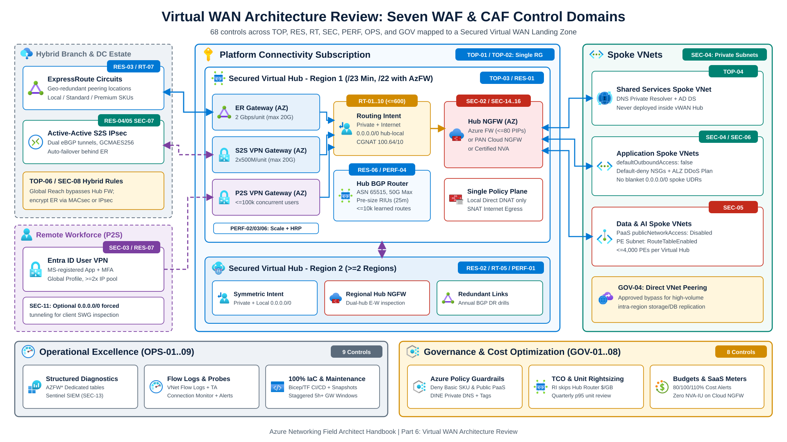
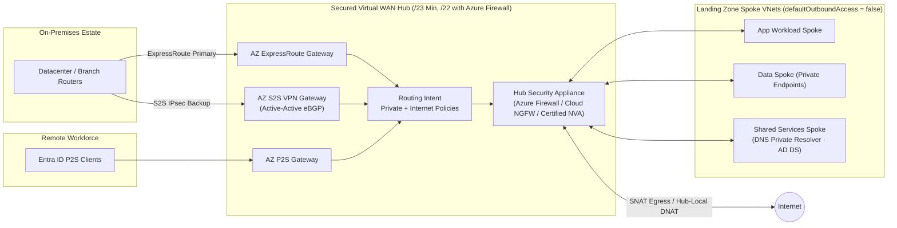

Use this field review checklist during architecture design sessions, production readiness reviews, and Well-Architected assessments of [Azure Virtual WAN](https://learn.microsoft.com/en-us/azure/well-architected/service-guides/azure-virtual-wan) and [Azure Landing Zone connectivity platforms](https://learn.microsoft.com/en-us/azure/cloud-adoption-framework/ready/azure-best-practices/virtual-wan-network-topology).

Every control row maps to a runnable verification procedure (Azure Resource Graph KQL, `az network vhub` CLI, or Azure Portal inspection) in the companion [Virtual WAN Review Verification Playbook](/azure-networking/06-operations-reviews/vwan-review-addendum/). For topology comparisons and routing mechanics, see [Hub-Spoke vs. Virtual WAN](/azure-networking/02-core-topologies/hub-spoke-vs-vwan/), [Virtual WAN & Routing Intent](/azure-networking/02-core-topologies/virtual-wan-and-routing-intent/), and the [Virtual WAN Architecture FAQ](/azure-networking/06-operations-reviews/vwan-architecture-faq/).

---

## Executive WAF and CAF pillar summary

Validate these core design requirements across the seven review domains before scoring individual rows:

- **Topology & CAF alignment (`TOP`)**: Place all Virtual WAN resources inside the dedicated Platform Connectivity subscription ([TOP-01](#top-01)) and a single lifecycle Resource Group ([TOP-02](#top-02)). Allocate at least a `/23` non-overlapping hub prefix, or `/22` when deploying Azure Firewall in the hub ([TOP-03](#top-03)), host DNS and Active Directory in a dedicated spoke ([TOP-04](#top-04)), and run one hub per region until scale limits require a second hub ([TOP-05](#top-05)).
- **Resiliency (`RES`)**: Deploy Virtual WAN Standard SKU ([RES-01](#res-01)) across at least two regions ([RES-02](#res-02)) in Availability Zone-enabled regions with explicit zone redundancy on Secured Hub Azure Firewalls ([RES-03](#res-03)). Run active-active eBGP S2S VPN tunnels ([RES-04](#res-04)) and VPN failover behind ExpressRoute ([RES-05](#res-05)). Pre-size [Routing Infrastructure Units](https://learn.microsoft.com/en-us/azure/virtual-wan/hub-settings#capacity) above baseline because hub router scale-out takes up to 25 minutes ([RES-06](#res-06)).
- **Routing (`RT`)**: Keep connections on `defaultRouteTable` paired with [Routing Intent](https://learn.microsoft.com/en-us/azure/virtual-wan/how-to-routing-policies) for private and internet inspection ([RT-02](#rt-02), [RT-04](#rt-04)). Export JSON backups before enabling Routing Intent because deleting the policy does not restore prior `defaultRouteTable` static routes ([RT-06](#rt-06)), and list all non-RFC 1918 or CGNAT `100.64.0.0/10` blocks in Private Traffic prefixes ([RT-09](#rt-09)).
- **Security (`SEC`)**: Inspect north-south and east-west flows in a [Secured Virtual Hub](https://learn.microsoft.com/en-us/azure/firewall-manager/secured-virtual-hub) ([SEC-02](#sec-02)), require Microsoft Entra ID with the Microsoft-registered VPN app and Conditional Access MFA on P2S VPN ([SEC-03](#sec-03)), set spoke subnets to `defaultOutboundAccess: false` with default-deny NSGs ([SEC-04](#sec-04)), enable `RouteTableEnabled` network policies on Private Endpoint subnets ([SEC-05](#sec-05)), enforce `GCMAES256` IPsec ([SEC-07](#sec-07)), and assign a single policy plane for [Cloud NGFW](https://learn.microsoft.com/en-us/azure/virtual-wan/how-to-palo-alto-cloud-ngfw) or third-party NVAs ([SEC-15](#sec-15)).
- **Performance (`PERF`)**: Place hubs near user and workload latency centers ([PERF-01](#perf-01)), size VPN (`500 Mbps/unit per instance` across 2 active-active instances, `1 Gbps/unit` up to `20 Gbps` aggregate) and ExpressRoute (`2 Gbps/unit`, up to `20 Gbps` plus FastPath) gateways for p95 peak and failover load ([PERF-02](#perf-02), [PERF-03](#perf-03)), respect the `50 Gbps` aggregate hub router limit and `1.5 Gbps` single-TCP-flow ceiling ([PERF-04](#perf-04)), and align `hubRoutingPreference` with your primary WAN transport ([PERF-06](#perf-06)).
- **Operational excellence (`OPS`)**: Deploy all resources through modular Bicep or Terraform ([OPS-01](#ops-01)) with gated CI/CD pipelines ([OPS-02](#ops-02)), send resource-specific diagnostic logs to Log Analytics ([OPS-04](#ops-04)), enable VNet Flow Logs with Traffic Analytics ([OPS-06](#ops-06)), stagger 5-hour minimum gateway maintenance windows ([OPS-08](#ops-08)), and assign Azure Policy guardrails ([OPS-09](#ops-09)).
- **Governance & FinOps (`GOV`)**: Model fixed hourly units and variable per-GB processing fees accurately using [Virtual WAN pricing concepts](https://learn.microsoft.com/en-us/azure/virtual-wan/pricing-concepts) ([GOV-01](#gov-01)), apply FinOps tags ([GOV-02](#gov-02)), rightsize underused scale units quarterly ([GOV-03](#gov-03)), use direct VNet peering for approved high-volume intra-region replication ([GOV-04](#gov-04)), and govern Marketplace SaaS NGFW consumption separately from NVA Infrastructure Units ([GOV-08](#gov-08)).

---

## Reference architecture and control domain map

The architecture map below places all seven WAF and CAF control domains (`TOP`, `RES`, `RT`, `SEC`, `PERF`, `OPS`, `GOV`) across hybrid branches, multi-region Secured Virtual Hubs, and Landing Zone spoke VNets:

Inside each regional Secured Virtual Hub, Routing Intent steers hybrid, spoke, and internet packet flows through the designated hub security solution:

---

## Scoring rubrics and executive rollup template

- **Status**: `Pass` (implemented with captured CLI or ARG evidence) · `Partial` (in remediation or scoped exception) · `Gap` (unmitigated finding) · `N/A` (documented non-applicability).
- **Priority**: `Required` (blocks production sign-off) · `Recommended` (WAF/CAF standard; requires risk sign-off to waive) · `Optional` (scenario-dependent).
- **Risk if Gap**: `H` (data exposure, single-region or single-AZ outage blast radius, or unbacked routing change) · `M` (degraded failover, visibility blind spot, or avoidable cost overrun) · `L` (hygiene, tagging, or documentation debt).

| Review Domain | Controls | Pass | Partial | Gap | N/A | Top Architectural Callouts |
| --- | --- | --- | --- | --- | --- | --- |
| **Topology & CAF (`TOP`)** | 8 | | | | | |
| **Resiliency (`RES`)** | 10 | | | | | |
| **Routing (`RT`)** | 10 | | | | | |
| **Security & NGFW (`SEC`)** | 16 | | | | | |
| **Performance (`PERF`)** | 7 | | | | | |
| **Operations (`OPS`)** | 9 | | | | | |
| **Governance & Cost (`GOV`)** | 8 | | | | | |

---

## 1. Topology & CAF landing zone alignment (`TOP`)

| ID | Control | Why It Matters | Priority | Risk | Verification |
| --- | --- | --- | --- | --- | --- |
| **TOP-01** | Place Virtual WAN, Virtual Hubs, Gateways, and Secured Hub Firewalls in the dedicated **Platform Connectivity subscription** | Enforces Azure Landing Zone RBAC, subscription quota isolation, and central network ownership | Required | L | [A-TOP-01](/azure-networking/06-operations-reviews/vwan-review-addendum/#a-top-01) |
| **TOP-02** | Co-locate Virtual WAN core resources in a single **Resource Group** per lifecycle boundary | Required by the Virtual WAN portal experience and aligns IaC deployment stacks | Required | L | [A-TOP-02](/azure-networking/06-operations-reviews/vwan-review-addendum/#a-top-02) |
| **TOP-03** | Allocate at least **`/23`** per Virtual Hub (**`/22` minimum when deploying Azure Firewall**) with zero CIDR overlap across spokes or on-premises IPAM | Hub prefixes cannot change after creation; `/22` gives Azure Firewall sufficient IPs for maximum scale, and overlaps blackhole BGP routes | Required | H | [A-TOP-03](/azure-networking/06-operations-reviews/vwan-review-addendum/#a-top-03) |
| **TOP-04** | Deploy shared platform services (**Azure DNS Private Resolver**, AD DS) in a **dedicated spoke VNet**, never inside the Virtual Hub | Virtual Hubs are Microsoft-managed transit VNets and cannot host customer VMs, resolvers, or Private Endpoints | Required | M | [A-TOP-04](/azure-networking/06-operations-reviews/vwan-review-addendum/#a-top-04) |
| **TOP-05** | Default to **one Virtual Hub per region**; add a second in-region hub only when approaching [service limits](https://learn.microsoft.com/en-us/azure/azure-resource-manager/management/azure-subscription-service-limits#azure-virtual-wan-limits) or isolating incompatible NVAs | Avoids extra inter-hub hops and duplicate fixed gateway costs | Required | M | [A-TOP-05](/azure-networking/06-operations-reviews/vwan-review-addendum/#a-top-05) |
| **TOP-06** | Evaluate **ExpressRoute Global Reach** vs. Routing Intent private transit for branch-to-branch and AVS Gen 1 paths | Weighs direct MSEE backbone latency against Secured Hub firewall inspection | Recommended | M | [A-TOP-06](/azure-networking/06-operations-reviews/vwan-review-addendum/#a-top-06) |
| **TOP-07** | Document a staged **brownfield Hub-and-Spoke to Virtual WAN migration runbook** | Prevents asymmetric paths and overlapping UDR or BGP advertisements during coexistence cutovers | Optional | M | [A-TOP-07](/azure-networking/06-operations-reviews/vwan-review-addendum/#a-top-07) |
| **TOP-08** | Validate **certified SD-WAN and NVA Managed Application** hub coexistence rules before deployment | Separate SD-WAN connectivity NVAs and separate Firewall NVAs or Cloud NGFW SaaS cannot share the same Routing Intent hub | Optional | M | [A-TOP-08](/azure-networking/06-operations-reviews/vwan-review-addendum/#a-top-08) |

---

## 2. Resiliency & availability (`RES`)

| ID | Control | Why It Matters | Priority | Risk | Verification |
| --- | --- | --- | --- | --- | --- |
| **RES-01** | Deploy **Virtual WAN Standard SKU** (never Basic) for all production environments | Basic SKU lacks meshed hubs, ExpressRoute, P2S, Azure Firewall, NVAs, and Routing Intent; Standard hubs cannot downgrade to Basic | Required | H | [A-RES-01](/azure-networking/06-operations-reviews/vwan-review-addendum/#a-res-01) |
| **RES-02** | Deploy Virtual Hubs in **at least two Azure regions** with independent hybrid circuits and VPN tunnels | Removes single-region blast radius for global transit and remote user access | Required | H | [A-RES-02](/azure-networking/06-operations-reviews/vwan-review-addendum/#a-res-02) |
| **RES-03** | Deploy hubs in **Availability Zone-enabled regions** (auto-zonal gateways) and explicitly set **Availability Zones (`1, 2, 3`) on Secured Hub Azure Firewalls** | vWAN gateways deploy across zones automatically in AZ regions, but Azure Firewall requires explicit zone selection at creation | Required | H | [A-RES-03](/azure-networking/06-operations-reviews/vwan-review-addendum/#a-res-03) |
| **RES-04** | Configure Site-to-Site VPN connections **active-active** with dual-tunnel eBGP to both hub gateway instances | Prevents tunnel-failover blackholes during gateway maintenance or instance healing | Recommended | M | [A-RES-04](/azure-networking/06-operations-reviews/vwan-review-addendum/#a-res-04) |
| **RES-05** | Deploy **S2S IPsec VPN as automatic failover** behind ExpressRoute with symmetric BGP AS-path prepending on VPN | Preserves hybrid reachability during fiber cuts or peering-location outages (see [Bow-Tie Failures](/azure-networking/03-hybrid-connectivity/expressroute-bowtie-failures/)) | Recommended | M | [A-RES-05](/azure-networking/06-operations-reviews/vwan-review-addendum/#a-res-05) |
| **RES-06** | Pre-size **Virtual Hub Routing Infrastructure Units** (`minCapacity`) for connected VM count and non-Routing-Intent burst load | Hub router scale-out takes **up to 25 minutes**; default `2` units cover `3 Gbps` and `2,000` connected VMs | Required | M | [A-RES-06](/azure-networking/06-operations-reviews/vwan-review-addendum/#a-res-06) |
| **RES-07** | Distribute the **Global P2S VPN Profile** and size non-overlapping client address pools (`>= 10,000` IPs per gateway instance at `40+` scale units, `>= 2x` peak users) | Enables Traffic Manager nearest-hub selection and prevents IP pool exhaustion during regional failover | Recommended | M | [A-RES-07](/azure-networking/06-operations-reviews/vwan-review-addendum/#a-res-07) |
| **RES-08** | Maintain a **Failure Mode Analysis (FMA)** covering region loss, ER circuit/MSEE loss, CPE failure, BGP route leaks, and 25-minute router scale-out | Validates failover symmetry and TCP timeout behavior (`15-30s` for Private Link) before production cutover | Required | M | [A-RES-08](/azure-networking/06-operations-reviews/vwan-review-addendum/#a-res-08) |
| **RES-09** | Calculate **end-to-end Composite SLA** across Hub Router, Gateways, Firewall/SaaS, and telco circuits | A `99.95%` hub SLA paired with a single CPE or single-peering-location circuit yields a much lower path availability | Recommended | L | [A-RES-09](/azure-networking/06-operations-reviews/vwan-review-addendum/#a-res-09) |
| **RES-10** | Run **annual live DR and BGP failover drills** across ExpressRoute, S2S VPN, and secondary regional hubs | Live drills expose asymmetric firewall drops, missing AS-path prepends, and stale static routes | Recommended | M | [A-RES-10](/azure-networking/06-operations-reviews/vwan-review-addendum/#a-res-10) |

---

## 3. Routing decision matrix (`RT`)

:::caution[Routing Intent Rollback & `defaultRouteTable` Snapshot Rule]
Enabling [Routing Intent](https://learn.microsoft.com/en-us/azure/virtual-wan/how-to-routing-policies) requires zero custom route tables in the hub and rewrites `defaultRouteTable` (`_policy_PrivateTraffic` and `_policy_PublicTraffic`), removing or consolidating prior static routes. You **can** delete Routing Intent later (`az network vhub routing-intent delete`), which resets hub connections to propagate to the `default` label, **but Virtual WAN does not restore your previous `defaultRouteTable` static routes or custom propagations automatically**. Export JSON snapshots of hub route tables and connections before enabling Routing Intent.
:::

| ID | Scenario | Recommended Configuration | Configuration Summary | Key Trade-offs | When NOT to Use | Verification |
| --- | --- | --- | --- | --- | --- | --- |
| **RT-01** | **Any-to-any default transit** | `defaultRouteTable` + `Default` label | Built-in default on Standard hub creation | Zero east-west segmentation; no central firewall inspection | Regulated or production multi-workload environments | [A-RT-01](/azure-networking/06-operations-reviews/vwan-review-addendum/#a-rt-01) |
| **RT-02** | **Internet egress via Azure Firewall** | Routing Intent (`InternetTraffic -> Azure Firewall`) | Hub -> Routing Intent -> Internet Traffic -> Azure Firewall (Direct Access) | Firewall deployment + per-GB firewall data processing; use Premium for TLS/IDPS | When Cloud NGFW SaaS or a certified third-party NGFW is standard | [A-RT-02](/azure-networking/06-operations-reviews/vwan-review-addendum/#a-rt-02) |
| **RT-03** | **Internet egress via Cloud NGFW or NVA** | Routing Intent (`InternetTraffic -> SaaS / NVA`) | Hub -> Routing Intent -> Internet Traffic -> Cloud NGFW SaaS or eligible NGFW NVA | `0.0.0.0/0` is hub-local and never crosses hubs; each breakout hub needs a local firewall | When first-party Azure Firewall meets policy with fewer moving parts | [A-RT-03](/azure-networking/06-operations-reviews/vwan-review-addendum/#a-rt-03) |
| **RT-04** | **Intra-region private inspection (E-W & N-S)** | Routing Intent (`PrivateTraffic -> Security Solution`) | Hub -> Routing Intent -> Private Traffic -> Azure FW, Cloud NGFW, or eligible NVA | Steers VNet-to-VNet and branch-to-VNet flows via hub firewall (skips hub router `$/GB`) | Approved high-throughput storage or HPC flows using direct VNet peering | [A-RT-04](/azure-networking/06-operations-reviews/vwan-review-addendum/#a-rt-04) |
| **RT-05** | **Inter-hub cross-region private inspection** | Routing Intent (`PrivateTraffic`) on **both** source and destination hubs | Enable matching Private Routing Intent across all regional hubs | Dual-firewall latency and cross-region bandwidth charges | ER-to-ER flows intended to stay on ExpressRoute Global Reach | [A-RT-05](/azure-networking/06-operations-reviews/vwan-review-addendum/#a-rt-05) |
| **RT-06** | **Routing Intent change & prefix-limit governance** | Pre-enablement JSON backup + `<= 600` local VNet prefixes per hub | Snapshot `vhub route-table` and connections prior to enabling; monitor `540`-prefix (`90%`) threshold | Deleting Routing Intent requires manual restoration of prior static routes; `600`-prefix limit is non-adjustable | Hubs requiring per-tenant custom route tables | [A-RT-06](/azure-networking/06-operations-reviews/vwan-review-addendum/#a-rt-06) |
| **RT-07** | **ExpressRoute transit (VNet & ER-to-ER)** | Hub ER Gateway (+ FastPath) + Global Reach **or** support-enabled Private Routing Intent | Attach `Local` (local-region hub only), `Standard`, or `Premium` circuits; choose Global Reach or hub-inspected ER-to-ER | Global Reach bypasses hub firewall and is unavailable on `Local` SKU; inspected ER-to-ER requires Global Reach disabled + support enablement | `Local` circuits needing cross-region direct ER attachment or Global Reach | [A-RT-07](/azure-networking/06-operations-reviews/vwan-review-addendum/#a-rt-07) |
| **RT-08** | **Branch-to-branch (`VPN <-> VPN`, `VPN <-> ER`)** | `allowBranchToBranchTraffic: true` + Private Routing Intent | Enable on Virtual WAN resource; pair with Private Routing Intent for branch inspection | Consumes gateway scale units and outbound data transfer | SD-WAN fabrics routing branch-to-branch overlays externally | [A-RT-08](/azure-networking/06-operations-reviews/vwan-review-addendum/#a-rt-08) |
| **RT-09** | **Non-RFC 1918, CGNAT (`100.64.0.0/10`) & bare-metal prefixes** | Explicit **Private Traffic Prefixes** in Routing Intent on **every** hub | Add CGNAT `100.64.0.0/10`, public-owned internal blocks, and ANF/NC2/Oracle@Azure delegated CIDRs on all hubs | Omitted prefixes match `0.0.0.0/0` internet rules (SNAT or drop); additional prefixes do not auto-propagate across hubs | Pure RFC 1918 (`10/8`, `172.16/12`, `192.168/16`) networks without bare-metal delegations | [A-RT-09](/azure-networking/06-operations-reviews/vwan-review-addendum/#a-rt-09) |
| **RT-10** | **Multi-tenant VRF isolation (Custom Route Tables)** | Custom Hub Route Tables + Propagation Labels + Route Maps | Associate isolated spokes to custom route tables; filter advertisements with [Route Maps](https://learn.microsoft.com/en-us/azure/virtual-wan/route-maps-about) | **Mutually exclusive with Routing Intent** in the same hub; higher manual complexity | Enterprise landing zones satisfied by stateful Secured Hub firewall rules | [A-RT-10](/azure-networking/06-operations-reviews/vwan-review-addendum/#a-rt-10) |

---

## 4. Network security & Secured Hub controls (`SEC`)

### Hub security insertion matrix: Azure Firewall vs. Cloud NGFW SaaS vs. certified NVA

| Architectural Dimension | Azure Firewall (Standard / Premium) | Palo Alto Networks Cloud NGFW (SaaS in Hub) | Certified Hub NGFW NVA (Fortinet / Check Point / Cisco TDV) |
| --- | --- | --- | --- |
| **Operational model** | First-party Microsoft PaaS inside [Secured Virtual Hub](https://learn.microsoft.com/en-us/azure/firewall-manager/secured-virtual-hub) | Managed Palo Alto SaaS integrated into [Virtual Hub](https://learn.microsoft.com/en-us/azure/virtual-wan/how-to-palo-alto-cloud-ngfw) | Marketplace Managed Application VMSS inside [Virtual Hub](https://learn.microsoft.com/en-us/azure/virtual-wan/about-nva-hub) |
| **Threat inspection** | Premium SKU: TLS inspection, IDPS, URL filtering, web categories, FQDN tags | PAN-OS App-ID, Advanced Threat Prevention, Advanced URL Filtering, DNS Security | Vendor-native IPS, UTM, and dual-role SD-WAN + NGFW options |
| **Policy control plane** | Azure Firewall Policy / Firewall Manager (Bicep or Terraform) | Pick one: [Azure Rulestack, Panorama, or Strata Cloud Manager](https://learn.microsoft.com/en-us/azure/partner-solutions/palo-alto/faq) | Vendor manager (FortiManager, SmartConsole, Catalyst SD-WAN Manager) |
| **Routing Intent support** | Native (`Next Hop = Azure Firewall`) | Native (`Next Hop = SaaS solution`) | Native for eligible vendors (`checkpoint`, `fortinet-ngfw`, `fortinet-ngfw-and-sdwan`, `cisco-tdv-vwan-nva`) |
| **Public IP & scale model** | Up to `80` PIPs in standard Secured Hub (`250` with BYOPIP preview); deployment + per-GB fee | Marketplace SaaS PAYG (**zero vWAN NVA Infrastructure Units billed**) | NVA Infrastructure Units + vendor BYOL or PAYG licensing |
| **Coexistence rule** | Can split Private vs. Internet policy with SaaS or NVA (shared subnet limits apply) | **Cannot deploy alongside a third-party NVA in the same Virtual Hub** | Separate SD-WAN NVA + separate Firewall NVA in one Routing Intent hub is unsupported |

### Security checklist controls

| ID | Control | Why It Matters | Priority | Risk | Verification |
| --- | --- | --- | --- | --- | --- |
| **SEC-01** | Apply the **Microsoft Cloud Security Benchmark (MCSB)** baseline to Virtual WAN in Defender for Cloud | Tracks continuous compliance drift across network resources | Required | M | [A-SEC-01](/azure-networking/06-operations-reviews/vwan-review-addendum/#a-sec-01) |
| **SEC-02** | Deploy a **Secured Virtual Hub** with **Routing Intent** inspecting both `PrivateTraffic` and `InternetTraffic` | Enforces east-west and north-south inspection without manual spoke `0.0.0.0/0` UDR tables | Required | H | [A-SEC-02](/azure-networking/06-operations-reviews/vwan-review-addendum/#a-sec-02) |
| **SEC-03** | Enforce **Microsoft Entra ID OpenVPN authentication** (Microsoft-registered App ID `c632b3df-fb67-4d84-bdcf-b95ad541b5c8`) + Conditional Access MFA on P2S User VPN | Replaces shared client certificates and avoids the March 31, 2028 retirement of manually registered Entra VPN apps | Required | H | [A-SEC-03](/azure-networking/06-operations-reviews/vwan-review-addendum/#a-sec-03) |
| **SEC-04** | Enforce **NSGs (default-deny inbound)** and **`defaultOutboundAccess: false`** on every spoke workload subnet | Provides subnet microsegmentation and aligns all templates with [post-March 31, 2026 private subnet defaults](https://learn.microsoft.com/en-us/azure/virtual-network/ip-services/default-outbound-access) | Required | M | [A-SEC-04](/azure-networking/06-operations-reviews/vwan-review-addendum/#a-sec-04) |
| **SEC-05** | Disable `publicNetworkAccess` on PaaS services, deploy **Private Endpoints** (`<= 4,000` per hub), and set `RouteTableEnabled` network policy on PE subnets | Blocks public data plane access and prevents on-premises-to-PE return asymmetry under Routing Intent | Required | H | [A-SEC-05](/azure-networking/06-operations-reviews/vwan-review-addendum/#a-sec-05) |
| **SEC-06** | Attach the shared ALZ **Azure DDoS Network Protection** plan (or per-IP Protection) to spoke VNets hosting public IPs | Mitigates volumetric L3/L4 floods on spoke edge endpoints (Secured Virtual Hubs do not support DDoS Network Protection plans directly) | Recommended | M | [A-SEC-06](/azure-networking/06-operations-reviews/vwan-review-addendum/#a-sec-06) |
| **SEC-07** | Enforce custom IPsec/IKE policies using **`GCMAES256`**, **`SHA256`/`SHA384`**, and **`DHGroup14+`/`ECP256`/`ECP384`** | Removes default fallback to `SHA1`/`DHGroup2`/`3DES` and increases gateway packet-per-second throughput | Required | H | [A-SEC-07](/azure-networking/06-operations-reviews/vwan-review-addendum/#a-sec-07) |
| **SEC-08** | Encrypt regulated ExpressRoute traffic via **MACsec** (ExpressRoute Direct) or **IPsec VPN-over-ExpressRoute** | ExpressRoute private peering sends traffic unencrypted across provider and MSEE links by default | Recommended | M | [A-SEC-08](/azure-networking/06-operations-reviews/vwan-review-addendum/#a-sec-08) |
| **SEC-09** | Document **inter-hub encryption** compliance posture across regional hubs | Verifies whether Microsoft backbone physical/link encryption satisfies regulatory scope or requires overlay encryption | Optional | M | [A-SEC-09](/azure-networking/06-operations-reviews/vwan-review-addendum/#a-sec-09) |
| **SEC-10** | Enforce **least-privilege RBAC** with PIM-eligible JIT; remove standing human `Owner` and `Contributor` assignments on the Connectivity RG | Blocks unauthorized changes to Routing Intent, Firewall Policies, and BGP peers | Required | M | [A-SEC-10](/azure-networking/06-operations-reviews/vwan-review-addendum/#a-sec-10) |
| **SEC-11** | Advertise `0.0.0.0/0` (**P2S forced tunneling**) to User VPN clients when corporate internet inspection is required | Sends remote workstation internet egress through the hub firewall rather than local split-tunnel breakout | Optional | M | [A-SEC-11](/azure-networking/06-operations-reviews/vwan-review-addendum/#a-sec-11) |
| **SEC-12** | Store all S2S VPN pre-shared keys and TLS/IKE certificates in **Azure Key Vault** with scheduled rotation | Keeps plaintext PSKs out of CI/CD logs and operator workstations | Required | H | [A-SEC-12](/azure-networking/06-operations-reviews/vwan-review-addendum/#a-sec-12) |
| **SEC-13** | Connect **Microsoft Sentinel** to Virtual WAN, Azure Firewall structured tables, and Cloud NGFW or NVA logs | Correlates BGP peer drops, IDPS signatures, and denied flows in the central SIEM | Recommended | M | [A-SEC-13](/azure-networking/06-operations-reviews/vwan-review-addendum/#a-sec-13) |
| **SEC-14** | Validate **Cloud NGFW SaaS prerequisites**: `PaloAltoNetworks.Cloudngfw` registered, supported Azure Public region, and hub `RoutingState == Provisioned` | Deploying Cloud NGFW before hub routing reaches `Provisioned` or in an unsupported region fails provisioning | Required | M | [A-SEC-14](/azure-networking/06-operations-reviews/vwan-review-addendum/#a-sec-14) |
| **SEC-15** | Standardize Cloud NGFW or NVA **policy management** on one authority (Azure Rulestack, Panorama, or Strata Cloud Manager) and enforce reverse teardown order | Prevents split-brain rule drift and deletion lockups (`Routing Intent -> Cloud NGFW -> Hub SaaS -> Virtual Hub`) | Required | M | [A-SEC-15](/azure-networking/06-operations-reviews/vwan-review-addendum/#a-sec-15) |
| **SEC-16** | Restrict **inbound DNAT** on Secured Hub firewalls (`<= 80` standard PIPs on Azure Firewall) to **hub-local** targets in **Direct Access** mode | `0.0.0.0/0` does not cross hubs, and [Hub Forced Tunnel mode breaks inbound DNAT return symmetry](https://learn.microsoft.com/en-us/azure/virtual-wan/about-internet-routing#known-limitations) | Required | M | [A-SEC-16](/azure-networking/06-operations-reviews/vwan-review-addendum/#a-sec-16) |

---

## 5. Performance efficiency (`PERF`)

| ID | Control | Why It Matters | Priority | Risk | Verification |
| --- | --- | --- | --- | --- | --- |
| **PERF-01** | Place regional Virtual Hubs close to **branch, user, and spoke workload latency centers** | Secured Hub flows traverse the regional hub firewall; distant hub regions add permanent round-trip latency | Required | M | [A-PERF-01](/azure-networking/06-operations-reviews/vwan-review-addendum/#a-perf-01) |
| **PERF-02** | Size **S2S VPN Gateway scale units** (`1-20` units: `500 Mbps/unit per instance`, `1 Gbps/unit` up to `20 Gbps` active-active aggregate) above p95 peak plus ExpressRoute failover load | VPN Gateways do not autoscale dynamically; undersized gateways drop packets during ExpressRoute failover | Required | M | [A-PERF-02](/azure-networking/06-operations-reviews/vwan-review-addendum/#a-perf-02) |
| **PERF-03** | Size **ExpressRoute Gateway scale units** (`2 Gbps/unit` and `200K PPS/unit`, up to `10` units / `20 Gbps`) and enable **FastPath** where high-PPS spokes require it | Prevents gateway throughput and PPS bottlenecks on storage, AVS, and media workloads (see [FastPath & SKUs](/azure-networking/03-hybrid-connectivity/expressroute-fastpath-and-skus/)) | Recommended | M | [A-PERF-03](/azure-networking/06-operations-reviews/vwan-review-addendum/#a-perf-03) |
| **PERF-04** | Respect the **`50 Gbps` aggregate Virtual Hub router ceiling** (`50` RIUs / `50,000` VMs max, `10,000` routes max, and `1.5 Gbps` single-TCP-flow degradation threshold) | Non-Routing-Intent VNet transit exceeding `50 Gbps` or single TCP flows above `1.5 Gbps` degrade at the hub router | Recommended | M | [A-PERF-04](/azure-networking/06-operations-reviews/vwan-review-addendum/#a-perf-04) |
| **PERF-05** | Mandate **`GCMAES256`** for both IPsec encryption and integrity on high-throughput S2S tunnels | Reaches up to `2.3 Gbps` and `215K PPS` per tunnel at `7+` scale units (`~1 Gbps` when traversing Hub Firewall via Encrypted ER) | Recommended | L | [A-PERF-05](/azure-networking/06-operations-reviews/vwan-review-addendum/#a-perf-05) |
| **PERF-06** | Align **[`hubRoutingPreference`](https://learn.microsoft.com/en-us/azure/virtual-wan/about-virtual-hub-routing-preference)** (`ExpressRoute`, `VpnGateway`, or `ASPath`) with your primary WAN design | Default `ExpressRoute` preference can hair-pin VNet-to-VNet traffic over bow-tied ExpressRoute circuits unless set to `ASPath` | Recommended | M | [A-PERF-06](/azure-networking/06-operations-reviews/vwan-review-addendum/#a-perf-06) |
| **PERF-07** | Configure **70% utilization warning** and **80% scale-up** alerts on VPN, ExpressRoute, and Hub Router capacity | Gateway scale-unit changes can trigger brief TCP reconnects and must be scheduled ahead of saturation | Recommended | M | [A-PERF-07](/azure-networking/06-operations-reviews/vwan-review-addendum/#a-perf-07) |

---

## 6. Operational excellence (`OPS`)

| ID | Control | Why It Matters | Priority | Risk | Verification |
| --- | --- | --- | --- | --- | --- |
| **OPS-01** | Manage 100% of Virtual WAN, Gateways, Firewall Policies, and Routing Intent via **modular Bicep or Terraform** (API `2022-05-01` or newer) | Prevents portal drift across multi-region hubs | Required | M | [A-OPS-01](/azure-networking/06-operations-reviews/vwan-review-addendum/#a-ops-01) |
| **OPS-02** | Enforce **CI/CD pipelines** with `what-if` or `plan` diffs, peer approval gates, and route-snapshot backups | Stops an unreviewed Routing Intent or Firewall Policy change from dropping global transit | Recommended | M | [A-OPS-02](/azure-networking/06-operations-reviews/vwan-review-addendum/#a-ops-02) |
| **OPS-03** | Enable **[Azure Monitor Insights for Virtual WAN](https://learn.microsoft.com/en-us/azure/virtual-wan/azure-monitor-insights)** | Renders autodiscovered topology maps, BGP peer health, and gateway utilization workbooks | Recommended | L | [A-OPS-03](/azure-networking/06-operations-reviews/vwan-review-addendum/#a-ops-03) |
| **OPS-04** | Configure **Resource-Specific Diagnostic Settings** (`Dedicated`) on all Hubs, Gateways, and Azure Firewalls (`AZFWNetworkRule`, `AZFWApplicationRule`, `AZFWNatRule`, `AZFWIdpsSignature`) | Structured tables avoid `AzureDiagnostics` 500-column truncation and support fast incident triage | Required | H | [A-OPS-04](/azure-networking/06-operations-reviews/vwan-review-addendum/#a-ops-04) |
| **OPS-05** | Deploy **[Network Watcher Connection Monitor](https://learn.microsoft.com/en-us/azure/network-watcher/connection-monitor-overview)** synthetic probes across spoke, inter-hub, and hybrid endpoints | Detects silent packet loss, MTU drops, and latency shifts within 60 seconds | Recommended | M | [A-OPS-05](/azure-networking/06-operations-reviews/vwan-review-addendum/#a-ops-05) |
| **OPS-06** | Enable **[Virtual Network Flow Logs](https://learn.microsoft.com/en-us/azure/network-watcher/vnet-flow-logs-overview)** and **Traffic Analytics** across spoke VNets | Replaces retiring NSG Flow Logs and records east-west, Private Endpoint, and cross-region talkers | Recommended | M | [A-OPS-06](/azure-networking/06-operations-reviews/vwan-review-addendum/#a-ops-06) |
| **OPS-07** | Alert on `TunnelEgressPacketDropCount`, `TunnelIngressPacketDropCount`, `BgpPeerStatus`, `RoutingState`, and Firewall `SNATPortUtilization` | Catches BGP flaps, tunnel shaper drops, and SNAT port exhaustion before user outages | Required | M | [A-OPS-07](/azure-networking/06-operations-reviews/vwan-review-addendum/#a-ops-07) |
| **OPS-08** | Configure staggered **[customer-controlled maintenance windows](https://learn.microsoft.com/en-us/azure/virtual-wan/customer-controlled-gateway-maintenance)** (daily, `>= 5 hours`) on hub gateways and Azure Firewalls | Prevents overlapping guest OS and service updates across primary and secondary regional hubs | Recommended | L | [A-OPS-08](/azure-networking/06-operations-reviews/vwan-review-addendum/#a-ops-08) |
| **OPS-09** | Assign **Azure Policy network guardrails** (`Deny` Basic vWAN, `Deny` public PaaS endpoints, `Audit`/`Deny` non-Entra P2S, DINE Private DNS) | Enforces preventative governance across federated landing zone subscriptions | Recommended | M | [A-OPS-09](/azure-networking/06-operations-reviews/vwan-review-addendum/#a-ops-09) |

---

## 7. Governance & cost optimization (`GOV`)

| ID | Control | Why It Matters | Priority | Risk | Verification |
| --- | --- | --- | --- | --- | --- |
| **GOV-01** | Build a pre-deployment **[TCO model](https://learn.microsoft.com/en-us/azure/virtual-wan/pricing-concepts)** covering fixed hub/gateway/RIU hours plus VNet peering, firewall `$/GB`, and hub router `$/GB` (noting Routing Intent flows skip hub router `$/GB`, and Private Link flows skip VNet peering `$/GB`) | Prevents unmodeled firewall data-processing and inter-region bandwidth overruns | Required | M | [A-GOV-01](/azure-networking/06-operations-reviews/vwan-review-addendum/#a-gov-01) |
| **GOV-02** | Enforce mandatory **FinOps tags** (`CostCenter`, `Environment`, `Workload`, `Owner`) on hubs, gateways, and firewalls via Azure Policy | Supports chargeback and showback of shared Platform Connectivity spend | Recommended | L | [A-GOV-02](/azure-networking/06-operations-reviews/vwan-review-addendum/#a-gov-02) |
| **GOV-03** | Run **quarterly scale-unit rightsizing** across Hub Routing Units, VPN Gateways, and ExpressRoute Gateways | Reclaims unused hourly gateway and RIU spend where 90-day p95 load sits well below provisioned capacity | Required | M | [A-GOV-03](/azure-networking/06-operations-reviews/vwan-review-addendum/#a-gov-03) |
| **GOV-04** | Use **direct VNet peering** for approved high-volume intra-region spoke-to-spoke replication | Skips both Virtual Hub routing and Hub Firewall per-GB inspection fees for trusted storage or database sync | Recommended | M | [A-GOV-04](/azure-networking/06-operations-reviews/vwan-review-addendum/#a-gov-04) |
| **GOV-05** | Audit **inter-region hub-to-hub bandwidth meters** monthly in Azure Cost Management | Cross-region spoke traffic incurs outbound hub data transfer plus inter-region continental bandwidth fees | Recommended | M | [A-GOV-05](/azure-networking/06-operations-reviews/vwan-review-addendum/#a-gov-05) |
| **GOV-06** | Configure **Azure Cost Management budgets and anomaly alerts** (`80%`, `100%`, `110%` forecasted spend) on the Connectivity subscription | Flags runaway traffic loops or uncleaned test gateways within 24 hours | Recommended | L | [A-GOV-06](/azure-networking/06-operations-reviews/vwan-review-addendum/#a-gov-06) |
| **GOV-07** | Match **branch transport tier** (ExpressRoute vs. S2S IPsec over internet) to site criticality | Reserves dedicated ExpressRoute circuit fees for headquarters, datacenters, and latency-critical sites | Recommended | L | [A-GOV-07](/azure-networking/06-operations-reviews/vwan-review-addendum/#a-gov-07) |
| **GOV-08** | Govern **Cloud NGFW SaaS and Marketplace NVA** spend separately and verify zero orphaned NVA Infrastructure Units on Cloud NGFW hubs | Cloud NGFW SaaS bills through Palo Alto Marketplace meters and incurs zero vWAN NVA Infrastructure Unit fees | Recommended | M | [A-GOV-08](/azure-networking/06-operations-reviews/vwan-review-addendum/#a-gov-08) |

---

## Findings and remediation backlog template

Copy this table into your architecture review readout and attach CLI or ARG JSON output for each open gap:

| Finding ID | Control ID | Gap Summary & Blast Radius | Severity | Owner | Target Date | Status |
| --- | --- | --- | --- | --- | --- | --- |
| `F-001` | `TOP-03` | Example: Secured Hub deployed with `/24` prefix instead of `/22`, which caps Azure Firewall IP scale-out | High | Platform NetOps | YYYY-MM-DD | Open |
| `F-002` | `SEC-05` | Example: Spoke Private Endpoint subnet missing `RouteTableEnabled` policy under Private Routing Intent | High | Security Arch | YYYY-MM-DD | Open |
| `F-003` | `RT-09` | Example: `100.64.0.0/10` AKS CGNAT range omitted from Private Traffic prefixes on secondary regional hub | Medium | Cloud Platform | YYYY-MM-DD | Open |

