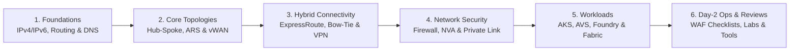

import { Card, CardGrid } from '@astrojs/starlight/components';

## The Lifecycle Architecture Journey

This handbook is written from a Principal Field Architect perspective. Rather than restating product documentation, every chapter focuses on **non-obvious routing behavior**, **failure blast radius**, **hard platform limits**, and **what to recommend in production**.

<CardGrid stagger>
  <Card title="1. Foundations" icon="setting">
    Non-overlapping IPv4/IPv6 CIDR allocation, system/UDR/BGP route selection rules, and hybrid DNS using Azure DNS Private Resolver.
    [Explore Foundations →](/azure-networking/01-foundations/vnet-and-ip-addressing/)
  </Card>
  <Card title="2. Core Topologies" icon="random">
    Customer-managed Hub-and-Spoke with Azure Route Server versus Azure Virtual WAN Standard, Routing Intent, Route Maps, and Azure Virtual Network Manager.
    [Compare Topologies →](/azure-networking/02-core-topologies/hub-spoke-vs-vwan/)
  </Card>
  <Card title="3. Hybrid Connectivity" icon="rocket">
    ExpressRoute resiliency, Bow-Tie failure matrices, `ErGwScale` & AZ gateways, FastPath bypass limits, traffic segregation, and S2S VPN failover.
    [Design Hybrid Links →](/azure-networking/03-hybrid-connectivity/expressroute-resiliency/)
  </Card>
  <Card title="4. Network Security & Private Link" icon="approve-check-circle">
    Azure Firewall vs. third-party NVA HA and Gateway Load Balancer, plus enterprise Private Link DNS governance with Deployment Stacks and Azure Policy.
    [Harden the Network →](/azure-networking/04-network-security/firewall-and-nva-patterns/)
  </Card>
  <Card title="5. Workload Networking" icon="puzzle">
    AKS (CNI Overlay, Cilium, Application Gateway for Containers / Gateway API), Azure VMware Solution (Gen 1 & Gen 2), Microsoft Foundry Standard Agent BYO-VNet, and Fabric.
    [Integrate Workloads →](/azure-networking/05-workload-networking/aks-networking/)
  </Card>
  <Card title="6. Day-2 Ops, Reviews & Labs" icon="magnifier">
    WAF/CAF architecture review checklists, routing decision matrices, Resource Graph queries, Bicep/CLI labs, Firewall Monitor, and Netbench latency/throughput testing.
    [Run Reviews & Labs →](/azure-networking/06-operations-reviews/vwan-review-checklist/)
  </Card>
</CardGrid>

## Quick Topology Selector

| Decision Driver | Recommend Hub-and-Spoke (Customer-Managed) | Recommend Azure Virtual WAN (Standard) |
| --- | --- | --- |
| **Footprint** | 1–2 regions, predictable spoke count, custom NVA topologies | 3+ regions, global any-to-any transit, high branch/SD-WAN density |
| **Routing Control** | Granular UDRs, Azure Route Server + custom BGP appliances | Automated full-mesh hub routing, Routing Intent, Route Maps |
| **Operational Model** | Platform team comfortable owning route tables, peerings, and NVA HA | Managed hub router lifecycle (note ~25-min router scale-out latency) |
| **Inspection Appliance** | Custom L7/IDS NVA clusters, Gateway LB chaining, or Azure Firewall | Integrated Azure Firewall Secured Hub or certified SaaS/NVA in-hub |
