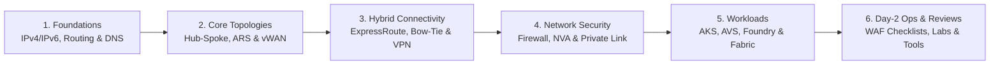

import { Card, CardGrid } from '@astrojs/starlight/components';

## Reference architecture

In the Azure landing zone model, a dedicated connectivity subscription centralizes hybrid gateways, regional transit hubs, firewall inspection, Private DNS resolution, and a tenant-wide Azure DDoS Network Protection plan. Because virtual networks cannot span subscription boundaries, application teams deploy workloads into isolated landing zone subscriptions and connect spoke virtual networks back to the regional hub.

## Architecture roadmap

Every chapter in this handbook focuses on route-selection precedence, failure blast radius, hard Azure platform limits, and production design decisions rather than restating product overviews.

<CardGrid stagger>
  <Card title="1. Foundations" icon="setting">
    Plan non-overlapping IPv4 and IPv6 CIDR blocks, evaluate system, UDR, and BGP route-selection precedence, and resolve hybrid names with Azure DNS Private Resolver.
    [Explore Foundations →](/azure-networking/01-foundations/vnet-and-ip-addressing/)
  </Card>
  <Card title="2. Core Topologies" icon="random">
    Compare customer-managed hub-and-spoke networks with Azure Route Server against Azure Virtual WAN Standard, Routing Intent, Route Maps, and Azure Virtual Network Manager.
    [Compare Topologies →](/azure-networking/02-core-topologies/hub-spoke-vs-vwan/)
  </Card>
  <Card title="3. Hybrid Connectivity" icon="rocket">
    Engineer ExpressRoute dual-peering resiliency, analyze bow-tie failure matrices, size `ErGwScale` and Availability Zone gateways, and configure FastPath, circuit segregation, and S2S VPN backup.
    [Design Hybrid Links →](/azure-networking/03-hybrid-connectivity/expressroute-resiliency/)
  </Card>
  <Card title="4. Network Security & Private Link" icon="approve-check-circle">
    Compare Azure Firewall against third-party NVA high availability and Gateway Load Balancer chaining, and govern Private Link DNS at scale with Azure Policy and Deployment Stacks.
    [Harden the Network →](/azure-networking/04-network-security/firewall-and-nva-patterns/)
  </Card>
  <Card title="5. Workload Networking" icon="puzzle">
    Integrate AKS (CNI Overlay, Cilium, Application Gateway for Containers with Gateway API), Azure VMware Solution (Gen 1 and Gen 2), Microsoft Foundry Standard Agent BYO-VNet, and Fabric.
    [Integrate Workloads →](/azure-networking/05-workload-networking/aks-networking/)
  </Card>
  <Card title="6. Day-2 Ops, Reviews & Labs" icon="magnifier">
    Run WAF and CAF architecture reviews, trace routing decision matrices, execute Azure Resource Graph queries, and deploy the Bicep labs, Firewall Monitor, and Netbench.
    [Run Reviews & Labs →](/azure-networking/06-operations-reviews/vwan-review-checklist/)
  </Card>
</CardGrid>

## Hub-and-spoke vs. Virtual WAN selector

| Decision driver | Customer-managed hub-and-spoke | Azure Virtual WAN (Standard) |
| --- | --- | --- |
| **Regional and branch scale** | 1 to 2 Azure regions without full-mesh inter-region transit; fewer than 30 IPsec branch sites per region (`VpnGw1AZ` to `VpnGw3AZ` cap at 30 S2S tunnels; `VpnGw5AZ` reaches 100 tunnels and 10 Gbps aggregate) | Multi-region global transit with automatic full-mesh hub interconnect; 30+ IPsec branch sites (up to 1,000 S2S connections and 20 Gbps aggregate per hub VPN gateway) or native SD-WAN partner integration |
| **Routing and protocol support** | Granular UDRs, Azure Route Server (`ASN 65515`) with custom BGP appliances, and full dual-stack IPv4/IPv6 support | Managed any-to-any transit across VNets, VPN, and ExpressRoute with Routing Intent and Route Maps; IPv6 is unsupported in Virtual WAN hubs and gateways |
| **Hub capacity and scale-out** | Customer sizes gateways, route tables, peerings, and NAT Gateway SNAT pools directly | Default 2 routing infrastructure units (3 Gbps, 2,000 VMs) up to 50 units (50 Gbps, 50,000 VMs); router scale-out takes up to 25 minutes, accepts at most 10,000 routes per hub, and degrades above 1.5 Gbps per single TCP flow |
| **Inspection and shared services** | In-hub custom L7 or IDS NVA clusters, Gateway Load Balancer chaining, Azure Firewall with NAT Gateway public IP prefixes, and in-hub DNS or Bastion subnets | Secured Virtual Hub with Azure Firewall (requires at least `/22` immutable hub CIDR; scales SNAT via up to 80 Standard public IPs since NAT Gateway and direct public IP prefix attachment are unsupported in hub) or certified in-hub SaaS/NGFW NVA; DNS Private Resolver deploys in a dedicated spoke VNet |

## Platform baselines and Microsoft Learn references

- [Define an Azure network topology (Cloud Adoption Framework)](https://learn.microsoft.com/en-us/azure/cloud-adoption-framework/ready/azure-best-practices/define-an-azure-network-topology) establishes the landing zone decision criteria for choosing between regional customer-managed hub-and-spoke networks (`<30` IPsec branch tunnels) and Virtual WAN global transit.
- [Traditional Azure networking topology (Cloud Adoption Framework)](https://learn.microsoft.com/en-us/azure/cloud-adoption-framework/ready/azure-best-practices/traditional-azure-networking-topology) documents non-transitive VNet peering, Route Server BGP transit between ExpressRoute and VPN, and global VNet peering vs. ExpressRoute MSEE hairpin trade-offs.
- [Virtual WAN network topology in an Azure landing zone (Cloud Adoption Framework)](https://learn.microsoft.com/en-us/azure/cloud-adoption-framework/ready/azure-best-practices/virtual-wan-network-topology) specifies connectivity subscription boundaries, dedicated shared-services spokes for DNS, and tenant-wide DDoS Network Protection plan sizing (100 VNet public IPs included; Microsoft-managed Secured Hub public IPs do not support DDoS Protection plans).
- [About virtual hub settings](https://learn.microsoft.com/en-us/azure/virtual-wan/hub-settings#virtual-hub-capacity) and the [Well-Architected Framework service guide for Azure Virtual WAN](https://learn.microsoft.com/en-us/azure/well-architected/service-guides/azure-virtual-wan) detail routing infrastructure unit scaling (up to 25 minutes per scale-out), the 10,000-route and 1.5 Gbps single-flow limits, and upfront sizing for non-autoscaling VPN and ExpressRoute gateway scale units.

