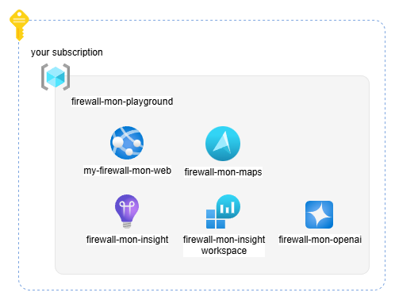

# Install az-firewall-mon in your environment

`az-firewall-mon` is maintained in [`jonathan-vella/azure-networking`](https://github.com/jonathan-vella/azure-networking) under `tools/firewall-monitor/` (originally created by [`nicolgit/azure-firewall-mon`](https://github.com/nicolgit/azure-firewall-mon)).


When installed in your environment, `az-firewall-mon` deploys the following Azure resources:



Follow these steps to deploy a private copy of `az-firewall-mon`:

1. Fork or clone the repository
2. Create a GitHub Personal Access Token (PAT) for Static Web Apps CI/CD
3. Deploy the Azure application infrastructure (`bicep/setup.bicep`)
4. Provision the Event Hub & configure Azure Firewall Structured Logs (`bicep/firewall-mon-azure-stuff.bicep`)
5. Review environment variables & restrict access

# 1. Fork or clone the GitHub repository

* Fork [`jonathan-vella/azure-networking`](https://github.com/jonathan-vella/azure-networking) into your GitHub account or organization (upstream source credit: [`nicolgit/azure-firewall-mon`](https://github.com/nicolgit/azure-firewall-mon)).
* Clone your fork locally so you can deploy the Bicep templates directly with the Azure CLI:

  ```bash
  git clone https://github.com/<your-github-account>/azure-networking.git
  cd azure-networking
  ```

# 2. Create a GitHub Personal Access Token (PAT)

Azure Static Web Apps uses a repository token if you want Azure to bootstrap a GitHub Actions deployment workflow automatically:

1. Go to GitHub **Settings** > **Developer settings** > **Personal access tokens** > **Fine-grained tokens** (<https://github.com/settings/tokens?type=beta>)
2. Scope the token to **Only select repositories** and pick your `azure-networking` fork
3. Set an explicit expiration (for example, `30` or `90` days — avoid non-expiring tokens)
4. Grant repository permissions:
   * **Contents**: Read and write
   * **Workflows**: Read and write
   * **Metadata**: Read-only
5. Generate and copy the token securely

# 3. Deploy all Azure application resources (`bicep/setup.bicep`)

An instance of `az-firewall-mon` consists of:
* 1 Azure Static Web App (Standard plan)
* 1 Azure Maps account (for IP geolocation flags)
* 1 Azure OpenAI account + `gpt-4o` deployment (for natural-language log filtering)
* 1 Log Analytics Workspace + Application Insights instance

Deploy [`bicep/setup.bicep`](bicep/setup.bicep) using the Azure CLI:

```bash
az deployment group create \
  --resource-group <your-resource-group> \
  --template-file tools/firewall-monitor/bicep/setup.bicep \
  --parameters \
    staticWebAppName=<your-swa-name> \
    repositoryUrl=https://github.com/<your-github-account>/azure-networking \
    branch=main \
    repositoryToken=<your-github-pat>
```

Key template parameters in [`bicep/setup.bicep`](bicep/setup.bicep):
* `staticWebAppName`: Name for your Azure Static Web App
* `repositoryUrl`: Your repository URL (defaults to `https://github.com/jonathan-vella/azure-networking`)
* `repositoryToken`: Secure GitHub PAT used by Static Web Apps to register the deployment workflow
* `branch`: Branch to deploy from (defaults to `main`)
* `appLocation`: Defaults to `/tools/firewall-monitor/firewall-mon-app` (override with `/firewall-mon-app` only if deploying from a standalone single-tool repository)
* `apiLocation`: Defaults to `/tools/firewall-monitor/firewall-mon-api` (override with `/firewall-mon-api` for a standalone repository)

# 4. Provision Event Hub & Azure Firewall Structured Logs (`bicep/firewall-mon-azure-stuff.bicep`)

Deploy the dedicated Event Hub Namespace, 1-day/1-partition Event Hub, and least-privilege `Listen`-only Shared Access Policy:

```bash
az deployment group create \
  --resource-group <your-firewall-or-monitoring-rg> \
  --template-file tools/firewall-monitor/bicep/firewall-mon-azure-stuff.bicep
```

Then configure **Monitoring** > **Diagnostic settings** on your Azure Firewall:
* Enable **Resource-specific** structured log categories (`AZFWNetworkRule`, `AZFWApplicationRule`, `AZFWNatRule`, `AZFWDnsQuery`, `AZFWIdpsSignature`, `AZFWThreatIntel`) rather than legacy `AzureDiagnostics`
* Stream to the Event Hub created above
* Connect in `az-firewall-mon` using **only** the `Listen`-scoped Event Hub policy connection string — never `RootManageSharedAccessKey` or policies with `Manage`/`Send` claims

# 5. Local Build & Test Verification

To build and test both the Angular 20 SPA (Vitest) and the .NET 8 isolated Azure Functions API locally:

```bash
# Frontend build & headless unit tests (Vitest)
cd tools/firewall-monitor/firewall-mon-app
npm install
npm run build
npm test

# Backend Azure Functions API build
cd ../firewall-mon-api
dotnet build api.csproj

# Validate Bicep templates
az bicep build --file ../bicep/setup.bicep --stdout > /dev/null
az bicep build --file ../bicep/firewall-mon-azure-stuff.bicep --stdout > /dev/null
```

# 6. Review environment variables

`az-firewall-mon` configures the following Static Web App application settings automatically via [`bicep/setup.bicep`](bicep/setup.bicep):

* **APPLICATIONINSIGHTS_CONNECTION_STRING**: Application Insights connection string

Azure Maps settings:
* **ip_api_key**: Azure Maps API key
* **ip_throttling_calls**: `'1'`
* **ip_throttling_window_milliseconds**: `'1000'`

With these settings, the IP geolocation API returns HTTP `429` if more than 1 request per second (`1000` ms) is made per client IP.

Azure OpenAI settings:
* **aoai_api_key**: Azure OpenAI key
* **aoai_endpoint**: Azure OpenAI endpoint
* **aoai_deployment**: Azure OpenAI deployment name (`gpt4o` by default)
* **llm_throttling_calls**: `'5'`
* **llm_throttling_window_milliseconds**: `'60000'`

With these settings, the Chat API returns HTTP `429` if more than 5 requests per minute (`60000` ms) are made per client IP.

Angular application settings:
* **spa_applicationinsights_connection_string**: Application Insights connection string
* **spa_builddate**: Build timestamp
* **spa_local_queuelength**: `'100000'`

> **spa_local_queuelength** controls the maximum number of firewall log rows retained in browser memory. Older entries are evicted once the buffer reaches this limit.

# 7. Limit access

After setup is complete, restrict access to your `az-firewall-mon` deployment before connecting production firewall streams:

* [Static Web App Private Endpoint](https://learn.microsoft.com/en-us/azure/static-web-apps/private-endpoint): Expose `az-firewall-mon` exclusively on a private IP inside your virtual network (reachable over VPN or ExpressRoute).
* [Static Web App Authentication & Authorization](https://learn.microsoft.com/en-us/azure/static-web-apps/authentication-authorization): Restrict authorized identities/roles in [`./firewall-mon-app/src/assets/staticwebapp.config.json`](./firewall-mon-app/src/assets/staticwebapp.config.json).

