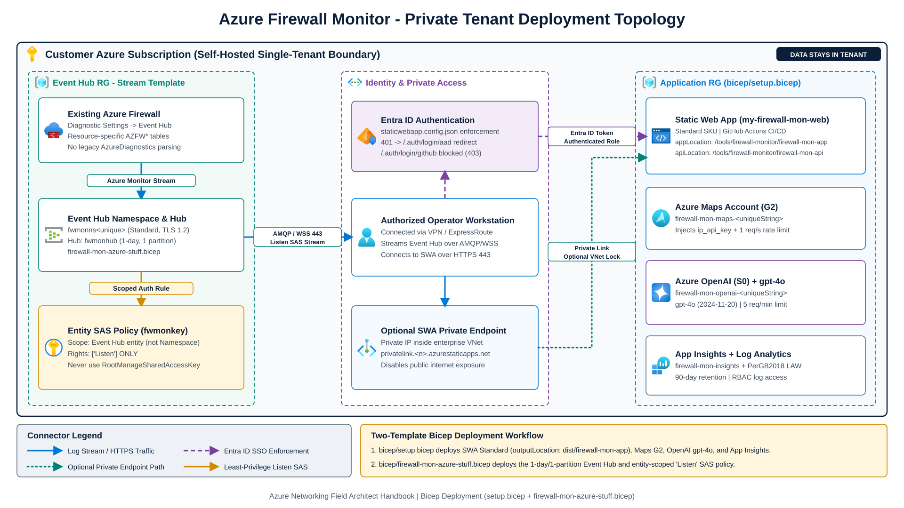

# Install az-firewall-mon in your environment

`az-firewall-mon` is maintained in [`jonathan-vella/azure-networking`](https://github.com/jonathan-vella/azure-networking) under `tools/firewall-monitor/` and originates from [`nicolgit/azure-firewall-mon`](https://github.com/nicolgit/azure-firewall-mon). For architectural guidance on when to pair live Event Hub streaming with Log Analytics, see [Firewall and NVA patterns](../../src/content/docs/04-network-security/firewall-and-nva-patterns.md) and the [Labs and tools guide](../../src/content/docs/06-operations-reviews/labs-and-tools-guide.md).


A private deployment provisions the following Azure topology inside your subscription:



Complete these steps to deploy a private instance of `az-firewall-mon`:

1. Fork or clone the repository.
2. Create a fine-grained GitHub personal access token (PAT) for Static Web Apps CI/CD.
3. Deploy the application infrastructure (`bicep/setup.bicep`).
4. Deploy the Event Hub and configure Azure Firewall structured logs (`bicep/firewall-mon-azure-stuff.bicep`).
5. Verify local frontend, backend, and Bicep builds.
6. Review environment variables and enforce network and identity access controls.

## 1. Fork or clone the GitHub repository

* Fork [`jonathan-vella/azure-networking`](https://github.com/jonathan-vella/azure-networking) into your GitHub account or organization.
* Clone your fork locally so you can deploy the Bicep templates with the Azure CLI:

  ```bash
  git clone https://github.com/<your-github-account>/azure-networking.git
  cd azure-networking
  ```

## 2. Create a GitHub personal access token

Azure Static Web Apps uses a repository token when bootstrapping a GitHub Actions deployment workflow:

1. Open GitHub **Settings** > **Developer settings** > **Personal access tokens** > **Fine-grained tokens** (<https://github.com/settings/tokens?type=beta>).
2. Scope the token to **Only select repositories** and choose your `azure-networking` fork.
3. Set an explicit expiration, such as 30 or 90 days. Avoid non-expiring tokens.
4. Grant repository permissions:
   * **Contents**: Read and write
   * **Workflows**: Read and write
   * **Metadata**: Read-only
5. Generate and store the token securely.

## 3. Deploy application resources (`bicep/setup.bicep`)

[`bicep/setup.bicep`](bicep/setup.bicep) provisions:

* 1 Azure Static Web App (Standard plan, building Angular 22 to `dist/firewall-mon-app` and .NET 8 isolated Azure Functions from `/tools/firewall-monitor/firewall-mon-api`)
* 1 Azure Maps account (`G2` SKU for public IP country flags)
* 1 Azure OpenAI account (`S0` SKU) with a `gpt-4o` (`2024-11-20`) deployment for natural-language filter generation
* 1 Log Analytics workspace (`PerGB2018` SKU) and 1 Application Insights instance

Deploy [`bicep/setup.bicep`](bicep/setup.bicep) with the Azure CLI:

```bash
az deployment group create \
  --resource-group <your-resource-group> \
  --template-file tools/firewall-monitor/bicep/setup.bicep \
  --parameters \
    staticWebAppName=<your-swa-name> \
    repositoryUrl=https://github.com/<your-github-account>/azure-networking \
    branch=main \
    repositoryToken=<your-github-pat>
```

Key template parameters in [`bicep/setup.bicep`](bicep/setup.bicep):

* `staticWebAppName`: Name for your Azure Static Web App.
* `staticWebAppLocation`: Supported Azure Static Web Apps control-plane region (`eastus2`, `centralus`, `westus2`, `westeurope`, or `eastasia`; defaults to `eastus2`).
* `repositoryUrl`: Repository URL (defaults to `https://github.com/jonathan-vella/azure-networking`).
* `repositoryToken`: Secure GitHub PAT used by Static Web Apps to register the workflow.
* `branch`: Branch to deploy from (defaults to `main`).
* `appLocation`: Defaults to `/tools/firewall-monitor/firewall-mon-app` (override with `/firewall-mon-app` only for a standalone repository).
* `apiLocation`: Defaults to `/tools/firewall-monitor/firewall-mon-api` (override with `/firewall-mon-api` only for a standalone repository).

## 4. Provision Event Hub and structured firewall logs (`bicep/firewall-mon-azure-stuff.bicep`)

Deploy the Event Hub Namespace (`Standard`, TLS 1.2), 1-day/1-partition Event Hub (`fwmonhub`), and entity-scoped `Listen`-only Shared Access Policy (`fwmonkey`):

```bash
az deployment group create \
  --resource-group <your-firewall-or-monitoring-rg> \
  --template-file tools/firewall-monitor/bicep/firewall-mon-azure-stuff.bicep
```

Next, open **Monitoring** > **Diagnostic settings** on your Azure Firewall:

* Enable **Resource-specific** structured log categories (`AZFWNetworkRule`, `AZFWApplicationRule`, `AZFWNatRule`, `AZFWDnsQuery`, `AZFWIdpsSignature`, `AZFWThreatIntel`) instead of legacy `AzureDiagnostics`.
* Stream logs to the Event Hub deployed above.
* Connect in `az-firewall-mon` with the `Listen`-only Event Hub policy connection string. Never use `RootManageSharedAccessKey` or policies that grant `Manage` or `Send` rights.

## 5. Local build and test verification

Build and test the Angular 22 SPA (TypeScript 6.0, Vitest 5.1), the .NET 8 isolated Azure Functions backend, the xUnit test suite, and both Bicep templates locally:

```bash
# Frontend Angular 22 production build and Vitest 5.1 unit tests
cd tools/firewall-monitor/firewall-mon-app
npm ci
npm run build
npm test

# Backend .NET 8 isolated Azure Functions build and xUnit tests
cd ../..
dotnet build tools/firewall-monitor/firewall-mon-api/api.csproj --configuration Release
dotnet test tools/firewall-monitor/firewall-mon-api.Tests/firewall-mon-api.Tests.csproj --configuration Release

# Validate and lint Bicep templates
az bicep lint --file tools/firewall-monitor/bicep/setup.bicep
az bicep lint --file tools/firewall-monitor/bicep/firewall-mon-azure-stuff.bicep
az bicep build --file tools/firewall-monitor/bicep/setup.bicep --stdout > /dev/null
az bicep build --file tools/firewall-monitor/bicep/firewall-mon-azure-stuff.bicep --stdout > /dev/null
```

## 6. Review environment variables

[`bicep/setup.bicep`](bicep/setup.bicep) configures the following Static Web App settings:

* `APPLICATIONINSIGHTS_CONNECTION_STRING`: Application Insights connection string for the Functions worker.

Azure Maps geolocation settings:

* `ip_api_key`: Azure Maps subscription key, sent by the backend exclusively via the `subscription-key` HTTP header. Private, loopback, link-local, CGNAT, documentation, multicast, and IPv6 unique-local addresses return `zz` locally without calling Azure Maps.
* `ip_throttling_calls`: `'1'`
* `ip_throttling_window_milliseconds`: `'1000'`

When a client exceeds 1 public IP lookup per second (`1000` ms, tracked per client IP via `X-Forwarded-For`), `/api/ip/{ipAddress}` returns HTTP `429`.

Azure OpenAI settings:

* `aoai_api_key`: Azure OpenAI API key
* `aoai_endpoint`: Azure OpenAI endpoint URL
* `aoai_deployment`: Azure OpenAI model deployment name (`gpt4o` by default)
* `llm_throttling_calls`: `'5'`
* `llm_throttling_window_milliseconds`: `'60000'`

When a client exceeds 5 chat requests per minute (`60000` ms), `/api/chat` returns HTTP `429`.

Allowlisted SPA configuration settings (`/api/settings/{attribute}`):

* `spa_applicationinsights_connection_string`: Application Insights connection string for browser telemetry
* `spa_builddate`: Deployment timestamp
* `spa_local_queuelength`: `'100000'` (maximum firewall log rows retained in browser memory before oldest entries are evicted)

`/api/settings/{attribute}` enforces a case-insensitive allowlist (`applicationinsights_connection_string`, `builddate`, `local_queuelength`) and rejects all other attribute names with HTTP `400`.

## 7. Restrict network and identity access

Restrict access to your `az-firewall-mon` deployment before connecting production firewall streams:

* [Static Web App Private Endpoint](https://learn.microsoft.com/en-us/azure/static-web-apps/private-endpoint): Expose `az-firewall-mon` only on a private IP inside your virtual network over VPN or ExpressRoute.
* [Static Web App authentication and authorization](https://learn.microsoft.com/en-us/azure/static-web-apps/authentication-authorization): [`firewall-mon-app/src/assets/staticwebapp.config.json`](./firewall-mon-app/src/assets/staticwebapp.config.json) requires the `authenticated` role via Microsoft Entra ID (`/.auth/login/aad`) and blocks GitHub social login (`/.auth/login/github` returns `403`).


