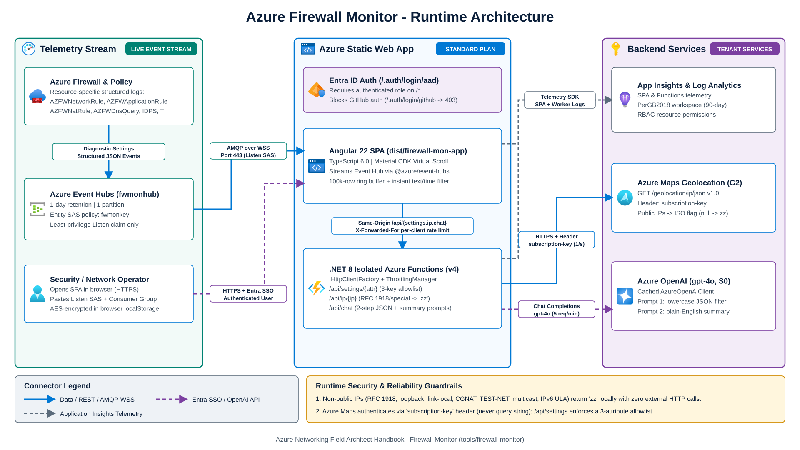

<div align="center">

> Consolidated into [`jonathan-vella/azure-networking`](https://github.com/jonathan-vella/azure-networking) under `tools/firewall-monitor/` from upstream [`nicolgit/azure-firewall-mon`](https://github.com/nicolgit/azure-firewall-mon). Do not hardcode Event Hub connection strings or credentials in frontend code.


</div>
<h1 align="center">az-firewall-mon</h1>

<div align="center">
  Real-time Event Hub log stream viewer for Azure Firewall
</div>

<br/>

<div align="center">
  <sub>Originally built by
  <a href="https://github.com/nicolgit">nicolgit</a> and
  <a href="https://github.com/nicolgit/azure-firewall-mon/contributors">
    contributors
  </a></sub>
</div>

<br/>


Microsoft recommends sending Azure Firewall logs to a Log Analytics workspace and analyzing them with Kusto Query Language (KQL). Log Analytics ingestion adds two to five minutes of latency, which slows down live cutovers and rule troubleshooting.

`az-firewall-mon` answers one operational question: "What is Azure Firewall allowing or dropping right now?" It streams structured firewall events directly from Azure Event Hubs into a virtual-scrolled browser table, similar to [Sysinternals Process Monitor](https://learn.microsoft.com/en-us/sysinternals/downloads/procmon) or [Check Point SmartView](https://sc1.checkpoint.com/documents/R80.40/WebAdminGuides/EN/CP_R80.40_LoggingAndMonitoring_AdminGuide/Topics-LMG/Using-log-view.htm?tocpath=Logging%7C_____2), with no KQL queries or dashboards required first.

## Related handbook chapters

* [Firewall and NVA patterns](../../src/content/docs/04-network-security/firewall-and-nva-patterns.md)
* [Labs and tools guide](../../src/content/docs/06-operations-reviews/labs-and-tools-guide.md)
* [Virtual WAN verification playbook](../../src/content/docs/06-operations-reviews/vwan-review-addendum.md)

## Live filtering and natural-language search

Type in the top toolbar search box to filter the live event stream across all columns as events arrive.


Display timestamps in UTC or local time, and filter by either a rolling minute window or an explicit start and end time.


The Event Hub template configures a 24-hour retention period on a single partition so the browser reads only recent traffic tailored for real-time inspection.

Switch the toolbar to AI filter mode (`gpt-4o` on Azure OpenAI) to translate natural-language prompts into structured field filters:

* "Show me events from the last 15 minutes"
* "Search project alpha"
* "Filter rows with category containing NetworkRule"
* "Filter events between 12:00 and 13:00"
* "Filter for target containing 192.168.1.1"
* "Include only logs with protocol TCP"
* "Show me only the deny actions"
* "More information on source 192.168.1.1"


## Runtime architecture

`az-firewall-mon` is a single-page application built with [Angular 22](https://angular.dev/) (TypeScript 6.0, tested with Vitest 5.1) and backed by an [Azure Functions](https://learn.microsoft.com/en-us/azure/azure-functions/functions-overview) v4 isolated worker API in C# (.NET 8, tested with xUnit).



To connect `az-firewall-mon` to your firewall telemetry, choose one of two options:

1. Deploy `az-firewall-mon` in your own Azure subscription (recommended). All firewall logs, Azure OpenAI prompts, and Application Insights telemetry remain inside your tenant.
2. Use the upstream demo at <https://az-firewall-mon.duckiesfarm.com> for synthetic or non-sensitive testing only.

> Never paste production Event Hub connection strings into a third-party demo URL. Follow [INSTALL.md](INSTALL.md) to deploy a private instance in your own subscription with Entra ID authentication and optional Private Endpoint isolation.

## Azure Firewall structured logs and Event Hub security

### Use resource-specific structured logs instead of legacy AzureDiagnostics

When configuring Diagnostic settings on Azure Firewall, select **Resource-specific** structured log categories rather than the legacy `AzureDiagnostics` mode:

| Structured category | Description | Key parsed fields in `az-firewall-mon` |
|---|---|---|
| `AZFWNetworkRule` | L3/L4 network rule evaluations | `Protocol`, `SourceIp`, `SourcePort`, `DestinationIp`, `DestinationPort`, `Action`, `Policy`, `RuleCollectionGroup`, `RuleCollection`, `Rule`, `ActionReason` |
| `AZFWApplicationRule` | L7 FQDN, HTTP(S), and web category rules | `Protocol`, `SourceIp`, `Fqdn`, `DestinationPort`, `TargetUrl`, `WebCategory`, `Action`, `Policy` |
| `AZFWNatRule` | Inbound DNAT rule translations | `Protocol`, `SourceIp`, `SourcePort`, `TranslatedIp`, `TranslatedPort`, `Policy` |
| `AZFWDnsQuery` | DNS proxy queries and responses | `SourceIp`, `Protocol`, `QueryId`, `QueryType`, `QueryName`, `ResponseCode` |
| `AZFWIdpsSignature` | Azure Firewall Premium IDPS alerts and drops | `Protocol`, `SourceIp`, `DestinationIp`, `Action`, `Severity`, `SignatureId`, `Category`, `Description` |
| `AZFWThreatIntel` | Threat intelligence indicator matches | `Protocol`, `SourceIp`, `Fqdn`, `Action`, `ThreatDescription` |

Structured logs emit typed JSON fields instead of packing free-form strings into `properties.msg`. This avoids fragile string parsing, reduces payload size, and parses Premium IDPS and Threat Intelligence categories directly. Legacy categories (`AzureFirewallNetworkRule`, `AzureFirewallApplicationRule`, `AzureFirewallDnsProxy`) remain supported for existing deployments, while new deployments should enable `AZFW*` categories.

### Event Hub SAS least-privilege controls (`Listen` only)

The Angular 22 SPA connects directly to Azure Event Hubs over AMQP-over-WebSockets (`@azure/event-hubs`). Apply these least-privilege controls:

* **Scope SAS to the Event Hub entity, never the namespace**: Do not use `RootManageSharedAccessKey`. Create an Event Hub entity Shared Access Policy with only the `Listen` claim (never `Manage` or `Send`).
* **Short retention and dedicated consumer group**: Configure 1-day message retention and 1 partition for live inspection. Use a dedicated consumer group (or `$Default` when no other reader shares the hub) to avoid offset contention.
* **Credential hygiene**: Rotate SAS keys on a regular schedule and never commit connection strings to Git. Connection strings entered in the UI are AES-encrypted in browser `localStorage` for the active browser profile.

## Stream Azure Firewall logs to Event Hub

1. Deploy the Event Hub Namespace, Event Hub (`1-day` retention, `1` partition), and `Listen`-only Shared Access Policy with [`bicep/firewall-mon-azure-stuff.bicep`](bicep/firewall-mon-azure-stuff.bicep):

   ```bash
   az deployment group create \
     --resource-group <your-resource-group> \
     --template-file tools/firewall-monitor/bicep/firewall-mon-azure-stuff.bicep
   ```

2. Open your Azure Firewall resource in the Azure portal and select **Monitoring** > **Diagnostic settings** > **Add diagnostic setting**:
   * Check the structured log categories (`AZFWNetworkRule`, `AZFWApplicationRule`, `AZFWNatRule`, `AZFWDnsQuery`, `AZFWIdpsSignature`, `AZFWThreatIntel`).
   * Check **Stream to an event hub**, and select the Event Hub Namespace and Event Hub (`fwmonhub` by default) deployed in step 1.
   * Select **Save**.

3. Open your private `az-firewall-mon` Static Web App (see [INSTALL.md](INSTALL.md)):
   * Paste the connection string from the `Listen`-only Event Hub Shared Access Policy (`fwmonkey` by default) into **Event Hub connection string**.
   * Enter the **Event Hub Consumer Group** name (for example `$Default`).
   * Select **Let's begin**.

## Deploy and verify locally

Follow [INSTALL.md](INSTALL.md) to deploy Azure Static Web Apps, the .NET 8 isolated Azure Functions API, Azure Maps, Azure OpenAI (`gpt-4o`), and Application Insights in your tenant.

To build and run the automated test suites locally:

```bash
# Angular 22 SPA build and Vitest 5.1 unit tests
cd tools/firewall-monitor/firewall-mon-app
npm ci
npm run build
npm test

# .NET 8 isolated Azure Functions build and xUnit test suite
cd ../..
dotnet build tools/firewall-monitor/firewall-mon-api/api.csproj --configuration Release
dotnet test tools/firewall-monitor/firewall-mon-api.Tests/firewall-mon-api.Tests.csproj --configuration Release
```

## Azure Monitor and Log Analytics reference

* [Azure Firewall documentation](https://learn.microsoft.com/en-us/azure/firewall/overview): Stateful network and application firewall service for east-west and north-south Azure traffic inspection.
* [Azure Monitor overview](https://learn.microsoft.com/en-us/azure/azure-monitor/overview): Routes Azure Firewall metrics and diagnostic logs to Log Analytics workspaces, Azure Storage, and Azure Event Hubs.
* [Log Analytics workspace overview](https://learn.microsoft.com/en-us/azure/azure-monitor/logs/log-analytics-workspace-overview): Retains historical firewall telemetry for long-term auditing, Policy Analytics, and KQL investigation after an incident.
* [Kusto Query Language (KQL) reference](https://learn.microsoft.com/en-us/azure/data-explorer/kusto/query/): Query language used to correlate historical `AZFW*` tables in Log Analytics.

## Tools that inspired az-firewall-mon

### [Check Point SmartView](https://community.checkpoint.com/t5/Management/SmartView-Accessing-Check-Point-Logs-from-Web/td-p/3710) web log viewer


### Sysinternals [Process Monitor](https://learn.microsoft.com/en-us/sysinternals/downloads/procmon)


## Credits

* [90342-security.json](https://lottiefiles.com/90342-security) Lottie animation by Kawsar Mahmud
* [lf20_giodppcr.json](https://lottiefiles.com/95739-no-connection-to-internet) Lottie animation by hdev coder
* [rubik.json](https://lottiefiles.com/animations/abstract-modular-cube-1-INITf22TH2) Lottie animation by Ision Industries
* Logo created with [Microsoft Bing](https://www.bing.com/new)


