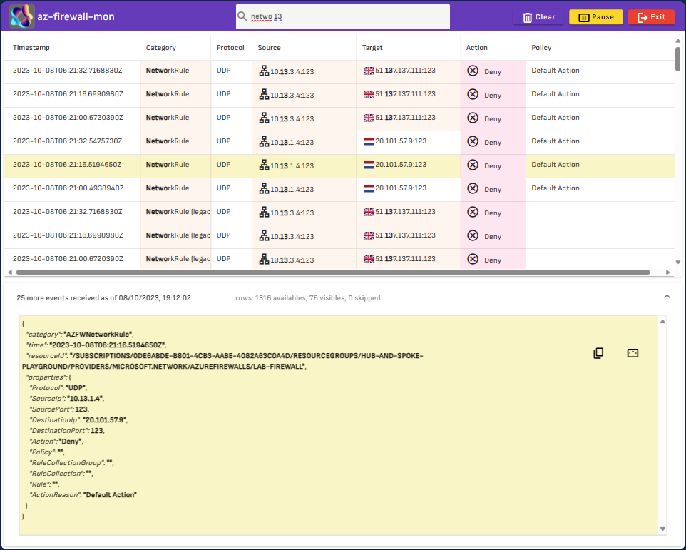
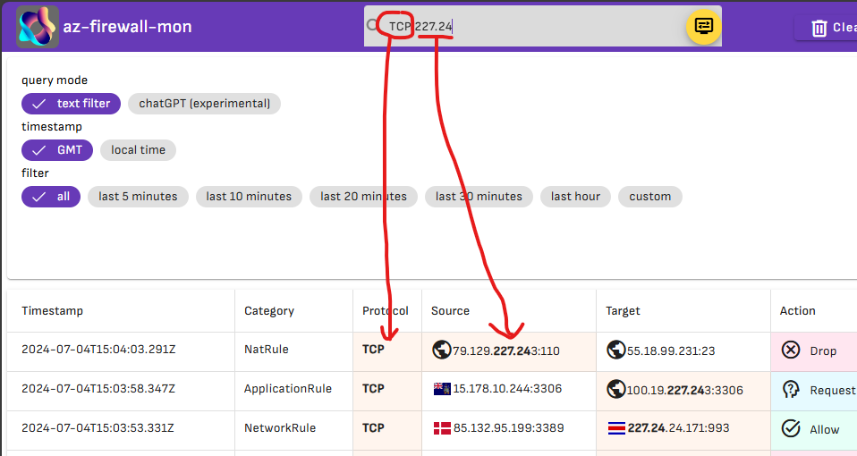
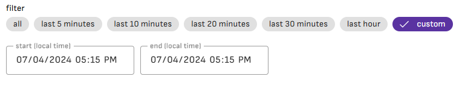
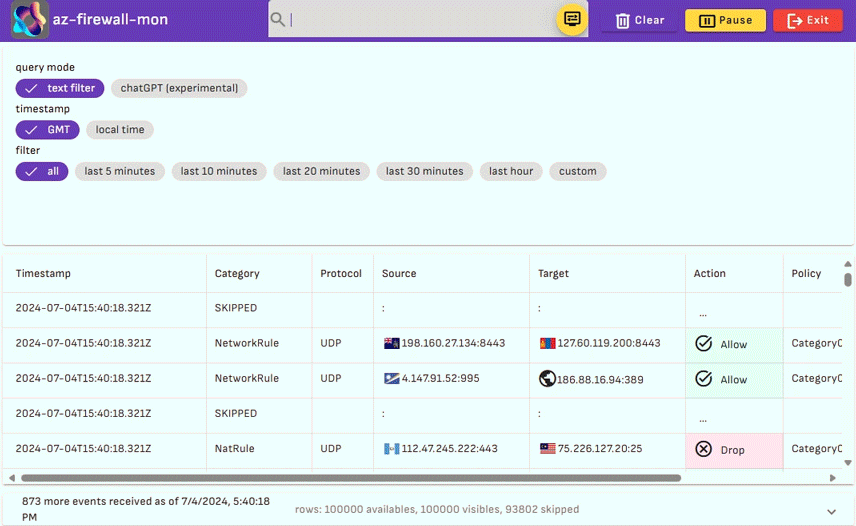
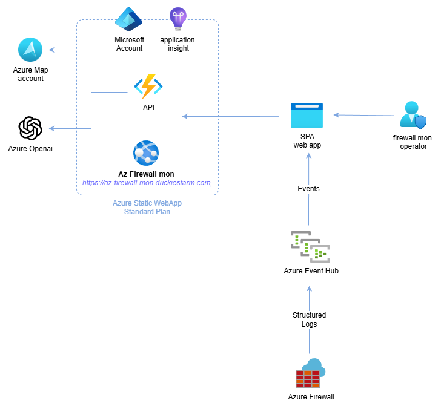
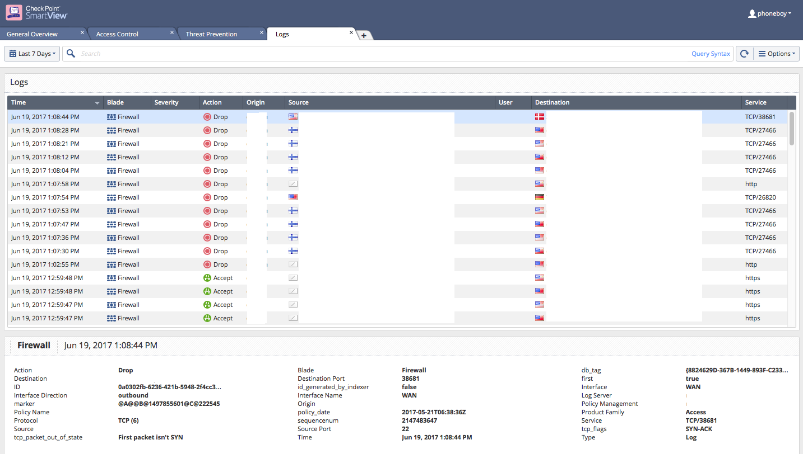
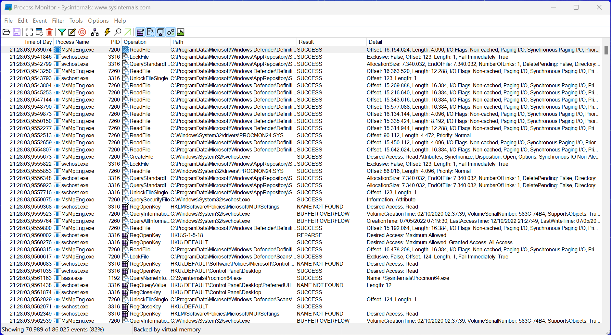

<div align="center">

> Consolidated into [`jonathan-vella/azure-networking`](https://github.com/jonathan-vella/azure-networking) under `tools/firewall-monitor/` from upstream [`nicolgit/azure-firewall-mon`](https://github.com/nicolgit/azure-firewall-mon). Do not hardcode Event Hub connection strings or credentials in frontend code.


</div>
<h1 align="center">az-firewall-mon🧑‍🚒</h1>

<div align="center">
  an <i>alternative and opinionated</i> way to access and inspect Azure Firewall logs
</div>

<br/>

<div align="center">
  <sub>built by
  <a href="https://github.com/nicolgit">nicolgit</a> and
  <a href="https://github.com/nicolgit/azure-firewall-mon/contributors">
    contributors
  </a>
</div>

<br/>



We all know that Microsoft's recommended approach for analyzing Azure Firewall logs is to set up a Log Analytics Workspace to collect all the data and use Kusto Query Language (KQL) queries to check the results. 

Azure-Firewall-mon focuses more on providing a tool that can answer the simple question "_what is happening right now?_" in an alternative and practical way. The idea is to provide an approach similar to [Sysinternals Process Monitor](https://learn.microsoft.com/en-us/sysinternals/downloads/procmon) or [Check Point's SmartView/SmartLog](https://sc1.checkpoint.com/documents/R80.40/WebAdminGuides/EN/CP_R80.40_LoggingAndMonitoring_AdminGuide/Topics-LMG/Using-log-view.htm?tocpath=Logging%7C_____2), where you don't need to implement KQL queries or dashboards first to get it working. All events are available as a _log-stream_.

The real strength of the tool is the search field available in the top toolbar. To search for an event, simply start typing and the log flow will be automatically filtered according to those parameters.



The timestamp field displays the event date in UTC or local format. You can filter the view for the last few minutes or for a specific time range.



Within this tool, only events from the last 24 hours will appear because this is the duration set on the Event Hub Namespace. A longer duration would slow down the tool and not help answer the question "_what is happening right now?_" that az-firewall-mon aims to address.

As an alternative to full-text search, you can use the **chatGPT mode**: in the top search field, you can enter a request in natural language, and the system will filter the content accordingly.

Some examples of queries are as follows:

* "_Show me events from the last 15 minutes_" 
* "_Search project alpha_" 
* "_Filter rows with category containing "NetworkRule"_" 
* "_Filter events between 12:00 and 13:00_" 
* "_Filter for target containing 192.168.1.1_" 
* "_Include only logs with protocol TCP_" 
* "_Show me only the deny actions_" 
* "_More information on source 192.168.1.1_"



# Set up a connection with your Azure Firewall
Azure-Firewall-mon is an open-source [Single Page Application](https://en.wikipedia.org/wiki/Single-page_application) written in [Angular](https://angular.dev/) (Angular 20, tested with Vitest) with an [Azure Functions](https://learn.microsoft.com/en-us/azure/azure-functions/functions-overview) v4 isolated worker backend written in C# (.NET 8).

Here's the current architecture:



To use this app with **YOUR FIREWALL data**, you have 2 options:

1. Deploy `az-firewall-mon` in your own Azure subscription (**recommended** — keeps all telemetry, OpenAI prompts, and Event Hub traffic inside your tenant)
2. Use the upstream sample deployment at <https://az-firewall-mon.duckiesfarm.com> for non-sensitive testing only

> <https://az-firewall-mon.duckiesfarm.com> is an upstream community demo with strict rate limits on Azure Maps and Azure OpenAI. Deploying your own instance in [`jonathan-vella/azure-networking`](https://github.com/jonathan-vella/azure-networking) (see [INSTALL.md](INSTALL.md)) gives you full control over performance, network isolation, and data residency.

# Azure Firewall Structured Logs & Event Hub Security (2026 Guidance)

### Prefer Resource-Specific Structured Logs over Legacy `AzureDiagnostics`
When configuring **Diagnostic Settings** on Azure Firewall, select **Resource-specific** structured log categories instead of the legacy `AzureDiagnostics` mode:

| Structured Category | Description | Key Parsed Fields in `az-firewall-mon` |
|---|---|---|
| `AZFWNetworkRule` | L3/L4 Network rule evaluations | `Protocol`, `SourceIp`, `SourcePort`, `DestinationIp`, `DestinationPort`, `Action`, `Policy`, `RuleCollectionGroup`, `RuleCollection`, `Rule`, `ActionReason` |
| `AZFWApplicationRule` | L7 FQDN / HTTP(S) / Web Category rules | `Protocol`, `SourceIp`, `Fqdn`, `DestinationPort`, `TargetUrl`, `WebCategory`, `Action`, `Policy` |
| `AZFWNatRule` | Inbound DNAT rule translations | `Protocol`, `SourceIp`, `SourcePort`, `TranslatedIp`, `TranslatedPort`, `Policy` |
| `AZFWDnsQuery` | DNS Proxy queries and responses | `SourceIp`, `Protocol`, `QueryId`, `QueryType`, `QueryName`, `ResponseCode` |
| `AZFWIdpsSignature` | Azure Firewall Premium IDPS alerts/drops | `Protocol`, `SourceIp`, `DestinationIp`, `Action`, `Severity`, `SignatureId`, `Category`, `Description` |
| `AZFWThreatIntel` | Threat intelligence indicator matches | `Protocol`, `SourceIp`, `Fqdn`, `Action`, `ThreatDescription` |

Structured logs emit strongly typed JSON properties rather than packing free-form strings into `properties.msg`, avoiding brittle regex/string parsing, reducing payload overhead, and supporting Premium IDPS and Threat Intelligence categories natively. Legacy categories (`AzureFirewallNetworkRule`, `AzureFirewallApplicationRule`, `AzureFirewallDnsProxy`) remain parsed for backward compatibility, but new deployments should use the `AZFW*` categories above.

### Event Hub SAS Least-Privilege Security (`Listen` Only)
Because the Angular SPA streams events directly from Azure Event Hubs over AMQP-over-WebSockets (`@azure/event-hubs`), apply strict least-privilege controls:

* **Scope SAS to the Event Hub entity, never the Namespace**: Do **not** use `RootManageSharedAccessKey`. Create an Event Hub–level Shared Access Policy with **only** the `Listen` claim (never `Manage` or `Send`).
* **Short retention & dedicated consumer group**: Configure a `1-day` message retention and `1` partition for real-time inspection, and use a dedicated consumer group (or `$Default` if no other reader shares the hub) so readers do not contend over offsets.
* **Credential hygiene**: Rotate SAS keys regularly and never hardcode connection strings in source files or commit them to Git. Connection strings entered in the UI are AES-encrypted in browser `localStorage` for the active browser profile only.

# Stream Azure Firewall Logs to Event Hub

1. Provision an Event Hub Namespace, Event Hub (`1-day` retention, `1` partition), and a least-privilege `Listen`-only Shared Access Policy using [`bicep/firewall-mon-azure-stuff.bicep`](bicep/firewall-mon-azure-stuff.bicep) from [`jonathan-vella/azure-networking`](https://github.com/jonathan-vella/azure-networking):

   ```bash
   az deployment group create \
     --resource-group <your-resource-group> \
     --template-file tools/firewall-monitor/bicep/firewall-mon-azure-stuff.bicep
   ```

2. Open the Azure Firewall instance you want to monitor in the Azure Portal, go to **Monitoring** > **Diagnostic settings** > **Add diagnostic setting**:
   * Select the structured log categories (`AZFWNetworkRule`, `AZFWApplicationRule`, `AZFWNatRule`, `AZFWDnsQuery`, `AZFWIdpsSignature`, `AZFWThreatIntel`)
   * Select **Stream to an event hub**, and pick the Event Hub Namespace and Event Hub (`fwmonhub` by default) created above
   * Click **Save**

3. Open your deployed `az-firewall-mon` web app (see [INSTALL.md](INSTALL.md)):
   * Paste the connection string of the **`Listen`-only** Event Hub Shared Access Policy (`fwmonkey` by default) into **Event Hub connection string**
   * Enter the **Event Hub Consumer Group** name (for example `$Default`)
   * Click **Let's begin**

# Install az-firewall-mon in your environment

To deploy a private instance of `az-firewall-mon` (Azure Static Web App, Azure Functions API, Azure Maps, Azure OpenAI, and Application Insights), follow [INSTALL.md](INSTALL.md). Once deployed, follow [Stream Azure Firewall Logs to Event Hub](#stream-azure-firewall-logs-to-event-hub) using your Static Web App URL.

# More Information

[Azure Firewall](https://learn.microsoft.com/en-us/azure/firewall/overview) (AF) is a cloud-native and intelligent network firewall security service that provides best-of-breed threat protection for your cloud workloads running in Azure. It's a fully stateful, firewall-as-a-service with built-in high availability and unrestricted cloud scalability. It provides both east-west and north-south traffic inspection.

[Azure Monitor](https://learn.microsoft.com/en-us/azure/azure-monitor/overview) helps you maximize the availability and performance of your applications and services. It delivers a comprehensive solution for collecting, analyzing, and acting on telemetry from your cloud and on-premises environments. 

Azure Firewall is integrated with Azure Monitor. This means you can forward Azure Firewall metrics and logs to:

* Log Analytics Workspace
* Azure Storage
* Event Hub

A [Log Analytics workspace](https://docs.microsoft.com/en-us/azure/azure-monitor/logs/log-analytics-workspace-overview) is a unique environment for log data from Azure Monitor and other Azure services. Each workspace has its own data repository and configuration but might combine data from multiple services.

Be mindful that the ingestion of logs into a Log Analytics workspace has some latency, so you may see a delay before logs are displayed.

Latency refers to the time between when data is created on the monitored system and when it becomes available for analysis in Azure Monitor.

The [Kusto Query Language](https://learn.microsoft.com/en-us/azure/data-explorer/kusto/query/) (KQL) is a tool to explore your data in a Log Analytics Workspace. The query uses schema entities that are organized in a hierarchy similar to SQL's: databases, tables, and columns.

# UIs and tools that inspired Az-Firewall-mon

## [Check Point's SmartView](https://community.checkpoint.com/t5/Management/SmartView-Accessing-Check-Point-Logs-from-Web/td-p/3710) web log access



## SysInternals [process monitor](https://learn.microsoft.com/en-us/sysinternals/downloads/procmon)


# Credits

* [90342-security.json](https://lottiefiles.com/90342-security) lottie animation by Kawsar Mahmud
* [lf20_giodppcr.json](https://lottiefiles.com/95739-no-connection-to-internet) lottie animation by hdev coder
* [rubik.json](https://lottiefiles.com/animations/abstract-modular-cube-1-INITf22TH2) lottie animation by Ision Industries
* Logo built with the [new Bing](https://www.bing.com/new)

