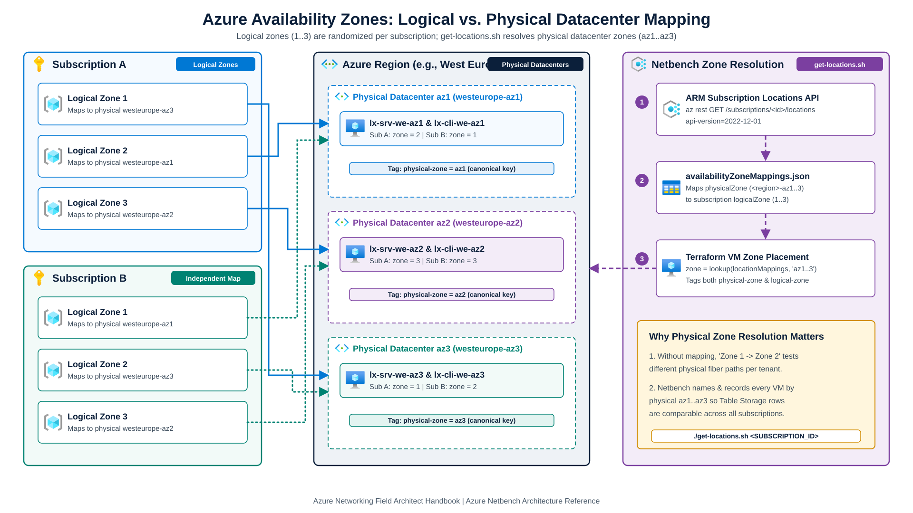
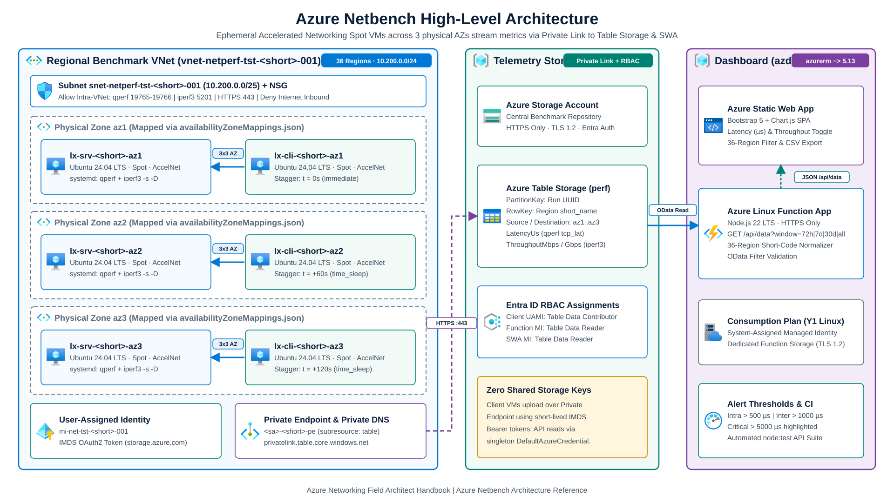
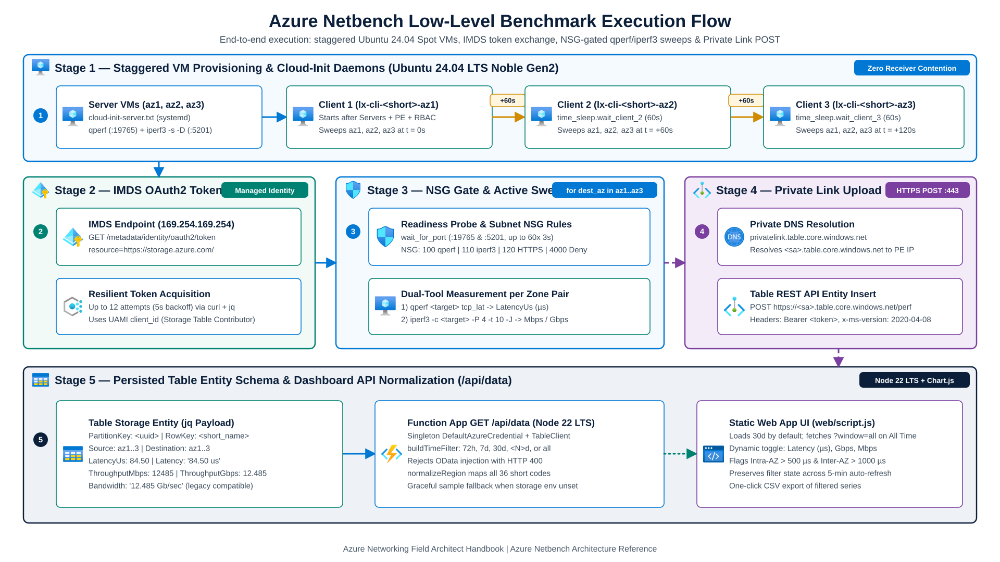

# Azure network internal zone latency and throughput benchmark (`netbench`)

> **Attribution:** Adapted from [`vmisson/azure-netbench`](https://github.com/vmisson/azure-netbench) into [`jonathan-vella/azure-networking/tools/netbench`](https://github.com/jonathan-vella/azure-networking/tree/main/tools/netbench). See [LICENSE](../../LICENSE) and [THIRD_PARTY_NOTICES.md](../../THIRD_PARTY_NOTICES.md) for license terms and provenance.

Terraform benchmark suite and Azure Static Web Apps dashboard for measuring intra-zone and inter-zone one-way TCP latency (`qperf`) and 4-stream TCP throughput (`iperf3`) across physical Azure Availability Zones in 36 regions.

- **Handbook guide:** [Hands-On Labs & Operational Tools Guide (`tools/netbench`)](../../src/content/docs/06-operations-reviews/labs-and-tools-guide.md#5-azure-netbench-latency--throughput-suite-toolsnetbench) ([live site](https://jonathan-vella.github.io/azure-networking/06-operations-reviews/labs-and-tools-guide/#5-azure-netbench-latency--throughput-suite-toolsnetbench))
- **Related handbook chapters:** [ExpressRoute Resiliency](../../src/content/docs/03-hybrid-connectivity/expressroute-resiliency.md) and [Virtual WAN Review Checklist (`PERF-01`)](../../src/content/docs/06-operations-reviews/vwan-review-checklist.md#perf-01)

> **Disclaimer:** This is an unofficial community tool and is not affiliated with Microsoft. Benchmark figures depend on VM SKU, host placement, and regional load. Validate production architectures with your target SKUs and workloads.

## Overview

`netbench` provisions ephemeral Ubuntu 24.04 LTS Spot VMs with Accelerated Networking across all three physical Availability Zones in a selected Azure region (`azurerm ~> 5.13`). Client VMs run staggered `qperf` latency and `iperf3` throughput tests against each server zone, write JSON entities to Azure Table Storage over an Azure Private Endpoint using Managed Identity tokens, and expose historical trends through a Node.js 22 LTS Azure Functions API and Static Web App dashboard.

## Physical vs. logical Availability Zones

Azure separates subscription-visible zone labels from underlying datacenter identifiers:

- **Logical zones:** Subscription-scoped numbers (`1`, `2`, `3`).
- **Physical zones:** Regional datacenter identifiers (`<region>-az1`, `<region>-az2`, `<region>-az3`).

Azure assigns logical-to-physical mappings independently for each subscription. Logical `Zone 1` in Subscription A can map to physical `westeurope-az3` while Logical `Zone 1` in Subscription B maps to `westeurope-az1`.



### How `netbench` resolves physical zones

1. `modules/netperf/locals.tf` reads `availabilityZoneMappings.json` to map physical zones (`az1`, `az2`, `az3`) to the active subscription's logical zone numbers.
2. Terraform places each VM in its resolved logical zone and tags every VM with both `physical-zone` and `logical-zone`.
3. `./get-locations.sh <subscription-id>` queries the Azure Resource Manager Locations API (`api-version=2022-12-01`) to refresh `availabilityZoneMappings.json` for your subscription before running benchmarks.

## Architecture

### Regional topology

- Three Ubuntu 24.04 LTS Noble Gen2 (`Canonical:ubuntu-24_04-lts:server:latest`) Spot server VMs (`lx-srv-<short>-az1..az3`) with Accelerated Networking, one per physical Availability Zone.
- Three Ubuntu 24.04 LTS Noble Gen2 Spot client VMs (`lx-cli-<short>-az1..az3`) with Accelerated Networking and a User-Assigned Managed Identity (`mi-net-tst-<short>-001`), staggered by 60 seconds (`time_sleep`) so two clients do not saturate the same server NIC at the same time.
- A subnet Network Security Group that allows intra-VNet benchmark traffic on `qperf` (`19765-19766`), `iperf3` (`5201`), and Private Endpoint HTTPS (`443`), and denies inbound Internet traffic.



### Benchmark execution flow

- **Server VMs (`cloud-init-server.txt`):** Configure `systemd` units for `qperf` (`qperf-server.service`) and `iperf3 -s -D` (`iperf3-server.service`).
- **Client VMs (`cloud-init-client.txt`):**
  1. Request a Microsoft Entra ID access token for `https://storage.azure.com/` from IMDS (`169.254.169.254`) using the User-Assigned Managed Identity.
  2. Poll TCP ports `19765` and `5201` on `lx-srv-<short>-az1..az3` until both daemons accept connections.
  3. Measure TCP one-way latency with `qperf <target> tcp_lat` (`LatencyUs`) and 4-stream TCP throughput over 10 seconds with `iperf3 -c <target> -P 4 -t 10 -J` (`ThroughputMbps` and `ThroughputGbps`).
  4. Upload each zone-pair entity over HTTPS to Azure Table Storage through the VNet Private Endpoint (`privatelink.table.core.windows.net`).



## Collected metrics and Table Storage schema

Each client-to-server zone pair inserts one entity into Azure Table Storage (default table `perf`):

| Property | Type | Description |
| --- | --- | --- |
| `PartitionKey` | `string` | Unique run UUID |
| `RowKey` | `string` | Region short code from `azurerm/locations/azure` (for example `we`, `frc`, `eus2`) |
| `Source` | `string` | Source physical Availability Zone (`az1`, `az2`, `az3`) |
| `Destination` | `string` | Destination physical Availability Zone (`az1`, `az2`, `az3`) |
| `LatencyUs` | `number` | TCP one-way latency in microseconds (`qperf tcp_lat`) |
| `ThroughputMbps` | `number` | 4-stream TCP throughput in Mbps (`iperf3 -P 4 -t 10 -J`) |
| `ThroughputGbps` | `number` | 4-stream TCP throughput in Gbps (`iperf3 -P 4 -t 10 -J`) |
| `Latency` | `string` | Formatted latency string kept for historical compatibility (for example `"84.50 us"`) |
| `Bandwidth` | `string` | Formatted throughput string kept for historical compatibility (for example `"12.485 Gb/sec"`) |

### Latency alert thresholds

- **Intra-zone (`azX -> azX`):** Values above `500 µs` are flagged as abnormal.
- **Inter-zone (`azX -> azY`):** Values above `1000 µs` are flagged as warning (`> 5000 µs` critical).

## Supported regions (`regions.json`)

[`regions.json`](regions.json) maps all 36 supported Availability Zone regions to default Accelerated Networking VM SKUs:

- **Americas (10):** `centralus`, `eastus`, `eastus2`, `southcentralus`, `westus2`, `westus3`, `canadacentral`, `brazilsouth`, `chilecentral`, `mexicocentral`
- **Europe (12):** `belgiumcentral`, `francecentral`, `germanywestcentral`, `italynorth`, `northeurope`, `norwayeast`, `polandcentral`, `spaincentral`, `swedencentral`, `switzerlandnorth`, `uksouth`, `westeurope`
- **Asia-Pacific (10):** `australiaeast`, `centralindia`, `eastasia`, `indonesiacentral`, `japaneast`, `japanwest`, `koreacentral`, `malaysiawest`, `newzealandnorth`, `southeastasia`
- **Middle East and Africa (4):** `israelcentral`, `qatarcentral`, `southafricanorth`, `uaenorth`

## Quick start

### Prerequisites

- Azure subscription with `Contributor` and `Role Based Access Control Administrator` permissions (needed to assign `Storage Table Data Contributor` to the benchmark Managed Identity)
- [Azure CLI](https://learn.microsoft.com/cli/azure/install-azure-cli) (`az`)
- [Terraform](https://developer.hashicorp.com/terraform/downloads) >= 1.9 (`azurerm ~> 5.13`, `azapi ~> 2.13`)
- [Node.js](https://nodejs.org/) >= 20 (Node.js 22 LTS on Azure Functions) for running dashboard API tests locally

### 1. Refresh subscription zone mappings

Run once per subscription so `availabilityZoneMappings.json` matches your tenant's logical-to-physical zone map:

```bash
cd tools/netbench
./get-locations.sh "<YOUR_SUBSCRIPTION_ID>"
```

### 2. Deploy a regional benchmark

`variables.tf` defaults `location` to `"westeurope"` and looks up the regional VM SKU from `regions.json`:

```bash
cd tools/netbench

# Initialize Terraform without remote state (or pass -backend-config flags for remote state)
terraform init -backend=false

# Benchmark the default region (westeurope -> Standard_D4als_v6)
terraform apply \
  -var="subscription_id=<YOUR_SUBSCRIPTION_ID>" \
  -var="storage_account_name=<YOUR_STORAGE_ACCOUNT>" \
  -var="storage_account_resource_group=<YOUR_STORAGE_RG>"

# Benchmark any of the 36 regions in regions.json
terraform apply \
  -var="location=japaneast" \
  -var="subscription_id=<YOUR_SUBSCRIPTION_ID>" \
  -var="storage_account_name=<YOUR_STORAGE_ACCOUNT>" \
  -var="storage_account_resource_group=<YOUR_STORAGE_RG>"

# Override the regional VM SKU when testing a specific instance family
terraform apply \
  -var="location=westeurope" \
  -var="vm_sku=Standard_D8as_v5" \
  -var="subscription_id=<YOUR_SUBSCRIPTION_ID>" \
  -var="storage_account_name=<YOUR_STORAGE_ACCOUNT>" \
  -var="storage_account_resource_group=<YOUR_STORAGE_RG>"

# Wait ~5 minutes for staggered client sweeps to finish, then destroy ephemeral resources
terraform destroy \
  -var="location=westeurope" \
  -var="subscription_id=<YOUR_SUBSCRIPTION_ID>" \
  -var="storage_account_name=<YOUR_STORAGE_ACCOUNT>" \
  -var="storage_account_resource_group=<YOUR_STORAGE_RG>"
```

### 3. Configure GitHub secrets (optional)

`setup-github-secrets.sh` accepts CLI flags or environment variables:

```bash
cd tools/netbench
./setup-github-secrets.sh \
  --repo "jonathan-vella/azure-networking" \
  --subscription-id "<YOUR_SUBSCRIPTION_ID>" \
  --location "westeurope" \
  --state-rg "rg-netbench-state-001" \
  --state-sa "sanetbenchstate001" \
  --yes
```

Run `./setup-github-secrets.sh --help` to list all flags and environment variables.

## Visualization dashboard and API tests

See [`dashboard/README.md`](dashboard/README.md) for full dashboard deployment and API documentation.

```bash
# Run the zero-dependency Node.js API unit test suite
cd tools/netbench/dashboard/api
npm test

# Deploy the Static Web App and Node.js 22 LTS Function App with Azure Developer CLI
cd tools/netbench/dashboard
azd auth login
azd init
azd up
```

## Project structure

```text
tools/netbench/
├── main.tf                         # Root Terraform module call
├── locals.tf                       # Resolves location -> VM SKU via regions.json
├── variables.tf                    # Input variables (location defaults to westeurope)
├── outputs.tf                      # Resource group and resolved benchmark map outputs
├── providers.tf                    # Provider constraints (azurerm ~> 5.13, azapi ~> 2.13)
├── regions.json                    # 36-region default VM SKU map
├── availabilityZoneMappings.json   # Subscription physical-to-logical AZ mapping
├── get-locations.sh                # Refreshes availabilityZoneMappings.json via ARM REST
├── setup-github-secrets.sh         # Parameterized GitHub repository secret helper
├── images/                         # Official Azure V23 architecture SVGs
│   ├── azure-az.svg                # Logical vs. physical Availability Zone mapping
│   ├── archi-hld.svg               # High-level VNet, Private Link, and SWA topology
│   └── archi-lld.svg               # Staggered cloud-init and Table REST execution flow
├── modules/netperf/                # Per-region VNet, NSG, Private Endpoint, and Spot VMs
│   ├── main.tf                     # Ubuntu 24.04 LTS Spot VMs, NSG, PE, Private DNS
│   ├── locals.tf                   # Zone lookup and templated client cloud-init
│   ├── variables.tf                # Module inputs
│   ├── data.tf                     # Benchmark Storage Account data source
│   ├── outputs.tf                  # Module outputs
│   ├── versions.tf                 # Module provider version constraints
│   ├── cloud-init-server.txt       # systemd units for qperf and iperf3 -s -D
│   └── cloud-init-client.txt       # IMDS token, readiness probe, qperf/iperf3, Table POST
└── dashboard/                      # Azure Static Web App and Node.js 22 LTS Functions API
    ├── api/                        # GET /api/data normalization, OData filter, node:test suite
    ├── web/                        # Bootstrap 5 + Chart.js frontend
    └── infra/                      # Terraform hosting stack (azurerm ~> 5.13)
```

## License

Licensed under the MIT License. See [LICENSE](../../LICENSE) and [THIRD_PARTY_NOTICES.md](../../THIRD_PARTY_NOTICES.md) (upstream project: [`vmisson/azure-netbench`](https://github.com/vmisson/azure-netbench)).

