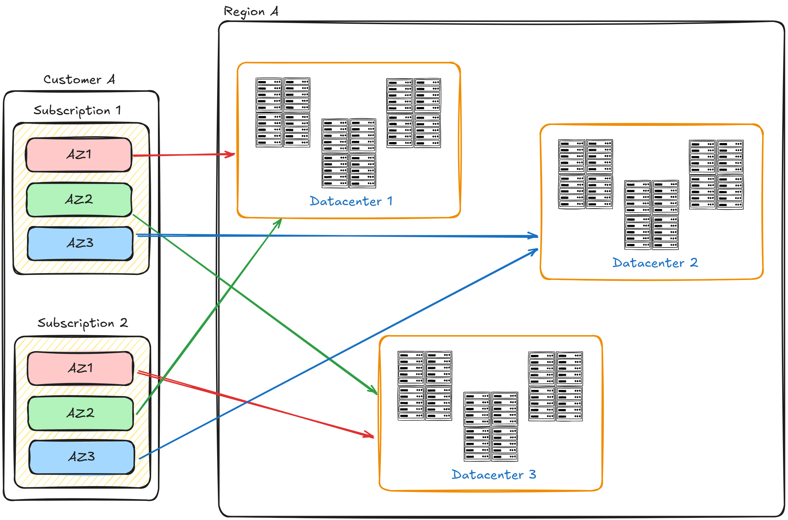
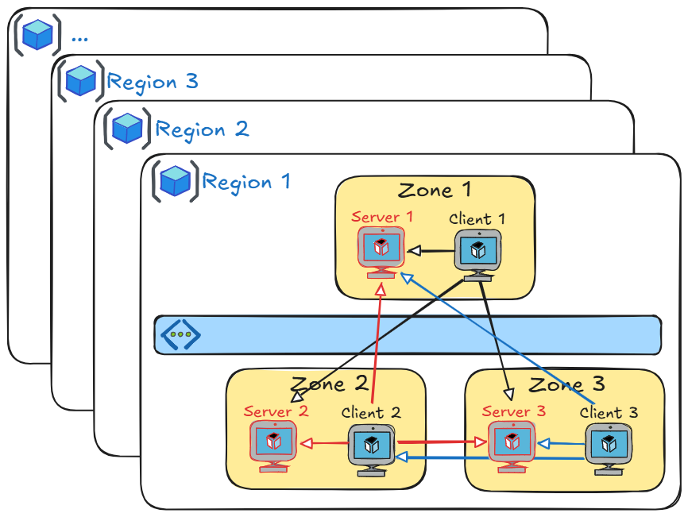
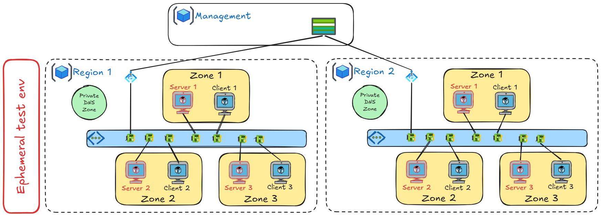

# Azure Network Internal Zone Latency & Throughput Benchmark (`netbench`)

> **Attribution:** Adapted and modernized from [`vmisson/azure-netbench`](https://github.com/vmisson/azure-netbench) into [`jonathan-vella/azure-networking/tools/netbench`](https://github.com/jonathan-vella/azure-networking/tree/main/tools/netbench). See the repository [LICENSE](../../LICENSE) and [THIRD_PARTY_NOTICES.md](../../THIRD_PARTY_NOTICES.md) for licensing details.

A self-contained Terraform + Azure Static Web Apps benchmark harness for measuring **intra-zone and inter-zone one-way TCP latency (`qperf`)** and **parallel-stream TCP throughput (`iperf3`)** across physical Azure Availability Zones in **36 global regions**.

> **Disclaimer**: This is an **unofficial** community tool, not affiliated with Microsoft Azure. Results are provided on a **best-effort basis** for informational purposes only. Always validate performance with your own production SKUs and workloads.

## Purpose

This tool deploys ephemeral Accelerated Networking Linux VMs across all three physical Availability Zones in a target Azure region, runs automated zone-to-zone `qperf` latency and `iperf3` multi-stream throughput benchmarks, persists structured metrics to Azure Table Storage over Private Link, and visualizes trends in an interactive web dashboard.

## Azure Availability Zones: Physical vs Logical

### Understanding Azure Zone Architecture

Azure exposes a two-level zone model:

- **Logical Zones**: Subscription-scoped labels (`Zone 1`, `Zone 2`, `Zone 3`).
- **Physical Zones**: The underlying physical datacenters in a region (`<region>-az1`, `<region>-az2`, `<region>-az3`).

### Subscription-Specific Physical Mapping

Logical-to-physical zone assignments are randomized per Azure subscription:

- Logical `Zone 1` in Subscription A may map to Physical `az3`, while Logical `Zone 1` in Subscription B maps to Physical `az1`.



### How `netbench` Resolves Physical Zones

1. Reads `availabilityZoneMappings.json` to map physical zones (`az1`, `az2`, `az3`) to your subscription's logical zone numbers.
2. Tags every VM with both `physical-zone` and `logical-zone` for repeatable cross-subscription comparisons.
3. Provides `./get-locations.sh <subscription-id>` to refresh `availabilityZoneMappings.json` for your subscription via the Azure Resource Manager Locations API.

## Architecture

- **Deployment Topology**:
  - 3 Spot Linux Server VMs (`lx-srv-<shortregion>-az1..az3`) with Accelerated Networking enabled — one per physical Availability Zone.
  - 3 Spot Linux Client VMs (`lx-cli-<shortregion>-az1..az3`) with Accelerated Networking and a User-Assigned Managed Identity — staggered by 60 seconds (`time_sleep`) to avoid cross-client contention.
  - Dedicated Subnet Network Security Group explicitly permitting intra-VNet benchmark traffic on `qperf` (`19765-19766` TCP/UDP), `iperf3` (`5201` TCP/UDP), and Private Endpoint HTTPS (`443` TCP) while denying inbound Internet traffic.



- **End-to-End Benchmark Execution**:
  - **Server VMs (`cloud-init-server.txt`)**: Provision persistent `systemd` services for both `qperf` (`qperf-server.service`) and `iperf3 -s -D` (`iperf3-server.service`).
  - **Client VMs (`cloud-init-client.txt`)**:
    1. Acquire an Azure AD access token for `https://storage.azure.com/` via IMDS using the User-Assigned Managed Identity.
    2. Wait for server readiness on **both** `qperf` (`19765`) and `iperf3` (`5201`) across `az1`, `az2`, and `az3`.
    3. Measure TCP one-way latency via `qperf <target> tcp_lat` (`LatencyUs`) and 4-stream TCP throughput over 10 seconds via `iperf3 -c <target> -P 4 -t 10 -J` (`ThroughputMbps` / `ThroughputGbps`).
    4. Write each zone-pair measurement directly to Azure Table Storage over an Azure Private Endpoint (`privatelink.table.core.windows.net`).



## Collected Metrics & Table Storage Schema

Each client-to-server zone pair writes an entity to the configured Azure Table Storage table (default `perf`):

| Property | Type | Description |
| --- | --- | --- |
| `PartitionKey` | `string` | Unique run UUID |
| `RowKey` | `string` | Region short code (e.g., `we`, `frc`, `eus2`) |
| `Source` | `string` | Source physical Availability Zone (`az1`, `az2`, `az3`) |
| `Destination` | `string` | Destination physical Availability Zone (`az1`, `az2`, `az3`) |
| `LatencyUs` | `number` | Numeric TCP one-way latency in microseconds (`qperf tcp_lat`) |
| `ThroughputMbps` | `number` | Numeric 4-stream TCP throughput in Mbps (`iperf3 -P 4 -t 10 -J`) |
| `ThroughputGbps` | `number` | Numeric 4-stream TCP throughput in Gbps (`iperf3 -P 4 -t 10 -J`) |
| `Latency` | `string` | Legacy-compatible formatted latency string (e.g., `"84.50 us"`) |
| `Bandwidth` | `string` | Legacy-compatible formatted throughput string (e.g., `"12.485 Gb/sec"`) |

### Latency Alert Thresholds
- **Intra-zone** (`azX -> azX`): `> 500 µs` highlighted as abnormal
- **Inter-zone** (`azX -> azY`): `> 1000 µs` highlighted in dashboard (`> 5000 µs` critical)

## Supported Regions (`regions.json`)

All **36 regions** are consolidated into a single [`regions.json`](regions.json) region-to-SKU map (eliminating per-region `.tfvars` duplication):

- **Americas (10)**: `centralus`, `eastus`, `eastus2`, `southcentralus`, `westus2`, `westus3`, `canadacentral`, `brazilsouth`, `chilecentral`, `mexicocentral`
- **Europe (12)**: `belgiumcentral`, `francecentral`, `germanywestcentral`, `italynorth`, `northeurope`, `norwayeast`, `polandcentral`, `spaincentral`, `swedencentral`, `switzerlandnorth`, `uksouth`, `westeurope`
- **Asia-Pacific (10)**: `australiaeast`, `centralindia`, `eastasia`, `indonesiacentral`, `japaneast`, `japanwest`, `koreacentral`, `malaysiawest`, `newzealandnorth`, `southeastasia`
- **Middle East & Africa (4)**: `israelcentral`, `qatarcentral`, `southafricanorth`, `uaenorth`

## Quick Start

### Prerequisites
- Azure subscription with Contributor + RBAC Administrator permissions (for Managed Identity role assignment)
- [Azure CLI](https://learn.microsoft.com/cli/azure/install-azure-cli) (`az`)
- [Terraform](https://developer.hashicorp.com/terraform/downloads) >= 1.0

### 1. Refresh Subscription Zone Mappings (Recommended Once per Subscription)

```bash
cd tools/netbench
./get-locations.sh "<YOUR_SUBSCRIPTION_ID>"
```

### 2. Run a Benchmark for Any Region

`variables.tf` defaults `location` to `"westeurope"` and automatically resolves the regional VM SKU from `regions.json`:

```bash
cd tools/netbench

# Initialize Terraform (use -backend=false for local state, or configure backend flags)
terraform init -backend=false

# Deploy default region (westeurope -> Standard_D4als_v6 from regions.json)
terraform apply \
  -var="subscription_id=<YOUR_SUBSCRIPTION_ID>" \
  -var="storage_account_name=<YOUR_STORAGE_ACCOUNT>" \
  -var="storage_account_resource_group=<YOUR_STORAGE_RG>"

# Deploy any of the 36 regions (automatically selects its SKU from regions.json)
terraform apply \
  -var="location=japaneast" \
  -var="subscription_id=<YOUR_SUBSCRIPTION_ID>" \
  -var="storage_account_name=<YOUR_STORAGE_ACCOUNT>" \
  -var="storage_account_resource_group=<YOUR_STORAGE_RG>"

# Override VM SKU explicitly when desired
terraform apply \
  -var="location=westeurope" \
  -var="vm_sku=Standard_D8as_v5" \
  -var="subscription_id=<YOUR_SUBSCRIPTION_ID>" \
  -var="storage_account_name=<YOUR_STORAGE_ACCOUNT>" \
  -var="storage_account_resource_group=<YOUR_STORAGE_RG>"

# Wait ~5 minutes for staggered client runs to complete, then tear down
terraform destroy \
  -var="location=westeurope" \
  -var="storage_account_name=<YOUR_STORAGE_ACCOUNT>" \
  -var="storage_account_resource_group=<YOUR_STORAGE_RG>"
```

### 3. Configure GitHub Secrets (Optional CI Automation)

`setup-github-secrets.sh` is fully parameterized via CLI flags or environment variables:

```bash
cd tools/netbench
./setup-github-secrets.sh \
  --repo "jonathan-vella/azure-networking" \
  --subscription-id "<YOUR_SUBSCRIPTION_ID>" \
  --location "westeurope" \
  --state-rg "rg-netbench-state-001" \
  --state-sa "sanetbenchstate001" \
  --yes
```

Run `./setup-github-secrets.sh --help` to inspect all supported options and environment variables.

## Visualization Dashboard

Deploy the Static Web App + Azure Functions API from `tools/netbench/dashboard`:

```bash
cd tools/netbench/dashboard
azd auth login
azd init
azd up
```

### Dashboard Highlights
- **Metric View Toggle**: Switch all regional bar charts and time-series charts between **Latency (µs)**, **Throughput (Gbps)**, and **Throughput (Mbps)**.
- **Backward-Compatible API**: Seamlessly renders historical latency-only Table Storage rows alongside new `qperf` + `iperf3` records.
- **Filtering & CSV Export**: Filter by region, source AZ, destination AZ, and time window (`72h`, `7d`, `30d`, `all`) and export to CSV.

## Project Structure

```text
tools/netbench/
├── main.tf                         # Root Terraform orchestration
├── locals.tf                       # Resolves location -> VM SKU via regions.json
├── variables.tf                    # Input variables (location defaults to westeurope)
├── outputs.tf                      # Resource group and resolved benchmark map outputs
├── providers.tf                    # Provider and optional backend configuration
├── regions.json                    # Consolidated 36-region default VM SKU map
├── availabilityZoneMappings.json   # Subscription physical-to-logical AZ mapping
├── get-locations.sh                # Helper to refresh availabilityZoneMappings.json
├── setup-github-secrets.sh         # Parameterized GitHub Actions secret setup script
├── modules/netperf/                # Per-region benchmark VNet, NSG, PE, and Spot VMs
│   ├── main.tf                     # VNet, Subnet, NSG (19765-19766/5201/443), VMs, PE
│   ├── locals.tf                   # Zone mapping + templated client cloud-init
│   ├── variables.tf                # Module inputs
│   ├── data.tf                     # Benchmark Storage Account lookup
│   ├── outputs.tf                  # Module outputs
│   ├── cloud-init-server.txt       # systemd daemons for qperf + iperf3 -s -D
│   └── cloud-init-client.txt       # Readiness wait + qperf/iperf3 runner + Table POST
└── dashboard/                      # Azure Static Web App + Functions visualization
    ├── api/                        # Azure Functions Node.js API (/api/data)
    ├── web/                        # Bootstrap 5 + Chart.js dashboard UI
    └── infra/                      # Terraform infrastructure for dashboard hosting
```

## License

Licensed under the MIT License — see [LICENSE](../../LICENSE) and [THIRD_PARTY_NOTICES.md](../../THIRD_PARTY_NOTICES.md) (original upstream project: [`vmisson/azure-netbench`](https://github.com/vmisson/azure-netbench)).

